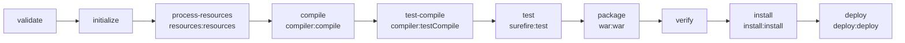

# 2. An empty Maven WAR project

<div class="level-tabs" data-levels>
  <button data-level="overview" aria-pressed="true">Overview</button>
  <button data-level="deep" data-short="Deep">Deep Understanding</button>
  <button data-level="drill">Drilling</button>
</div>

<div class="level overview">

Every file in the VWO API is held together by one `pom.xml`. It says what
the project is called, which libraries it needs and in which version, and
how to turn the sources into `target/restAPI.war`, the file Tomcat runs.
This chapter writes TechOlympiad's `pom.xml` and nothing else. At the end,
`mvn package` produces `target/techolympiadAPI.war`: a WAR with Spring in
it and no code of our own yet.

The VWO `pom.xml` is over 600 lines long, but most of it is a list of
dependencies, a few of them left over from older versions of the API. We
start with the three dependencies a Spring web application on an external
Tomcat needs, and the two build <dfn data-def="Maven does no work itself: every build step (compiling, testing, zipping the WAR) is a goal of a plugin, like an MSBuild task.">plugins</dfn> the VWO configures by hand. Later
chapters add to it whenever a feature needs a new library.

**After this chapter you can:**

- read a Maven coordinate and find that <dfn data-def="Any file Maven builds or downloads, such as a library jar, a WAR or a POM, identified by its coordinate. Roughly a NuGet package.">artifact</dfn> in `~/.m2/repository`;
- say which lifecycle phases `mvn package` runs and which plugin does the work in each;
- explain the `compile`, `provided`, `runtime` and `test` scopes, and why Tomcat and Lombok are `provided`;
- read `mvn dependency:tree` and explain where each <dfn data-def="Java archive: a zip of compiled .class files plus metadata, usually one library. Roughly a .NET assembly.">jar</dfn> in the WAR comes from;
- list what is inside a WAR and what each part is for.

<div class="code-compare" data-code-compare data-labels="VWO pom.xml|TechOlympiad pom.xml">

```xml
<artifactId>restAPI</artifactId>
<version>1.11a</version>
<packaging>war</packaging>

<parent>
    <groupId>be.vwo</groupId>
    <artifactId>serverInfo</artifactId>
    <version>1.0-SNAPSHOT</version>
    <relativePath>pom-userProperties.xml</relativePath>
</parent>
...
<dependency>
    <groupId>org.springframework.boot</groupId>
    <artifactId>spring-boot-starter-tomcat</artifactId>
    <version>2.7.18</version>
    <scope>provided</scope>
</dependency>
...
<build>
    <finalName>restAPI</finalName>
```

```xml
<groupId>be.techolympiad</groupId>
<artifactId>techolympiadAPI</artifactId>
<version>0.1.0</version>
<packaging>war</packaging>

<!-- no parent: VWO's only holds deploy-server settings -->
...
<dependency>
    <groupId>org.springframework.boot</groupId>
    <artifactId>spring-boot-starter-tomcat</artifactId>
    <version>2.7.18</version>
    <scope>provided</scope>
</dependency>
...
<build>
    <finalName>techolympiadAPI</finalName>
```

</div>

</div>

<div class="level deep">

### What a POM is

<dfn data-def="Project Object Model: the pom.xml file that describes a Maven project, its dependencies and its build.">POM</dfn>
stands for Project Object Model. Where a .NET project spreads this over a
`.csproj`, `Directory.Build.props` and `NuGet.config`, Maven keeps it in
one XML file. Maven never sees your `pom.xml` alone: it merges it with a
built-in <dfn data-def="The POM every Maven project inherits from implicitly. It sets the default folder layout (src/main/java, target/...) and default plugin versions.">super POM</dfn>
and with any parent you declare, and builds with the result, the
*effective POM*. `mvn help:effective-pom` prints it. Most of what Maven
"just knows", such as `src/main/java` holding the sources and `target/`
holding the output, comes from the super POM.

<div class="table-wrap">

| Maven | .NET | Notes |
|---|---|---|
| `pom.xml` | `.csproj` | One per module |
| `groupId:artifactId:version` | `PackageId` + `Version` | NuGet has no group; Maven ids are namespaced |
| `<dependency>` | `<PackageReference>` | Transitive in both |
| `<dependencyManagement>` with a BOM | Central Package Management (`Directory.Packages.props`) | Pins versions without adding a dependency |
| plugin | MSBuild task or target | Maven itself only runs plugins |
| `target/` | `bin/` + `obj/` | Build output, never committed |
| `~/.m2/repository` | `~/.nuget/packages` | Local download cache |

</div>

### Coordinates

Every artifact in the Maven world has a
<dfn data-def="The groupId, artifactId and version that identify an artifact, often written as groupId:artifactId:version (GAV).">coordinate</dfn>:

- **groupId**: the organisation or project, written like a reversed domain. `org.springframework.boot`, `be.techolympiad`.
- **artifactId**: the module name. `spring-boot-starter-web`, `techolympiadAPI`.
- **version**: `2.7.18`, `0.1.0`. A version ending in `-SNAPSHOT` means "still changing"; Maven may download a newer build of the same snapshot version. A plain version is final.
- **packaging**: what the build produces. `jar` is the default; ours is `war`.

The coordinate is also the path in the repository. `org.springframework.boot:spring-boot-starter-web:2.7.18`
lives at `~/.m2/repository/org/springframework/boot/spring-boot-starter-web/2.7.18/`,
next to its `.pom` file, which lists *its* dependencies. That `.pom` is
how Maven finds the transitive dependencies.

The VWO writes `artifactId` `restAPI` and inherits `groupId` `be.vwo` from
its parent. It sets `<finalName>restAPI</finalName>`, so the file is
`restAPI.war` instead of Maven's default `restAPI-1.11a.war`. We do the
same with `techolympiadAPI`. The file name matters: the VWO `ant.xml`
uploads `${project.artifactId}.${project.packaging}`, which only exists
because the final name equals the artifact id, and in [chapter 4](build-04-tomcat.md)
the name of the WAR inside Tomcat becomes the URL.

<div class="callout note">
<div class="callout-label">Why no parent</div>

The VWO's parent is `pom-userProperties.xml`, a local file that is listed
in `.gitignore`. It holds nothing but the usernames, hostnames and paths
of the deploy servers, which the `ant.xml` deploy targets read. The
pipeline creates it from `pom-userProperties.xml.tmpl`. TechOlympiad
never deploys to a server from Maven, so it has no parent.
Chapter 22 comes back to it.

</div>

### No Spring Boot parent either

Spring Boot ships its libraries as *starters*: a starter such as
`spring-boot-starter-web` contains no code of its own, only a list of
dependencies that together give you one feature (here Spring MVC, Jackson
and an embedded Tomcat). A Spring Boot tutorial starts with `spring-boot-starter-parent` as the
parent POM. That parent pins the versions of a few hundred libraries and
configures the Spring Boot Maven plugin. The VWO does not use it (its
parent slot is taken), so every Spring Boot dependency in its `pom.xml`
carries an explicit `<version>2.7.18</version>`. Leave the version out and
the build fails before it starts:

```text
[ERROR] 'dependencies.dependency.version' for org.springframework.boot:spring-boot-starter-web:jar is missing.
```

There is a second effect. Spring Boot 2.7.18 was built against Spring
Framework 5.3.31, and without the parent that is the version the starters
pull in. The VWO wants 5.3.39, so it declares eighteen Spring modules one
by one, each with `<version>5.3.39</version>`. We get the same result in
one place with a <dfn data-def="Bill of materials: a POM that only lists versions. Imported into dependencyManagement, it pins those versions for every dependency, direct or transitive.">BOM</dfn>:
importing `spring-framework-bom` 5.3.39 into `<dependencyManagement>`.
`dependencyManagement` adds no dependency. It only says "whenever
`spring-core` or any other Spring module turns up, at any depth, use
5.3.39". It is the Maven counterpart of `Directory.Packages.props`.

### The lifecycle

Maven builds in <dfn data-def="A named step in a Maven lifecycle, such as compile or package. Running a phase runs every phase before it.">phases</dfn>.
`mvn package` runs every phase of the default lifecycle up to and
including `package`, in order. A phase does
nothing by itself. Plugins *bind* their goals to phases, and the
packaging type decides the default bindings:



The diagram leaves out a few phases that have nothing bound for a WAR,
such as `generate-sources` and `prepare-package`. For a `war` project:

<div class="table-wrap">

| Phase | Plugin goal | What it does for us |
|---|---|---|
| `process-resources` | `resources:resources` | Copies `src/main/resources/*` to `target/classes/` |
| `compile` | `compiler:compile` | Compiles `src/main/java` into `target/classes/` |
| `test` | `surefire:test` | Runs the unit tests; neither project has any |
| `package` | `war:war` | Assembles `target/techolympiadAPI/` and zips it into `target/techolympiadAPI.war` |
| `install` | `install:install` | Copies the WAR into `~/.m2/repository/be/techolympiad/...` for other local projects |
| `deploy` | `deploy:deploy` | Uploads to a remote Maven repository; neither project does this |

</div>

`clean` belongs to a separate lifecycle, so `mvn clean package` runs two
lifecycles in a row: delete `target/`, then build up to `package`. The
VWO pipeline always cleans; locally you clean when something stale is
suspected. [Chapter 6](build-06-build-profiles.md) binds extra plugin
goals to `initialize` and `compile`, which is how the VWO picks its
environment file.

<div class="callout rule">
<div class="callout-label">Pin your plugins</div>

When the `pom.xml` names no version for a plugin, Maven uses the default
of the Maven release you happen to run, and that changes between Maven
releases. The VWO pins `maven-compiler-plugin` 3.14.0 and
`maven-war-plugin` 3.3.2, and so do we. A `maven-war-plugin` older than
3.3.1 crashes on Java 16 and newer with an `InaccessibleObjectException`,
which is a classic when an old project moves to Java 17.

</div>

### The compiler settings

`<release>17</release>` tells `javac` to compile against the Java 17 API
and emit Java 17 bytecode. It is stricter than the older `source`/`target`
pair: with `release`, using a method that only exists in Java 21 is a
compile error even when you build on a Java 21 JDK.

`-proc:full` switches annotation processing on explicitly. Annotation
processors are compiler plugins found on the classpath; Lombok is one. The
<dfn data-def="The list of jars and folders the compiler or the JVM loads classes from, roughly the set of referenced assemblies of a .NET project.">classpath</dfn>
is the list of jars and folders that `javac` or the JVM loads classes from,
roughly the set of assemblies a .NET project references. Maven builds it
from your dependencies.
Newer JDKs no longer run processors they merely find on the classpath, so
without this flag Lombok would silently stop generating getters on a
future JDK. On Java 17 it changes nothing, which is exactly the point:
the build behaves the same on every JDK. `<showDeprecation>true</showDeprecation>`
makes `javac` name every deprecated API you call instead of printing one
summary line; it will speak up in chapter 20,
where Spring Security's `WebSecurityConfigurerAdapter` is deprecated.

### Dependencies and scopes

A dependency's <dfn data-def="Decides on which classpaths a dependency is (compile, test, runtime) and whether it ends up in the packaged WAR.">scope</dfn>
answers two questions: on which classpaths is it, and does it go into the
WAR?

<div class="table-wrap">

| Scope | Compile | Tests | In the WAR | Example | .NET counterpart |
|---|---|---|---|---|---|
| `compile` (default) | yes | yes | yes, in `WEB-INF/lib` | Spring, Jackson | a normal `PackageReference` |
| `provided` | yes | yes | no | Tomcat, Lombok | a framework reference, or `PrivateAssets="all"` |
| `runtime` | no | yes | yes | a <dfn data-def="JDBC (Java Database Connectivity) is Java's standard low-level database API of connections, statements and result sets, roughly ADO.NET. A JDBC driver is the database-specific implementation, like a .NET ADO.NET provider such as MySqlConnector.">JDBC driver</dfn> you never import | `IncludeAssets="runtime"` |
| `test` | no | yes | no | JUnit (Java's xUnit) | a package only the test project references |
| `import` | | | | a BOM, only inside `dependencyManagement` | importing `Directory.Packages.props` |

</div>

`provided` means "I need it to compile, and something else will supply it
at run time". Two dependencies earn it here, for different reasons:

- **`spring-boot-starter-tomcat`**: Tomcat itself provides the <dfn data-def="The standard Java API (javax.servlet) for handling HTTP requests: servlets, filters, request and response objects. Every Java web server implements it, and Spring MVC is built on it.">servlet API</dfn>
  and everything else the starter would bring. `spring-boot-starter-web`
  depends on this starter with `compile` scope, so without our own
  declaration a complete embedded Tomcat would land in `WEB-INF/lib`.
  Tomcat always loads the `javax.servlet` classes from its own copy, so a
  bundled one is dead weight at best and a source of class conflicts at
  worst. It is the same idea as an ASP.NET Core app that is
  framework-dependent: the server has the framework, the publish folder
  does not.
- **`lombok`**: Lombok runs inside `javac`, writes the getters, setters
  and constructors into your class files, and is never called at run
  time. Shipping it would be like shipping a source generator. The VWO
  declares it the same way.

### How Maven picks one version

Two libraries may want different versions of the same artifact. Maven
picks one with <dfn data-def="Maven's rule for picking one version: the declaration closest to your pom in the dependency tree wins; on equal depth, the first one declared wins.">nearest wins</dfn>:
the declaration closest to your `pom.xml` in the tree wins, and on equal
depth the one declared first. A direct dependency is depth 1 and always
beats a transitive one, and the same rule settles the scope. That is why
declaring `spring-boot-starter-tomcat` ourselves as `provided` overrides
the `compile` scope it has inside `spring-boot-starter-web`. Entries in
`dependencyManagement` go above all of this: they fix the version no
matter where the artifact turns up. [Chapter 5](build-05-hello-swagger.md)
uses nearest wins on purpose to line up the Jackson libraries.

`mvn dependency:tree` prints the resolved tree. Each line ends with
`:scope`; a library that was asked for twice appears once, where it won.

### What a WAR is

A <dfn data-def="Web application archive: a zip with a fixed layout (WEB-INF/classes, WEB-INF/lib, WEB-INF/web.xml) that a servlet container deploys.">WAR</dfn>
is a zip file with a layout fixed by the servlet specification:

<div class="table-wrap">

| Path in the WAR | Comes from | Purpose |
|---|---|---|
| `WEB-INF/classes/` | `target/classes/` (compiled code and resources) | Your classes and config files, on the app's classpath |
| `WEB-INF/lib/*.jar` | every `compile` and `runtime` dependency | The libraries, on the app's classpath |
| `WEB-INF/web.xml` | `src/main/webapp/WEB-INF/web.xml` | The deployment descriptor (an XML file that registers servlets and filters); optional since Servlet 3.0 |
| everything else in `src/main/webapp/` | copied as is | Static files, served by Tomcat |
| `META-INF/MANIFEST.MF`, `META-INF/maven/...` | the WAR plugin | Build metadata and a copy of the `pom.xml` |

</div>

Nothing under `WEB-INF/` can be downloaded by a browser; Tomcat refuses to
serve it. The VWO has no web.xml content any more (every line of its
`web.xml` is commented out), and we start without the file at all.
`<failOnMissingWebXml>false</failOnMissingWebXml>` allows that. Since
`maven-war-plugin` 3.0 it is the default, so the line documents an
intention more than it changes behaviour; the VWO has it, so we keep it.

### What the VWO pom has that we leave out

You will meet these in the VWO `pom.xml`. None of them is needed to build
the WAR:

- **The eighteen `spring-*` dependencies at 5.3.39.** Replaced by the BOM above. Several (`spring-jms`, `spring-websocket`, `spring-oxm`) are not used by the API at all.
- **`<sourceDirectory>src/main/java/</sourceDirectory>`.** That is the default.
- **`maven-dependency-plugin` copying `javaee-endorsed-api` 7.0 into `target/endorsed`.** A leftover from the <dfn data-def="Java Enterprise Edition: a set of standard APIs for server applications (servlets, JPA, validation, ...) that servers such as Tomcat partly implement. Now called Jakarta EE.">Java EE</dfn> 7 era; nothing reads that folder.
- **`spring-boot-maven-plugin` 2.7.18 with no executions.** Its `repackage` goal, which makes an executable WAR, is only bound by `spring-boot-starter-parent`. Without that parent the plugin does nothing during `mvn package`, which is why the VWO's `target/` has no `restAPI.war.original`.
- **`javaee-api` 8.0.1 with `compile` scope.** It puts the Java EE 8 API jar into `WEB-INF/lib`; Tomcat provides the parts it implements.

</div>

<div class="level drill">

You should have `~/Coding/techolympiad` from [chapter 1](build-01-toolbox.md):
a git repository holding `mise.toml` and `.gitignore`, with `java -version`
and `mvn -v` reporting 17.0.20 inside it.

### Tasks

<ul class="checklist">
<li><label><input type="checkbox"><span>In <code>~/Coding/techolympiad</code>, create <code>pom.xml</code> exactly as below.</span></label></li>
<li><label><input type="checkbox"><span>Run <code>mvn validate</code>. It downloads nothing yet and ends with <code>BUILD SUCCESS</code>: the POM is well-formed and every dependency has a version.</span></label></li>
<li><label><input type="checkbox"><span>Run <code>mvn package</code>. The first run downloads the dependencies and plugins; watch which plugin goal runs in which order.</span></label></li>
<li><label><input type="checkbox"><span>Run <code>mvn dependency:tree</code> and find <code>tomcat-embed-core</code> and <code>lombok</code>. Note their scope.</span></label></li>
<li><label><input type="checkbox"><span>Look inside the WAR: <code>jar tf target/techolympiadAPI.war</code>. Check that no <code>tomcat-embed-*</code> and no <code>lombok</code> jar is in <code>WEB-INF/lib</code>.</span></label></li>
<li><label><input type="checkbox"><span>Read the manifest: <code>unzip -p target/techolympiadAPI.war META-INF/MANIFEST.MF</code>.</span></label></li>
<li><label><input type="checkbox"><span>Find a dependency on disk: <code>ls ~/.m2/repository/org/springframework/boot/spring-boot-starter-web/2.7.18/</code>, then open its <code>.pom</code> and find its dependency on <code>spring-boot-starter-tomcat</code>.</span></label></li>
<li><label><input type="checkbox"><span>Remove <code>&lt;scope&gt;provided&lt;/scope&gt;</code> from the Tomcat starter, run <code>mvn -q package</code> and <code>jar tf target/techolympiadAPI.war | grep tomcat</code>. Put the scope back and build again.</span></label></li>
<li><label><input type="checkbox"><span>Print the effective POM: <code>mvn help:effective-pom | less</code>. Find the <code>maven-resources-plugin</code> and <code>maven-surefire-plugin</code> you never declared.</span></label></li>
<li><label><input type="checkbox"><span>Open the project in IntelliJ, open the Maven tool window and expand <em>Lifecycle</em> and <em>Dependencies</em>. It is the same model as the command line.</span></label></li>
<li><label><input type="checkbox"><span>Commit: <code>git add -A &amp;&amp; git commit -m "Add the Maven WAR project"</code>.</span></label></li>
</ul>

### The file

`pom.xml`:

```xml
<?xml version="1.0" encoding="UTF-8"?>
<project xmlns="http://maven.apache.org/POM/4.0.0" xmlns:xsi="http://www.w3.org/2001/XMLSchema-instance" xsi:schemaLocation="http://maven.apache.org/POM/4.0.0 http://maven.apache.org/xsd/maven-4.0.0.xsd">
    <modelVersion>4.0.0</modelVersion>

    <groupId>be.techolympiad</groupId>
    <artifactId>techolympiadAPI</artifactId>
    <version>0.1.0</version>
    <packaging>war</packaging>

    <properties>
        <project.build.sourceEncoding>UTF-8</project.build.sourceEncoding>
    </properties>

    <dependencyManagement>
        <dependencies>
            <dependency>
                <groupId>org.springframework</groupId>
                <artifactId>spring-framework-bom</artifactId>
                <version>5.3.39</version>
                <type>pom</type>
                <scope>import</scope>
            </dependency>
        </dependencies>
    </dependencyManagement>

    <dependencies>
        <dependency>
            <groupId>org.springframework.boot</groupId>
            <artifactId>spring-boot-starter-web</artifactId>
            <version>2.7.18</version>
        </dependency>
        <dependency>
            <groupId>org.springframework.boot</groupId>
            <artifactId>spring-boot-starter-tomcat</artifactId>
            <version>2.7.18</version>
            <scope>provided</scope>
        </dependency>
        <dependency>
            <groupId>org.projectlombok</groupId>
            <artifactId>lombok</artifactId>
            <version>1.18.38</version>
            <scope>provided</scope>
        </dependency>
    </dependencies>

    <build>
        <finalName>techolympiadAPI</finalName>
        <plugins>
            <plugin>
                <groupId>org.apache.maven.plugins</groupId>
                <artifactId>maven-compiler-plugin</artifactId>
                <version>3.14.0</version>
                <configuration>
                    <release>17</release>
                    <compilerArgs>
                        <arg>-proc:full</arg>
                    </compilerArgs>
                    <showDeprecation>true</showDeprecation>
                </configuration>
            </plugin>
            <plugin>
                <groupId>org.apache.maven.plugins</groupId>
                <artifactId>maven-war-plugin</artifactId>
                <version>3.3.2</version>
                <configuration>
                    <failOnMissingWebXml>false</failOnMissingWebXml>
                </configuration>
            </plugin>
        </plugins>
    </build>
</project>
```

The same file, annotated:

<div class="code-walk" data-code-walk>

```xml
<modelVersion>4.0.0</modelVersion>                          <!-- (1) -->
<groupId>be.techolympiad</groupId>                          <!-- (2) -->
<packaging>war</packaging>                                  <!-- (3) -->
<project.build.sourceEncoding>UTF-8</project.build.sourceEncoding>  <!-- (4) -->
<artifactId>spring-framework-bom</artifactId>               <!-- (5) -->
<artifactId>spring-boot-starter-web</artifactId>            <!-- (6) -->
<scope>provided</scope>                                     <!-- (7) -->
<finalName>techolympiadAPI</finalName>                      <!-- (8) -->
<arg>-proc:full</arg>                                       <!-- (9) -->
```

1. The POM format version. It has been 4.0.0 for every Maven 2 and 3 release.
2. With `artifactId` and `version`, our coordinate: `be.techolympiad:techolympiadAPI:0.1.0`.
3. Selects the `war:war` goal for the `package` phase and the WAR folder layout.
4. Without it, the resources and compiler plugins use the platform encoding and warn that the build is platform dependent. The VWO sets it too.
5. Pins every Spring Framework module to 5.3.39, also the ones the starters pull in.
6. <dfn data-def="Spring's web framework for controllers and request mapping, the counterpart of ASP.NET Core MVC.">Spring MVC</dfn>, Jackson, the Spring Boot core and <dfn data-def="Spring Boot's habit of creating and configuring beans for you, based on the libraries it finds and your properties.">auto-configuration</dfn>, <dfn data-def="Spring Boot's default logging library.">Logback</dfn>, and (as `compile`) the Tomcat starter, which the next entry overrides.
7. Our own declaration of the Tomcat starter is nearer than the one inside `spring-boot-starter-web`, so its scope wins and the embedded Tomcat stays out of the WAR.
8. The WAR is called `techolympiadAPI.war` instead of `techolympiadAPI-0.1.0.war`.
9. Annotation processing, and with it Lombok, stays on regardless of the JDK's default.

</div>

### Run it

```bash
cd ~/Coding/techolympiad
mvn package
```

The interesting lines, in order:

```text
[INFO] --- resources:3.3.1:resources (default-resources) @ techolympiadAPI ---
[INFO] skip non existing resourceDirectory /home/you/Coding/techolympiad/src/main/resources
[INFO] --- compiler:3.14.0:compile (default-compile) @ techolympiadAPI ---
[INFO] No sources to compile
[INFO] --- surefire:3.2.5:test (default-test) @ techolympiadAPI ---
[INFO] No tests to run.
[INFO] --- war:3.3.2:war (default-war) @ techolympiadAPI ---
[INFO] Packaging webapp
[INFO] Assembling webapp [techolympiadAPI] in [/home/you/Coding/techolympiad/target/techolympiadAPI]
[INFO] Building war: /home/you/Coding/techolympiad/target/techolympiadAPI.war
[INFO] BUILD SUCCESS
```

The versions of the resources and surefire plugins are whatever your
Maven release defaults to, so yours may show other numbers; the compiler and WAR versions are the ones we
pinned. Each line has the form `plugin:version:goal (execution id)`, which
is the binding table from the Deep Understanding tab, live.

```bash
mvn dependency:tree
```

```text
[INFO] be.techolympiad:techolympiadAPI:war:0.1.0
[INFO] +- org.springframework.boot:spring-boot-starter-web:jar:2.7.18:compile
[INFO] |  +- org.springframework.boot:spring-boot-starter:jar:2.7.18:compile
[INFO] |  |  +- org.springframework.boot:spring-boot:jar:2.7.18:compile
[INFO] |  |  +- org.springframework.boot:spring-boot-autoconfigure:jar:2.7.18:compile
[INFO] |  |  +- org.springframework.boot:spring-boot-starter-logging:jar:2.7.18:compile
[INFO] |  |  |  ...
[INFO] |  |  +- jakarta.annotation:jakarta.annotation-api:jar:1.3.5:compile
[INFO] |  |  +- org.springframework:spring-core:jar:5.3.39:compile
[INFO] |  |  |  \- org.springframework:spring-jcl:jar:5.3.39:compile
[INFO] |  |  \- org.yaml:snakeyaml:jar:1.30:compile
[INFO] |  +- org.springframework.boot:spring-boot-starter-json:jar:2.7.18:compile
[INFO] |  |  +- com.fasterxml.jackson.core:jackson-databind:jar:2.13.5:compile
[INFO] |  |  ...
[INFO] |  +- org.springframework:spring-web:jar:5.3.39:compile
[INFO] |  |  \- org.springframework:spring-beans:jar:5.3.39:compile
[INFO] |  \- org.springframework:spring-webmvc:jar:5.3.39:compile
[INFO] |     +- org.springframework:spring-aop:jar:5.3.39:compile
[INFO] |     +- org.springframework:spring-context:jar:5.3.39:compile
[INFO] |     \- org.springframework:spring-expression:jar:5.3.39:compile
[INFO] +- org.springframework.boot:spring-boot-starter-tomcat:jar:2.7.18:provided
[INFO] |  +- org.apache.tomcat.embed:tomcat-embed-core:jar:9.0.83:provided
[INFO] |  +- org.apache.tomcat.embed:tomcat-embed-el:jar:9.0.83:provided
[INFO] |  \- org.apache.tomcat.embed:tomcat-embed-websocket:jar:9.0.83:provided
[INFO] \- org.projectlombok:lombok:jar:1.18.38:provided
```

The tree is trimmed at the `...` lines. Note three things. The Spring
modules say 5.3.39 although the Boot starters ask for 5.3.31: that is the
BOM. The Tomcat starter appears once, at the top level, as `provided`;
inside `spring-boot-starter-web` it lost to our declaration. And
`jackson-databind` is 2.13.5; remember that number for chapter 5.

```bash
jar tf target/techolympiadAPI.war | grep -v '^WEB-INF/lib/.'
jar tf target/techolympiadAPI.war | grep '^WEB-INF/lib/.' | sort
```

The first command shows the skeleton: `META-INF/MANIFEST.MF`,
`META-INF/maven/be.techolympiad/techolympiadAPI/pom.xml` and
`pom.properties`, and the `WEB-INF/` folders. No `web.xml`, no classes.
The second lists about thirty jars: `spring-boot-2.7.18.jar`,
`spring-webmvc-5.3.39.jar`, `jackson-databind-2.13.5.jar`,
`logback-classic-...jar` and the rest of the compile scope. No
`tomcat-embed-core`, no `lombok`.

The manifest tells you who built the WAR:

```text
Manifest-Version: 1.0
Created-By: Maven WAR Plugin 3.3.2
Build-Jdk-Spec: 17
```

<div class="callout danger">
<div class="callout-label">When it breaks</div>

- **`'dependencies.dependency.version' for ... is missing`**: a dependency without `<version>`. Without a Spring Boot parent, nothing supplies one; only the Spring Framework modules get theirs from the BOM.
- **`Could not find artifact org.springframework.boot:spring-boot-starter-webb:jar:2.7.18`**: a typo in a coordinate. Maven looks for exactly the path the coordinate spells.
- **`Unknown lifecycle phase "pacakge"`**: Maven treats anything that is not `plugin:goal` as a phase name, and rejects a misspelled one.
- **`mvn: command not found`, or `mvn -v` shows the wrong Java**: you are outside `~/Coding/techolympiad`, so mise activates nothing. See [chapter 1](build-01-toolbox.md).
- **`InaccessibleObjectException` during `war:war`**: a `maven-war-plugin` older than 3.3.1 on Java 17. Check the pinned version is 3.3.2.
- **`tomcat-embed-core` is in `WEB-INF/lib`**: the `provided` scope is missing or on the wrong dependency. It belongs on `spring-boot-starter-tomcat`.

</div>

### Quiz

<div class="quiz" data-quiz>
<p class="quiz-q">You run <code>mvn package</code>. Which of these goals runs?</p>
<ol class="quiz-options">
<li>Only <code>war:war</code>, because you asked for <code>package</code><p class="quiz-whynot">A phase on the command line runs the whole lifecycle up to and including that phase.</p></li>
<li data-correct><code>resources:resources</code>, <code>compiler:compile</code>, <code>surefire:test</code> and <code>war:war</code>, in that order<p class="quiz-why">Every phase from <code>validate</code> to <code>package</code> runs, with the goals bound to it.</p></li>
<li>Everything including <code>install:install</code><p class="quiz-whynot"><code>install</code> comes after <code>package</code>; it only runs for <code>mvn install</code> or later phases.</p></li>
</ol>
<p class="quiz-explain">This is why <code>-DskipTests</code> exists: the <code>test</code> phase is on the way to <code>package</code>, so the only way past it is to tell Surefire to skip.</p>
</div>

<div class="quiz" data-quiz>
<p class="quiz-q">Lombok is <code>provided</code>. What does that mean at run time?</p>
<ol class="quiz-options">
<li>Tomcat provides Lombok, like it provides the servlet API<p class="quiz-whynot">Tomcat knows nothing about Lombok. <code>provided</code> only says the WAR will not contain it.</p></li>
<li>The application crashes when it calls a generated getter<p class="quiz-whynot">The getter is ordinary bytecode in your class file. Nothing refers to Lombok any more.</p></li>
<li data-correct>Nothing: Lombok did its work inside <code>javac</code> and is not needed after compilation<p class="quiz-why">An annotation processor runs during compilation only, so leaving it out of the WAR is correct.</p></li>
</ol>
<p class="quiz-explain">Tomcat and Lombok are both <code>provided</code>, for different reasons: Tomcat is supplied by the server, Lombok is not needed at run time at all.</p>
</div>

<div class="quiz" data-quiz>
<p class="quiz-q"><code>spring-boot-starter-web</code> depends on <code>spring-boot-starter-tomcat</code> with scope <code>compile</code>. You also declare <code>spring-boot-starter-tomcat</code> yourself with scope <code>provided</code>. What ends up in the WAR?</p>
<ol class="quiz-options">
<li>The embedded Tomcat, because <code>compile</code> is the stronger scope<p class="quiz-whynot">Maven does not rank scopes by strength here; it picks the nearest declaration.</p></li>
<li data-correct>No embedded Tomcat: the direct declaration is nearest, so its <code>provided</code> scope wins, also for Tomcat's own dependencies<p class="quiz-why">Depth 1 beats depth 2, and the transitive dependencies of a <code>provided</code> dependency are <code>provided</code> too.</p></li>
<li>Maven fails with a scope conflict<p class="quiz-whynot">Conflicts are always resolved silently. <code>mvn dependency:tree -Dverbose</code> shows what lost.</p></li>
</ol>
</div>

### Flashcards

<div class="flashcards" data-flashcards data-front-label="Term" data-back-label="Meaning">
<div class="card"><div class="front">Coordinate (GAV)</div><div class="back"><code>groupId:artifactId:version</code>. Also the folder path in <code>~/.m2/repository</code>.</div></div>
<div class="card"><div class="front">Phase</div><div class="back">A step in a lifecycle. Running one runs all earlier phases; plugins bind goals to phases.</div></div>
<div class="card"><div class="front"><code>provided</code> scope</div><div class="back">On the compile classpath and left out of the WAR. For things the server supplies (Tomcat) or that run only at compile time (Lombok).</div></div>
<div class="card"><div class="front">Nearest wins</div><div class="back">Maven's version and scope mediation: the declaration closest to your POM wins; on a tie, the first declared.</div></div>
<div class="card"><div class="front">BOM</div><div class="back">A POM of versions, imported into <code>dependencyManagement</code>. Pins versions at any depth without adding dependencies.</div></div>
<div class="card"><div class="front"><code>WEB-INF/lib</code></div><div class="back">Where every <code>compile</code> and <code>runtime</code> dependency goes inside a WAR. Not downloadable by browsers.</div></div>
<div class="card"><div class="front"><code>finalName</code></div><div class="back">The output file name without extension. Default <code>artifactId-version</code>; ours is <code>techolympiadAPI</code>.</div></div>
</div>

### Self-checks

<details class="qa">
<summary>Self-check: why does every Spring Boot dependency in the VWO pom carry <code>&lt;version&gt;2.7.18&lt;/version&gt;</code>?</summary>
<div class="ans">
The VWO does not inherit from <code>spring-boot-starter-parent</code> (its parent is <code>pom-userProperties.xml</code>), and it imports no Spring Boot BOM, so nothing manages those versions. Each dependency has to state its own.
<div class="mark"><button type="button">Mark as known</button></div>
</div>
</details>

<details class="qa">
<summary>Self-check: where would <code>mvn install</code> put our WAR, and under what name?</summary>
<div class="ans">
In <code>~/.m2/repository/be/techolympiad/techolympiadAPI/0.1.0/techolympiadAPI-0.1.0.war</code>. The repository path follows the coordinate; <code>finalName</code> only names the file in <code>target/</code>.
<div class="mark"><button type="button">Mark as known</button></div>
</div>
</details>

<details class="qa">
<summary>Self-check: the Boot 2.7.18 starters were built against Spring 5.3.31. Why does <code>dependency:tree</code> show 5.3.39?</summary>
<div class="ans">
The imported <code>spring-framework-bom</code> 5.3.39 in <code>dependencyManagement</code> overrides the version of every Spring Framework module wherever it appears in the tree. The VWO reaches the same versions by declaring each module directly, which wins by nearest wins.
<div class="mark"><button type="button">Mark as known</button></div>
</div>
</details>

<button type="button" data-mark-done>Mark this chapter done</button>

</div>
