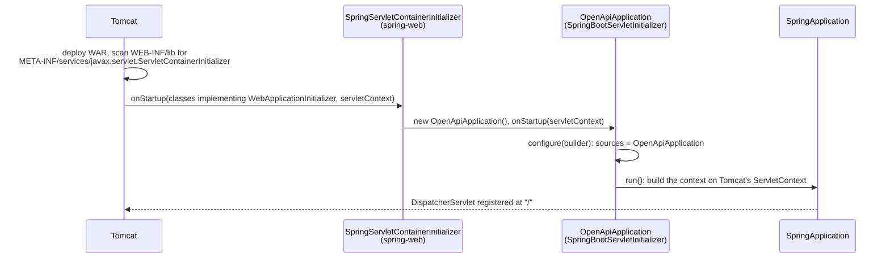

# 3. The application class

<div class="level-tabs" data-levels>
  <button data-level="overview" aria-pressed="true">Overview</button>
  <button data-level="deep" data-short="Deep">Deep Understanding</button>
  <button data-level="drill">Drilling</button>
</div>

<div class="level overview">

A Spring Boot application starts from one class. In the VWO API it is
`be.vwo.common.restAPI.OpenApiApplication`. Its annotations decide three
things for the whole API:

- which packages Spring searches for components (the classes it should create and wire for you)
- which of Spring Boot's automatic setups are switched off
- which properties files are loaded

The class also extends `SpringBootServletInitializer`, the hook
that lets Tomcat start the application from a WAR.

This chapter writes TechOlympiad's `OpenApiApplication` with those
annotations and one properties file, `api.properties`. The Swagger
<dfn data-def="An object created and managed by Spring's dependency injection container, the counterpart of a registered service in .NET.">beans</dfn>
and the other property sources join it in later chapters, so the class
grows in the same order the VWO's features are built.

**After this chapter you can:**

- explain the two ways a Spring Boot application starts, and which one Tomcat uses;
- say why the WAR has a `main` method that production never calls;
- explain what `@SpringBootApplication` switches on, and how `scanBasePackages` changes component scanning;
- read the auto-configuration report and say why `DataSourceAutoConfiguration` (Spring Boot's automatic database connection setup) is excluded;
- load a properties file with `@PropertySource`.

<div class="code-compare" data-code-compare data-labels="VWO OpenApiApplication|TechOlympiad, chapter 3">

```java
@OpenAPIDefinition
@SpringBootApplication(exclude = {DataSourceAutoConfiguration.class}, scanBasePackages = "be.vwo.common")
@PropertySource("classpath:environment.properties")
@PropertySource("classpath:api.properties")
@ImportResource("classpath:applicationContextAPI.xml")
public class OpenApiApplication extends SpringBootServletInitializer {
    public static void main(String[] args) {
        SpringApplication.run(OpenApiApplication.class, args);
    }
    // ... Swagger beans ...
    @Override
    protected SpringApplicationBuilder configure(SpringApplicationBuilder application) {
        return application.sources(OpenApiApplication.class);
    }
}
```

```java
@SpringBootApplication(exclude = {DataSourceAutoConfiguration.class}, scanBasePackages = "be.techolympiad.common")
@PropertySource("classpath:api.properties")
public class OpenApiApplication extends SpringBootServletInitializer {
    public static void main(String[] args) {
        SpringApplication.run(OpenApiApplication.class, args);
    }

    @Override
    protected SpringApplicationBuilder configure(SpringApplicationBuilder application) {
        return application.sources(OpenApiApplication.class);
    }
}
```

</div>

The missing lines arrive later: `@OpenAPIDefinition` and the Swagger beans
in [chapter 5](build-05-hello-swagger.md), `environment.properties` in
[chapter 6](build-06-build-profiles.md), and `@ImportResource` with the
Spring XML in chapter 8.

</div>

<div class="level deep">

### The application context

Everything Spring manages lives in the
<dfn data-def="Spring's container: it creates the beans, injects their dependencies, and holds them for the application's lifetime. The counterpart of .NET's IServiceProvider.">application context</dfn>.
The objects in it are <dfn data-def="An object created and managed by the Spring container. By default there is exactly one instance per bean definition (a singleton).">beans</dfn>.
If you know ASP.NET Core, the context plays the roles of
`IServiceCollection` and `IServiceProvider` at once: it collects the
registrations, then builds and wires the objects. There are three ways to
register a bean, and the VWO uses all three:

<div class="table-wrap">

| Spring | ASP.NET Core | VWO example |
|---|---|---|
| A class annotated `@Component`, `@Repository`, `@RestController`, ..., found by component scanning | Scanning an assembly for types (Scrutor, MVC finding controllers) | every DAO, repository and controller |
| A `@Bean` method in a `@Configuration` class | `services.AddSingleton(sp => ...)` | the `OpenAPI` and `GroupedOpenApi` beans in `OpenApiApplication` |
| A `<bean>` element in Spring XML | no counterpart | the session factories in `applicationContextAPI.xml` |
| Auto-configuration | `AddControllers()`, `AddRouting()`: framework defaults | Jackson, the `DispatcherServlet`, springdoc |

</div>

Beans are singletons unless you ask otherwise, so a DAO is created once
and shared by every request, the way `AddSingleton` works. That is why the
VWO's DAOs and repositories keep no per-request state in fields.

### Two ways to start

A Spring Boot application can start in two ways, and the class supports
both.

**From `main`.** `SpringApplication.run(OpenApiApplication.class, args)`
creates the context, sees Tomcat's classes on the classpath, starts an
*embedded* Tomcat inside the same JVM and registers the
`DispatcherServlet` in it. A servlet is a class that handles HTTP requests
under the Servlet API. The `DispatcherServlet` is Spring MVC's single
servlet that receives every request and routes it to the right controller
method. This is how `dotnet run` works with Kestrel, and
how most Spring Boot tutorials run.

**From a servlet container.** Tomcat is already running and deploys the
WAR. It never calls `main`. Instead, it runs a chain defined by the
servlet specification:



Step by step:

1. Tomcat looks in every jar in `WEB-INF/lib` for the file
   `META-INF/services/javax.servlet.ServletContainerInitializer`.
   `spring-web` has one, naming `SpringServletContainerInitializer`.
   This is Java's standard service lookup: a file named after an
   interface, listing the classes that implement it.
2. That class is annotated `@HandlesTypes(WebApplicationInitializer.class)`,
   so Tomcat scans the WAR's classes for every implementation of
   `WebApplicationInitializer` and hands them over.
3. `SpringBootServletInitializer` implements `WebApplicationInitializer`.
   Our class extends it, so it is found, instantiated and its
   `onStartup(ServletContext)` is called.
4. `onStartup` creates a `SpringApplicationBuilder`, lets `configure` add
   the sources (our class), and runs the application. A
   `ServletContext` (the object that stands for one deployed web
   application inside Tomcat) already exists, so Spring Boot starts no
   embedded server. It registers the `DispatcherServlet` and its filters
   in Tomcat's context instead.
5. It also registers a listener that closes the Spring context when
   Tomcat stops or undeploys the application.

The ASP.NET Core counterpart is hosting in IIS in-process: IIS owns the
process and the ASP.NET Core module loads your application into it. One
difference: under IIS your `Program.cs` still runs, but in a WAR `main`
does not.

<div class="callout note">
<div class="callout-label">Is <code>configure</code> needed?</div>

Strictly, no. When `configure` adds no sources and the class itself is a
`@Configuration` (which `@SpringBootApplication` implies),
`SpringBootServletInitializer` uses the class anyway. The VWO overrides it,
as the Spring Boot documentation shows, so we do too: it makes the WAR's
entry point explicit.

</div>

### Why the WAR has a `main` that production never calls

The WAR is not executable. Run `java -jar` on it and you get
`no main manifest attribute`: the manifest names no main class, because
the Spring Boot Maven plugin that would write one is not bound (see
[chapter 2](build-02-maven-project.md)). Even with a manifest, Tomcat is
`provided`, so it is missing from the WAR.

The `main` method is for development: run the class from IntelliJ with
the `provided` dependencies on the classpath, and you get an embedded
Tomcat in seconds without building a WAR. The drill does exactly that
from the command line. It is also the most likely way to get the port
wrong: the embedded Tomcat defaults to 8080, which on this machine
belongs to the VWO's local API.

### `@SpringBootApplication`

The annotation is a shortcut for three others:

<div class="table-wrap">

| Part | What it does |
|---|---|
| `@SpringBootConfiguration` | Marks the class as a `@Configuration`: its `@Bean` methods become beans |
| `@EnableAutoConfiguration` | Imports Spring Boot's auto-configuration classes. `exclude` removes some |
| `@ComponentScan` | Scans packages for `@Component` classes. `scanBasePackages` sets which |

</div>

### Component scanning and `scanBasePackages`

<dfn data-def="Spring searching packages on the classpath for classes annotated @Component (or @Repository, @Service, @Controller, @RestController, @Configuration) and registering each as a bean.">Component scanning</dfn>
reads the class files under a package and registers every class annotated
`@Component` or one of its specialisations: `@Repository`, `@Service`,
`@Controller`, `@RestController`, `@Configuration`. Without
`scanBasePackages`, the base package is the package of the annotated
class, here `be.techolympiad.common.restAPI`. The VWO's DAOs live in
`be.vwo.common.dao.impl` and its security classes in
`be.vwo.common.security`: siblings of `restAPI`, outside its subtree. A default
scan would not find them. A controller needs a repository, and a
repository needs a DAO, so every controller would fail to start with
`No qualifying bean of type '...' available`.

`scanBasePackages = "be.vwo.common"` moves the root up one level, so the
whole API is scanned. We copy that with `be.techolympiad.common`. The
usual Spring Boot advice is to put the application class in the root
package instead. The VWO keeps it in `restAPI` with the other web classes
and widens the scan, and so do we.

### Auto-configuration

When a Spring Boot application starts, it does more than create your own
beans. It also walks through a list of 144
<dfn data-def="Spring Boot configuration classes that register beans only when their conditions hold, for example when a class is on the classpath or no bean of that type exists yet.">auto-configuration</dfn>
classes that ship with Spring Boot. Each one is a recipe of the form
"if this situation applies, register these beans for the developer". The
list lives in a text file,
`META-INF/spring/org.springframework.boot.autoconfigure.AutoConfiguration.imports`,
inside `spring-boot-autoconfigure-2.7.18.jar`. The `@EnableAutoConfiguration`
part of `@SpringBootApplication` tells Spring to read it.

Each recipe checks its conditions first:

- `@ConditionalOnClass(DispatcherServlet.class)`: only if Spring MVC, Spring's web framework, is on the classpath;
- `@ConditionalOnMissingBean(ObjectMapper.class)`: only if you did not define your own `ObjectMapper` (Jackson's JSON serializer);
- `@ConditionalOnProperty(...)`: only if a property has a certain value.

The classpath condition is the important one: adding a jar to the pom can
switch a feature on without a single line of code. In .NET terms, it is as
if referencing the EF Core package made ASP.NET Core call `AddDbContext`
for you, reading the connection string from a fixed place in
`appsettings.json`.

The `--debug` flag prints the *conditions evaluation report*: every
recipe, whether its conditions matched, and at the end a list of
exclusions. The drill runs it.

### Why `DataSourceAutoConfiguration` is excluded

Two Java terms first. <dfn data-def="Java Database Connectivity: Java's standard low-level database API (connections, SQL statements, result sets), with one driver per database. Roughly ADO.NET.">JDBC</dfn>
(Java Database Connectivity) is Java's standard low-level database API:
open a connection, send SQL, read rows. It is roughly ADO.NET, and every
database ships a JDBC driver for it, the way MariaDB has an ADO.NET
provider in .NET. Hibernate, like EF Core on top of ADO.NET, talks to the
database through JDBC underneath. A `DataSource` is the JDBC object that
hands out connections, usually from a
<dfn data-def="A set of open database connections that are reused instead of opened and closed per query, like ADO.NET's built-in connection pooling.">connection pool</dfn>.

One of those recipes is `DataSourceAutoConfiguration`. Its job: as soon as
Spring's JDBC support (the `spring-jdbc` jar) is on the classpath, create
one connection pool (a `DataSource` bean) from the
`spring.datasource.url`, `username` and `password` properties, much like
a .NET template that reads `ConnectionStrings:Default` for you.

The VWO does not want that bean. It talks to the database in its own way,
through two Hibernate session factories defined in its Spring XML: one
that logs in as the read-only database user, one as the read-write user.
Each opens its connections through Hibernate's own pool, built with the
<dfn data-def="An old, stable JDBC connection pool library. Hibernate integrates it through the hibernate-c3p0 module.">c3p0</dfn>
library:

```xml
<bean id="vwoRW" class="org.springframework.orm.hibernate5.LocalSessionFactoryBean">
    <property name="configLocation" value="classpath:hibernate_VWO.cfg.xml"/>
    <property name="hibernateProperties">
        <props>
            <prop key="hibernate.connection.url">${database.VWO.url}</prop>
            <prop key="hibernate.connection.username">${database.VWO.readWrite.username}</prop>
            ...
```

So there are no `spring.datasource.*` properties anywhere. If the recipe
ran, this is what would happen at startup:

1. `spring-boot-starter-data-jpa` is added in [chapter 8](build-08-hibernate-xml.md). It is Spring Boot's starter for database access through JPA: one dependency that brings Hibernate, Spring's ORM and transaction support, `spring-jdbc` and the HikariCP connection pool. With `spring-jdbc` on the classpath, the recipe's condition matches.
2. The recipe looks for `spring.datasource.url` and finds nothing.
3. It then looks for an in-memory database such as H2 (a Java database that can run inside the application, often used in tests) to fall back on, and finds none either.
4. Startup stops with `Failed to configure a DataSource: 'url' attribute is not specified and no embedded datasource could be configured.`

The exclusion skips the recipe. It is written on the application class
itself, as an argument of `@SpringBootApplication`:

```java
@SpringBootApplication(exclude = {DataSourceAutoConfiguration.class}, scanBasePackages = "be.techolympiad.common")
```

`exclude` takes recipes off the list before Spring Boot evaluates them, so
`DataSourceAutoConfiguration` never runs and no `DataSource` bean is made.
Spring Boot's JPA recipe, `HibernateJpaAutoConfiguration`, would build
Hibernate's JPA entry point (an `EntityManagerFactory`, JPA's name for a
session factory) on top of that `DataSource`. It needs the bean, so it
stays quiet too. The database setup is left entirely to the XML. The
`spring.autoconfigure.exclude` property does the same from a properties
file, but the VWO uses the annotation.

In this chapter the exclusion changes nothing yet: `spring-jdbc` is not
on the classpath, so the recipe's condition would fail on its
own. We add it now so the class matches the VWO's from the first line,
and so you can see it in the `--debug` report.

### `@PropertySource` and the Environment

Spring keeps all configuration values in one
<dfn data-def="Spring's Environment: an ordered list of property sources (system properties, environment variables, application.properties, @PropertySource files, ...) searched top to bottom for each key.">Environment</dfn>,
an ordered list of property sources searched from the top, much like
`IConfiguration` with its providers. Spring Boot fills it with command
line arguments, environment variables and `application.properties`.
`@PropertySource("classpath:api.properties")` adds one more source.
`classpath:` means "look on the classpath". In a WAR, the classpath is
`WEB-INF/classes` plus the jars. `src/main/resources/api.properties`
ends up at `WEB-INF/classes/api.properties`.

A missing file is a startup error:
`java.io.FileNotFoundException: class path resource [api.properties] cannot be opened because it does not exist`.
The VWO's `api.properties` holds one key, `apiPomVersion`, the version
shown in Swagger (chapter 5) and read by the pipeline (chapter 22). Values
are read with `@Value("${apiPomVersion}")` or `Environment.getProperty`.
[Chapter 6](build-06-build-profiles.md) explains how several property
sources rank against each other.

</div>

<div class="level drill">

You should have the end state of [chapter 2](build-02-maven-project.md):
`pom.xml` with `spring-boot-starter-web`, the `provided` Tomcat starter
and Lombok, and `mvn package` producing `target/techolympiadAPI.war`.

### Tasks

<ul class="checklist">
<li><label><input type="checkbox"><span>Create the folders: <code>mkdir -p src/main/java/be/techolympiad/common/restAPI src/main/resources</code>. The folder path must match the package name.</span></label></li>
<li><label><input type="checkbox"><span>Create <code>src/main/resources/api.properties</code> (below).</span></label></li>
<li><label><input type="checkbox"><span>Create <code>OpenApiApplication.java</code> (below).</span></label></li>
<li><label><input type="checkbox"><span>Build: <code>mvn -q package</code>. Then <code>jar tf target/techolympiadAPI.war | grep WEB-INF/classes</code> shows your class and <code>api.properties</code>.</span></label></li>
<li><label><input type="checkbox"><span>Read the compiled class: <code>javap -cp target/classes be.techolympiad.common.restAPI.OpenApiApplication</code>.</span></label></li>
<li><label><input type="checkbox"><span>Try to run the WAR directly: <code>java -jar target/techolympiadAPI.war</code>. Read the error.</span></label></li>
<li><label><input type="checkbox"><span>Write the classpath to a file and run <code>main</code> with an embedded Tomcat on port 8081 (see <em>Run it</em>). Call it with <code>curl</code>, then stop it with <kbd>Ctrl</kbd>+<kbd>C</kbd>.</span></label></li>
<li><label><input type="checkbox"><span>Run it once more with <code>--debug</code> and find <code>DispatcherServletAutoConfiguration</code> under <em>Positive matches</em> and <code>DataSourceAutoConfiguration</code> under <em>Exclusions</em>.</span></label></li>
<li><label><input type="checkbox"><span>Run it without the <code>provided</code> dependencies and read the error.</span></label></li>
<li><label><input type="checkbox"><span>Optional, in IntelliJ: run <code>OpenApiApplication</code>, edit the run configuration, enable <em>Modify options → Add dependencies with "provided" scope to classpath</em> and add the program argument <code>--server.port=8081</code>.</span></label></li>
<li><label><input type="checkbox"><span>Commit: <code>git add -A &amp;&amp; git commit -m "Add the application class"</code>.</span></label></li>
</ul>

### The files

`src/main/resources/api.properties`:

```properties
apiPomVersion=0.1.0
```

`src/main/java/be/techolympiad/common/restAPI/OpenApiApplication.java`:

```java
package be.techolympiad.common.restAPI;

import org.springframework.boot.SpringApplication;
import org.springframework.boot.autoconfigure.SpringBootApplication;
import org.springframework.boot.autoconfigure.jdbc.DataSourceAutoConfiguration;
import org.springframework.boot.builder.SpringApplicationBuilder;
import org.springframework.boot.web.servlet.support.SpringBootServletInitializer;
import org.springframework.context.annotation.PropertySource;

@SpringBootApplication(exclude = {DataSourceAutoConfiguration.class}, scanBasePackages = "be.techolympiad.common")
@PropertySource("classpath:api.properties")
public class OpenApiApplication extends SpringBootServletInitializer {
    public static void main(String[] args) {
        SpringApplication.run(OpenApiApplication.class, args);
    }

    @Override
    protected SpringApplicationBuilder configure(SpringApplicationBuilder application) {
        return application.sources(OpenApiApplication.class);
    }
}
```

<div class="code-walk" data-code-walk>

```java
@SpringBootApplication(exclude = {DataSourceAutoConfiguration.class}, // (1)
        scanBasePackages = "be.techolympiad.common")                  // (2)
@PropertySource("classpath:api.properties")                           // (3)
public class OpenApiApplication extends SpringBootServletInitializer { // (4)
    public static void main(String[] args) {                          // (5)
        SpringApplication.run(OpenApiApplication.class, args);
    }

    @Override
    protected SpringApplicationBuilder configure(SpringApplicationBuilder application) { // (6)
        return application.sources(OpenApiApplication.class);
    }
}
```

1. Turns on configuration, auto-configuration and component scanning, minus the automatic `DataSource`. The session factories come from Spring XML in chapter 8.
2. Scan the whole `be.techolympiad.common` tree, so the `dao` and `security` packages are found later.
3. Adds `api.properties` to the Environment. A missing file stops the startup.
4. Makes the class a `WebApplicationInitializer`, which is how Tomcat finds and starts it.
5. Only used when you run the class yourself, with an embedded Tomcat.
6. Called by Tomcat's start-up chain: tells Spring Boot which class to build the context from.

</div>

### Run it

```bash
mvn -q package
javap -cp target/classes be.techolympiad.common.restAPI.OpenApiApplication
```

```text
Compiled from "OpenApiApplication.java"
public class be.techolympiad.common.restAPI.OpenApiApplication extends org.springframework.boot.web.servlet.support.SpringBootServletInitializer {
  public be.techolympiad.common.restAPI.OpenApiApplication();
  public static void main(java.lang.String[]);
  protected org.springframework.boot.builder.SpringApplicationBuilder configure(org.springframework.boot.builder.SpringApplicationBuilder);
}
```

The public no-argument constructor was added by `javac`. Tomcat's chain
needs a no-argument constructor: `SpringServletContainerInitializer`
creates the class by reflection.

```bash
java -jar target/techolympiadAPI.war
```

```text
no main manifest attribute, in target/techolympiadAPI.war
```

Now run `main` the way IntelliJ would: our classes plus every dependency,
`provided` ones included. `dependency:build-classpath` writes that
classpath to a file:

```bash
mvn -q dependency:build-classpath -Dmdep.outputFile=target/classpath.txt
java -cp "target/classes:$(cat target/classpath.txt)" \
    be.techolympiad.common.restAPI.OpenApiApplication --server.port=8081
```

```text
 :: Spring Boot ::               (v2.7.18)

... INFO ... Starting OpenApiApplication using Java 17.0.20 ...
... INFO ... No active profile set, falling back to 1 default profile: "default"
... INFO ... Tomcat initialized with port(s): 8081 (http)
... INFO ... Starting Servlet engine: [Apache Tomcat/9.0.83]
... INFO ... Root WebApplicationContext: initialization completed in 640 ms
... INFO ... Tomcat started on port(s): 8081 (http) with context path ''
... INFO ... Started OpenApiApplication in 1.4 seconds (JVM running for 1.8)
```

`--server.port=8081` is a command line argument, the highest-ranking
property source, so it overrides the default 8080. The context path is
empty: an embedded Tomcat serves the application at `/`. In another
terminal:

```bash
curl -s http://localhost:8081/
```

```json
{"timestamp":"2026-10-19T09:12:44.512+00:00","status":404,"error":"Not Found","path":"/"}
```

A 404 written by Spring Boot's error handling, as JSON: the application
runs, it just has no endpoints yet. Stop it with <kbd>Ctrl</kbd>+<kbd>C</kbd>
and start it again with `--debug` added after `--server.port=8081`. Among
the start-up lines is a long report. It lists *Positive matches* (for example
`DispatcherServletAutoConfiguration` and `JacksonAutoConfiguration`),
*Negative matches* with the condition that failed, and at the end:

```text
Exclusions:
-----------

    org.springframework.boot.autoconfigure.jdbc.DataSourceAutoConfiguration
```

Finally, leave out the `provided` scope. `-DincludeScope=runtime` keeps
the `compile` and `runtime` dependencies, which is what the WAR contains:

```bash
mvn -q dependency:build-classpath -DincludeScope=runtime -Dmdep.outputFile=target/classpath.txt
java -cp "target/classes:$(cat target/classpath.txt)" be.techolympiad.common.restAPI.OpenApiApplication
```

```text
Error: Unable to initialize main class be.techolympiad.common.restAPI.OpenApiApplication
Caused by: java.lang.NoClassDefFoundError: javax/servlet/ServletContext
```

`SpringBootServletInitializer.onStartup` takes a `ServletContext`, and the
servlet API is only in the Tomcat jars we marked `provided`. Inside Tomcat
that class is always there. Outside Tomcat, the class cannot even be loaded.
Rerun the first `build-classpath` command to restore the full classpath.

<div class="callout danger">
<div class="callout-label">When it breaks</div>

- **`Web server failed to start. Port 8080 was already in use.`**: you left out `--server.port=8081`, and the VWO's local API holds 8080. Never stop that one to make room. Pass the port instead.
- **`class path resource [api.properties] cannot be opened because it does not exist`**: the file is not in `src/main/resources`, or it is named differently. Check `ls target/classes`.
- **`package org.springframework.boot.web.servlet.support does not exist`**: a typo in an import, or the build ran outside the project folder. `SpringBootServletInitializer` is in `spring-boot-2.7.18.jar`, which `spring-boot-starter-web` brings.
- **`Could not find or load main class be.techolympiad.common.restAPI.OpenApiApplication`**: the file's folder does not match its `package` line, so `javac` put the class elsewhere, or `target/classes` is missing from `-cp`.
- **`NoClassDefFoundError: javax/servlet/ServletContext`**: the classpath has no Tomcat. In IntelliJ, tick *Add dependencies with "provided" scope to classpath*.

</div>

### Quiz

<div class="quiz" data-quiz>
<p class="quiz-q">The WAR is deployed to Tomcat. How does Tomcat get to your <code>OpenApiApplication</code>?</p>
<ol class="quiz-options">
<li>It calls <code>OpenApiApplication.main</code>, found through the manifest<p class="quiz-whynot">The WAR's manifest names no main class, and Tomcat never calls a <code>main</code> method of a web application.</p></li>
<li>Through <code>web.xml</code>, which names the class<p class="quiz-whynot">We have no <code>web.xml</code>, and the VWO's is entirely commented out.</p></li>
<li data-correct>Through <code>spring-web</code>'s <code>ServletContainerInitializer</code>, which receives every <code>WebApplicationInitializer</code>, including our subclass of <code>SpringBootServletInitializer</code><p class="quiz-why">The servlet 3.0 discovery mechanism finds the initializer in <code>WEB-INF/lib</code>, and <code>@HandlesTypes</code> makes Tomcat pass it our class.</p></li>
</ol>
<p class="quiz-explain">That is why the class must extend <code>SpringBootServletInitializer</code>: without it, Tomcat deploys the WAR, finds nothing to start, and every URL returns 404.</p>
</div>

<div class="quiz" data-quiz>
<p class="quiz-q">You move a DAO class to <code>be.techolympiad.dao</code> (outside <code>common</code>). What happens at startup?</p>
<ol class="quiz-options">
<li>Nothing changes: component scanning covers the whole classpath<p class="quiz-whynot">Scanning covers only the base packages, here <code>be.techolympiad.common</code> and below.</p></li>
<li data-correct>The DAO is not registered as a bean, and whatever needs it fails with <code>No qualifying bean of type</code><p class="quiz-why">The class is outside <code>scanBasePackages</code>, so Spring never sees its <code>@Repository</code>.</p></li>
<li>The build fails<p class="quiz-whynot">The compiler does not know about Spring's scanning. The class compiles fine. The failure comes when the context starts.</p></li>
</ol>
</div>

<div class="quiz" data-quiz>
<p class="quiz-q">Why does the VWO exclude <code>DataSourceAutoConfiguration</code>?</p>
<ol class="quiz-options">
<li>To make the application start faster<p class="quiz-whynot">The time saved is negligible. Without the exclusion the application would not start at all.</p></li>
<li data-correct>Its database connections come from two Hibernate session factories defined in Spring XML, so a Boot-made <code>DataSource</code> would be unwanted and, without <code>spring.datasource.url</code>, fail<p class="quiz-why">With JPA on the classpath, Spring Boot would try to build a pool and stop with "Failed to configure a DataSource".</p></li>
<li>Because MariaDB is not supported by Spring Boot<p class="quiz-whynot">Spring Boot supports MariaDB fine. The VWO simply sets up Hibernate itself.</p></li>
</ol>
</div>

### Flashcards

<div class="flashcards" data-flashcards data-front-label="Term" data-back-label="Meaning">
<div class="card"><div class="front">Bean</div><div class="back">An object created and wired by the Spring container. A singleton by default.</div></div>
<div class="card"><div class="front"><code>@SpringBootApplication</code></div><div class="back"><code>@SpringBootConfiguration</code> + <code>@EnableAutoConfiguration</code> + <code>@ComponentScan</code>.</div></div>
<div class="card"><div class="front"><code>scanBasePackages</code></div><div class="back">The root package(s) for component scanning. Default: the package of the annotated class.</div></div>
<div class="card"><div class="front"><code>SpringBootServletInitializer</code></div><div class="back">A <code>WebApplicationInitializer</code>. It lets Tomcat start the Spring Boot application from a WAR via <code>onStartup</code> and <code>configure</code>.</div></div>
<div class="card"><div class="front"><code>ServletContainerInitializer</code></div><div class="back">Servlet 3.0 hook, found via <code>META-INF/services</code> in a jar. <code>spring-web</code> provides one that calls every <code>WebApplicationInitializer</code>.</div></div>
<div class="card"><div class="front">Auto-configuration</div><div class="back">Spring Boot's conditional <code>@Configuration</code> classes. <code>--debug</code> prints which matched and why.</div></div>
<div class="card"><div class="front"><code>@PropertySource</code></div><div class="back">Adds a properties file to the Environment. A missing file stops startup.</div></div>
</div>

### Self-checks

<details class="qa">
<summary>Self-check: if production never calls <code>main</code>, why keep it?</summary>
<div class="ans">
For development: running <code>main</code> with the <code>provided</code> dependencies on the classpath starts the API on an embedded Tomcat without building and deploying a WAR. The VWO keeps it for the same reason.
<div class="mark"><button type="button">Mark as known</button></div>
</div>
</details>

<details class="qa">
<summary>Self-check: what would the default component scan cover if you removed <code>scanBasePackages</code>?</summary>
<div class="ans">
Only <code>be.techolympiad.common.restAPI</code> and its subpackages, the package of <code>OpenApiApplication</code>. The <code>dao</code>, <code>dbEntities</code> and <code>security</code> packages, which are siblings of <code>restAPI</code>, would be missed.
<div class="mark"><button type="button">Mark as known</button></div>
</div>
</details>

<details class="qa">
<summary>Self-check: in the embedded run the context path was empty. Who decides the context path when Tomcat deploys the WAR?</summary>
<div class="ans">
Tomcat, from the WAR's file name in <code>webapps/</code>. The application does not choose it. That is the subject of the next chapter.
<div class="mark"><button type="button">Mark as known</button></div>
</div>
</details>

<button type="button" data-mark-done>Mark this chapter done</button>

</div>
