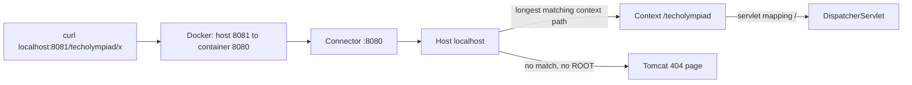

# 4. Running on Tomcat

<div class="level-tabs" data-levels>
  <button data-level="overview" aria-pressed="true">Overview</button>
  <button data-level="deep" data-short="Deep">Deep Understanding</button>
  <button data-level="drill">Drilling</button>
</div>

<div class="level overview">

The WAR from [chapter 3](build-03-application-class.md) holds a Spring
Boot application, but nothing runs it yet. In production the VWO API runs
in the official `tomcat:9` Docker image: the `Dockerfile` copies
`target/restAPI.war` into Tomcat's `webapps/` folder under the name
`database.war`, and Tomcat serves it at `/database`. On this machine,
`~/bin/vwo-local-restart` does the same with a
<dfn data-def="A Docker mount that makes a file or folder of your machine appear inside the container, so the container sees changes without a rebuild.">bind mount</dfn>
instead of a copy.

TechOlympiad does what the local script does, written down as a
`docker-compose.yml` with one service, `api`. The WAR stays in `target/`
on your machine and appears inside the container as
`webapps/techolympiad.war`, so after every build a restart is enough.
Chapter 7 adds the database as a second service to
the same file.

**After this chapter you can:**

- explain what a <dfn data-def="A Java web server that implements the Servlet API: it accepts HTTP connections, deploys WARs and calls their servlets and filters. Tomcat is one.">servlet container</dfn> does and where Tomcat 9 sits between <dfn data-def="Java Enterprise Edition: the set of standard Java APIs for server applications (servlets, JPA, validation), in javax.* packages. Renamed Jakarta EE when it moved to the Eclipse Foundation, and from version 9 on its packages are jakarta.*.">Java EE and Jakarta EE</dfn>;
- deploy a WAR by dropping it into `webapps/`, and predict its URL from the file name;
- find Tomcat's logs, both in `docker compose logs` and in the log files;
- redeploy after a build, and say why we restart instead of relying on hot redeploy.

<div class="code-compare" data-code-compare data-labels="VWO Dockerfile|vwo-local-restart|TechOlympiad compose">

```dockerfile
FROM tomcat:9

ENV TZ="Europe/Brussels"

RUN mkdir -p /usr/local/tomcat/webapps/ROOT
COPY tomcat/index.html /usr/local/tomcat/webapps/ROOT/

ARG WAR_FILENAME=database.war

COPY target/restAPI.war /usr/local/tomcat/webapps/${WAR_FILENAME}

EXPOSE 8080
```

```bash
docker run -d --name "$API_CONTAINER" --network host -e TZ=Europe/Brussels \
    -v "$WAR:/usr/local/tomcat/webapps/database.war:ro" tomcat:9-jdk17 >/dev/null
```

```yaml
services:
  api:
    image: tomcat:9-jdk17
    container_name: techolympiad-api
    environment:
      TZ: Europe/Brussels
    ports:
      - "8081:8080"
    volumes:
      - ./target/techolympiadAPI.war:/usr/local/tomcat/webapps/techolympiad.war:ro
```

</div>

</div>

<div class="level deep">

### What a servlet container is

The <dfn data-def="The Java specification (javax.servlet) for classes that handle HTTP requests inside a container. Spring MVC's DispatcherServlet is one such servlet.">Servlet API</dfn>
is a specification: interfaces such as `HttpServlet`, `Filter`,
`ServletContext` and `HttpServletRequest`, and rules for how a WAR is
laid out and started. A
<dfn data-def="A server that implements the Servlet specification: it accepts HTTP connections, deploys WARs and calls their servlets and filters. Tomcat, Jetty and Undertow are servlet containers.">servlet container</dfn>
implements it. It opens the HTTP port, parses requests, deploys web
applications, and calls their servlets and filters. Spring MVC is one
servlet, the `DispatcherServlet`, plus everything behind it.

In .NET terms, Tomcat is IIS and Kestrel together: it is the web server,
and it also hosts several applications side by side, each in its own
isolated space, like IIS application pools with a virtual path each.

Tomcat's parts nest the same way its `conf/server.xml` does:

<div class="table-wrap">

| Element | In our container | Role |
|---|---|---|
| Server | one per JVM | The whole Tomcat process |
| Service "Catalina" | one | Ties connectors to an engine |
| Connector | HTTP on port 8080 | Accepts connections and parses HTTP (the part called Coyote) |
| Engine "Catalina" | one | Picks the host for a request |
| Host "localhost" | `appBase="webapps"` | Deploys every WAR in `webapps/` |
| Context | one per web application: `/techolympiad` | One WAR, with its own class loader and its own `ServletContext` |
| Wrapper | one per servlet | Spring's `DispatcherServlet`, mapped to `/` |

</div>

### Tomcat 9, javax and jakarta

Each Tomcat major version implements one version of the specification:

<div class="table-wrap">

| Tomcat | Servlet spec | Package | Runs |
|---|---|---|---|
| 9 | 4.0 (Java EE 8) | `javax.servlet` | Spring 5 / Spring Boot 2, the VWO API |
| 10.1 and 11 | 6.0 and 6.1 (Jakarta EE 10 and 11) | `jakarta.servlet` | Spring 6 and later, Spring Boot 3 and later |

</div>

<div class="callout danger">
<div class="callout-label">Never <code>tomcat:latest</code></div>

A Spring Boot 2.7 WAR on Tomcat 10 or 11 deploys without an error and
then does nothing: Tomcat only looks for
`META-INF/services/jakarta.servlet.ServletContainerInitializer`, while
`spring-web` 5.3 ships the `javax` one. No Spring log line appears, and
every URL returns 404. The image tag must say `9`. The VWO's `FROM tomcat:9`
gets that right, but leaves the JDK floating (see [chapter 1](build-01-toolbox.md));
`tomcat:9-jdk17` pins both.

</div>

### Inside the `tomcat:9-jdk17` image

<div class="table-wrap">

| Path | What it is |
|---|---|
| `/usr/local/tomcat` | `CATALINA_HOME`, Tomcat's installation |
| `conf/server.xml` | The structure above: connector on 8080, host `localhost` with `appBase="webapps"`, `unpackWARs="true"`, `autoDeploy="true"` |
| `conf/logging.properties` | Where Tomcat's own log lines go |
| `webapps/` | Empty. The image moves Tomcat's sample apps to `webapps.dist/` |
| `logs/` | Tomcat's log files |
| `bin/catalina.sh` | The start script; the image's command is `catalina.sh run` |

</div>

`catalina.sh run` keeps Tomcat in the foreground and writes its console
output to stdout, which is what Docker records. Because `webapps/` is
empty, a request for `/` gets Tomcat's own 404 page. The VWO's
`Dockerfile` adds a `webapps/ROOT/index.html`, so its root URL shows a
page instead.

### How a WAR becomes a URL

At startup, and every ten seconds after that, the host's deployer
(`HostConfig`) looks at `webapps/`. For every `.war` it finds, it unpacks
it into a folder of the same name (`unpackWARs`), creates a Context and
starts it. The
<dfn data-def="The first part of the URL path, which selects the web application inside Tomcat. For webapps/techolympiad.war it is /techolympiad.">context path</dfn>
comes from the file name:

<div class="table-wrap">

| File in `webapps/` | Context path | Example URL |
|---|---|---|
| `techolympiad.war` | `/techolympiad` | `http://localhost:8081/techolympiad/...` |
| `database.war` | `/database` | the VWO API |
| `ROOT.war` or `ROOT/` | empty | `http://localhost:8081/...` |
| `api#v2.war` | `/api/v2` | `#` becomes `/` |
| `techolympiad##2.war` | `/techolympiad`, version 2 | Tomcat's parallel deployment |

</div>

This is why the build's file name (`techolympiadAPI.war`) and the deployed
name (`techolympiad.war`) differ, exactly like the VWO's `restAPI.war` and
`database.war`. The build produces one artifact; whoever deploys it
chooses the URL. The VWO pipeline passes `WAR_FILENAME` (default
`database.war`) into the `Dockerfile` for the same reason.

The application cannot pick its own context path. The VWO has a
`src/main/webapp/META-INF/context.xml` that says `<Context path="/servlet">`,
and Tomcat ignores that attribute for applications deployed from
`webapps/`: the path always comes from the file name. The file still
matters for its other setting (a cookie option); we have no use for it and
leave it out.

### One class loader per application

Each Context gets its own
<dfn data-def="The object that finds and loads classes. Tomcat gives every web application its own, so two WARs can contain different versions of the same library.">class loader</dfn>,
which loads `WEB-INF/classes` first, then `WEB-INF/lib/*.jar`, and asks
Tomcat's class loader for the rest. Two WARs in one Tomcat can therefore
hold different versions of Spring without noticing each other, like two
`AssemblyLoadContext`s in .NET. The exception is the platform: classes
such as `javax.servlet.*` always come from Tomcat, which is what made the
`provided` scope in [chapter 2](build-02-maven-project.md) correct.

### `web.xml`, and why its version matters

`WEB-INF/web.xml` is the
<dfn data-def="WEB-INF/web.xml: the XML file that used to declare a web application's servlets, filters and listeners. Optional since Servlet 3.0.">deployment descriptor</dfn>.
Before Servlet 3.0, every servlet, filter and listener had to be declared
in it. The VWO's `web.xml` still contains its old configuration (a
`DispatcherServlet` reading `dispatcher-servlet.xml`, Spring Security's
`DelegatingFilterProxy`, an encoding filter), all inside comments, because
`SpringBootServletInitializer` now registers those things from code.

What is left still matters. Tomcat only runs `ServletContainerInitializer`s,
and thus Spring, when the descriptor allows it:

- `version` must be 3.0 or higher (the VWO says 3.1);
- `metadata-complete` must not be `true`, because that tells Tomcat "everything is declared here, do not scan".

A `web.xml` copied from an old project with `version="2.5"` silently
turns Spring off. We add the same near-empty `web.xml` as the VWO so the
WAR has the same layout and states its servlet version.

### Ports, networks and the time zone

The container listens on 8080. `ports: "8081:8080"` publishes it as 8081
on your machine, because the VWO's local API already uses 8080: its
script runs the container with `--network host`, so Tomcat binds 8080 on
the host directly. Port 3307 is likewise taken by the VWO's database.
`TZ: Europe/Brussels` sets the JVM's default time zone; it matters from
the moment the API reads dates and times, and the VWO sets it in every
environment.

### Logs

Two kinds of output end up in `docker compose logs api`:

- **Tomcat's own lines**, through Java's built-in logging: `INFO [main] org.apache.catalina.startup.HostConfig.deployWAR Deploying web application archive ...`.
- **The application's lines**, through Spring Boot's logging (Logback for now): the Spring banner, `Started OpenApiApplication in ...`.

Tomcat also writes files in `/usr/local/tomcat/logs`:

<div class="table-wrap">

| File | Holds |
|---|---|
| `catalina.<date>.log` | Tomcat's own lines: startup, deployment, errors |
| `localhost.<date>.log` | Lines the application writes through `ServletContext.log`, and exceptions Tomcat catches while starting an application |
| `localhost_access_log.<date>.txt` | One line per request: client, time, method, URL, status, bytes |

</div>

The application's Logback output is not in these files; it only goes to
stdout. In chapter 21 Log4j2 adds a file of our own next to them, the way
the VWO pipeline reads `/usr/local/tomcat/logs/restapi.log` after a
deploy.

### Redeploying

With `autoDeploy="true"`, Tomcat notices when a WAR in `webapps/` gets a
newer modification time, undeploys the old version, deletes the unpacked
folder and deploys again. That is hot redeploy, and the drill shows it
working with `touch`. We still restart the container after a build, for
three reasons:

1. **A single-file bind mount is tied to the file it started with.** Docker
   mounts the file that existed when the container started. When a build
   replaces `target/techolympiadAPI.war` with a new file, or `mvn clean`
   deletes it, the container can keep seeing the old one. A restart sets
   up the mount again from the path.
2. **Tomcat may read a half-written WAR.** The check runs every ten
   seconds and can land while the build is still writing the file.
3. **Undeploying leaks.** Threads, JDBC drivers and caches created by the
   old version can keep its class loader alive. Tomcat warns about it in
   the log, and memory grows with every redeploy.

The VWO does the same: `vwo-local-restart` removes and recreates its
container, and the production target in its `ant.xml` runs
`sudo service tomcat9 restart` on the server after uploading.

### A request, end to end



The context path is removed before the application sees the path: inside
the application, the request above is for `/x`. That is why the VWO's
`@RequestMapping` paths (Spring's annotation that maps a URL to a
controller, like `[Route]`) start with `/api/v2`, never with `/database`, and
why the same WAR works under any name.

</div>

<div class="level drill">

You should have the end state of [chapter 3](build-03-application-class.md):
`OpenApiApplication` and `api.properties`, and `mvn package` producing a
WAR with both in `WEB-INF/classes`. Nothing should be listening on port
8081: stop the embedded run from chapter 3 if it is still going.

### Tasks

<ul class="checklist">
<li><label><input type="checkbox"><span>Create <code>src/main/webapp/WEB-INF/web.xml</code> (below).</span></label></li>
<li><label><input type="checkbox"><span>Build first, so the WAR exists before Docker mounts it: <code>mvn -q package</code>. Check <code>jar tf target/techolympiadAPI.war | grep web.xml</code>.</span></label></li>
<li><label><input type="checkbox"><span>Create <code>docker-compose.yml</code> in the project root (below).</span></label></li>
<li><label><input type="checkbox"><span>Start it: <code>docker compose up -d</code>, then follow the log with <code>docker compose logs -f api</code> until <code>Server startup in</code> appears. Press <kbd>Ctrl</kbd>+<kbd>C</kbd> to stop following.</span></label></li>
<li><label><input type="checkbox"><span>Find these lines in the log: the JVM version, <code>Deploying web application archive</code>, <code>1 Spring WebApplicationInitializers detected on classpath</code>, the Spring banner, <code>Started OpenApiApplication</code>.</span></label></li>
<li><label><input type="checkbox"><span>Call the root and the application (see <em>Run it</em>) and compare who answered each.</span></label></li>
<li><label><input type="checkbox"><span>Look inside: <code>docker compose exec api ls /usr/local/tomcat/webapps</code> and <code>docker compose exec api ls /usr/local/tomcat/logs</code>.</span></label></li>
<li><label><input type="checkbox"><span>Read your requests in the access log: <code>docker compose exec api sh -c 'tail /usr/local/tomcat/logs/localhost_access_log.*'</code>.</span></label></li>
<li><label><input type="checkbox"><span>Watch a hot redeploy: run <code>docker compose logs -f api</code> in one terminal and <code>touch target/techolympiadAPI.war</code> in another. Within about ten seconds Tomcat deploys again.</span></label></li>
<li><label><input type="checkbox"><span>Do the real cycle once: <code>mvn -q package &amp;&amp; docker compose restart api</code>, and follow the log again.</span></label></li>
<li><label><input type="checkbox"><span>Stop it when you are done for the day: <code>docker compose stop</code>. <code>docker compose down</code> also removes the container; both are fine, nothing is stored in it.</span></label></li>
<li><label><input type="checkbox"><span>Commit: <code>git add -A &amp;&amp; git commit -m "Run the WAR on Tomcat 9"</code>.</span></label></li>
</ul>

### The files

`src/main/webapp/WEB-INF/web.xml`:

```xml
<?xml version="1.0" encoding="UTF-8"?>
<web-app version="3.1" xmlns="http://xmlns.jcp.org/xml/ns/javaee" xmlns:xsi="http://www.w3.org/2001/XMLSchema-instance" xsi:schemaLocation="http://xmlns.jcp.org/xml/ns/javaee http://xmlns.jcp.org/xml/ns/javaee/web-app_3_1.xsd">
</web-app>
```

This is the VWO's root element with its commented-out contents removed.
Nothing in `pom.xml` changes: `maven-war-plugin` picks up
`src/main/webapp` by default.

`docker-compose.yml`:

```yaml
services:
  api:
    image: tomcat:9-jdk17
    container_name: techolympiad-api
    environment:
      TZ: Europe/Brussels
    ports:
      - "8081:8080"
    volumes:
      - ./target/techolympiadAPI.war:/usr/local/tomcat/webapps/techolympiad.war:ro
```

<div class="code-walk" data-code-walk>

```yaml
services:
  api:                                       # (1)
    image: tomcat:9-jdk17                    # (2)
    container_name: techolympiad-api         # (3)
    environment:
      TZ: Europe/Brussels                    # (4)
    ports:
      - "8081:8080"                          # (5)
    volumes:
      - ./target/techolympiadAPI.war:/usr/local/tomcat/webapps/techolympiad.war:ro  # (6)
```

1. The service name, used in `docker compose logs api` and `docker compose restart api`.
2. Tomcat 9 (`javax.servlet`) on Java 17, the same image as `vwo-local-restart`.
3. A fixed container name instead of the generated `techolympiad-api-1`, so `docker ps` and `docker logs techolympiad-api` read well.
4. The JVM's default time zone, as in the VWO's `Dockerfile`.
5. Host port 8081 to Tomcat's 8080; 8080 on the host belongs to the VWO's local API.
6. Our build output appears in `webapps/` under the deployed name, which makes the context path `/techolympiad`. `:ro` stops the container from changing the file.

</div>

### Run it

```bash
mvn -q package
docker compose up -d
docker compose logs -f api
```

The log, trimmed to the lines that tell the story:

```text
techolympiad-api  | ... INFO [main] org.apache.catalina.startup.VersionLoggerListener.log Server version name:   Apache Tomcat/9.0.x
techolympiad-api  | ... INFO [main] org.apache.catalina.startup.VersionLoggerListener.log JVM Version:           17.0.x+x
techolympiad-api  | ... INFO [main] org.apache.catalina.startup.HostConfig.deployWAR Deploying web application archive [/usr/local/tomcat/webapps/techolympiad.war]
techolympiad-api  | ... INFO [main] org.apache.catalina.core.ApplicationContext.log 1 Spring WebApplicationInitializers detected on classpath
techolympiad-api  |  :: Spring Boot ::               (v2.7.18)
techolympiad-api  | ... INFO ... Starting OpenApiApplication using Java 17.0.x ...
techolympiad-api  | ... INFO ... Root WebApplicationContext: initialization completed in 900 ms
techolympiad-api  | ... INFO ... Started OpenApiApplication in 2.1 seconds (JVM running for 4.2)
techolympiad-api  | ... INFO [main] org.apache.catalina.startup.HostConfig.deployWAR Deployment of web application archive [/usr/local/tomcat/webapps/techolympiad.war] has finished in [3,512] ms
techolympiad-api  | ... INFO [main] org.apache.catalina.startup.Catalina.start Server startup in [3601] milliseconds
```

Compare it with the embedded run of chapter 3: there are no
`Tomcat initialized with port(s)` and `Tomcat started on port(s)` lines,
because Spring Boot started no server. The Tomcat lines in between are
the chain from chapter 3 happening for real. You will also see a line
about JARs that were scanned for TLDs and contained none; that is Tomcat
looking for the tag library descriptors of JSP (JavaServer Pages, Java's
old server-side HTML templates, a bit like Razor views), harmless.

```bash
curl -s -o /dev/null -w '%{http_code}\n' http://localhost:8081/
curl -s http://localhost:8081/techolympiad/
```

```text
404
{"timestamp":"2026-10-19T09:31:07.218+00:00","status":404,"error":"Not Found","path":"/techolympiad/"}
```

The first 404 comes from Tomcat: no context matches `/` (open it in a
browser to see Tomcat's HTML error page). The second comes from Spring,
as JSON: Tomcat routed the request to our application, which has no
endpoint at `/` yet. That difference is the quickest way to tell "my
application did not deploy" from "my application has no such endpoint".

```bash
docker compose exec api ls /usr/local/tomcat/webapps
```

```text
techolympiad
techolympiad.war
```

The `.war` is your mounted file; `techolympiad/` is the copy Tomcat
unpacked and actually runs.

<div class="callout danger">
<div class="callout-label">When it breaks</div>

- **`Bind for 0.0.0.0:8081 failed: port is already allocated`**: something holds 8081, usually the embedded run from chapter 3. Stop it, then `docker compose up -d` again.
- **`mvn package` fails because `target/techolympiadAPI.war` is a directory**: you ran `docker compose up` before the first build. Docker creates a missing bind-mount source as an empty directory, owned by root. Run `docker compose down`, remove it with `sudo rm -rf target/techolympiadAPI.war`, build, and start again.
- **Every URL is 404 and no Spring banner appears**: the WAR deployed but Spring did not start. Check the image tag says `9`, and that `web.xml` has `version="3.1"` and no `metadata-complete="true"`.
- **`Context [/techolympiad] startup failed due to previous errors`**: Spring threw during startup. The cause is a few lines higher in `docker compose logs api`, or in `localhost.<date>.log`; a missing `api.properties` shows up here.
- **The old version is still running after a build**: you rebuilt without restarting. `docker compose restart api`.
- **`http://localhost:8081/techolympiadAPI/` is 404**: the URL follows the deployed name in `webapps/`, which is `techolympiad.war`.

</div>

### Quiz

<div class="quiz" data-quiz>
<p class="quiz-q">The VWO's <code>META-INF/context.xml</code> says <code>&lt;Context path="/servlet"&gt;</code>, and its WAR is deployed as <code>webapps/database.war</code>. At which path does the API answer?</p>
<ol class="quiz-options">
<li><code>/servlet</code>, because the application's own <code>context.xml</code> wins<p class="quiz-whynot">Tomcat ignores the <code>path</code> attribute for applications deployed from <code>webapps/</code>.</p></li>
<li data-correct><code>/database</code>, from the file name<p class="quiz-why">For anything in the host's <code>appBase</code>, the context path is always derived from the file or folder name.</p></li>
<li><code>/restAPI</code>, from the <code>finalName</code> in the <code>pom.xml</code><p class="quiz-whynot">Tomcat never sees the <code>pom.xml</code>; the WAR was renamed when it was copied into the image.</p></li>
</ol>
</div>

<div class="quiz" data-quiz>
<p class="quiz-q"><code>curl http://localhost:8081/</code> returns Tomcat's HTML 404 page, while <code>curl http://localhost:8081/techolympiad/</code> returns a JSON 404. What does that tell you?</p>
<ol class="quiz-options">
<li>The application failed to deploy<p class="quiz-whynot">A failed deployment means no context at <code>/techolympiad</code>, which would give Tomcat's HTML page for both URLs.</p></li>
<li data-correct>The application runs; it simply has no endpoint at <code>/</code> yet<p class="quiz-why">The JSON body comes from Spring Boot's error handling, so the request reached our application.</p></li>
<li>Tomcat's <code>webapps/ROOT</code> is broken<p class="quiz-whynot">The image has no ROOT application at all; a 404 at <code>/</code> is the expected answer.</p></li>
</ol>
</div>

<div class="quiz" data-quiz>
<p class="quiz-q">Why do we restart the container after each build instead of relying on Tomcat's hot redeploy?</p>
<ol class="quiz-options">
<li>Tomcat in Docker cannot redeploy<p class="quiz-whynot">It can, as the <code>touch</code> experiment shows. The problems are around it.</p></li>
<li data-correct>The bind mount may still point at the old file, Tomcat may pick up a half-written WAR, and repeated undeploys leak memory<p class="quiz-why">A restart avoids all three and costs a few seconds.</p></li>
<li>Restarting is needed to change the context path<p class="quiz-whynot">The context path only depends on the name in <code>webapps/</code>, which does not change between builds.</p></li>
</ol>
</div>

### Flashcards

<div class="flashcards" data-flashcards data-front-label="Term" data-back-label="Meaning">
<div class="card"><div class="front">Servlet container</div><div class="back">Implements the Servlet API: HTTP port, deployment, servlets and filters. Tomcat, Jetty, Undertow.</div></div>
<div class="card"><div class="front">Tomcat 9 versus 10</div><div class="back">9 is <code>javax.servlet</code> (Spring 5, Boot 2). 10 and later are <code>jakarta.servlet</code> (Spring 6, Boot 3).</div></div>
<div class="card"><div class="front">Context path</div><div class="back">The URL prefix that selects the application, taken from the file name in <code>webapps/</code>. <code>ROOT.war</code> is empty.</div></div>
<div class="card"><div class="front"><code>webapps/</code></div><div class="back">The host's <code>appBase</code>: every WAR in it is unpacked and deployed. Empty in the official image.</div></div>
<div class="card"><div class="front"><code>catalina.sh run</code></div><div class="back">Starts Tomcat in the foreground with console output on stdout, which is what <code>docker logs</code> shows.</div></div>
<div class="card"><div class="front"><code>localhost_access_log.*.txt</code></div><div class="back">One line per request handled by the host: who, when, what, status.</div></div>
<div class="card"><div class="front"><code>web.xml</code> version</div><div class="back">Must be 3.0 or higher, without <code>metadata-complete="true"</code>, or Tomcat skips the initializers and Spring never starts.</div></div>
</div>

### Self-checks

<details class="qa">
<summary>Self-check: what changes if you mount the WAR as <code>webapps/ROOT.war</code>?</summary>
<div class="ans">
The context path becomes empty: the API answers at <code>http://localhost:8081/</code> and Tomcat's 404 page at the root disappears. The application itself is unchanged, because it never sees the context path.
<div class="mark"><button type="button">Mark as known</button></div>
</div>
</details>

<details class="qa">
<summary>Self-check: Spring's start-up error is not in <code>catalina.&lt;date&gt;.log</code>. Where do you look?</summary>
<div class="ans">
In <code>docker compose logs api</code>, which has the application's own log output (Logback writes to stdout), and in <code>localhost.&lt;date&gt;.log</code>, where Tomcat records exceptions thrown while starting a context.
<div class="mark"><button type="button">Mark as known</button></div>
</div>
</details>

<details class="qa">
<summary>Self-check: why does the VWO's local script use <code>--network host</code>, and why do we publish a port instead?</summary>
<div class="ans">
With <code>--network host</code> the container shares the host's network, so Tomcat binds port 8080 on your machine directly, without port mapping. We map host 8081 to the container's 8080 so both APIs can run at the same time.
<div class="mark"><button type="button">Mark as known</button></div>
</div>
</details>

<button type="button" data-mark-done>Mark this chapter done</button>

</div>
