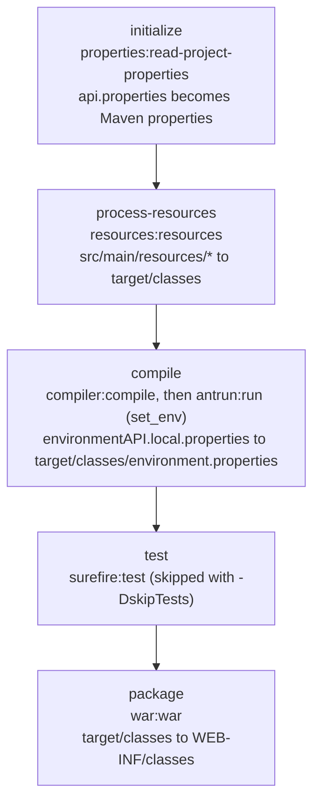

# 6. Build profiles

<div class="level-tabs" data-levels>
  <button data-level="overview" aria-pressed="true">Overview</button>
  <button data-level="deep" data-short="Deep">Deep Understanding</button>
  <button data-level="drill">Drilling</button>
</div>

<div class="level overview">

The VWO API runs in more than one place, and each place has its own
database URL, database users, log levels and description. Those values
live in two files, `environmentAPI.dev.properties` and
`environmentAPI.prod.properties`. The application reads neither of them.
It reads `environment.properties`, a file that does not exist in the
sources: during the build, a Maven *profile* runs an Ant target that
copies one of the two environment files to `target/classes/environment.properties`.
Which environment a WAR is for is therefore decided when it is built.

This chapter builds the same mechanism for TechOlympiad, with two
profiles: `local`, for the Docker stack on your machine, and `production`.
It also moves `application-description` out of `api.properties`, where
[chapter 5](build-05-hello-swagger.md) parked it, into the environment
files where the VWO keeps it. From now on every build is
`mvn -q -DskipTests -Plocal package`.

**After this chapter you can:**

- explain what a Maven profile is, how it is activated, and how it differs from a Spring profile;
- bind a plugin execution to a phase and predict when it runs;
- read the VWO's `ant.xml` and say what each of its targets does;
- explain how several property sources rank, and why the order of `@PropertySource` lines matters;
- say which VWO profile is safe to build with locally, and why `-Pdev` is not.

<div class="code-compare" data-code-compare data-labels="VWO|TechOlympiad">

```xml
<!-- pom.xml -->
<profile>
    <id>gitlab-dev</id>
    ...
        <execution>
            <id>set_env</id>
            <phase>compile</phase>
            <goals><goal>run</goal></goals>
            <configuration>
                <target>
                    <ant antfile="ant.xml" target="properties-APIdev"/>
                </target>
            </configuration>
        </execution>

<!-- ant.xml -->
<macrodef name="copy-properties">
    <attribute name="file"/>
    <sequential>
        <replace-file source="src/main/resources/@{file}.properties"
                      target="${project.build.outputDirectory}/environment.properties"/>
    </sequential>
</macrodef>

<target name="properties-APIdev">
    <copy-properties file="environmentAPI.dev"/>
</target>
```

```xml
<!-- pom.xml -->
<profile>
    <id>local</id>
    ...
        <execution>
            <id>set_env</id>
            <phase>compile</phase>
            <goals><goal>run</goal></goals>
            <configuration>
                <target>
                    <ant antfile="ant.xml" target="properties-APIlocal"/>
                </target>
            </configuration>
        </execution>

<!-- ant.xml -->
<macrodef name="copy-properties">
    <attribute name="file"/>
    <sequential>
        <replace-file source="src/main/resources/@{file}.properties"
                      target="${project.build.outputDirectory}/environment.properties"/>
    </sequential>
</macrodef>

<target name="properties-APIlocal">
    <copy-properties file="environmentAPI.local"/>
</target>
```

</div>

</div>

<div class="level deep">

### Choosing the environment at build time

ASP.NET Core picks its environment when the application *starts*: one
build, and `ASPNETCORE_ENVIRONMENT` selects `appsettings.Production.json`
at run time. Spring has the same idea under the name Spring profiles
(`spring.profiles.active` and `application-{profile}.properties`). The VWO
uses neither. It picks the environment when the WAR is *built*:

<div class="table-wrap">

| | Run-time choice (ASP.NET Core, Spring profiles) | Build-time choice (VWO) |
|---|---|---|
| Artifacts | one, for every environment | one per environment |
| Chosen by | a variable on the server | `-P` on the `mvn` command line |
| Wrong environment | a wrong variable on one server | a WAR built with the wrong profile, wrong wherever it goes |
| What the server needs | the variable, and usually the secrets | nothing: the WAR is complete |

</div>

The last row is why it suits the VWO: the server only needs Tomcat, and
the pipeline only copies a file into an image. The price is that a WAR is
only as right as the command that built it, which makes knowing the
profiles part of knowing the build.

### Maven profiles

A <dfn data-def="A named block in pom.xml (dependencies, plugins, properties) that only takes effect when activated, for example with mvn -P name.">Maven profile</dfn>
is a named part of the POM that only counts when it is active. Inside
`<profiles>`, each `<profile>` can hold almost anything the POM itself
holds: dependencies, properties, and a `<build>` with plugins. When it is
active, Maven merges it into the effective POM.

- **Activation**: `-P local` (or `-Plocal`) on the command line. Several at once: `-Plocal,other`. A profile can also activate itself with `<activation>` (a property, the JDK version, a file that exists, or `activeByDefault`), and one can be listed in `~/.m2/settings.xml`. The VWO uses only `-P`, and so do we.
- **Checking**: `mvn help:active-profiles -Plocal` lists what is active and where it was defined.
- **A misspelled name**: Maven 3 prints `The requested profile "loacl" could not be activated because it does not exist.` as a warning and builds anyway, without it.

<div class="callout rule">
<div class="callout-label">Two kinds of profile</div>

A Maven profile and a Spring profile share a name and nothing else. A
Maven profile changes what the build does; it is gone once the WAR
exists. A Spring profile changes which beans and property files the
running application uses. Nothing in the VWO uses Spring profiles, which
is why Spring Boot logs `No active profile set, falling back to 1 default profile: "default"`
at every start.

</div>

### Plugin executions

In [chapter 2](build-02-maven-project.md) the plugins ran because the
`war` packaging binds them to phases. A plugin can also be bound by hand,
with an `<execution>`:

<div class="table-wrap">

| Element | Meaning |
|---|---|
| `<id>` | A name for this execution, shown in the build log: `antrun:3.1.0:run (set_env)` |
| `<phase>` | When it runs |
| `<goals>` | Which goal of the plugin runs |
| `<configuration>` | Settings for this execution only |

</div>

When several goals are bound to one phase, the packaging's own bindings
run first, then the POM's executions in the order they appear. The VWO
binds its Ant call to `compile`, so it runs right after `javac`, and
before `package` zips `target/classes` into the WAR. Any phase from
`process-resources` up to `prepare-package` would work: the file only has
to be in `target/classes` before `war:war`.

### Ant inside Maven

<dfn data-def="Apache Ant: the XML-based Java build tool that came before Maven. A build file holds targets made of tasks such as copy, delete and exec.">Ant</dfn>
is the Java build tool from before Maven: an XML file of *targets*, each a
list of *tasks* (`copy`, `delete`, `exec`, ...). If you know MSBuild, an
Ant target is an MSBuild `<Target>` and a task is a task. Maven has no
"copy this file" step of its own, so `maven-antrun-plugin` runs Ant tasks
in the middle of a Maven build. Its `run` goal executes the `<target>` in
its configuration; the VWO's one-liner there calls a target in a separate
file, `ant.xml`, with `<ant antfile="ant.xml" target="..."/>`.

Two kinds of placeholders appear in `ant.xml`:

- **`${...}`** are Ant properties. `maven-antrun-plugin` passes the Maven
  properties to Ant, so `${project.build.outputDirectory}` is
  `target/classes` and `${project.artifactId}` is the artifact id.
- **`@{...}`** are the attributes of a `<macrodef>`, a reusable task
  defined in the same file. `<copy-properties file="environmentAPI.local"/>`
  calls the macro with `@{file}` set to `environmentAPI.local`.

### Why `replace-file` deletes first

The VWO's `copy-properties` macro does not call `<copy>` directly. It
calls another macro, `replace-file`, which deletes the target and then
copies:

```xml
<macrodef name="replace-file">
    <attribute name="source"/>
    <attribute name="target"/>
    <sequential>
        <delete file="@{target}"/>
        <copy file="@{source}" tofile="@{target}"/>
    </sequential>
</macrodef>
```

Ant's `<copy>` skips a file when the target is newer than the source. A
copied file gets the time of the copy, so after a `production` build,
`environment.properties` is newer than `environmentAPI.local.properties`,
and a following `local` build without `clean` would silently keep the
production file. Deleting first makes every build copy. We copy both
macros.

### The build, phase by phase



Note what `process-resources` does: it copies *everything* in
`src/main/resources`, so both environment files end up in
`WEB-INF/classes` next to `environment.properties`. The application only
reads `environment.properties`; the others ride along. In the VWO's case
that means every WAR, also one built for development, contains the
production file with its credentials.

### `properties-maven-plugin`

The VWO's `pom.xml` also binds `properties-maven-plugin` to `initialize`,
the second phase. Its `read-project-properties` goal reads
`src/main/resources/api.properties` and adds each key as a Maven property,
so `${apiPomVersion}` could be used anywhere in the POM, as the version of
a dependency or in an Ant target. In the VWO's `pom.xml` and `ant.xml`
nothing uses it; the pipeline reads the version by running `grep` on the
file instead. We add the plugin so the build matches, and the drill shows
the property is there. Chapter 22 comes back to how the version number
travels.

### Which property file wins

After this chapter the application has four sources of configuration,
searched in this order for each key:

<div class="table-wrap">

| Rank | Source | Added by |
|---|---|---|
| 1 | command line arguments (`--server.port=8081`) | Spring Boot |
| 2 | OS environment variables | Spring Boot |
| 3 | `application.properties` | Spring Boot |
| 4 | `api.properties` | the second `@PropertySource` |
| 5 | `environment.properties` | the first `@PropertySource` |

</div>

Among `@PropertySource` annotations, the one processed last wins, and they
are processed in the order they are written. The VWO lists
`environment.properties` first and `api.properties` second, so a key in
both files takes the value from `api.properties`. That is why the move
below deletes `application-description` from `api.properties` instead of
just adding it to the environment files: left in both, the environment
files would be ignored for that key without a warning.

### The VWO's profiles

<div class="table-wrap">

| Profile | At `compile` | At `package` | Used by |
|---|---|---|---|
| `dev` | copies `environmentAPI.dev.properties` | target `api-dev`: over SSH through the jump server, deletes the WAR on the test server, then uploads yours with `scp` | not the pipeline |
| `production` | copies `environmentAPI.prod.properties` | target `api-production`: uploads the WAR to the production server and runs `sudo service tomcat9 restart` there | not the pipeline |
| `gitlab-dev` | copies `environmentAPI.dev.properties` | nothing | the pipeline, and `~/bin/vwo-local-restart` |
| `gitlab-prod` | copies `environmentAPI.prod.properties` | nothing | the pipeline |

</div>

The `dev` and `production` profiles deploy from whichever machine runs
the build. The server names, users
and paths they need come from the parent POM, `pom-userProperties.xml`,
which is why that file exists ([chapter 2](build-02-maven-project.md)).
The pipeline builds with `mvn clean -U package ... -P gitlab-${PROFILE}`,
the profiles that only pick the environment file, and deploys the
resulting Docker image itself (chapter 22).

<div class="callout danger">
<div class="callout-label">Never <code>-Pdev</code> on the VWO API</div>

The deploy runs in the `package` phase, so **any** command that reaches
`package` deploys: `mvn -Pdev package`, `mvn -Pdev install`, a
"package" click in IntelliJ with the `dev` box ticked. On this machine
the parent POM holds real server names and the SSH setup reaches the jump
server, so it would work: the WAR on the shared test server is deleted
and replaced by whatever you just built. `-Pproduction` does the same to
production and restarts its Tomcat. Build the VWO API locally only with
`-Pgitlab-dev`, as `vwo-local-restart` does; its comment says the same.

</div>

TechOlympiad's `ant.xml` has no deploy targets at all, so none of its
profiles can do more than copy a file.

### Secrets

The VWO commits both environment files to git, database passwords
included, and, as shown above, both end up in every WAR. TechOlympiad
does not repeat that. `environmentAPI.local.properties` will hold the
passwords of the throwaway local database from chapter 7, which protect
nothing. `environmentAPI.prod.properties` holds placeholders only; a real
production deployment would have to inject its secrets at deploy time,
and this book never deploys to production.

### What we leave out

- **The second `<resource>` in the VWO's `<build>`**, with directory `${project.build.outputDirectory}` and include `environment.properties`. It copies `target/classes/environment.properties` onto itself during `process-resources`, before the Ant target has written it. It does nothing.
- **`build-helper-maven-plugin` 3.3.0 in the `dev` profile.** Declared without executions, so it never runs.
- **`/src/main/resources/environment.properties` in the VWO's `.gitignore`.** The build writes to `target/classes`, which `/target/` already covers.

</div>

<div class="level drill">

You should have the end state of [chapter 5](build-05-hello-swagger.md):
`GET /api/v1/hello` works from the Swagger UI, and `api.properties` holds
`apiPomVersion` and `application-description`.

### Tasks

<ul class="checklist">
<li><label><input type="checkbox"><span>Create <code>src/main/resources/environmentAPI.local.properties</code> and <code>environmentAPI.prod.properties</code> (below).</span></label></li>
<li><label><input type="checkbox"><span>Create <code>ant.xml</code> in the project root, next to <code>pom.xml</code>.</span></label></li>
<li><label><input type="checkbox"><span>Replace <code>pom.xml</code> with the new version: the <code>properties-maven-plugin</code> and the two profiles are new.</span></label></li>
<li><label><input type="checkbox"><span>Remove <code>application-description</code> from <code>api.properties</code>, and add the <code>environment.properties</code> source to <code>OpenApiApplication</code> (diffs below).</span></label></li>
<li><label><input type="checkbox"><span>Check the profiles: <code>mvn help:active-profiles -Plocal</code>.</span></label></li>
<li><label><input type="checkbox"><span>Build with the profile and without <code>-q</code> once: <code>mvn -DskipTests -Plocal package</code>. Find the <code>properties</code> and <code>antrun</code> lines in the log.</span></label></li>
<li><label><input type="checkbox"><span>Check which file was copied: <code>head -1 target/classes/environment.properties</code>, and in the WAR: <code>unzip -p target/techolympiadAPI.war WEB-INF/classes/environment.properties</code>.</span></label></li>
<li><label><input type="checkbox"><span>Build with <code>-Pproduction</code>, check again, then build with <code>-Plocal</code> again (without <code>clean</code>). The delete in <code>replace-file</code> is what makes the second switch work.</span></label></li>
<li><label><input type="checkbox"><span>Read the Maven property: <code>mvn -q initialize help:evaluate -Dexpression=apiPomVersion -DforceStdout; echo</code>.</span></label></li>
<li><label><input type="checkbox"><span>Break it on purpose: <code>mvn -q clean package -DskipTests</code> (no profile), <code>docker compose restart api</code>, and read the error in <code>docker compose logs api</code>.</span></label></li>
<li><label><input type="checkbox"><span>Fix it: <code>mvn -q -DskipTests -Plocal package &amp;&amp; docker compose restart api</code>. The Swagger UI shows the same title as before, now from <code>environment.properties</code>. Execute <code>GET /api/v1/hello</code> once more.</span></label></li>
<li><label><input type="checkbox"><span>In IntelliJ's Maven tool window, open <em>Profiles</em> and tick <code>local</code>, so builds started from IntelliJ use it too.</span></label></li>
<li><label><input type="checkbox"><span>Commit: <code>git add -A &amp;&amp; git commit -m "Add build profiles"</code>.</span></label></li>
</ul>

### The files

`src/main/resources/environmentAPI.local.properties`:

```properties
# Local Docker stack
application-description=TechOlympiad API
```

`src/main/resources/environmentAPI.prod.properties`:

```properties
# Production: placeholders only, never real secrets
application-description=TechOlympiad API
```

The VWO's two files have the same keys in the same order, with different
values; ours will too. Chapter 8 adds the database keys, chapter 20 the
JWT secret and chapter 21 the log settings. The comment on the first line
is only there so you can see which file was copied.

`ant.xml`:

```xml
<project>

    <macrodef name="replace-file">
        <attribute name="source"/>
        <attribute name="target"/>
        <sequential>
            <delete file="@{target}"/>
            <copy file="@{source}" tofile="@{target}"/>
        </sequential>
    </macrodef>

    <macrodef name="copy-properties">
        <attribute name="file"/>
        <sequential>
            <replace-file source="src/main/resources/@{file}.properties"
                          target="${project.build.outputDirectory}/environment.properties"/>
        </sequential>
    </macrodef>

    <target name="properties-APIlocal">
        <copy-properties file="environmentAPI.local"/>
    </target>

    <target name="properties-APIprod">
        <copy-properties file="environmentAPI.prod"/>
    </target>

</project>
```

The VWO's file has the same two macros and the same two kinds of targets,
plus the deploy macros (`scp-via-jump`, `ssh-via-jump`, `scp-project`,
`remove-old`, `restart-tomcat`, `upload-and-restart`) and the deploy
targets that use them. Relative paths such as `src/main/resources/...`
are resolved from the folder of `ant.xml`, the project root.

`pom.xml`, the full new version:

```xml
<?xml version="1.0" encoding="UTF-8"?>
<project xmlns="http://maven.apache.org/POM/4.0.0" xmlns:xsi="http://www.w3.org/2001/XMLSchema-instance" xsi:schemaLocation="http://maven.apache.org/POM/4.0.0 http://maven.apache.org/xsd/maven-4.0.0.xsd">
    <modelVersion>4.0.0</modelVersion>

    <groupId>be.techolympiad</groupId>
    <artifactId>techolympiadAPI</artifactId>
    <version>0.1.0</version>
    <packaging>war</packaging>

    <profiles>
        <profile>
            <id>local</id>
            <build>
                <plugins>
                    <plugin>
                        <groupId>org.apache.maven.plugins</groupId>
                        <artifactId>maven-antrun-plugin</artifactId>
                        <version>3.1.0</version>
                        <executions>
                            <execution>
                                <id>set_env</id>
                                <phase>compile</phase>
                                <goals>
                                    <goal>run</goal>
                                </goals>
                                <configuration>
                                    <target>
                                        <ant antfile="ant.xml" target="properties-APIlocal"/>
                                    </target>
                                </configuration>
                            </execution>
                        </executions>
                    </plugin>
                </plugins>
            </build>
        </profile>
        <profile>
            <id>production</id>
            <build>
                <plugins>
                    <plugin>
                        <groupId>org.apache.maven.plugins</groupId>
                        <artifactId>maven-antrun-plugin</artifactId>
                        <version>3.1.0</version>
                        <executions>
                            <execution>
                                <id>set_env</id>
                                <phase>compile</phase>
                                <goals>
                                    <goal>run</goal>
                                </goals>
                                <configuration>
                                    <target>
                                        <ant antfile="ant.xml" target="properties-APIprod"/>
                                    </target>
                                </configuration>
                            </execution>
                        </executions>
                    </plugin>
                </plugins>
            </build>
        </profile>
    </profiles>

    <properties>
        <project.build.sourceEncoding>UTF-8</project.build.sourceEncoding>
    </properties>

    <dependencyManagement>
        <dependencies>
            <dependency>
                <groupId>org.springframework</groupId>
                <artifactId>spring-framework-bom</artifactId>
                <version>5.3.39</version>
                <type>pom</type>
                <scope>import</scope>
            </dependency>
        </dependencies>
    </dependencyManagement>

    <dependencies>
        <dependency>
            <groupId>org.springframework.boot</groupId>
            <artifactId>spring-boot-starter-web</artifactId>
            <version>2.7.18</version>
        </dependency>
        <dependency>
            <groupId>org.springframework.boot</groupId>
            <artifactId>spring-boot-starter-tomcat</artifactId>
            <version>2.7.18</version>
            <scope>provided</scope>
        </dependency>
        <dependency>
            <groupId>org.projectlombok</groupId>
            <artifactId>lombok</artifactId>
            <version>1.18.38</version>
            <scope>provided</scope>
        </dependency>
        <dependency>
            <groupId>io.swagger.core.v3</groupId>
            <artifactId>swagger-core</artifactId>
            <version>2.2.30</version>
        </dependency>
        <dependency>
            <groupId>org.springdoc</groupId>
            <artifactId>springdoc-openapi-ui</artifactId>
            <version>1.8.0</version>
        </dependency>
    </dependencies>

    <build>
        <finalName>techolympiadAPI</finalName>
        <plugins>
            <plugin>
                <groupId>org.codehaus.mojo</groupId>
                <artifactId>properties-maven-plugin</artifactId>
                <version>1.1.0</version>
                <executions>
                    <execution>
                        <phase>initialize</phase>
                        <goals>
                            <goal>read-project-properties</goal>
                        </goals>
                        <configuration>
                            <files>
                                <file>src/main/resources/api.properties</file>
                            </files>
                        </configuration>
                    </execution>
                </executions>
            </plugin>
            <plugin>
                <groupId>org.apache.maven.plugins</groupId>
                <artifactId>maven-compiler-plugin</artifactId>
                <version>3.14.0</version>
                <configuration>
                    <release>17</release>
                    <compilerArgs>
                        <arg>-proc:full</arg>
                    </compilerArgs>
                    <showDeprecation>true</showDeprecation>
                </configuration>
            </plugin>
            <plugin>
                <groupId>org.apache.maven.plugins</groupId>
                <artifactId>maven-war-plugin</artifactId>
                <version>3.3.2</version>
                <configuration>
                    <failOnMissingWebXml>false</failOnMissingWebXml>
                </configuration>
            </plugin>
        </plugins>
    </build>
</project>
```

The profiles sit at the top of the file, where the VWO has them. The two
are identical except for the Ant target name, as in the VWO. The
`properties-maven-plugin` execution has no `<id>`, so Maven calls it
`default`.

`src/main/resources/api.properties`:

<div class="diff-view" data-diff-view>

```diff
 apiPomVersion=0.1.0
-application-description=TechOlympiad API
```

</div>

`src/main/java/be/techolympiad/common/restAPI/OpenApiApplication.java`:

<div class="diff-view" data-diff-view>

```diff
 @OpenAPIDefinition
 @SpringBootApplication(exclude = {DataSourceAutoConfiguration.class}, scanBasePackages = "be.techolympiad.common")
+@PropertySource("classpath:environment.properties")
 @PropertySource("classpath:api.properties")
 public class OpenApiApplication extends SpringBootServletInitializer {
```

</div>

The new line goes above the existing one, as in the VWO, so
`api.properties` keeps the last word for any key in both.

### Run it

```bash
mvn help:active-profiles -Plocal
```

```text
Active Profiles for Project 'be.techolympiad:techolympiadAPI:war:0.1.0':

The following profiles are active:

 - local (source: be.techolympiad:techolympiadAPI:0.1.0)
```

```bash
mvn -DskipTests -Plocal package
```

```text
[INFO] --- properties:1.1.0:read-project-properties (default) @ techolympiadAPI ---
[INFO] --- resources:...:resources (default-resources) @ techolympiadAPI ---
[INFO] Copying 4 resources from src/main/resources to target/classes
[INFO] --- compiler:3.14.0:compile (default-compile) @ techolympiadAPI ---
[INFO] --- antrun:3.1.0:run (set_env) @ techolympiadAPI ---
[INFO] Executing tasks
[INFO]      [copy] Copying 1 file to /home/you/Coding/techolympiad/target/classes
[INFO] Executed tasks
[INFO] --- surefire:...:test (default-test) @ techolympiadAPI ---
[INFO] Tests are skipped.
[INFO] --- war:3.3.2:war (default-war) @ techolympiadAPI ---
[INFO] Building war: /home/you/Coding/techolympiad/target/techolympiadAPI.war
```

The four resources are `api.properties`, `application.properties` and the
two environment files. When `environment.properties` already exists from
an earlier build, a `[delete] Deleting: ...` line comes before the copy.
The order of the lines is the binding order: `antrun` comes after
`compiler` within `compile`, because the packaging's binding runs first.

```bash
head -1 target/classes/environment.properties
mvn -q -DskipTests -Pproduction package && head -1 target/classes/environment.properties
mvn -q -DskipTests -Plocal package && head -1 target/classes/environment.properties
```

```text
# Local Docker stack
# Production: placeholders only, never real secrets
# Local Docker stack
```

```bash
mvn -q initialize help:evaluate -Dexpression=apiPomVersion -DforceStdout; echo
```

```text
0.1.0
```

`help:evaluate` alone would print `null object or invalid expression`:
the property only exists after `initialize` has run the
`properties-maven-plugin` in the same build.

Now the broken build:

```bash
mvn -q clean package -DskipTests
docker compose restart api
docker compose logs api | grep -m1 -A2 'Application run failed'
```

```text
... ERROR ... Application run failed
org.springframework.beans.factory.BeanDefinitionStoreException: Failed to parse configuration class [be.techolympiad.common.restAPI.OpenApiApplication]; nested exception is java.io.FileNotFoundException: class path resource [environment.properties] cannot be opened because it does not exist
```

Further down, Tomcat reports `Context [/techolympiad] startup failed due to previous errors`,
and every URL under `/techolympiad` is a Tomcat 404. Build with
`-Plocal`, restart, and everything is back.

<div class="callout danger">
<div class="callout-label">When it breaks</div>

- **`class path resource [environment.properties] cannot be opened because it does not exist`**: the WAR was built without a profile. After `clean`, nothing writes the file. Rebuild with `-Plocal`.
- **It works, but only until the next `clean`**: a build without a profile reuses the `environment.properties` left in `target/classes` by an earlier one. Always pass the profile; `mvn clean -Plocal package` shows whether you depend on a leftover.
- **`The requested profile "loacl" could not be activated because it does not exist.`**: a typo in `-P`. Maven 3 only warns, then builds without the profile, which ends in the error above.
- **`Warning: Could not find file .../environmentAPI.locl.properties to copy.`** and a failed antrun execution: the file name in the Ant target does not match the file in `src/main/resources`.
- **The Swagger title does not change when you edit `environmentAPI.local.properties`**: the key is still in `api.properties` too, which wins. Remove it there.
- **IntelliJ runs fail with the missing file, the command line works**: IntelliJ's own build does not run Maven plugins. Run `mvn -Plocal compile` first, or delegate building to Maven in IntelliJ's settings.

</div>

### Quiz

<div class="quiz" data-quiz>
<p class="quiz-q">You want to check whether the VWO API compiles and run <code>mvn -Pdev package</code>. What happens?</p>
<ol class="quiz-options">
<li>It compiles and packages with the development environment file, nothing else<p class="quiz-whynot">That is what <code>-Pgitlab-dev</code> does. The <code>dev</code> profile has a second execution, in <code>package</code>.</p></li>
<li data-correct>It packages the WAR, then deletes the WAR on the test server and uploads yours there<p class="quiz-why">The <code>clydesv-dev</code> execution runs the <code>api-dev</code> Ant target in the <code>package</code> phase, which uses <code>ssh</code> and <code>scp</code> through the jump server.</p></li>
<li>Maven refuses, because <code>dev</code> needs the pipeline<p class="quiz-whynot">Nothing in the profile checks where it runs. With <code>pom-userProperties.xml</code> and SSH access in place, it simply works.</p></li>
</ol>
<p class="quiz-explain">For a compile check, <code>mvn -q -DskipTests -Pgitlab-dev package</code> is safe, or <code>mvn compile</code>, which stops before <code>package</code> under any profile.</p>
</div>

<div class="quiz" data-quiz>
<p class="quiz-q"><code>application-description</code> is in both <code>environment.properties</code> and <code>api.properties</code>, with different values. The class declares <code>environment.properties</code> first. Which value does Swagger show?</p>
<ol class="quiz-options">
<li>The one from <code>environment.properties</code>, because it is declared first<p class="quiz-whynot">Earlier is not stronger: each later <code>@PropertySource</code> is placed above the earlier ones.</p></li>
<li data-correct>The one from <code>api.properties</code>, because the last <code>@PropertySource</code> processed wins<p class="quiz-why">That is why the move deletes the key from <code>api.properties</code>.</p></li>
<li>Startup fails with a duplicate key<p class="quiz-whynot">Spring never complains about a key in several sources; it uses the first one found in its ranking.</p></li>
</ol>
</div>

<div class="quiz" data-quiz>
<p class="quiz-q">Why does the VWO's <code>replace-file</code> macro delete the target before copying?</p>
<ol class="quiz-options">
<li>Because Ant's <code>&lt;copy&gt;</code> fails when the target exists<p class="quiz-whynot">It does not fail; it quietly skips the copy when the target is newer than the source.</p></li>
<li data-correct>Because <code>&lt;copy&gt;</code> skips a target that is newer than the source, so switching profiles without <code>clean</code> would keep the old file<p class="quiz-why">The previous copy is always newer than the source files, so only a delete guarantees the new copy.</p></li>
<li>To remove secrets from <code>target/</code> after the build<p class="quiz-whynot">The delete runs before the copy, and the copied file stays in <code>target/classes</code> and in the WAR.</p></li>
</ol>
</div>

### Flashcards

<div class="flashcards" data-flashcards data-front-label="Term" data-back-label="Meaning">
<div class="card"><div class="front">Maven profile</div><div class="back">A named part of the POM, merged in when activated with <code>-P</code>. Changes only the build; the running application never sees it.</div></div>
<div class="card"><div class="front">Plugin execution</div><div class="back"><code>id</code>, <code>phase</code>, <code>goals</code>, <code>configuration</code>: runs a plugin goal at a chosen point in the lifecycle.</div></div>
<div class="card"><div class="front"><code>maven-antrun-plugin</code></div><div class="back">Runs Ant tasks inside a Maven build. The VWO uses it to copy the environment file, and in <code>dev</code>/<code>production</code> to deploy.</div></div>
<div class="card"><div class="front"><code>@{file}</code> versus <code>${...}</code></div><div class="back"><code>@{}</code>: a <code>macrodef</code> attribute. <code>${}</code>: an Ant property, including the Maven properties antrun passes in.</div></div>
<div class="card"><div class="front"><code>environment.properties</code></div><div class="back">Exists only in <code>target/classes</code> and the WAR: a copy of the environment file the profile chose.</div></div>
<div class="card"><div class="front"><code>@PropertySource</code> order</div><div class="back">The last one processed wins. The VWO lists <code>environment.properties</code>, then <code>api.properties</code>.</div></div>
<div class="card"><div class="front">Safe VWO profile locally</div><div class="back"><code>-Pgitlab-dev</code>: copies the dev environment file, deploys nothing. Never <code>-Pdev</code> or <code>-Pproduction</code>.</div></div>
</div>

### Self-checks

<details class="qa">
<summary>Self-check: why does Ant's copy run in <code>compile</code> and not in <code>process-resources</code>, and would <code>process-resources</code> work too?</summary>
<div class="ans">
The VWO chose <code>compile</code>; either works, because the file only has to be in <code>target/classes</code> before <code>war:war</code> runs in <code>package</code>. In <code>process-resources</code> it would run after the resources plugin, since the packaging's binding comes first within a phase.
<div class="mark"><button type="button">Mark as known</button></div>
</div>
</details>

<details class="qa">
<summary>Self-check: a colleague says "the production WAR has the right database, so the dev WAR cannot reach production". Is that true for the VWO?</summary>
<div class="ans">
Not as far as the files go: every VWO WAR contains both <code>environmentAPI.dev.properties</code> and <code>environmentAPI.prod.properties</code>, because the resources plugin copies all of <code>src/main/resources</code>. Only <code>environment.properties</code> is used, but the production credentials are inside every WAR, and in git.
<div class="mark"><button type="button">Mark as known</button></div>
</div>
</details>

<details class="qa">
<summary>Self-check: what is the difference between <code>mvn -Plocal package</code> and starting the application with <code>--spring.profiles.active=local</code>?</summary>
<div class="ans">
The first activates a Maven profile at build time: the <code>local</code> environment file is copied into the WAR. The second activates a Spring profile at run time, which would make Spring look for <code>application-local.properties</code> and <code>@Profile("local")</code> beans; TechOlympiad, like the VWO, has neither, so it would change nothing.
<div class="mark"><button type="button">Mark as known</button></div>
</div>
</details>

<button type="button" data-mark-done>Mark this chapter done</button>

</div>
