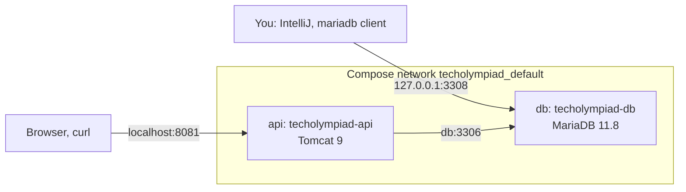
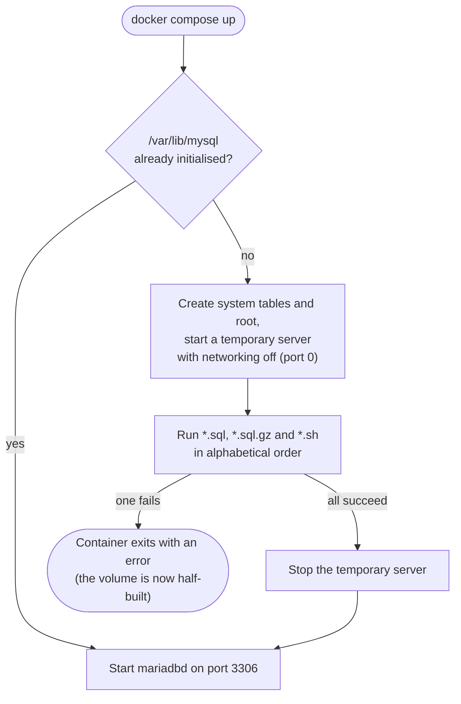

# 7. A MariaDB container

<div class="level-tabs" data-levels>
  <button data-level="overview" aria-pressed="true">Overview</button>
  <button data-level="deep" data-short="Deep">Deep Understanding</button>
  <button data-level="drill">Drilling</button>
</div>

<div class="level overview">

Until now TechOlympiad has answered `Hello world` without touching any
data. Phase 2 puts a database behind it, and this chapter builds that
database: a MariaDB 11.8 container next to the Tomcat container, created
from three SQL files that live in the repository.

The VWO API has no migrations and no code that creates tables. The schema
lives in the MariaDB server, and the API assumes it is there. To work on
the API locally, the VWO setup in `~/Coding/vwo-local-db` starts a
MariaDB container and fills it from SQL dumps the first time it starts.
TechOlympiad does the same thing on a small scale: `01-schema.sql` creates
every table of the [design](design.md), `02-users.sql` creates a read
user and a write user, and `03-seed.sql` loads fictional schools,
teachers and pupils. Wiping the database and rebuilding it from those
files takes one command and about ten seconds.

The schema is complete from this chapter on, including tables no Java
code reads yet. The Java side catches up one entity at a time, starting
with `Scholen` in [chapter 9](build-09-first-entity.md).

**After this chapter you can:**

- add a database service with a healthcheck to a Compose file and make another service wait for it;
- explain when the scripts in `/docker-entrypoint-initdb.d` run, and when they silently do not;
- read and write MariaDB DDL: keys, `enum`, `set`, views and grants;
- rebuild the database from scratch with `docker compose down -v`.

<div class="code-compare" data-code-compare data-labels="VWO: vwo-local-db|TechOlympiad">

```yaml
services:
  mariadb:
    image: mariadb:11.8
    container_name: vwo-local-db
    environment:
      MARIADB_ROOT_PASSWORD: devpass
      TZ: Europe/Brussels
    ports:
      - "127.0.0.1:3307:3306"
    volumes:
      - vwo-data:/var/lib/mysql
      - ./initdb:/docker-entrypoint-initdb.d:ro
      - ./local-data:/local-data:ro
      - ${SCHEMA_DIR:-/home/jeffrey/Documents/VWO/db-schemas/Production}:/schemas:ro
      - ${PROD_EXPORT_DIR:-/home/jeffrey/Documents/VWO/db-schemas/Full Prod export}:/prod-export:ro
      - ${MAILS_DIR:-/home/jeffrey/Documents/mails}:/mails:ro
    healthcheck:
      test: ["CMD", "healthcheck.sh", "--connect", "--innodb_initialized"]
      interval: 5s
      retries: 20

volumes:
  vwo-data:
```

```yaml
services:
  db:
    image: mariadb:11.8
    container_name: techolympiad-db
    environment:
      MARIADB_ROOT_PASSWORD: devpass
      TZ: Europe/Brussels
    ports:
      - "127.0.0.1:3308:3306"
    volumes:
      - to-data:/var/lib/mysql
      - ./db/initdb:/docker-entrypoint-initdb.d:ro
    healthcheck:
      test: ["CMD", "healthcheck.sh", "--connect", "--innodb_initialized"]
      interval: 5s
      retries: 20

  api:
    # ... as in chapter 4, plus:
    depends_on:
      db:
        condition: service_healthy

volumes:
  to-data:
```

</div>

The VWO version mounts extra folders because its init scripts are shell
scripts that load a production export from your disk. Ours are plain SQL
files in the repository, so the database is fully described by what is
committed.

</div>

<div class="level deep">

### Why a container, and why from files

A .NET project with EF Core usually owns its schema: migrations create
the tables, and `dotnet ef database update` brings any database up to
date. The VWO API works the other way around. The database came first,
its schema is managed by hand on the server, and the Java code maps onto
whatever is there. Hibernate can generate tables (`hibernate.hbm2ddl.auto`),
but the VWO configuration never turns that on, and neither will we.

That leaves a question for local development: where does a developer's
database come from? The answer in both projects is a container that
builds itself from SQL files on its first start. Because the files are
the only input, you can throw the database away whenever an experiment
goes wrong and get the same starting point back.

### The MariaDB image

The official `mariadb` image reads a few environment variables the first
time it starts with an empty data folder:

<div class="table-wrap">

| Variable | Effect |
|---|---|
| `MARIADB_ROOT_PASSWORD` | Creates `root@localhost` and `root@'%'` with this password |
| `MARIADB_DATABASE`, `MARIADB_USER`, `MARIADB_PASSWORD` | Optionally create one database and one user with all rights on it (we do not use these: our users need different rights) |
| `TZ` | The container's time zone. MariaDB's `@@time_zone` stays `SYSTEM`, so `NOW()` and `current_timestamp()` follow it |

</div>

`TZ: Europe/Brussels` matters because `Leerling_eerste_ronde.INSCHRIJFDATUM`
defaults to `current_timestamp()`. Without it the container runs in UTC
and every registration time is one or two hours off. Production runs in
Brussels time, so the local database does too.

`MARIADB_ROOT_PASSWORD` is only read while the data folder is empty.
Changing it later in `docker-compose.yml` changes nothing: the password
is stored inside the database, in the volume.

### Ports, hostnames and the Compose network

Compose puts all services of a project on one private network and gives
each service a DNS name equal to its service name. Inside that network
the Tomcat container reaches the database as `db` on port `3306`, which is
why the JDBC URL in [chapter 8](build-08-hibernate-xml.md) will be
`jdbc:mariadb://db:3306/TechOlympiad`.

The `ports` entry `127.0.0.1:3308:3306` is only for you. It publishes the
container's port 3306 on your machine's port 3308, bound to the loopback
address so nobody else on the network can reach it. Port 3307 belongs to
the VWO local database and 3306 is often taken by something else, so
TechOlympiad uses 3308. The API never uses 3308.



### Two kinds of volume

The `db` service mounts two things:

- `to-data:/var/lib/mysql` is a <dfn data-def="Storage managed by Docker itself, independent of any container. It survives docker compose down and is only removed by docker compose down -v or docker volume rm.">named volume</dfn>.
  MariaDB keeps all its data files there, so stopping or recreating the
  container keeps your data. Compose prefixes the name with the project
  name (the folder name), so `docker volume ls` shows it as
  `techolympiad_to-data`.
- `./db/initdb:/docker-entrypoint-initdb.d:ro` is a
  <dfn data-def="A folder from your machine mounted into the container at a path. The container sees your files live; :ro makes it read-only inside the container.">bind mount</dfn>
  of a folder in the repository, read-only.

### The first-start-only init scripts

The image's entrypoint script runs before the real server starts. It
checks whether `/var/lib/mysql` already holds a database. Only when it is
empty does it initialise one, and only then does it run the files in
`/docker-entrypoint-initdb.d`:



Four consequences follow, and each one will bite you once:

1. **The scripts run once per volume.** Editing `03-seed.sql` and running
   `docker compose restart db` does nothing. To apply a change, remove the
   volume with `docker compose down -v` and start again. This is the VWO
   README's "wipe; next `up` rebuilds everything" for exactly this reason.
2. **The order is the file name.** The numeric prefixes are there to make
   alphabetical order the right order: the schema before the users and
   the users before the data.
3. **Each `.sql` file is a separate client session.** The entrypoint pipes
   every file into its own `mariadb` client. A `USE TechOlympiad;` at the
   top of `01-schema.sql` does not carry over to `03-seed.sql`, so every
   file that touches tables starts with its own `USE`.
4. **A failed script leaves a half-built database.** The system tables
   were already created before the scripts ran, so the next start sees an
   initialised folder and skips the scripts. The container then runs
   happily with whatever the failed script left behind. After any init
   error: fix the file, `docker compose down -v`, start again.

<div class="callout rule">
<div class="callout-label">Rule</div>

Treat `db/initdb` as the source of truth and the volume as disposable.
Never fix the local database by hand with an `ALTER TABLE` you do not
also put in `01-schema.sql`: the next `down -v` throws it away, and your
colleague never had it.

</div>

### The healthcheck and `depends_on`

`depends_on: db` on its own only waits for the database container to be
*started*. During the first start that is far too early: the entrypoint
is still running the init scripts on a temporary server that accepts no
network connections. Tomcat would deploy the WAR, Hibernate would try to
connect to `db:3306` and fail.

The image ships a script, `healthcheck.sh`, for exactly this check:

- `--connect` passes when a client can connect over the network. The
  temporary server of the init phase runs with networking off, so this
  test cannot pass until the init scripts are done and the real server
  listens on 3306.
- `--innodb_initialized` passes when the InnoDB storage engine has
  finished starting, which is when tables can actually be read.

The script logs in as a `healthcheck` user that the entrypoint created
for itself during initialisation (you will see it in `mysql.user`).
Docker runs the test every `interval` (5 seconds) and marks the
container `healthy` after the first success, or `unhealthy` after
`retries` (20) failures in a row. `depends_on` with
`condition: service_healthy` makes `docker compose up` hold the `api`
container back until that first success.

<div class="callout note">
<div class="callout-label">What depends_on does not do</div>

The condition is checked when Compose starts the `api` container, so
during `docker compose up`. It does not stop Tomcat if the database goes
away later, and `docker compose restart api` does not wait for anything.
The connection pool of [chapter 8](build-08-hibernate-xml.md) handles a
database that comes and goes at runtime.

</div>

### Reading the schema

`01-schema.sql` follows the [design](design.md) table by table. A few
MariaDB types deserve a closer look, because the entities of later
chapters must match them exactly:

<div class="table-wrap">

| MariaDB type | Range or meaning | Java type it maps to | Where |
|---|---|---|---|
| `tinyint` | -128 to 127 | `Byte` / `byte` | `PROVINCIE`, `LEERJAAR`, `RESULTAAT`, `RONDE`, `VRAAG` |
| `tinyint(1)` | the MariaDB driver reports it as a boolean | `Boolean` | `DIGITALE_DEELNAME` |
| `smallint` | -32768 to 32767 | `Short` / `short` | ids of schools and persons, `JAAR`, `POSTCODE` |
| `mediumint` | about ±8.3 million | `Integer` | pupil ids |
| `int` | about ±2.1 billion | `Integer` | `DEELNEMERSNUMMER` |
| `decimal(4,2)` | exact, two decimals, up to 99.99 | `BigDecimal` | `BEDRAG` |
| `enum('JTO','STO')` | exactly one of the listed strings | a Java `enum`, stored by name | `EDITIE`, `ROL`, `FUNCTIE` |
| `set('A','B','C','D','E')` | zero or more of the listed strings, stored as `'A,C'` | `String` | `ANTWOORD` |
| `char(30)` | always 30 characters, padded | `String` | `ANTWOORDEN`: one letter per question |
| `year(4)` | a year from 1901 to 2155 | `Short`, read with native SQL | `Historiek_*.JAAR` |
| `datetime` | date and time, no time zone | `LocalDateTime` | `INSCHRIJFDATUM` |

</div>

Java has no unsigned integer types. The VWO schema declares most ids
`UNSIGNED` (`SCHOOL_ID smallint(4) UNSIGNED`), which allows school ids up
to 65535, while the entity maps them to a Java `Short` that stops at
32767. It works because no VWO id comes close. TechOlympiad drops
`UNSIGNED` so the column range and the Java range are the same.

The <dfn data-def="Every value of the key columns together identifies one row. A composite key uses several columns, like (JAAR, SCHOOL_ID, EDITIE).">composite keys</dfn>
carry the domain rules. `Wedstrijdinfo_to` is keyed on
`(JAAR, SCHOOL_ID, EDITIE)`, so a school can register once per edition per
year, and the database itself refuses a second registration. `Functies`
is keyed on all three of its columns: a teacher can be the responsable of
several schools and editions, but each combination exists once. In the
VWO this is only a unique index (the table has no primary key); the
[design](design.md) explains why we promote it.

`Functies` is also the only table with foreign keys, as in the VWO. The
VWO has one, from `PERSOON_ID` to `Persoon` with `ON DELETE CASCADE`:
deleting a person deletes their functions. We copy that and add the one
to `Scholen` that the VWO lacks. The pupil tables have no foreign keys at
all, in the VWO or here: moving pupils between round tables and the
history table (chapters 16 and 17) is simpler without them.

`Leerling_tweede_ronde_full` is a
<dfn data-def="A stored SELECT that can be queried like a table. It holds no data of its own; every read runs the query.">view</dfn>
joining a pupil's round 1 row with their round 2 row. Chapter 16 maps it
as a read-only entity. Our view renames the round 2 columns to
`RESULTAAT_TWEEDE_RONDE` and `ANTWOORDEN_TWEEDE_RONDE`, so both rounds'
results can sit in one row.

<div class="callout note">
<div class="callout-label">Views and DEFINER</div>

A view runs with the rights of the user that created it, its `DEFINER`.
Ours are created by `root` during initialisation, and `root` exists in
every TechOlympiad container. Production VWO views name definers such as
staff accounts that do not exist on your machine, which is why
`vwo-local-db/initdb/01-load-vwo.sh` strips every `DEFINER=` clause from
the dump with `sed` before loading it.

</div>

### Two users and least privilege

The VWO API connects to its database with two different accounts: a
read-only one and a read-write one. Chapter 8 builds two Hibernate
session factories on top of them, and chapter 10 makes every read go
through the first and every write through the second. The point is that
the database enforces the split, whatever the Java code does. A read
method that accidentally issues an `UPDATE` fails with an error from
MariaDB instead of silently changing data.

`02-users.sql` creates both accounts:

- `to_read` gets `SELECT` on `TechOlympiad.*`.
- `to_write` gets `SELECT, INSERT, UPDATE, DELETE` on `TechOlympiad.*`:
  everything needed to change rows, nothing to change the schema. It
  cannot `DROP`, `ALTER` or `CREATE` a table.

The host part `'%'` means "from any host". The API connects from the
Tomcat container's address on the Compose network, which changes between
runs, so a fixed host would not work. Because `GRANT` updates the
privilege tables through the server, no `FLUSH PRIVILEGES` is needed.

<div class="callout note">
<div class="callout-label">VWO detail</div>

In the local copy of the VWO API, `environmentAPI.dev.properties` sets
both `database.VWO.readWrite.username` and `database.VWO.readonly.username`
to `root`, so locally the VWO split exists only in the Java code.
TechOlympiad keeps two real users locally too, so you can watch the
database refuse a write.

</div>

### The seed data

`03-seed.sql` loads just enough to exercise every chapter: four schools,
five teachers, who is responsable where, the 2027 registrations, the
registration fee per edition, answer keys and cut-offs for both rounds,
the three contest dates of 2027, nine round 1 pupils without results, and
four pupils of 2026 in the history table. All of it is invented: the
school names, streets and people do not exist, and the e-mail addresses
use the reserved `.example` domain. Never copy rows from a VWO dump into
TechOlympiad.

The school year is 2026-2027, stored as `2027`: the year the school year
ends in, the same convention as the VWO `JAAR` columns.

</div>

<div class="level drill">

### Before you start

You should have the end state of [chapter 6](build-06-build-profiles.md): a WAR
project in `~/Coding/techolympiad` that builds with
`mvn -q -DskipTests -Plocal package`, a `docker-compose.yml` with the
`api` service, and `GET /techolympiad/api/v1/hello` answering
`Hello world` in the Swagger UI.

### Tasks

<ul class="checklist">
<li><label><input type="checkbox"><span>Create the folder for the init scripts: <code>mkdir -p db/initdb</code>.</span></label></li>
<li><label><input type="checkbox"><span>Write <code>db/initdb/01-schema.sql</code>, <code>02-users.sql</code> and <code>03-seed.sql</code> (below).</span></label></li>
<li><label><input type="checkbox"><span>Replace <code>docker-compose.yml</code> with the version below: the new <code>db</code> service, <code>depends_on</code> on <code>api</code>, and the <code>to-data</code> volume.</span></label></li>
<li><label><input type="checkbox"><span>Start only the database: <code>docker compose up -d db</code>. Watch it become healthy with <code>docker compose ps</code>.</span></label></li>
<li><label><input type="checkbox"><span>Read the init log: <code>docker compose logs db | grep -E "Entrypoint|port"</code>. Find the three scripts, and the temporary server on <code>port: 0</code>.</span></label></li>
<li><label><input type="checkbox"><span>Connect as root and run the checks under <em>Run it</em>.</span></label></li>
<li><label><input type="checkbox"><span>Connect as <code>to_read</code> and try to insert a school. Read the error.</span></label></li>
<li><label><input type="checkbox"><span>Connect as <code>to_write</code> and try to drop a table. Read that error too.</span></label></li>
<li><label><input type="checkbox"><span>Prove the scripts run only once: change a school name in <code>03-seed.sql</code>, run <code>docker compose restart db</code>, and see the old name is still there. Then <code>docker compose down -v</code>, <code>docker compose up -d db</code>, and see the new one. Change the name back the same way.</span></label></li>
<li><label><input type="checkbox"><span>Start the whole stack with <code>docker compose up -d</code> and watch Compose wait for the database before it starts Tomcat. <code>GET /api/v1/hello</code> still works.</span></label></li>
<li><label><input type="checkbox"><span>Optional: add a data source in IntelliJ (<em>Database → + → MariaDB</em>, host <code>localhost</code>, port <code>3308</code>, user <code>root</code>, password <code>devpass</code>, database <code>TechOlympiad</code>).</span></label></li>
<li><label><input type="checkbox"><span>Commit: <code>git add -A &amp;&amp; git commit -m "Add the MariaDB container and schema"</code>.</span></label></li>
</ul>

### The schema

`db/initdb/01-schema.sql`:

```sql
CREATE DATABASE TechOlympiad CHARACTER SET utf8mb4 COLLATE utf8mb4_unicode_ci;
USE TechOlympiad;

CREATE TABLE Scholen (
    SCHOOL_ID smallint NOT NULL,
    INSTITUUT varchar(100) DEFAULT NULL,
    STRAAT    varchar(100) DEFAULT NULL,
    POSTCODE  smallint     DEFAULT NULL,
    GEMEENTE  varchar(50)  DEFAULT NULL,
    PROVINCIE tinyint      DEFAULT NULL,
    PRIMARY KEY (SCHOOL_ID)
);

CREATE TABLE Persoon (
    PERSOON_ID smallint NOT NULL AUTO_INCREMENT,
    NAAM       varchar(64)       DEFAULT NULL,
    VOORNAAM   varchar(64)       DEFAULT NULL,
    EMAIL      varchar(100)      DEFAULT NULL,
    GENDER     enum('M','V','X') DEFAULT NULL,
    PRIMARY KEY (PERSOON_ID),
    UNIQUE KEY EMAIL (EMAIL)
);

CREATE TABLE Functies (
    PERSOON_ID smallint          NOT NULL,
    SCHOOL_ID  smallint          NOT NULL,
    FUNCTIE    enum('JTO','STO') NOT NULL,
    PRIMARY KEY (PERSOON_ID, SCHOOL_ID, FUNCTIE),
    KEY SCHOOL_ID (SCHOOL_ID),
    CONSTRAINT Functies_ibfk_1 FOREIGN KEY (PERSOON_ID) REFERENCES Persoon (PERSOON_ID) ON DELETE CASCADE,
    CONSTRAINT Functies_ibfk_2 FOREIGN KEY (SCHOOL_ID) REFERENCES Scholen (SCHOOL_ID)
);

CREATE TABLE Wedstrijdinfo_to (
    JAAR              smallint          NOT NULL,
    SCHOOL_ID         smallint          NOT NULL,
    EDITIE            enum('JTO','STO') NOT NULL,
    DIGITALE_DEELNAME tinyint(1)        NOT NULL DEFAULT 0,
    PRIMARY KEY (JAAR, SCHOOL_ID, EDITIE)
);

CREATE TABLE Inschrijvingsgeld (
    EDITIE enum('JTO','STO') NOT NULL,
    BEDRAG decimal(4,2)      NOT NULL,
    PRIMARY KEY (EDITIE)
);

CREATE TABLE Leerling_eerste_ronde (
    PERSOON_ID       mediumint         NOT NULL AUTO_INCREMENT,
    DEELNEMERSNUMMER int               DEFAULT NULL,
    SCHOOL_ID        smallint          DEFAULT NULL,
    NAAM             varchar(64)       DEFAULT NULL,
    VOORNAAM         varchar(64)       DEFAULT NULL,
    GENDER           enum('M','V','X') DEFAULT NULL,
    LEERJAAR         tinyint           DEFAULT NULL,
    ROL              enum('JTO','STO') DEFAULT NULL,
    RESULTAAT        tinyint           DEFAULT NULL,
    ANTWOORDEN       char(30)          DEFAULT NULL,
    INSCHRIJFDATUM   datetime          NOT NULL DEFAULT current_timestamp(),
    PRIMARY KEY (PERSOON_ID),
    UNIQUE KEY DEELNEMERSNUMMER (DEELNEMERSNUMMER),
    KEY ROL (SCHOOL_ID, ROL)
);

CREATE TABLE Leerling_tweede_ronde (
    PERSOON_ID mediumint NOT NULL,
    RESULTAAT  tinyint   DEFAULT NULL,
    ANTWOORDEN char(30)  DEFAULT NULL,
    PRIMARY KEY (PERSOON_ID)
);

CREATE TABLE Leerling_finale (
    PERSOON_ID mediumint NOT NULL,
    VRAAG1     tinyint   DEFAULT NULL,
    VRAAG2     tinyint   DEFAULT NULL,
    VRAAG3     tinyint   DEFAULT NULL,
    VRAAG4     tinyint   DEFAULT NULL,
    PRIMARY KEY (PERSOON_ID)
);

CREATE VIEW Leerling_tweede_ronde_full AS
SELECT l1.PERSOON_ID,
       l1.DEELNEMERSNUMMER,
       l1.SCHOOL_ID,
       l1.NAAM,
       l1.VOORNAAM,
       l1.GENDER,
       l1.LEERJAAR,
       l1.ROL,
       l1.RESULTAAT,
       l1.ANTWOORDEN,
       l1.INSCHRIJFDATUM,
       l2.RESULTAAT  AS RESULTAAT_TWEEDE_RONDE,
       l2.ANTWOORDEN AS ANTWOORDEN_TWEEDE_RONDE
FROM Leerling_eerste_ronde l1
         JOIN Leerling_tweede_ronde l2 ON l1.PERSOON_ID = l2.PERSOON_ID;

CREATE TABLE Antwoorden (
    JAAR    smallint                  NOT NULL,
    EDITIE  enum('JTO','STO')         NOT NULL,
    RONDE   tinyint                   NOT NULL,
    VRAAG   tinyint                   NOT NULL,
    ANTWOORD set('A','B','C','D','E') NOT NULL,
    PRIMARY KEY (JAAR, EDITIE, RONDE, VRAAG)
);

CREATE TABLE Cesuren (
    JAAR   smallint          NOT NULL,
    EDITIE enum('JTO','STO') NOT NULL,
    RONDE  tinyint           NOT NULL,
    CESUUR tinyint           NOT NULL,
    PRIMARY KEY (JAAR, EDITIE, RONDE)
);

CREATE TABLE Website_to_wedstrijddatums (
    JAAR  smallint          NOT NULL,
    RONDE enum('1','2','F') NOT NULL,
    DATUM date              NOT NULL,
    UUR   time              NOT NULL,
    PRIMARY KEY (JAAR, RONDE)
);

CREATE TABLE Historiek_leerling_eerste_ronde (
    JAAR             year(4)           NOT NULL,
    PERSOON_ID       mediumint         NOT NULL,
    DEELNEMERSNUMMER int               DEFAULT NULL,
    SCHOOL_ID        smallint          DEFAULT NULL,
    NAAM             varchar(64)       DEFAULT NULL,
    VOORNAAM         varchar(64)       DEFAULT NULL,
    GENDER           enum('M','V','X') DEFAULT NULL,
    LEERJAAR         tinyint           DEFAULT NULL,
    ROL              enum('JTO','STO') DEFAULT NULL,
    RESULTAAT        tinyint           DEFAULT NULL,
    ANTWOORDEN       char(30)          DEFAULT NULL,
    INSCHRIJFDATUM   datetime          DEFAULT NULL,
    PRIMARY KEY (JAAR, PERSOON_ID),
    UNIQUE KEY VOLGNUMMER (JAAR, DEELNEMERSNUMMER)
);
```

### The users

`db/initdb/02-users.sql`:

```sql
CREATE USER 'to_read'@'%' IDENTIFIED BY 'readpass';
GRANT SELECT ON TechOlympiad.* TO 'to_read'@'%';

CREATE USER 'to_write'@'%' IDENTIFIED BY 'writepass';
GRANT SELECT, INSERT, UPDATE, DELETE ON TechOlympiad.* TO 'to_write'@'%';
```

### The seed data

`db/initdb/03-seed.sql`:

```sql
USE TechOlympiad;

-- Fictional schools; PROVINCIE: 1 Antwerpen, 2 Limburg, 3 Oost-Vlaanderen, 4 Vlaams-Brabant, 5 West-Vlaanderen
INSERT INTO Scholen (SCHOOL_ID, INSTITUUT, STRAAT, POSTCODE, GEMEENTE, PROVINCIE)
VALUES (1, 'Campus Zonnedauw', 'Proefstraat 12', 3000, 'Leuven', 4),
       (2, 'Atheneum Kruidenhof', 'Testlaan 4', 9000, 'Gent', 3),
       (3, 'Instituut Parelmoer', 'Voorbeeldplein 7', 8000, 'Brugge', 5),
       (4, 'Lyceum Klavervier', 'Oefenweg 21', 3500, 'Hasselt', 2);

INSERT INTO Persoon (PERSOON_ID, NAAM, VOORNAAM, EMAIL, GENDER)
VALUES (1, 'Peeters', 'An', 'an.peeters@school.example', 'V'),
       (2, 'Janssens', 'Bram', 'bram.janssens@school.example', 'M'),
       (3, 'Maes', 'Charlotte', 'charlotte.maes@school.example', 'V'),
       (4, 'Jacobs', 'Dries', 'dries.jacobs@school.example', 'M'),
       (5, 'Willems', 'Eli', 'eli.willems@school.example', 'X');

INSERT INTO Functies (PERSOON_ID, SCHOOL_ID, FUNCTIE)
VALUES (1, 1, 'JTO'),
       (1, 1, 'STO'),
       (2, 2, 'STO'),
       (5, 2, 'JTO'),
       (3, 3, 'JTO'),
       (4, 4, 'JTO'),
       (4, 4, 'STO');

INSERT INTO Wedstrijdinfo_to (JAAR, SCHOOL_ID, EDITIE, DIGITALE_DEELNAME)
VALUES (2027, 1, 'JTO', 0),
       (2027, 1, 'STO', 1),
       (2027, 2, 'JTO', 0),
       (2027, 2, 'STO', 0),
       (2027, 3, 'JTO', 1),
       (2027, 4, 'STO', 0);

INSERT INTO Inschrijvingsgeld (EDITIE, BEDRAG)
VALUES ('JTO', 2.50),
       ('STO', 3.00);

INSERT INTO Antwoorden (JAAR, EDITIE, RONDE, VRAAG, ANTWOORD)
VALUES (2027, 'JTO', 1, 1, 'B'), (2027, 'JTO', 1, 2, 'D'), (2027, 'JTO', 1, 3, 'A'), (2027, 'JTO', 1, 4, 'C'), (2027, 'JTO', 1, 5, 'E'),
       (2027, 'JTO', 1, 6, 'A'), (2027, 'JTO', 1, 7, 'B'), (2027, 'JTO', 1, 8, 'D'), (2027, 'JTO', 1, 9, 'C'), (2027, 'JTO', 1, 10, 'E'),
       (2027, 'JTO', 1, 11, 'C'), (2027, 'JTO', 1, 12, 'E'), (2027, 'JTO', 1, 13, 'A'), (2027, 'JTO', 1, 14, 'B'), (2027, 'JTO', 1, 15, 'D'),
       (2027, 'JTO', 1, 16, 'D'), (2027, 'JTO', 1, 17, 'B'), (2027, 'JTO', 1, 18, 'E'), (2027, 'JTO', 1, 19, 'C'), (2027, 'JTO', 1, 20, 'A'),
       (2027, 'JTO', 1, 21, 'E'), (2027, 'JTO', 1, 22, 'A'), (2027, 'JTO', 1, 23, 'C'), (2027, 'JTO', 1, 24, 'D'), (2027, 'JTO', 1, 25, 'B'),
       (2027, 'JTO', 1, 26, 'A'), (2027, 'JTO', 1, 27, 'C'), (2027, 'JTO', 1, 28, 'B'), (2027, 'JTO', 1, 29, 'E'), (2027, 'JTO', 1, 30, 'D'),
       (2027, 'STO', 1, 1, 'C'), (2027, 'STO', 1, 2, 'A'), (2027, 'STO', 1, 3, 'B'), (2027, 'STO', 1, 4, 'E'), (2027, 'STO', 1, 5, 'D'),
       (2027, 'STO', 1, 6, 'D'), (2027, 'STO', 1, 7, 'C'), (2027, 'STO', 1, 8, 'E'), (2027, 'STO', 1, 9, 'A'), (2027, 'STO', 1, 10, 'B'),
       (2027, 'STO', 1, 11, 'B'), (2027, 'STO', 1, 12, 'E'), (2027, 'STO', 1, 13, 'D'), (2027, 'STO', 1, 14, 'A'), (2027, 'STO', 1, 15, 'C'),
       (2027, 'STO', 1, 16, 'A'), (2027, 'STO', 1, 17, 'C'), (2027, 'STO', 1, 18, 'D'), (2027, 'STO', 1, 19, 'B'), (2027, 'STO', 1, 20, 'E'),
       (2027, 'STO', 1, 21, 'E'), (2027, 'STO', 1, 22, 'D'), (2027, 'STO', 1, 23, 'B'), (2027, 'STO', 1, 24, 'C'), (2027, 'STO', 1, 25, 'A'),
       (2027, 'STO', 1, 26, 'B'), (2027, 'STO', 1, 27, 'A'), (2027, 'STO', 1, 28, 'C'), (2027, 'STO', 1, 29, 'E'), (2027, 'STO', 1, 30, 'D'),
       (2027, 'JTO', 2, 1, 'E'), (2027, 'JTO', 2, 2, 'A'), (2027, 'JTO', 2, 3, 'C'), (2027, 'JTO', 2, 4, 'B'), (2027, 'JTO', 2, 5, 'D'),
       (2027, 'JTO', 2, 6, 'D'), (2027, 'JTO', 2, 7, 'C'), (2027, 'JTO', 2, 8, 'A'), (2027, 'JTO', 2, 9, 'B'), (2027, 'JTO', 2, 10, 'E'),
       (2027, 'JTO', 2, 11, 'B'), (2027, 'JTO', 2, 12, 'D'), (2027, 'JTO', 2, 13, 'E'), (2027, 'JTO', 2, 14, 'A'), (2027, 'JTO', 2, 15, 'C'),
       (2027, 'JTO', 2, 16, 'C'), (2027, 'JTO', 2, 17, 'E'), (2027, 'JTO', 2, 18, 'B'), (2027, 'JTO', 2, 19, 'A'), (2027, 'JTO', 2, 20, 'D'),
       (2027, 'JTO', 2, 21, 'A'), (2027, 'JTO', 2, 22, 'D'), (2027, 'JTO', 2, 23, 'B'), (2027, 'JTO', 2, 24, 'C'), (2027, 'JTO', 2, 25, 'E'),
       (2027, 'JTO', 2, 26, 'E'), (2027, 'JTO', 2, 27, 'B'), (2027, 'JTO', 2, 28, 'D'), (2027, 'JTO', 2, 29, 'A'), (2027, 'JTO', 2, 30, 'C'),
       (2027, 'STO', 2, 1, 'D'), (2027, 'STO', 2, 2, 'E'), (2027, 'STO', 2, 3, 'B'), (2027, 'STO', 2, 4, 'A'), (2027, 'STO', 2, 5, 'C'),
       (2027, 'STO', 2, 6, 'C'), (2027, 'STO', 2, 7, 'A'), (2027, 'STO', 2, 8, 'D'), (2027, 'STO', 2, 9, 'E'), (2027, 'STO', 2, 10, 'B'),
       (2027, 'STO', 2, 11, 'A'), (2027, 'STO', 2, 12, 'E'), (2027, 'STO', 2, 13, 'C'), (2027, 'STO', 2, 14, 'B'), (2027, 'STO', 2, 15, 'D'),
       (2027, 'STO', 2, 16, 'B'), (2027, 'STO', 2, 17, 'D'), (2027, 'STO', 2, 18, 'E'), (2027, 'STO', 2, 19, 'A'), (2027, 'STO', 2, 20, 'C'),
       (2027, 'STO', 2, 21, 'C'), (2027, 'STO', 2, 22, 'B'), (2027, 'STO', 2, 23, 'A'), (2027, 'STO', 2, 24, 'E'), (2027, 'STO', 2, 25, 'D'),
       (2027, 'STO', 2, 26, 'D'), (2027, 'STO', 2, 27, 'C'), (2027, 'STO', 2, 28, 'E'), (2027, 'STO', 2, 29, 'A'), (2027, 'STO', 2, 30, 'B');

INSERT INTO Cesuren (JAAR, EDITIE, RONDE, CESUUR)
VALUES (2027, 'JTO', 1, 18),
       (2027, 'JTO', 2, 20),
       (2027, 'STO', 1, 20),
       (2027, 'STO', 2, 22);

INSERT INTO Website_to_wedstrijddatums (JAAR, RONDE, DATUM, UUR)
VALUES (2027, '1', '2027-01-14', '10:00:00'),
       (2027, '2', '2027-03-03', '14:00:00'),
       (2027, 'F', '2027-04-24', '10:00:00');

INSERT INTO Leerling_eerste_ronde (DEELNEMERSNUMMER, SCHOOL_ID, NAAM, VOORNAAM, GENDER, LEERJAAR, ROL)
VALUES (27000001, 1, 'Claes', 'Lotte', 'V', 1, 'JTO'),
       (27000002, 1, 'Goossens', 'Mats', 'M', 2, 'JTO'),
       (27000003, 1, 'Wouters', 'Nora', 'V', 5, 'STO'),
       (27000004, 1, 'De Smet', 'Oscar', 'M', 6, 'STO'),
       (27000005, 2, 'Hermans', 'Pia', 'V', 2, 'JTO'),
       (27000006, 2, 'Aerts', 'Quinten', 'M', 4, 'STO'),
       (27000007, 3, 'Martens', 'Roos', 'V', 1, 'JTO'),
       (27000008, 3, 'Coppens', 'Sam', 'X', 2, 'JTO'),
       (27000009, 4, 'Mertens', 'Tibo', 'M', 6, 'STO');

INSERT INTO Historiek_leerling_eerste_ronde
    (JAAR, PERSOON_ID, DEELNEMERSNUMMER, SCHOOL_ID, NAAM, VOORNAAM, GENDER, LEERJAAR, ROL, RESULTAAT, ANTWOORDEN, INSCHRIJFDATUM)
VALUES (2026, 1, 26000001, 1, 'Vermeulen', 'Ada', 'V', 2, 'JTO', 21, 'ADBCEABDCACEABDDBEDAEACDBBCBEA', '2025-11-20 09:12:00'),
       (2026, 2, 26000002, 2, 'Lambrechts', 'Ben', 'M', 1, 'JTO', 14, 'BCACDABECECEDBDABECAEBCDEACAED', '2025-11-21 14:30:00'),
       (2026, 3, 26000003, 1, 'Dubois', 'Cato', 'V', 6, 'STO', 25, 'CABEDDCEABBEAACACDBEEDBDABACEB', '2025-11-20 09:15:00'),
       (2026, 4, 26000004, 4, 'Van Damme', 'Daan', 'M', 5, 'STO', 17, 'CABDEDCEBBBEDACDCDBAEDBCABBCED', '2025-11-24 11:02:00');
```

### The Compose file

`docker-compose.yml` (complete):

```yaml
services:
  db:
    image: mariadb:11.8
    container_name: techolympiad-db
    environment:
      MARIADB_ROOT_PASSWORD: devpass
      TZ: Europe/Brussels
    ports:
      - "127.0.0.1:3308:3306"
    volumes:
      - to-data:/var/lib/mysql
      - ./db/initdb:/docker-entrypoint-initdb.d:ro
    healthcheck:
      test: ["CMD", "healthcheck.sh", "--connect", "--innodb_initialized"]
      interval: 5s
      retries: 20

  api:
    image: tomcat:9-jdk17
    container_name: techolympiad-api
    environment:
      TZ: Europe/Brussels
    ports:
      - "8081:8080"
    volumes:
      - ./target/techolympiadAPI.war:/usr/local/tomcat/webapps/techolympiad.war:ro
    depends_on:
      db:
        condition: service_healthy

volumes:
  to-data:
```

### Run it

Start the database and wait for `(healthy)`:

```bash
docker compose up -d db
docker compose ps
```

```text
NAME              IMAGE          ...   STATUS                    PORTS
techolympiad-db   mariadb:11.8   ...   Up 12 seconds (healthy)   127.0.0.1:3308->3306/tcp
```

During the first few seconds the status reads `(health: starting)`. The
init log shows the scripts in order:

```text
[Note] [Entrypoint]: /usr/local/bin/docker-entrypoint.sh: running /docker-entrypoint-initdb.d/01-schema.sql
[Note] [Entrypoint]: /usr/local/bin/docker-entrypoint.sh: running /docker-entrypoint-initdb.d/02-users.sql
[Note] [Entrypoint]: /usr/local/bin/docker-entrypoint.sh: running /docker-entrypoint-initdb.d/03-seed.sql
[Note] [Entrypoint]: MariaDB init process done. Ready for start up.
```

Connect as root:

```bash
docker exec -it techolympiad-db mariadb -uroot -pdevpass TechOlympiad
```

```sql
SHOW FULL TABLES;
SELECT * FROM Scholen;
SELECT EDITIE, RONDE, GROUP_CONCAT(ANTWOORD ORDER BY VRAAG SEPARATOR '') AS sleutel
FROM Antwoorden GROUP BY EDITIE, RONDE;
SELECT user, host FROM mysql.user;
SHOW GRANTS FOR 'to_read'@'%';
```

`SHOW FULL TABLES` lists twelve `BASE TABLE`s and one `VIEW`.
`Scholen` holds the four schools. The answer keys come back as four
30-letter strings, one per edition and round. `mysql.user` shows `root`
twice, the two TechOlympiad users, and three `healthcheck` rows, the user
the healthcheck script logs in with.

Now log in as the read user. The fill-in below lets you try both users
with the same command:

<div class="fill-in" data-fill-in>

```bash
docker exec -it techolympiad-db mariadb -u{{USER:to_read}} -p{{PASSWORD:readpass}} TechOlympiad
```

</div>

```sql
SELECT CURRENT_USER(), COUNT(*) FROM Scholen;
INSERT INTO Scholen (SCHOOL_ID, INSTITUUT) VALUES (9, 'Test');
```

```text
ERROR 1142 (42000): INSERT command denied to user 'to_read'@'localhost' for table `TechOlympiad`.`Scholen`
```

As `to_write` / `writepass` the same `INSERT` works (delete the row again
with `DELETE FROM Scholen WHERE SCHOOL_ID = 9;`), while
`DROP TABLE Cesuren;` fails with `DROP command denied to user 'to_write'`.

Finally, the full stack:

```bash
docker compose up -d
```

```text
 ✔ Container techolympiad-db   Healthy
 ✔ Container techolympiad-api  Started
```

On a fresh volume you see `Waiting` next to the database for a few
seconds before it turns `Healthy`; only then does Compose start the
Tomcat container.

<div class="callout danger">
<div class="callout-label">When it breaks</div>

- **`Bind for 127.0.0.1:3308 failed: port is already allocated`**: something else uses 3308. Find it with `docker ps` or `ss -ltnp | grep 3308`. Do not move TechOlympiad to 3307: that is the VWO local database.
- **Your SQL change does not show up**: the volume already existed, so the scripts did not run. `docker compose down -v`, then `up` again.
- **The container exits right after starting** (`docker compose ps -a` shows `Exited (1)`): an init script failed. `docker compose logs db` ends with the failing statement and the MariaDB error. Fix the file, then `docker compose down -v` before the next `up`, or the half-built volume stays.
- **`ERROR 1046 (3D000): No database selected`** in the init log: a script without `USE TechOlympiad;` at the top.
- **`Access denied for user 'root'@'localhost'`** after changing `MARIADB_ROOT_PASSWORD`: the password lives in the volume and was set on the first start. Use the old one, or `down -v`.
- **`dependency failed to start: container techolympiad-db is unhealthy`**: the database did not become healthy within 20 checks. Read `docker compose logs db`; on a slow machine, raise `retries`.

</div>

### Quiz

<div class="quiz" data-quiz>
<p class="quiz-q">You add a fifth school to <code>03-seed.sql</code> and run <code>docker compose restart db</code>. What does <code>SELECT COUNT(*) FROM Scholen</code> return?</p>
<ol class="quiz-options">
<li>5: the entrypoint runs the init scripts on every start<p class="quiz-whynot">It runs them only when <code>/var/lib/mysql</code> is empty, and the volume still holds the old database.</p></li>
<li data-correct>4: the scripts only ran on the first start of this volume<p class="quiz-why">A restart keeps the volume, and an initialised volume makes the entrypoint skip <code>/docker-entrypoint-initdb.d</code>.</p></li>
<li>An error, because the seed would insert duplicate schools<p class="quiz-whynot">The seed never runs again, so it cannot collide with anything.</p></li>
</ol>
<p class="quiz-explain"><code>docker compose down -v</code> removes the named volume <code>techolympiad_to-data</code>. The next <code>up</code> finds an empty data folder and runs all three scripts again.</p>
</div>

<div class="quiz" data-quiz>
<p class="quiz-q">Which address does the API in the Tomcat container use to reach MariaDB?</p>
<ol class="quiz-options">
<li><code>localhost:3308</code><p class="quiz-whynot">Inside the Tomcat container, <code>localhost</code> is the Tomcat container itself. 3308 is the port published on your machine.</p></li>
<li><code>techolympiad-db:3308</code><p class="quiz-whynot">The container listens on 3306; the 3308 mapping exists only on the host's loopback address.</p></li>
<li data-correct><code>db:3306</code><p class="quiz-why">Compose's network resolves the service name <code>db</code>, and inside the network the server listens on its own port, 3306.</p></li>
</ol>
<p class="quiz-explain">The <code>ports</code> entry is a door from your machine into the network. Containers on the same network talk to each other directly, by service name and container port.</p>
</div>

<div class="quiz" data-quiz>
<p class="quiz-q">Why does the <code>api</code> service wait for <code>service_healthy</code> instead of plain <code>depends_on: [db]</code>?</p>
<ol class="quiz-options">
<li>Plain <code>depends_on</code> does not guarantee start order<p class="quiz-whynot">It does: the database container is started first. Started is just not the same as ready.</p></li>
<li data-correct>On a first start the init scripts run on a temporary server that accepts no network connections, and a started container is not yet a usable database<p class="quiz-why">The healthcheck's <code>--connect</code> test only passes once the real server listens on 3306, which is after the scripts.</p></li>
<li>Tomcat refuses to start when the database is down<p class="quiz-whynot">Tomcat knows nothing about the database. The deployment of the WAR fails later, when Hibernate cannot connect.</p></li>
</ol>
<p class="quiz-explain">Health conditions turn "the process is running" into "the service answers". The same idea returns in chapter 22 for the deployed image.</p>
</div>

### Flashcards

<div class="flashcards" data-flashcards data-front-label="Term" data-back-label="Meaning">
<div class="card"><div class="front"><code>/docker-entrypoint-initdb.d</code></div><div class="back">Folder whose <code>.sql</code>, <code>.sql.gz</code> and <code>.sh</code> files the MariaDB entrypoint runs in alphabetical order, only when the data folder is empty.</div></div>
<div class="card"><div class="front"><code>docker compose down -v</code></div><div class="back">Stops and removes the containers and the project's named volumes. The way to make the init scripts run again.</div></div>
<div class="card"><div class="front">Named volume</div><div class="back">Docker-managed storage that outlives containers. <code>to-data</code> appears as <code>techolympiad_to-data</code>.</div></div>
<div class="card"><div class="front"><code>healthcheck.sh --connect --innodb_initialized</code></div><div class="back">Passes once a client can connect over the network and InnoDB has started, so after the init scripts.</div></div>
<div class="card"><div class="front"><code>condition: service_healthy</code></div><div class="back">Makes <code>docker compose up</code> start a service only after the one it depends on reports healthy.</div></div>
<div class="card"><div class="front"><code>'to_read'@'%'</code></div><div class="back">A MariaDB account: user name plus the host it may connect from. <code>%</code> means any host.</div></div>
<div class="card"><div class="front"><code>set('A','B',...)</code></div><div class="back">A MariaDB column holding zero or more of the listed values, stored as a comma-separated string such as <code>'A,C'</code>.</div></div>
</div>

### Self-checks

<details class="qa">
<summary>Self-check: an init script failed, you fixed it, and ran <code>docker compose up -d db</code> again. The container now runs, but a table is missing. Why?</summary>
<div class="ans">
The failed first start had already created the system tables in the volume. On the second start the entrypoint saw an initialised data folder and skipped every init script, so whatever the failing script did not create is still missing. Run <code>docker compose down -v</code> and start again.
<div class="mark"><button type="button">Mark as known</button></div>
</div>
</details>

<details class="qa">
<summary>Self-check: why does every SQL file start with <code>USE TechOlympiad;</code> when <code>01-schema.sql</code> already selects the database?</summary>
<div class="ans">
The entrypoint runs each file in its own client session. The database selected in one session does not carry over to the next, so <code>03-seed.sql</code> would fail with "No database selected" without its own <code>USE</code>.
<div class="mark"><button type="button">Mark as known</button></div>
</div>
</details>

<details class="qa">
<summary>Self-check: what stops a bug in a read method from changing data, once chapter 10 is done?</summary>
<div class="ans">
The database account. Read methods use a session factory that logs in as <code>to_read</code>, which only has <code>SELECT</code>. Whatever SQL the Java code sends, MariaDB refuses an <code>INSERT</code>, <code>UPDATE</code> or <code>DELETE</code> from that user.
<div class="mark"><button type="button">Mark as known</button></div>
</div>
</details>

<button type="button" data-mark-done>Mark this chapter done</button>

</div>
