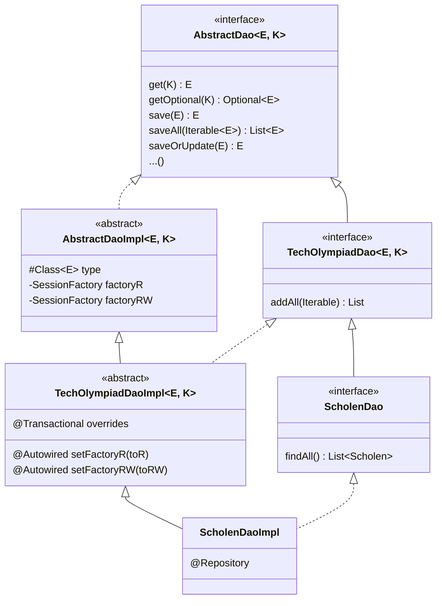
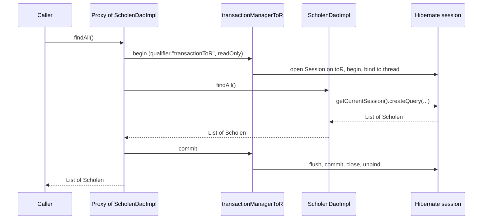

# 10. The DAO layer

<div class="level-tabs" data-levels>
  <button data-level="overview" aria-pressed="true">Overview</button>
  <button data-level="deep" data-short="Deep">Deep Understanding</button>
  <button data-level="drill">Drilling</button>
</div>

<div class="level overview">

This chapter writes the first query. Around it comes the layer every VWO
database call goes through: the
<dfn data-def="Data Access Object: a class whose only job is to run queries and writes for one entity, hiding the persistence API from the rest of the code.">DAO</dfn>s.
The VWO builds them in three steps, and we copy all three:

1. `AbstractDao` / `AbstractDaoImpl`: generic create, read, update and delete for any entity `E` with key `K`, working on two session factories it does not know by name.
2. `TechOlympiadDao` / `TechOlympiadDaoImpl` (VWO: `VwoDao` / `VwoDaoImpl`): binds those factories to this database, `toR` and `toRW`, and puts a `@Transactional` with the right transaction manager on every method.
3. `ScholenDao` / `ScholenDaoImpl`: the entity-specific queries, here `findAll` in HQL.

After this chapter, `scholenDao.findAll()` returns the four seeded
schools, and `scholenDao.getOptional((short) 1)` the first one, both
through the read-only login. No endpoint exposes them yet. A temporary
change to the Hello controller proves they work.

**After this chapter you can:**

- read generic Java classes with bounded type parameters (constraints like C#'s `where T : ...`), and explain why the type `E` has to be recovered with `GenericTypeResolver`;
- explain how `@Transactional` works through a <dfn data-def="A generated object that stands in for the real bean, has the same methods, and runs extra code (here: begin and commit a transaction) around each call.">proxy</dfn>, and recognise the self-invocation trap from its error message;
- say why DAOs call `getCurrentSession()` and never `openSession()`;
- write an HQL query and predict the SQL Hibernate sends.

<div class="code-compare" data-code-compare data-labels="VWO: ScholenDaoImpl.java|TechOlympiad">

```java
@Repository
public class ScholenDaoImpl extends VwoDaoImpl<Scholen, Short> implements ScholenDao {

    @Override
    @Transactional(value = transactionR, readOnly = true)
    public List<Scholen> findAll() {
        Session session = getFactoryR().getCurrentSession();
        String hql = "SELECT s FROM Scholen s";
        Query<Scholen> query = session.createQuery(hql, type);
        return query.getResultList();
    }

    // getByVwoResponsible, getByKangoeroeResponsible, schoolsPerZipcode
}
```

```java
@Repository
public class ScholenDaoImpl extends TechOlympiadDaoImpl<Scholen, Short> implements ScholenDao {

    @Override
    @Transactional(value = transactionR, readOnly = true)
    public List<Scholen> findAll() {
        Session session = getFactoryR().getCurrentSession();
        String hql = "SELECT s FROM Scholen s";
        Query<Scholen> query = session.createQuery(hql, type);
        return query.getResultList();
    }

}
```

</div>

</div>

<div class="level deep">

### Three layers of DAO



Each layer adds one kind of knowledge:

- `AbstractDaoImpl` knows Hibernate: how to `get`, `save` or `delete`
  an entity, and that reads go to one factory and writes to another. It
  does not know which factories, or which transaction managers.
- `TechOlympiadDaoImpl` knows this database: the factories are the beans
  `toR` and `toRW`, the managers are `transactionToR` and
  `transactionToRW`. The VWO's design leaves room for a second database
  with its own `...DaoImpl` at this level, but the API never got one.
- `ScholenDaoImpl` knows one entity and its queries.

The interfaces mirror the classes, so the rest of the code depends on
`ScholenDao` and never on an implementation. In EF Core terms, the whole
stack plays the role of a `DbSet<Scholen>` plus a small repository class
around it.

### Generics and their bounds

`AbstractDao<E extends Serializable, K extends Serializable>` declares two
type parameters, like `IRepository<TEntity, TKey>` in C#. `extends
Serializable` is a <dfn data-def="A constraint on a type parameter: only types that are, or extend, the bound are accepted. The Java counterpart of C#'s where T : ...">bound</dfn>,
the counterpart of `where TEntity : ISerializable`. It is there because
Hibernate 5's `session.get(Class<T>, Serializable id)` takes a
`Serializable` id, and the VWO extends the same rule to entities.

`TechOlympiadDao.addAll(Iterable<? extends E> entities)` uses a
<dfn data-def="? extends E: an unknown type that is E or a subtype of it. It makes a generic parameter accept, for example, an Iterable of a subclass. Like C#'s covariant IEnumerable&lt;out T&gt;.">wildcard</dfn>.
Java generics are invariant: a `List<LeerlingEersteRonde>` is not a
`List<ToParticipant>`, even though the element types are related.
`? extends E` removes that restriction for reading. C# gets the same
effect from the `out` in `IEnumerable<out T>`. Chapter 14 relies on it to add a list of pupils
through a DAO typed on their superclass.

### Type erasure, and why GenericTypeResolver

`AbstractDaoImpl` needs the entity class at runtime: `session.get(type, key)`
must know it is loading a `Scholen`. In C# that is `typeof(TEntity)`.
Java has nothing like it, because of
<dfn data-def="The Java compiler checks generic types and then removes them: at runtime a List&lt;Scholen&gt; is a plain List and E has no value. .NET generics, in contrast, are reified and keep their type arguments at runtime.">type erasure</dfn>:
the compiler checks `E` and then erases it, so inside the class there
is no `E` to ask. `E.class` does not compile.

One place keeps the information: a class declaration. When
`ScholenDaoImpl` is declared as `extends TechOlympiadDaoImpl<Scholen, Short>`,
the class file records that superclass with its type arguments. Spring's
`GenericTypeResolver` reads it:

<div class="code-walk" data-code-walk>

```java
protected AbstractDaoImpl() {
    @SuppressWarnings("unchecked")                                                   // (1)
    Class<E> typeCasted = (Class<E>) Objects.requireNonNull(                         // (2)
            GenericTypeResolver.resolveTypeArguments(getClass(), AbstractDaoImpl.class) // (3)
    )[0];                                                                            // (4)
    this.type = typeCasted;
}
```

1. The cast to `Class<E>` cannot be checked by the compiler, precisely because `E` is erased. The annotation silences that warning for this one declaration.
2. `resolveTypeArguments` returns `null` when it cannot resolve anything. `requireNonNull` turns that into an immediate `NullPointerException` instead of a confusing one later.
3. `getClass()` runs in the constructor of the abstract class, but it returns the class actually being built: `ScholenDaoImpl`. Spring walks from there up to `AbstractDaoImpl` and collects what each step filled in for `E` and `K`.
4. Index 0 is `E` (`Scholen.class`), index 1 would be `K` (`Short.class`).

</div>

This only works when a concrete class fixes the type arguments in its
declaration. An anonymous subclass, such as
`new TechOlympiadDaoImpl<Scholen, Short>() {}`, would work too. A plain
generic instance could never learn its `E`.

### Injecting two factories by name

There are two beans of type `SessionFactory`. `TechOlympiadDaoImpl`
picks the right one for each setter without a qualifier:

```java
@Override
@Autowired
public void setFactoryRW(SessionFactory toRW) {
    super.setFactoryRW(toRW);
}
```

`@Autowired` asks Spring to inject a bean at that spot (a constructor,
a setter or a field), much like a constructor parameter that .NET's
container fills. When `@Autowired` finds several candidates of the right type, Spring
falls back to matching the *parameter name* against the bean names. The
parameter is called `toRW` and there is a bean called `toRW`, so that
bean wins. Rename the parameter to `factory` and the deployment fails with
`NoUniqueBeanDefinitionException: ... expected single matching bean but
found 2: toRW,toR`.

Parameter names are not normally part of a class file. Spring 5.3 finds
them in two places: in the `MethodParameters` attribute that `javac
-parameters` writes, and failing that, in the debug information
(`LocalVariableTable`) that `javac -g` writes. Neither the VWO's pom nor
ours passes `-parameters`, but the Maven compiler plugin compiles with
`-g` by default, so the second route works. You can see the table with
`javap -l`.

<div class="callout note">
<div class="callout-label">For a future upgrade</div>

Spring 6.1 removed the debug-information route. On a newer Spring, this
code needs `-parameters` in the compiler arguments or an explicit
`@Qualifier("toRW")` on the parameter. The same applies to every
`@PathVariable` and `@RequestParam` (the annotations that bind a URL path
segment or a query parameter to a method parameter) without an explicit
name.

</div>

`AbstractDaoImpl` declares the setters `protected` and the fields
`private`. `TechOlympiadDaoImpl` overrides the setters as `public`, which
Java allows (an override may widen access, never narrow it), and puts
`@Autowired` on them. The VWO's comment above the fields, "Declare fields
as protected so they can be used in subclasses", describes an earlier
version: the fields are private, and subclasses use the getters that
Lombok's `@Getter` on the class generates.

### getCurrentSession, never openSession

Every method of `AbstractDaoImpl` starts with
`getFactoryR().getCurrentSession()` or `getFactoryRW().getCurrentSession()`.
"Current" means: the session of the transaction running on this thread
right now. [Chapter 8](build-08-hibernate-xml.md) showed both halves of
that: `JpaTransactionManager` binds a session to the thread when a
transaction begins, and `LocalSessionFactoryBean` configured
`SpringSessionContext`, which looks it up. So the DAO method never
opens, commits or closes anything. The transaction around it does that.

When no transaction is running, there is nothing to look up, and
`getCurrentSession()` throws:

```text
org.hibernate.HibernateException: Could not obtain transaction-synchronized Session for current thread
```

Remember that message: it almost always means a `@Transactional` did
not apply, and the next two sections explain why that happens.

`openSession()` creates a new session that you own, outside any
transaction Spring manages. The VWO still has code from before the DAO
layer that works like that, in `dao/WachtwoordenDao.java`:

```java
static String setNewPassword(short personId) {
    try (Session session = VWOQueryFactory.getSessionFactory().openSession()) {
        session.beginTransaction();
        // ... query and change the password ...
        session.getTransaction().commit();
        return newPassword;
    }
}
```

That code manages everything itself, uses the separate
`VWOQueryFactory` pool from chapter 8, and has no explicit rollback when
something fails halfway. TechOlympiad never calls `openSession()`.

### @Transactional and its proxy

`@Transactional` is an annotation, and annotations do nothing on their
own. At startup, the `tx:annotation-driven` of chapter 8 makes Spring
check every bean for `@Transactional` methods. For each such bean it
registers a
<dfn data-def="An object that stands in for the real bean, has the same methods, and runs extra code (here: begin and commit a transaction) around each call before delegating to the real object.">proxy</dfn>
in place of the bean itself. Whoever gets `ScholenDao` injected gets the
proxy. Spring Boot creates these proxies as generated subclasses, with
CGLIB, a library that generates classes at run time. `getClass()` on an
injected DAO prints something like
`ScholenDaoImpl$$EnhancerBySpringCGLIB$$...`.



This explains why `TechOlympiadDaoImpl` overrides every method of
`AbstractDaoImpl` only to call `super` with an annotation on top. The
annotation must name a transaction manager, and only the layer that
knows this database knows the names. The overrides are where the
binding happens.

The annotation values are constants:

```java
protected static final String transactionRW = "transactionToRW";
protected static final String transactionR = "transactionToR";
```

Annotation values must be compile-time constants, and a
`static final String` initialised with a literal is one. That lets every
DAO write `@Transactional(value = transactionR, readOnly = true)` without
repeating the string. The lowercase names break Java's convention for
constants (`TRANSACTION_R`). We keep them because they are the VWO's.

### The self-invocation trap

The proxy only sees calls that come through it. A call from inside the
bean to one of its own methods, `this.findAll()`, goes straight to the
real object and skips the proxy:

```java
public int countAll() {          // no @Transactional
    return findAll().size();     // this.findAll(): the proxy never sees it
}
```

Step by step:

1. `countAll()` arrives through the proxy, but it has no annotation, so no transaction starts.
2. `countAll()` calls `findAll()` on `this`. The proxy does not see that call, so it never evaluates the annotation on `findAll()`.
3. `getCurrentSession()` finds no session and throws the `Could not obtain transaction-synchronized Session` error.

Putting `@Transactional` on `countAll` itself fixes it: the transaction then
starts at the outer call, and the inner `findAll()` finds its session.
The same trap catches a `private` or `final` method, which a subclass
proxy cannot override. The drill below reproduces it.

<div class="callout rule">
<div class="callout-label">Rule</div>

Put `@Transactional` on the method that is called from outside the
bean. A transaction annotation on a method that is only ever called
from within its own class is decoration.

</div>

### HQL and the SQL it becomes

`findAll` runs `SELECT s FROM Scholen s`. That is
<dfn data-def="Hibernate Query Language: SQL-like, but written against entity and attribute names instead of tables and columns. JPA standardised a subset of it as JPQL.">HQL</dfn>,
not SQL. `Scholen` is the entity name and `s` an alias for an entity
instance. The query would stay the same if the table had another name.
Attributes are Java field names: `s.instituut`, never `s.INSTITUUT`. Of
everything in .NET, LINQ to Entities is closest: you query the model
and EF writes the SQL. HQL is that idea in string form, so mistakes show
at runtime, not at compile time.

`session.createQuery(hql, type)` returns a typed `Query<Scholen>`, and
`getResultList()` runs it. With `hibernate.show_sql` switched on (the
drill does it for a moment), the log shows what Hibernate sends:

```text
Hibernate: select scholen0_.SCHOOL_ID as school_i1_0_, scholen0_.GEMEENTE as gemeente2_0_, scholen0_.INSTITUUT as instituu3_0_, scholen0_.POSTCODE as postcode4_0_, scholen0_.PROVINCIE as provinci5_0_, scholen0_.STRAAT as straat6_0_ from Scholen scholen0_
```

Three things to notice: the id first and the other columns sorted by
attribute name, generated aliases, and `from Scholen` without the
`TechOlympiad.` prefix that `@Table(schema = ...)` might suggest.
`getOptional` does not use HQL at all: `session.get(Scholen.class, id)`
generates a `where scholen0_.SCHOOL_ID=?` query, or returns the instance
straight from the session if it is already loaded there.

Chapter 17 adds native SQL (`session.createNativeQuery`) for the history
table, which has no entity. The VWO's `application.properties` contains
`spring.jpa.show-sql=true`. That setting has no effect: it belongs to
Spring Boot's JPA auto-configuration, which is off in both projects
(chapter 8).

### readOnly, once more

Every read method carries `readOnly = true` and uses `transactionR`. As
chapter 8 showed, with `JpaTransactionManager` over a plain
`SessionFactory` the flag is recorded but not enforced. It still earns
its place: it documents intent, other code can test it, and a later
switch to `HibernateTransactionManager` would make it act. The read-only
guarantee itself comes from `to_read`.

### What @Repository adds

`@Repository` is a `@Component`, so component scanning registers
`ScholenDaoImpl` as the bean `scholenDaoImpl`. It also marks the class
for Spring's persistence exception translation, which Spring Boot
switches on: exceptions thrown by the DAO are converted to Spring's
`DataAccessException` hierarchy. The base classes carry no annotation:
abstract classes are never instantiated, so they are never beans.

The VWO also puts `@NoRepositoryBean` on its DAO interfaces, such as
`ScholenDao`. That annotation only has a meaning for interfaces that
extend Spring Data's `Repository`, which the DAO interfaces do not, so
we leave it off here. Chapter 11 uses it where it does something.

</div>

<div class="level drill">

### Before you start

You should have the end state of [chapter 9](build-09-first-entity.md):
the `Scholen` entity, mapped in `hibernate_TO.cfg.xml`, and an
application that deploys with two session factories.

### Tasks

<ul class="checklist">
<li><label><input type="checkbox"><span>Add <code>commons-collections4</code> to <code>pom.xml</code> (for <code>IterableUtils</code>).</span></label></li>
<li><label><input type="checkbox"><span>Create the packages <code>be.techolympiad.common.dao</code> and <code>be.techolympiad.common.dao.impl</code>.</span></label></li>
<li><label><input type="checkbox"><span>Write the interfaces <code>AbstractDao</code>, <code>TechOlympiadDao</code> and <code>ScholenDao</code>.</span></label></li>
<li><label><input type="checkbox"><span>Write <code>AbstractDaoImpl</code>, <code>TechOlympiadDaoImpl</code> and <code>ScholenDaoImpl</code>. Open the VWO's <code>AbstractDaoImpl.java</code> and <code>VwoDaoImpl.java</code> next to yours and compare line by line.</span></label></li>
<li><label><input type="checkbox"><span>Build and restart. The deployment must still finish.</span></label></li>
<li><label><input type="checkbox"><span>Prove the DAO works: temporarily change <code>HelloController</code> (below) and call <code>GET /api/v1/hello</code>.</span></label></li>
<li><label><input type="checkbox"><span>Temporarily add <code>&lt;property name="hibernate.show_sql"&gt;true&lt;/property&gt;</code> to <code>hibernate_TO.cfg.xml</code>, rebuild, call the endpoint, and read the SQL in the log.</span></label></li>
<li><label><input type="checkbox"><span>Reproduce the self-invocation trap with <code>countAll()</code> (below), then fix it with <code>@Transactional</code>.</span></label></li>
<li><label><input type="checkbox"><span>Undo the experiments: <code>git checkout -- src/main/java/be/techolympiad/common/restAPI/controllers/v1/HelloController.java src/main/resources/hibernate_TO.cfg.xml</code>, and remove <code>countAll</code> from <code>ScholenDao</code> and <code>ScholenDaoImpl</code> by hand. <code>git status</code> should list only the new DAO files and <code>pom.xml</code>.</span></label></li>
<li><label><input type="checkbox"><span>Build, restart, check that <code>/api/v1/hello</code> answers <code>Hello world</code> again.</span></label></li>
<li><label><input type="checkbox"><span>Commit: <code>git add -A &amp;&amp; git commit -m "Add the DAO layer"</code>.</span></label></li>
</ul>

### The dependency

`pom.xml`, at the end of `<dependencies>`:

<div class="diff-view" data-diff-view>

```diff
         <dependency>
             <groupId>org.mariadb.jdbc</groupId>
             <artifactId>mariadb-java-client</artifactId>
             <version>3.5.3</version>
         </dependency>
+        <dependency>
+            <groupId>org.apache.commons</groupId>
+            <artifactId>commons-collections4</artifactId>
+            <version>4.4</version>
+        </dependency>
     </dependencies>
```

</div>

### The interfaces

`src/main/java/be/techolympiad/common/dao/AbstractDao.java`:

```java
package be.techolympiad.common.dao;

import java.io.Serializable;
import java.util.List;
import java.util.Optional;

public interface AbstractDao<E extends Serializable, K extends Serializable> {

    E get(K key);

    Optional<E> getOptional(K key);

    E load(K key);

    E merge(E entity);

    E persist(E entity);

    E save(E entity);

    List<E> saveAll(Iterable<E> entities);

    E update(E entity);

    E saveOrUpdate(E entity);

    void delete(E entity);

    void deleteById(K key);

}
```

`src/main/java/be/techolympiad/common/dao/TechOlympiadDao.java`:

```java
package be.techolympiad.common.dao;

import java.io.Serializable;
import java.util.List;

public interface TechOlympiadDao<E extends Serializable, K extends Serializable> extends AbstractDao<E, K> {

    List<? extends E> addAll(Iterable<? extends E> entities);

}
```

`src/main/java/be/techolympiad/common/dao/ScholenDao.java`:

```java
package be.techolympiad.common.dao;

import be.techolympiad.common.dbEntities.Scholen;

import java.util.List;

public interface ScholenDao extends TechOlympiadDao<Scholen, Short> {

    List<Scholen> findAll();

}
```

The VWO's `VwoDao.addAll` and several private methods of its
`AbstractDaoImpl` carry `@NotNull` from `javax.validation`. On a DAO
those annotations are never checked: method validation needs a
`@Validated` class, which DAOs are not. We leave them out.

### The base implementation

`src/main/java/be/techolympiad/common/dao/impl/AbstractDaoImpl.java`:

```java
package be.techolympiad.common.dao.impl;

import be.techolympiad.common.dao.AbstractDao;
import lombok.Getter;
import org.apache.commons.collections4.IterableUtils;
import org.hibernate.Session;
import org.hibernate.SessionFactory;
import org.springframework.core.GenericTypeResolver;

import java.io.Serializable;
import java.util.List;
import java.util.Objects;
import java.util.Optional;

@Getter
public abstract class AbstractDaoImpl<E extends Serializable, K extends Serializable> implements AbstractDao<E, K> {

    protected final Class<E> type;
    private SessionFactory factoryRW;
    private SessionFactory factoryR;

    protected AbstractDaoImpl() {
        @SuppressWarnings("unchecked")
        Class<E> typeCasted = (Class<E>) Objects.requireNonNull(
                GenericTypeResolver.resolveTypeArguments(getClass(), AbstractDaoImpl.class)
        )[0];
        this.type = typeCasted;
    }

    protected void setFactoryRW(SessionFactory factoryRW) {
        this.factoryRW = factoryRW;
    }

    protected void setFactoryR(SessionFactory factoryR) {
        this.factoryR = factoryR;
    }

    private E getById(K key, Session session) {
        return session.get(type, key);
    }

    private Optional<E> getOptionalById(K key, Session session) {
        return Optional.ofNullable(this.getById(key, session));
    }

    @Override
    public E get(K key) {
        Session session = getFactoryR().getCurrentSession();
        return this.getById(key, session);
    }

    @Override
    public Optional<E> getOptional(K key) {
        Session session = getFactoryR().getCurrentSession();
        return this.getOptionalById(key, session);
    }

    @Override
    public E load(K key) {
        Session session = getFactoryR().getCurrentSession();
        return session.load(type, key);
    }

    @Override
    public E merge(E entity) {
        Session session = getFactoryRW().getCurrentSession();
        session.merge(entity);
        return entity;
    }

    @Override
    public E persist(E entity) {
        Session session = getFactoryRW().getCurrentSession();
        session.persist(entity);
        return entity;
    }

    @Override
    public E save(E entity) {
        Session session = getFactoryRW().getCurrentSession();
        session.save(entity);
        return entity;
    }

    @Override
    public List<E> saveAll(Iterable<E> entities) {
        Session session = getFactoryRW().getCurrentSession();
        entities.forEach(session::save);
        return IterableUtils.toList(entities);
    }

    @Override
    public E update(E entity) {
        Session session = getFactoryRW().getCurrentSession();
        session.update(entity);
        return entity;
    }

    @Override
    public E saveOrUpdate(E entity) {
        Session session = getFactoryRW().getCurrentSession();
        session.saveOrUpdate(entity);
        return entity;
    }

    @Override
    public void delete(E entity) {
        Session session = getFactoryRW().getCurrentSession();
        session.delete(entity);
    }

    @Override
    public void deleteById(K key) {
        Session session = getFactoryRW().getCurrentSession();
        Optional<E> result = this.getOptionalById(key, session);
        result.ifPresent(session::delete);
    }

}
```

`merge` returns the entity it was given, not the managed copy that
`session.merge` returns. That is the VWO's behaviour, kept as it is.
Chapter 13 takes `save`, `saveOrUpdate`, `persist` and `merge` apart.
`deleteById` reads the row through the write session, because the
entity must be loaded in the same session that deletes it.

### The database binding

`src/main/java/be/techolympiad/common/dao/impl/TechOlympiadDaoImpl.java`:

```java
package be.techolympiad.common.dao.impl;

import be.techolympiad.common.dao.TechOlympiadDao;
import org.apache.commons.collections4.IterableUtils;
import org.hibernate.Session;
import org.hibernate.SessionFactory;
import org.springframework.beans.factory.annotation.Autowired;
import org.springframework.transaction.annotation.Transactional;

import java.io.Serializable;
import java.util.List;
import java.util.Optional;

public abstract class TechOlympiadDaoImpl<E extends Serializable, K extends Serializable> extends AbstractDaoImpl<E, K> implements TechOlympiadDao<E, K> {

    protected static final String transactionRW = "transactionToRW";
    protected static final String transactionR = "transactionToR";

    @Override
    @Autowired
    public void setFactoryRW(SessionFactory toRW) {
        super.setFactoryRW(toRW);
    }

    @Override
    @Autowired
    public void setFactoryR(SessionFactory toR) {
        super.setFactoryR(toR);
    }

    @Override
    @Transactional(value = transactionR, readOnly = true)
    public E get(K key) {
        return super.get(key);
    }

    @Override
    @Transactional(value = transactionR, readOnly = true)
    public Optional<E> getOptional(K key) {
        return super.getOptional(key);
    }

    @Override
    @Transactional(value = transactionR, readOnly = true)
    public E load(K key) {
        return super.load(key);
    }

    @Override
    @Transactional(value = transactionRW)
    public E merge(E entity) {
        return super.merge(entity);
    }

    @Override
    @Transactional(value = transactionRW)
    public E persist(E entity) {
        return super.persist(entity);
    }

    @Override
    @Transactional(value = transactionRW)
    public E save(E entity) {
        return super.save(entity);
    }

    @Override
    @Transactional(value = transactionRW)
    public List<E> saveAll(Iterable<E> entities) {
        return super.saveAll(entities);
    }

    @Override
    @Transactional(value = transactionRW)
    public E update(E entity) {
        return super.update(entity);
    }

    @Override
    @Transactional(value = transactionRW)
    public E saveOrUpdate(E entity) {
        return super.saveOrUpdate(entity);
    }

    @Override
    @Transactional(value = transactionRW)
    public void delete(E entity) {
        super.delete(entity);
    }

    @Override
    @Transactional(value = transactionRW)
    public void deleteById(K key) {
        super.deleteById(key);
    }

    @Override
    @Transactional(value = transactionRW)
    public List<? extends E> addAll(Iterable<? extends E> entities) {
        Session session = getFactoryRW().getCurrentSession();
        for (E next : entities) {
            session.save(next);
        }
        return IterableUtils.toList(entities);
    }
}
```

`super.get(key)` is not self-invocation: it is the proxy calling the
overriding method, which then runs the inherited code. The transaction
is already open.

### The entity DAO

`src/main/java/be/techolympiad/common/dao/impl/ScholenDaoImpl.java`:

```java
package be.techolympiad.common.dao.impl;

import be.techolympiad.common.dao.ScholenDao;
import be.techolympiad.common.dbEntities.Scholen;
import org.hibernate.Session;
import org.hibernate.query.Query;
import org.springframework.stereotype.Repository;
import org.springframework.transaction.annotation.Transactional;

import java.util.List;

@Repository
public class ScholenDaoImpl extends TechOlympiadDaoImpl<Scholen, Short> implements ScholenDao {

    @Override
    @Transactional(value = transactionR, readOnly = true)
    public List<Scholen> findAll() {
        Session session = getFactoryR().getCurrentSession();
        String hql = "SELECT s FROM Scholen s";
        Query<Scholen> query = session.createQuery(hql, type);
        return query.getResultList();
    }

}
```

`Query` is `org.hibernate.query.Query`, Hibernate's typed query. The
older `org.hibernate.Query` is deprecated in Hibernate 5.

### Run it

Build and restart:

```bash
mvn -q -DskipTests -Plocal package && docker compose restart api
```

The deployment finishes as before. Spring now also builds the
`scholenDaoImpl` bean and its proxy. To call it, change
`HelloController` for a moment:

`src/main/java/be/techolympiad/common/restAPI/controllers/v1/HelloController.java` (temporary):

```java
package be.techolympiad.common.restAPI.controllers.v1;

import be.techolympiad.common.dao.ScholenDao;
import io.swagger.v3.oas.annotations.Operation;
import io.swagger.v3.oas.annotations.tags.Tag;
import org.springframework.beans.factory.annotation.Autowired;
import org.springframework.http.MediaType;
import org.springframework.web.bind.annotation.GetMapping;
import org.springframework.web.bind.annotation.RequestMapping;
import org.springframework.web.bind.annotation.RestController;

@RestController
@RequestMapping(path = V1Config.BASE_URL + "/hello", produces = MediaType.TEXT_PLAIN_VALUE)
@Tag(name = "hello-controller")
public class HelloController {

    private final ScholenDao scholenDao;

    @Autowired
    public HelloController(ScholenDao scholenDao) {
        this.scholenDao = scholenDao;
    }

    @GetMapping
    @Operation(summary = "Say hello")
    public String hello() {
        return "Hello world, " + scholenDao.findAll().size() + " schools, proxy " + scholenDao.getClass().getSimpleName();
    }
}
```

```bash
mvn -q -DskipTests -Plocal package && docker compose restart api
curl -s http://localhost:8081/techolympiad/api/v1/hello
```

```text
Hello world, 4 schools, proxy ScholenDaoImpl$$EnhancerBySpringCGLIB$$...
```

Four schools from MariaDB, read as `to_read`, through a proxy. Now add
`<property name="hibernate.show_sql">true</property>` to
`hibernate_TO.cfg.xml`, rebuild, restart, call the endpoint again and
look at `docker compose logs api | grep "Hibernate:"`: the `select` from
the HQL section above.

For the trap, add a method to the DAO:

```java
// ScholenDao
int countAll();

// ScholenDaoImpl
@Override
public int countAll() {
    return findAll().size();
}
```

and let `hello()` return `"Hello world, " + scholenDao.countAll() + " schools"`.
Rebuild, restart, call it. The answer is a 500, and the log shows:

```text
org.hibernate.HibernateException: Could not obtain transaction-synchronized Session for current thread
	at org.springframework.orm.hibernate5.SpringSessionContext.currentSession(SpringSessionContext.java:...)
	...
	at be.techolympiad.common.dao.impl.ScholenDaoImpl.findAll(ScholenDaoImpl.java:...)
	at be.techolympiad.common.dao.impl.ScholenDaoImpl.countAll(ScholenDaoImpl.java:...)
```

`countAll` called `findAll` directly, with no proxy in between. Add
`@Transactional(value = transactionR, readOnly = true)` to `countAll`,
rebuild, and it answers `4` again. Then undo all experiments as the task
list says.

<div class="callout danger">
<div class="callout-label">When it breaks</div>

- **`NoUniqueBeanDefinitionException: No qualifying bean of type 'org.hibernate.SessionFactory' available: expected single matching bean but found 2: toRW,toR`**: a setter parameter is not named exactly `toRW` / `toR`, or the class was compiled without debug information (`-g:none`, or `<debug>false</debug>` in the compiler plugin).
- **`Could not obtain transaction-synchronized Session for current thread`**: a method that calls `getCurrentSession()` ran without a transaction. Check that it has `@Transactional`, that it was called from outside its class, and that it is `public` and not `final`.
- **`NoUniqueBeanDefinitionException ... TransactionManager ... found 2`** on the first call: an `@Transactional` without a value.
- **`IllegalArgumentException: org.hibernate.hql.internal.ast.QuerySyntaxException: Scholen is not mapped [SELECT s FROM Scholen s]`**: the `<mapping>` line of chapter 9 is missing, or the HQL uses the table name of an entity whose class is named differently.
- **`could not resolve property: INSTITUUT of: be.techolympiad.common.dbEntities.Scholen`**: a column name in HQL. Use the field name, `instituut`.
- **`NullPointerException` in the `AbstractDaoImpl` constructor**: a DAO class that does not fix the type arguments, such as `class XDaoImpl<E, K> extends TechOlympiadDaoImpl<E, K>`.

</div>

### Quiz

<div class="quiz" data-quiz>
<p class="quiz-q">Why does <code>AbstractDaoImpl</code> call <code>GenericTypeResolver</code> instead of writing <code>E.class</code>?</p>
<ol class="quiz-options">
<li><code>E.class</code> works, but is slower<p class="quiz-whynot"><code>E.class</code> does not compile at all.</p></li>
<li data-correct>Generic type arguments are erased at compile time; only the subclass declaration <code>extends TechOlympiadDaoImpl&lt;Scholen, Short&gt;</code> keeps them, and Spring reads them from there<p class="quiz-why">The class file records a class's generic superclass. Inside the generic code, <code>E</code> has no runtime value.</p></li>
<li>Hibernate needs the class name as a string<p class="quiz-whynot"><code>session.get</code> takes a <code>Class&lt;T&gt;</code>. The problem is obtaining it, not its form.</p></li>
</ol>
<p class="quiz-explain">This is the main difference with .NET, where <code>typeof(T)</code> works inside generic code because generics are reified.</p>
</div>

<div class="quiz" data-quiz>
<p class="quiz-q">A new method <code>public List&lt;Scholen&gt; findLeuven()</code> without <code>@Transactional</code> calls <code>this.findAll()</code> and filters the result. What happens when a controller calls it?</p>
<ol class="quiz-options">
<li>It works, because <code>findAll()</code> is <code>@Transactional</code><p class="quiz-whynot">The annotation is applied by the proxy, and a call on <code>this</code> does not pass through the proxy.</p></li>
<li>It works, but in a read-write transaction<p class="quiz-whynot">No transaction starts at all; there is no default manager to fall back to either.</p></li>
<li data-correct>It fails with "Could not obtain transaction-synchronized Session for current thread"<p class="quiz-why"><code>findAll()</code> runs without a transaction, so <code>getCurrentSession()</code> has no session to return.</p></li>
</ol>
<p class="quiz-explain">The fix is <code>@Transactional(value = transactionR, readOnly = true)</code> on <code>findLeuven</code>, the method the outside world calls.</p>
</div>

<div class="quiz" data-quiz>
<p class="quiz-q">The DAO setter is <code>setFactoryR(SessionFactory toR)</code>, with two <code>SessionFactory</code> beans in the context. How does Spring choose?</p>
<ol class="quiz-options">
<li>It takes the first bean declared in the XML<p class="quiz-whynot">With several candidates and no other hint, Spring refuses to guess.</p></li>
<li data-correct>It matches the parameter name <code>toR</code> with the bean name <code>toR</code><p class="quiz-why">When type alone is ambiguous, Spring falls back to the dependency name, here read from the class file's debug information.</p></li>
<li>By the qualifier <code>transactionToR</code><p class="quiz-whynot">That qualifier is on the transaction manager bean, not on the session factory.</p></li>
</ol>
<p class="quiz-explain">Renaming the parameter breaks the application, which is unusual in Java. An explicit <code>@Qualifier("toR")</code> would make the choice visible.</p>
</div>

### Flashcards

<div class="flashcards" data-flashcards data-front-label="Term" data-back-label="Meaning">
<div class="card"><div class="front">Type erasure</div><div class="back">Java checks generic types at compile time and removes them; at runtime <code>E</code> has no value. Only declarations keep their type arguments.</div></div>
<div class="card"><div class="front"><code>GenericTypeResolver.resolveTypeArguments</code></div><div class="back">Spring helper that reads the type arguments a subclass fixed for a generic superclass, such as <code>[Scholen, Short]</code>.</div></div>
<div class="card"><div class="front"><code>? extends E</code></div><div class="back">A wildcard: E or any subtype. Lets a method accept, for example, an <code>Iterable</code> of subclass instances.</div></div>
<div class="card"><div class="front"><code>getCurrentSession()</code></div><div class="back">The session bound to the running Spring transaction. Throws when there is none.</div></div>
<div class="card"><div class="front"><code>@Transactional</code> proxy</div><div class="back">A generated subclass Spring injects in place of the bean; it begins and commits a transaction around each annotated call.</div></div>
<div class="card"><div class="front">Self-invocation</div><div class="back">A call on <code>this</code> skips the proxy, so the called method's <code>@Transactional</code> does not apply.</div></div>
<div class="card"><div class="front">HQL</div><div class="back">Queries on entity and attribute names (<code>SELECT s FROM Scholen s</code>), translated by Hibernate to SQL.</div></div>
<div class="card"><div class="front"><code>@Repository</code></div><div class="back">A <code>@Component</code> for DAOs, plus Spring's persistence exception translation.</div></div>
</div>

### Self-checks

<details class="qa">
<summary>Self-check: why does <code>TechOlympiadDaoImpl</code> override every method only to call <code>super</code>?</summary>
<div class="ans">
To put a <code>@Transactional</code> with the right transaction manager on each one. <code>AbstractDaoImpl</code> does not know the names of this database's managers; the binding to <code>transactionToR</code> and <code>transactionToRW</code> belongs one level down.
<div class="mark"><button type="button">Mark as known</button></div>
</div>
</details>

<details class="qa">
<summary>Self-check: which database user runs <code>scholenDao.getOptional((short) 1)</code>, and which runs <code>scholenDao.save(school)</code>?</summary>
<div class="ans">
<code>getOptional</code> uses <code>getFactoryR()</code> in a <code>transactionToR</code> transaction, so <code>to_read</code>. <code>save</code> uses <code>getFactoryRW()</code> in a <code>transactionToRW</code> transaction, so <code>to_write</code>. The session factory and the transaction manager must match: a <code>transactionToR</code> transaction binds a session for <code>toR</code> only.
<div class="mark"><button type="button">Mark as known</button></div>
</div>
</details>

<details class="qa">
<summary>Self-check: what would break if <code>ScholenDaoImpl</code> called <code>getFactoryRW().getCurrentSession()</code> inside a method annotated with <code>transactionR</code>?</summary>
<div class="ans">
The read transaction binds a session for <code>toR</code> only. <code>toRW</code> has no session on the thread, so <code>getCurrentSession()</code> throws "Could not obtain transaction-synchronized Session for current thread". The factory and the transaction manager must always belong together.
<div class="mark"><button type="button">Mark as known</button></div>
</div>
</details>

<button type="button" data-mark-done>Mark this chapter done</button>

</div>
