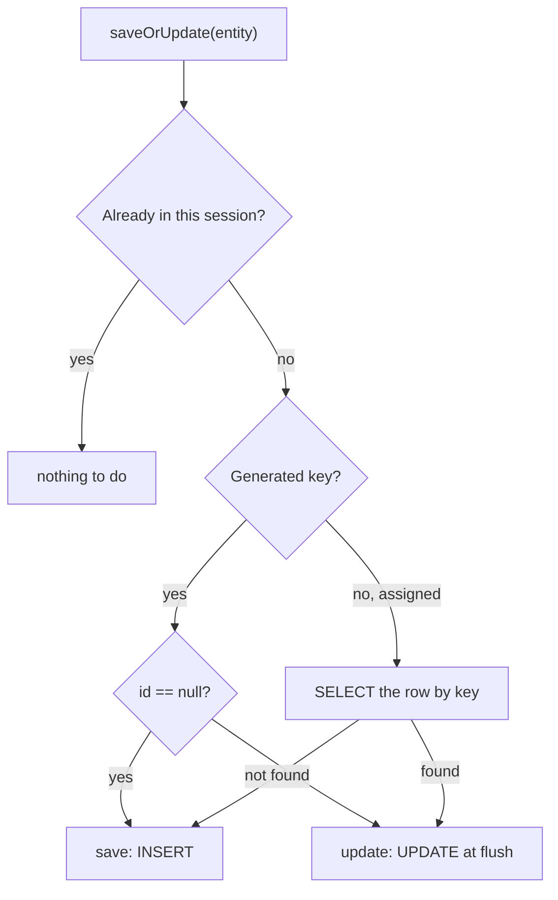
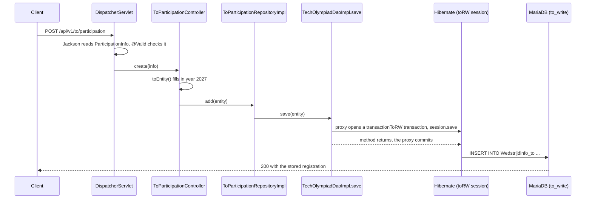

# 13. Registering a school

<div class="level-tabs" data-levels>
  <button data-level="overview" aria-pressed="true">Overview</button>
  <button data-level="deep" data-short="Deep">Deep Understanding</button>
  <button data-level="drill">Drilling</button>
</div>

<div class="level overview">

Every contest year begins with a registration: school 3 takes part in the
JTO in 2027, on paper or digitally. The VWO API keeps that in
`Wedstrijdinfo_vwo` and exposes it through `VwoParticipationController`;
TechOlympiad has `Wedstrijdinfo_to` and a `ToParticipationController`
with the same shape. Next to it sits the fee per edition,
`Inschrijvingsgeld`, read by a one-endpoint `RegistrationFeeController`.

This is the first chapter that writes data on purpose. The request
arrives as JSON, is checked with
<dfn data-def="The javax.validation standard (Bean Validation 2.0, implemented by Hibernate Validator): constraint annotations such as @NotNull on fields, checked by a Validator. Spring runs it for parameters marked @Valid.">bean validation</dfn>,
gets the current school year filled in when the caller left it out, and
goes to the database through the read-write session factory. On the way
we look at the five Hibernate methods that write an entity and why they
are not interchangeable.

**After this chapter you can:**

- compute the school year with `java.time` and default request fields to it;
- accept a JSON body as a Java record and validate it with `@Valid` and `@NotNull`;
- explain why writes go through `toRW` and what happens if they do not;
- choose between `save`, `persist`, `update`, `merge` and `saveOrUpdate`.

<div class="code-compare" data-code-compare data-labels="VWO VwoParticipationController|TechOlympiad ToParticipationController">

```java
@PostMapping
@ResponseBody
default ResponseEntity<WedstrijdinfoVwo> create(@NotNull @RequestBody DigitalParticipationInfo info) {
    short year = Objects.requireNonNullElse(info.year(), General.getCurrentSchoolYear());
    WedstrijdinfoVwo result = getRepository().add(year, info.schoolId(), info.edition(), info.digitalParticipation());
    return ResponseEntity.ok().body(result);
}

record DigitalParticipationInfo(
        @JsonProperty(index = 0) Short year,
        @JsonProperty(index = 1, required = true) short schoolId,
        @JsonProperty(index = 2, required = true) Configuration.VwoRole edition,
        @JsonProperty(index = 3, required = true) boolean digitalParticipation) {
}
```

```java
@PostMapping(consumes = MediaType.APPLICATION_JSON_VALUE)
@Operation(summary = "Register a school for an edition")
@ResponseBody
default ResponseEntity<WedstrijdinfoTo> create(@RequestBody @Valid @NotNull ParticipationInfo info) {
    return ResponseEntity.ok().body(getRepository().add(info.toEntity()));
}

record ParticipationInfo(
        @Schema(description = "School year; current school year if empty") Short year,
        @NotNull Short schoolId,
        @NotNull Configuration.ToRole edition,
        @NotNull Boolean digitalParticipation) {

    WedstrijdinfoTo toEntity() {
        short schoolYear = Objects.requireNonNullElse(year, General.getCurrentSchoolYear());
        return new WedstrijdinfoTo(schoolYear, schoolId, edition, digitalParticipation);
    }
}
```

</div>

The structure is the VWO's: a record nested in the controller interface
carries the body, and a missing `year` becomes the current school year.
The difference is in how fields are checked. The VWO relies on Jackson's
`required = true`, which only notices a field that is absent; an explicit
`"schoolId": null` still arrives as school `0` in its primitive `short`.
Ours has wrapper types with `@NotNull`, and `@Valid` rejects both cases
with a `400`.

</div>

<div class="level deep">

### The school year in `java.time`

The VWO stores a school year as the calendar year it ends in: 2026-2027
is `2027`. `General.getCurrentSchoolYear()` computes it:

```java
public static Short getCurrentSchoolYear() {
    LocalDate now = LocalDate.now();
    LocalDate threshold = LocalDate.of(now.getYear(), Month.SEPTEMBER, 1);
    if (now.isBefore(threshold)) {
        return (short) now.getYear();
    } else {
        return (short) (now.getYear() + 1);
    }
}
```

On 31 August 2027 it returns `2027`; on 1 September 2027 it returns
`2028`. We copy it unchanged. A few things about `java.time`, the date
API since Java 8, make it read the way it does:

<div class="table-wrap">

| `java.time` | .NET | Holds |
|---|---|---|
| `LocalDate` | `DateOnly` | A date without time or zone. `Wedstrijddatums.DATUM` in chapter 15. |
| `LocalTime` | `TimeOnly` | A time of day. `Wedstrijddatums.UUR`. |
| `LocalDateTime` | `DateTime` with `Kind.Unspecified` | Date and time, no zone. `INSCHRIJFDATUM` in chapter 14. |
| `Instant` | `DateTime` in UTC | A point on the timeline. |
| `ZonedDateTime` | `DateTimeOffset` plus a zone id | A local date-time in a named zone such as `Europe/Brussels`. |
| `Month.SEPTEMBER` | `9` | Months are an enum, so there is no 0-based or 1-based confusion. |

</div>

All these types are immutable: `plusDays(1)` returns a new object, like
.NET's `AddDays`. `LocalDate.now()` reads the JVM's default time zone,
which in our container is `Europe/Brussels` because the compose file sets
`TZ`. Near midnight on 31 August that is the difference between two school
years, so the `TZ` line is not decoration.

<div class="callout note">
<div class="callout-label">Your results depend on today's date</div>

Every endpoint that defaults the year calls this method. Until 31 August
2027 it returns `2027`, the year the seed data uses. After that the
default calls return empty lists, and you pass `year=2027` explicitly.

</div>

### Request bodies and records

`@RequestBody` tells Spring to read the HTTP body and turn it into the
parameter's type. Spring asks its list of
<dfn data-def="Spring MVC objects that read a request body into a Java object and write a return value into the response body. MappingJackson2HttpMessageConverter handles JSON.">HttpMessageConverters</dfn>
for one that can read `application/json` into a `ParticipationInfo`;
Jackson's converter wins. Jackson 2.12 and later construct a record
through its canonical constructor, matching JSON fields to component
names, so the body is:

```json
{ "year": 2027, "schoolId": 3, "edition": "STO", "digitalParticipation": true }
```

A record is a good request type for the same reasons a C# `record` is:
it is immutable, has value equality, and the compiler writes the
constructor and accessors. Note the accessor style: `info.schoolId()`,
not `info.getSchoolId()`. Records can carry methods, so `toEntity()`
lives next to the data it converts.

Jackson is forgiving with missing and `null` fields. Both become `null`
for a `Short` and `0` for a `short`, `null` for a `Boolean` and `false`
for a `boolean`. With primitives you cannot tell "not sent" from "sent as
zero", which is the reason to use wrapper types for anything you want to
validate. The one exception is `@JsonProperty(required = true)` on a
record component: Jackson enforces it when it calls the constructor, and
rejects a body that lacks the field with
`Missing required creator property 'schoolId'`. It does not look at the
value, so `"schoolId": null` passes.

### Bean validation

`javax.validation` defines constraint annotations (`@NotNull`,
`@NotBlank`, `@Size`, `@Min`, `@Pattern`, `@Email`, ...), and Hibernate
Validator, pulled in by `spring-boot-starter-validation`, checks them.
It is the Java counterpart of .NET's `[Required]` and friends in
`System.ComponentModel.DataAnnotations`, with one big difference:
nothing is validated automatically. A controller parameter is checked
only when it is marked `@Valid` (or Spring's `@Validated`).

When it fails, Spring throws `MethodArgumentNotValidException` before
your method body runs. Until [chapter 18](build-18-error-handling.md) adds an
error handler, Spring Boot's default answer is a `400` with a generic
body:

```json
{
  "timestamp": "2026-10-19T14:02:11.402+00:00",
  "status": 400,
  "error": "Bad Request",
  "path": "/techolympiad/api/v1/to/participation"
}
```

The field messages are in the Tomcat log, not in the response, because
Spring Boot 2.7 defaults `server.error.include-binding-errors` to
`never`.

On a record, a constraint written on a component ends up on the
generated field, which is where Hibernate Validator looks, so
`@NotNull Short schoolId` works as it would on a class. Two things to
keep straight:

- `@NotNull` on a primitive is pointless: a `short` is never `null`.
- `@NotNull` next to `@RequestBody` only rejects a missing body (Spring
  already does that, as `required = true` is the default); the fields are
  checked because of `@Valid`.

The VWO does not use bean validation in its controllers. Its records
mark fields `@JsonProperty(required = true)`, which puts them in the
`required` list of the Swagger schema and makes Jackson reject a body
without them, as described above. The `@NotNull` annotations it puts on
path variables and request parameters are not enforced at all: that
would need `@Validated` on the controller class, which no VWO controller
has.

### Query parameters with a default that is not a constant

`@RequestParam` has a `defaultValue`, but it is a compile-time string:
`defaultValue = "2027"` would be wrong next year, and
`defaultValue = General.getCurrentSchoolYear()` does not compile. The VWO
uses two patterns for "current school year when empty":

```java
@RequestParam(value = "year", required = false) Short yearOpt
...
short year = Objects.requireNonNullElse(yearOpt, General.getCurrentSchoolYear());
```

```java
@RequestParam("year") Optional<Short> yearOpt
...
short year = yearOpt.orElse(General.getCurrentSchoolYear());
```

Both work: Spring treats an `Optional` parameter as not required.
`Objects.requireNonNullElse` (Java 9) is the `??` operator of Java. We use
the first form, which is also what the body record does with its `year`.

### Writing through the read-write factory

Chapter 8 created two session factories: `toR`, connecting as `to_read`
with only `SELECT` rights, and `toRW`, connecting as `to_write`. Every
DAO method picks one. The base class's `save` looks like this (the VWO's
`VwoDaoImpl` and our `TechOlympiadDaoImpl` are identical apart from the
names):

```java
@Override
@Transactional(value = transactionRW)
public E save(E entity) {
    return super.save(entity);
}
```

and `AbstractDaoImpl.save` uses `getFactoryRW().getCurrentSession()`.
The two must agree. `@Transactional(value = transactionRW)` makes the
`transactionToRW` manager open a transaction and bind a session of the
`toRW` factory to the thread; `getFactoryRW().getCurrentSession()` asks
for exactly that session. Mixing them fails in one of two ways:

- A write through `getFactoryR()` reaches MariaDB as `to_read` and is
  refused: `INSERT command denied to user 'to_read'@'...' for table 'Wedstrijdinfo_to'`.
- A write in a method marked `@Transactional(value = transactionR, readOnly = true)`
  may not reach the database at all. Spring sets the Hibernate flush mode
  of a read-only transaction to `MANUAL`, so changes to managed entities
  are never flushed, and you get a `200` for a write that did not happen.

The VWO keeps the rule simple: every method that writes carries
`@Transactional(value = transactionRW)` and uses `getFactoryRW()`; every
read uses the R pair. When you add a DAO method, decide first which one
it is.

<div class="callout danger">
<div class="callout-label">Forgetting the transaction manager's name</div>

Our context has two transaction managers and no default. A bare
`@Transactional` fails at call time with
`NoUniqueBeanDefinitionException: No qualifying bean of type 'org.springframework.transaction.TransactionManager' available: expected single matching bean but found 2`.
Always write the qualifier.

</div>

### `save`, `persist`, `update`, `merge` and `saveOrUpdate`

Hibernate's `Session` has three write methods of its own and two from
JPA. They differ in what they do with an object that is new
(<dfn data-def="An object Hibernate has never seen: created with new, not in any session, with no row yet (or none Hibernate knows of).">transient</dfn>)
and with one that was loaded in an earlier session
(<dfn data-def="An object that represents a row but is not attached to the current session, for example one loaded in another session or built from a request body with its key filled in.">detached</dfn>).

<div class="table-wrap">

| Method | From | Transient object | Detached object | Returns |
|---|---|---|---|---|
| `save` | Hibernate | `INSERT` (at once for `IDENTITY` keys, else at flush) | treats it as new: a second row, or a duplicate-key error for assigned keys | the id |
| `persist` | JPA | `INSERT` at flush | generated key: `PersistentObjectException: detached entity passed to persist`; assigned key: Hibernate cannot tell, assumes new and inserts | nothing |
| `update` | Hibernate | `TransientObjectException` if the id is `null` | attaches it; `UPDATE` at flush | nothing |
| `merge` | JPA | copies it into a new managed object; `INSERT` | `SELECT`s the row, copies the fields onto the managed object; `UPDATE` if something changed | the **managed copy**, never the argument |
| `saveOrUpdate` | Hibernate | `save` | `update` | nothing |

</div>

A `WedstrijdinfoTo` built from a request body is an odd case: it is new
to Hibernate, but its key is fully filled in, because the key is
assigned. That is why the repository has separate `add` and `update`
methods, like the VWO's `WedstrijdinfoVwoRepositoryImpl`:

- `add` calls `save`: an `INSERT`. If the registration already exists,
  MariaDB answers `Duplicate entry '2027-3-STO' for key 'PRIMARY'`.
- `update` calls `update`: an `UPDATE ... WHERE JAAR=? AND SCHOOL_ID=? AND EDITIE=?`.
  If no row matches, Hibernate notices that zero rows changed and throws
  `StaleStateException: Batch update returned unexpected row count from update [0]; actual row count: 0; expected: 1`.
  The controller checks `findByPrimaryKey` first and answers `404`, which
  is what the VWO controller does too.

`saveOrUpdate` needs to know whether the object is new. For a generated
key it looks at the id (`null` means new). For an assigned key without a
version column it cannot tell, so it runs a `SELECT` on the key and
decides from the result:



That makes `saveOrUpdate` the safe "store this, whatever its state"
method, at the price of an extra query for assigned keys. The VWO leans
on it at the repository level: `ScholenRepositoryImpl.save`,
`PersoonRepositoryImpl.save` and `LeerlingVWORepositoryImpl.save` all
call `dao.saveOrUpdate(s)`, which is why our `FunctiesRepositoryImpl.save`
in [chapter 12](build-12-responsables.md) did the same. The DAO's own
`save` stays a plain `session.save`.

<div class="callout danger">
<div class="callout-label">The VWO's <code>merge</code> returns the wrong object</div>

`AbstractDaoImpl.merge` in the VWO calls `session.merge(entity)` and
returns `entity`, the argument. `merge` never attaches its argument; it
returns a different, managed instance. Changes you make to the returned
object afterwards are therefore not tracked. If you ever use `merge`,
return what `session.merge` returns.

</div>

In EF Core terms: `persist` is `Add`, `update` is `Update` (attach as
modified), `merge` is roughly "load, then `CurrentValues.SetValues`", and
`saveOrUpdate` is what `Update` does when keys are generated (`Added` for
a default key, `Modified` otherwise).

### `BigDecimal` for money

`BEDRAG decimal(4,2)` holds amounts up to `99.99`. In Java a SQL
`DECIMAL` maps to `java.math.BigDecimal`, the counterpart of C#'s
`decimal`, and `@Column(precision = 4, scale = 2)` describes it
(precision is the total number of digits, scale the digits after the
point; the VWO writes `precision = 2`, which only matters if Hibernate
generated the schema, and it does not). The VWO's repository then
returns `getBedrag().floatValue()`, and the controller sends a `Float`.
For amounts with two decimals Jackson prints the short form (`12.5`), so
the JSON looks right, but a `float` cannot hold most decimal fractions
exactly. We keep the VWO's `Float` response to stay compatible and note
that `BigDecimal` would be the cleaner contract.

</div>

<div class="level drill">

### What you should have

The end state of [chapter 12](build-12-responsables.md): `Configuration`
with `ToRole` and its converter, `Persoon` and `Functies` mapped, and the
function endpoints working. The seed has registrations for 2027 in
`Wedstrijdinfo_to`.

Paths are relative to `src/main/java/be/techolympiad/common/`.

### Tasks

<ul class="checklist">
<li><label><input type="checkbox"><span>Create <code>General.java</code> with <code>getCurrentSchoolYear()</code>.</span></label></li>
<li><label><input type="checkbox"><span>Create <code>WedstrijdinfoToPK</code>, <code>WedstrijdinfoTo</code> and <code>Inschrijvingsgeld</code>, and map the two entities in <code>hibernate_TO.cfg.xml</code>.</span></label></li>
<li><label><input type="checkbox"><span>Create <code>WedstrijdinfoToDao</code> and <code>InschrijvingsgeldDao</code> with their implementations.</span></label></li>
<li><label><input type="checkbox"><span>Create <code>ToParticipationRepository</code> and <code>RegistrationFeeRepository</code> with their implementations.</span></label></li>
<li><label><input type="checkbox"><span>Create the <code>ToParticipationController</code> and <code>RegistrationFeeController</code> interfaces and their <code>v1</code> classes.</span></label></li>
<li><label><input type="checkbox"><span>Build, restart, and run every call under <em>Run it</em>, including the failing ones.</span></label></li>
<li><label><input type="checkbox"><span>Commit: <code>git add -A &amp;&amp; git commit -m "Register schools for an edition"</code>.</span></label></li>
</ul>

### The school year helper

`General.java`

```java
package be.techolympiad.common;

import java.time.LocalDate;
import java.time.Month;

public final class General {

    private General() {
    }

    public static Short getCurrentSchoolYear() {
        LocalDate now = LocalDate.now();
        LocalDate threshold = LocalDate.of(now.getYear(), Month.SEPTEMBER, 1);
        if (now.isBefore(threshold)) {
            return (short) now.getYear();
        } else {
            return (short) (now.getYear() + 1);
        }
    }
}
```

The casts are needed because `getYear()` returns an `int` and Java never
narrows implicitly; `(short) now.getYear()` then autoboxes to `Short`.

### Entities

`dbEntities/WedstrijdinfoToPK.java`

```java
package be.techolympiad.common.dbEntities;

import be.techolympiad.common.Configuration;
import lombok.AllArgsConstructor;
import lombok.EqualsAndHashCode;
import lombok.Getter;
import lombok.NoArgsConstructor;
import lombok.Setter;

import java.io.Serializable;

@Getter
@Setter
@NoArgsConstructor
@AllArgsConstructor
@EqualsAndHashCode
public class WedstrijdinfoToPK implements Serializable {

    private short jaar;
    private short schoolId;
    private Configuration.ToRole editie;
}
```

The key fields are primitives here because they are primitives in the
entity, as in the VWO's `WedstrijdinfoVwo`: the types must match, and a
registration's key is never partly unknown.

`dbEntities/WedstrijdinfoTo.java`

```java
package be.techolympiad.common.dbEntities;

import be.techolympiad.common.Configuration;
import com.fasterxml.jackson.annotation.JsonAlias;
import com.fasterxml.jackson.annotation.JsonProperty;
import io.swagger.v3.oas.annotations.media.Schema;
import lombok.AllArgsConstructor;
import lombok.Getter;
import lombok.NoArgsConstructor;
import lombok.Setter;

import javax.persistence.*;
import java.io.Serializable;
import java.util.Objects;

@Entity
@Table(name = "Wedstrijdinfo_to", schema = "TechOlympiad")
@IdClass(WedstrijdinfoToPK.class)
@Schema(name = "ToParticipation")
@Getter
@Setter
@NoArgsConstructor
@AllArgsConstructor
public class WedstrijdinfoTo implements Serializable {

    @Id
    @Column(name = "JAAR", nullable = false)
    @JsonProperty("year")
    @JsonAlias("jaar")
    private short jaar;

    @Id
    @Column(name = "SCHOOL_ID", nullable = false)
    @JsonProperty("schoolId")
    private short schoolId;

    @Id
    @Column(name = "EDITIE", nullable = false)
    @Enumerated(EnumType.STRING)
    @JsonProperty("edition")
    @JsonAlias("editie")
    private Configuration.ToRole editie;

    @Column(name = "DIGITALE_DEELNAME", nullable = false)
    @JsonProperty("digitalParticipation")
    @JsonAlias("digitaleDeelname")
    private boolean digitaleDeelname;

    @Override
    public boolean equals(Object o) {
        if (this == o) return true;
        if (o == null || getClass() != o.getClass()) return false;
        WedstrijdinfoTo that = (WedstrijdinfoTo) o;
        return jaar == that.jaar && schoolId == that.schoolId && editie == that.editie;
    }

    @Override
    public int hashCode() {
        return Objects.hash(jaar, schoolId, editie);
    }
}
```

`@JsonAlias` lets a client also send the Dutch name (`"jaar": 2027`) in a
body; responses always use the `@JsonProperty` name. The VWO adds the
aliases on this entity, so we do too. `DIGITALE_DEELNAME tinyint(1)` maps
to `boolean` without help: the MariaDB driver reads `tinyint(1)` as a
boolean.

`dbEntities/Inschrijvingsgeld.java`

```java
package be.techolympiad.common.dbEntities;

import be.techolympiad.common.Configuration;
import com.fasterxml.jackson.annotation.JsonProperty;
import io.swagger.v3.oas.annotations.media.Schema;
import lombok.Getter;
import lombok.NoArgsConstructor;
import lombok.Setter;

import javax.persistence.*;
import java.io.Serializable;
import java.math.BigDecimal;

@Entity
@Table(name = "Inschrijvingsgeld", schema = "TechOlympiad")
@Schema(name = "RegistrationFee")
@Getter
@Setter
@NoArgsConstructor
public class Inschrijvingsgeld implements Serializable {

    @Id
    @Column(name = "EDITIE", nullable = false)
    @Enumerated(EnumType.STRING)
    @JsonProperty("edition")
    private Configuration.ToRole editie;

    @Column(name = "BEDRAG", nullable = false, precision = 4, scale = 2)
    @JsonProperty("amount")
    private BigDecimal bedrag;

    @Override
    public boolean equals(Object o) {
        if (this == o) return true;
        if (o == null || getClass() != o.getClass()) return false;
        return editie == ((Inschrijvingsgeld) o).editie;
    }

    @Override
    public int hashCode() {
        return editie != null ? editie.hashCode() : 0;
    }
}
```

The key is the enum itself. That works because every Java enum is
`Serializable`, which the DAO's `K extends Serializable` bound requires.

`hibernate_TO.cfg.xml`:

<div class="diff-view" data-diff-view>

```diff
         <mapping class="be.techolympiad.common.dbEntities.Functies"/>
+        <mapping class="be.techolympiad.common.dbEntities.WedstrijdinfoTo"/>
+        <mapping class="be.techolympiad.common.dbEntities.Inschrijvingsgeld"/>
     </session-factory>
```

</div>

### DAOs

`dao/WedstrijdinfoToDao.java`

```java
package be.techolympiad.common.dao;

import be.techolympiad.common.dbEntities.WedstrijdinfoTo;
import be.techolympiad.common.dbEntities.WedstrijdinfoToPK;
import org.springframework.data.repository.NoRepositoryBean;

import java.util.List;

@NoRepositoryBean
public interface WedstrijdinfoToDao extends TechOlympiadDao<WedstrijdinfoTo, WedstrijdinfoToPK> {

    List<WedstrijdinfoTo> getByYear(short year);

    List<WedstrijdinfoTo> getBySchool(short schoolId, short year);
}
```

`dao/impl/WedstrijdinfoToDaoImpl.java`

```java
package be.techolympiad.common.dao.impl;

import be.techolympiad.common.dao.WedstrijdinfoToDao;
import be.techolympiad.common.dbEntities.WedstrijdinfoTo;
import be.techolympiad.common.dbEntities.WedstrijdinfoToPK;
import org.hibernate.Session;
import org.hibernate.query.Query;
import org.springframework.stereotype.Repository;
import org.springframework.transaction.annotation.Transactional;

import java.util.List;

@Repository
public class WedstrijdinfoToDaoImpl extends TechOlympiadDaoImpl<WedstrijdinfoTo, WedstrijdinfoToPK> implements WedstrijdinfoToDao {

    @Override
    @Transactional(value = transactionR, readOnly = true)
    public List<WedstrijdinfoTo> getByYear(short year) {
        Session session = getFactoryR().getCurrentSession();
        String hql = "SELECT w FROM WedstrijdinfoTo w "
                + "WHERE w.jaar = :year "
                + "ORDER BY w.schoolId, w.editie";
        Query<WedstrijdinfoTo> query = session.createQuery(hql, type);
        query.setParameter("year", year);
        return query.getResultList();
    }

    @Override
    @Transactional(value = transactionR, readOnly = true)
    public List<WedstrijdinfoTo> getBySchool(short schoolId, short year) {
        Session session = getFactoryR().getCurrentSession();
        String hql = "SELECT w FROM WedstrijdinfoTo w "
                + "WHERE w.schoolId = :schoolId "
                + "AND w.jaar = :year";
        Query<WedstrijdinfoTo> query = session.createQuery(hql, type);
        query.setParameter("schoolId", schoolId);
        query.setParameter("year", year);
        return query.getResultList();
    }
}
```

`dao/InschrijvingsgeldDao.java`

```java
package be.techolympiad.common.dao;

import be.techolympiad.common.Configuration;
import be.techolympiad.common.dbEntities.Inschrijvingsgeld;
import org.springframework.data.repository.NoRepositoryBean;

@NoRepositoryBean
public interface InschrijvingsgeldDao extends TechOlympiadDao<Inschrijvingsgeld, Configuration.ToRole> {
}
```

`dao/impl/InschrijvingsgeldDaoImpl.java`

```java
package be.techolympiad.common.dao.impl;

import be.techolympiad.common.Configuration;
import be.techolympiad.common.dao.InschrijvingsgeldDao;
import be.techolympiad.common.dbEntities.Inschrijvingsgeld;
import org.springframework.stereotype.Repository;

@Repository
public class InschrijvingsgeldDaoImpl extends TechOlympiadDaoImpl<Inschrijvingsgeld, Configuration.ToRole> implements InschrijvingsgeldDao {
}
```

### Repositories

`restAPI/repositories/ToParticipationRepository.java`

```java
package be.techolympiad.common.restAPI.repositories;

import be.techolympiad.common.Configuration;
import be.techolympiad.common.dbEntities.WedstrijdinfoTo;
import be.techolympiad.common.dbEntities.WedstrijdinfoToPK;
import org.springframework.data.repository.NoRepositoryBean;
import org.springframework.data.repository.Repository;

import java.util.List;
import java.util.Optional;

@NoRepositoryBean
public interface ToParticipationRepository extends Repository<WedstrijdinfoTo, WedstrijdinfoToPK> {

    List<WedstrijdinfoTo> findByYear(short year);

    List<WedstrijdinfoTo> findBySchool(short schoolId, short year);

    Optional<WedstrijdinfoTo> findByPrimaryKey(short year, short schoolId, Configuration.ToRole edition);

    WedstrijdinfoTo add(WedstrijdinfoTo participation);

    WedstrijdinfoTo update(WedstrijdinfoTo participation);
}
```

`restAPI/repositories/ToParticipationRepositoryImpl.java`

```java
package be.techolympiad.common.restAPI.repositories;

import be.techolympiad.common.Configuration;
import be.techolympiad.common.dao.WedstrijdinfoToDao;
import be.techolympiad.common.dbEntities.WedstrijdinfoTo;
import be.techolympiad.common.dbEntities.WedstrijdinfoToPK;
import org.springframework.beans.factory.annotation.Autowired;
import org.springframework.stereotype.Repository;

import java.util.List;
import java.util.Optional;

@Repository
public class ToParticipationRepositoryImpl implements ToParticipationRepository {

    private final WedstrijdinfoToDao dao;

    @Autowired
    public ToParticipationRepositoryImpl(WedstrijdinfoToDao dao) {
        this.dao = dao;
    }

    @Override
    public List<WedstrijdinfoTo> findByYear(short year) {
        return dao.getByYear(year);
    }

    @Override
    public List<WedstrijdinfoTo> findBySchool(short schoolId, short year) {
        return dao.getBySchool(schoolId, year);
    }

    @Override
    public Optional<WedstrijdinfoTo> findByPrimaryKey(short year, short schoolId, Configuration.ToRole edition) {
        return dao.getOptional(new WedstrijdinfoToPK(year, schoolId, edition));
    }

    @Override
    public WedstrijdinfoTo add(WedstrijdinfoTo participation) {
        return dao.save(participation);
    }

    @Override
    public WedstrijdinfoTo update(WedstrijdinfoTo participation) {
        return dao.update(participation);
    }
}
```

`restAPI/repositories/RegistrationFeeRepository.java`

```java
package be.techolympiad.common.restAPI.repositories;

import be.techolympiad.common.Configuration;
import be.techolympiad.common.dbEntities.Inschrijvingsgeld;
import org.springframework.data.repository.NoRepositoryBean;
import org.springframework.data.repository.Repository;

import java.util.Optional;

@NoRepositoryBean
public interface RegistrationFeeRepository extends Repository<Inschrijvingsgeld, Configuration.ToRole> {

    Optional<Float> getAmount(Configuration.ToRole edition);
}
```

`restAPI/repositories/RegistrationFeeRepositoryImpl.java`

```java
package be.techolympiad.common.restAPI.repositories;

import be.techolympiad.common.Configuration;
import be.techolympiad.common.dao.InschrijvingsgeldDao;
import org.springframework.beans.factory.annotation.Autowired;
import org.springframework.stereotype.Repository;

import java.util.Optional;

@Repository
public class RegistrationFeeRepositoryImpl implements RegistrationFeeRepository {

    private final InschrijvingsgeldDao dao;

    @Autowired
    public RegistrationFeeRepositoryImpl(InschrijvingsgeldDao dao) {
        this.dao = dao;
    }

    @Override
    public Optional<Float> getAmount(Configuration.ToRole edition) {
        return dao.getOptional(edition).map(fee -> fee.getBedrag().floatValue());
    }
}
```

The VWO version returns a plain `float` from `dao.get(edition).getBedrag()`,
which throws a `NullPointerException` (and a `500`) for an edition without
a fee. Returning an `Optional` lets the controller answer `404` instead.

### Controllers

<div class="param-table" data-param-table>

| Name | Type | Description |
|---|---|---|
| `GET /to/participation` | `ToParticipation[]` | All registrations of a year; `year` optional, current school year by default. |
| `GET /to/participation/{schoolId}` | `ToParticipation[]` | The registrations of one school (zero, one or two editions); `year` as above. |
| `POST /to/participation` | `ToParticipation` | Body `ParticipationInfo`; `400` if a required field is missing. |
| `PUT /to/participation` | `ToParticipation` | Body `ParticipationInfo`; changes `digitalParticipation`; `404` if the registration does not exist. |
| `GET /registration-fee/{edition}` | `number` | The fee of an edition; `404` if none is set. |

</div>

The body of the `POST` and `PUT`:

<div class="param-table" data-param-table>

| Name | Type | Description |
|---|---|---|
| `year` | `number?` | School year; the current one when left out. |
| `schoolId` | `number` | An existing school id. |
| `edition` | `"JTO"\|"STO"` | Exactly in upper case: bodies go through Jackson, not through `ToRoleConverter`. |
| `digitalParticipation` | `boolean` | Whether the school takes the contest digitally. |

</div>

`restAPI/controllers/ToParticipationController.java`

```java
package be.techolympiad.common.restAPI.controllers;

import be.techolympiad.common.Configuration;
import be.techolympiad.common.General;
import be.techolympiad.common.dbEntities.WedstrijdinfoTo;
import be.techolympiad.common.restAPI.repositories.ToParticipationRepository;
import io.swagger.v3.oas.annotations.Operation;
import io.swagger.v3.oas.annotations.Parameter;
import io.swagger.v3.oas.annotations.media.Schema;
import org.springframework.http.MediaType;
import org.springframework.http.ResponseEntity;
import org.springframework.web.bind.annotation.*;

import javax.validation.Valid;
import javax.validation.constraints.NotNull;
import java.util.List;
import java.util.Objects;

public interface ToParticipationController {

    ToParticipationRepository getRepository();

    @GetMapping
    @Operation(summary = "Get all registrations of a school year")
    @ResponseBody
    default ResponseEntity<List<WedstrijdinfoTo>> getByYear(
            @RequestParam(value = "year", required = false) @Parameter(description = "School year; current school year if empty") Short year) {
        short schoolYear = Objects.requireNonNullElse(year, General.getCurrentSchoolYear());
        return ResponseEntity.ok().body(getRepository().findByYear(schoolYear));
    }

    @GetMapping("/{schoolId}")
    @Operation(summary = "Get the registrations of a school")
    @ResponseBody
    default ResponseEntity<List<WedstrijdinfoTo>> getBySchool(
            @PathVariable("schoolId") short schoolId,
            @RequestParam(value = "year", required = false) @Parameter(description = "School year; current school year if empty") Short year) {
        short schoolYear = Objects.requireNonNullElse(year, General.getCurrentSchoolYear());
        return ResponseEntity.ok().body(getRepository().findBySchool(schoolId, schoolYear));
    }

    @PostMapping(consumes = MediaType.APPLICATION_JSON_VALUE)
    @Operation(summary = "Register a school for an edition")
    @ResponseBody
    default ResponseEntity<WedstrijdinfoTo> create(@RequestBody @Valid @NotNull ParticipationInfo info) {
        return ResponseEntity.ok().body(getRepository().add(info.toEntity()));
    }

    @PutMapping(consumes = MediaType.APPLICATION_JSON_VALUE)
    @Operation(summary = "Change a registration")
    @ResponseBody
    default ResponseEntity<WedstrijdinfoTo> update(@RequestBody @Valid @NotNull ParticipationInfo info) {
        WedstrijdinfoTo participation = info.toEntity();
        if (getRepository().findByPrimaryKey(participation.getJaar(), participation.getSchoolId(), participation.getEditie()).isEmpty()) {
            return ResponseEntity.notFound().build();
        }
        return ResponseEntity.ok().body(getRepository().update(participation));
    }

    record ParticipationInfo(
            @Schema(description = "School year; current school year if empty") Short year,
            @NotNull Short schoolId,
            @NotNull Configuration.ToRole edition,
            @NotNull Boolean digitalParticipation) {

        WedstrijdinfoTo toEntity() {
            short schoolYear = Objects.requireNonNullElse(year, General.getCurrentSchoolYear());
            return new WedstrijdinfoTo(schoolYear, schoolId, edition, digitalParticipation);
        }
    }
}
```

`restAPI/controllers/v1/ToParticipationController.java`

```java
package be.techolympiad.common.restAPI.controllers.v1;

import be.techolympiad.common.restAPI.repositories.ToParticipationRepository;
import io.swagger.v3.oas.annotations.tags.Tag;
import lombok.Getter;
import org.springframework.beans.factory.annotation.Autowired;
import org.springframework.http.MediaType;
import org.springframework.web.bind.annotation.RequestMapping;
import org.springframework.web.bind.annotation.RestController;

@RestController("toParticipationController.v1")
@RequestMapping(path = V1Config.BASE_URL + "/to/participation", produces = MediaType.APPLICATION_JSON_VALUE)
@Tag(name = "to-participation-controller")
@Getter
public class ToParticipationController implements be.techolympiad.common.restAPI.controllers.ToParticipationController {

    private final ToParticipationRepository repository;

    @Autowired
    public ToParticipationController(ToParticipationRepository repository) {
        this.repository = repository;
    }
}
```

`restAPI/controllers/RegistrationFeeController.java`

```java
package be.techolympiad.common.restAPI.controllers;

import be.techolympiad.common.Configuration;
import be.techolympiad.common.restAPI.repositories.RegistrationFeeRepository;
import io.swagger.v3.oas.annotations.Operation;
import org.springframework.http.ResponseEntity;
import org.springframework.web.bind.annotation.GetMapping;
import org.springframework.web.bind.annotation.PathVariable;
import org.springframework.web.bind.annotation.ResponseBody;

public interface RegistrationFeeController {

    RegistrationFeeRepository getRepository();

    @GetMapping("/{edition}")
    @Operation(summary = "Get the registration fee of an edition")
    @ResponseBody
    default ResponseEntity<Float> get(@PathVariable("edition") Configuration.ToRole edition) {
        return getRepository().getAmount(edition)
                .map(amount -> ResponseEntity.ok().body(amount))
                .orElse(ResponseEntity.notFound().build());
    }
}
```

`restAPI/controllers/v1/RegistrationFeeController.java`

```java
package be.techolympiad.common.restAPI.controllers.v1;

import be.techolympiad.common.restAPI.repositories.RegistrationFeeRepository;
import io.swagger.v3.oas.annotations.tags.Tag;
import lombok.Getter;
import org.springframework.beans.factory.annotation.Autowired;
import org.springframework.http.MediaType;
import org.springframework.web.bind.annotation.RequestMapping;
import org.springframework.web.bind.annotation.RestController;

@RestController("registrationFeeController.v1")
@RequestMapping(path = V1Config.BASE_URL + "/registration-fee", produces = MediaType.APPLICATION_JSON_VALUE)
@Tag(name = "registration-fee-controller")
@Getter
public class RegistrationFeeController implements be.techolympiad.common.restAPI.controllers.RegistrationFeeController {

    private final RegistrationFeeRepository repository;

    @Autowired
    public RegistrationFeeController(RegistrationFeeRepository repository) {
        this.repository = repository;
    }
}
```

The path variable `{edition}` is a `ToRole`, so `ToRoleConverter` handles
it too: `/registration-fee/sto` works.

### What a `POST` does



The `INSERT` runs at commit, after `save` has returned. An error such as a
duplicate key therefore surfaces in the transaction proxy around the DAO,
not on the `session.save` line.

### Run it

```bash
mvn -q -DskipTests -Plocal package && docker compose restart api
```

In Swagger, under *to-participation-controller*:

1. `GET /api/v1/to/participation` without a year: the seeded 2027
   registrations, one object per school and edition:

   ```json
   [
     { "year": 2027, "schoolId": 1, "edition": "JTO", "digitalParticipation": false },
     { "year": 2027, "schoolId": 1, "edition": "STO", "digitalParticipation": true },
     { "year": 2027, "schoolId": 2, "edition": "JTO", "digitalParticipation": false },
     { "year": 2027, "schoolId": 2, "edition": "STO", "digitalParticipation": false },
     { "year": 2027, "schoolId": 3, "edition": "JTO", "digitalParticipation": true },
     { "year": 2027, "schoolId": 4, "edition": "STO", "digitalParticipation": false }
   ]
   ```

   `year=2026` gives `[]`, since the seed only registers 2027.
2. `GET /api/v1/to/participation/3`: Instituut Parelmoer has only JTO.
3. Register school 4 for the JTO, which it is not yet:

   ```json
   { "schoolId": 4, "edition": "JTO", "digitalParticipation": true }
   ```

   The response has `"year": 2027` filled in. Send the same body again:
   `500`, and the Tomcat log (`docker compose logs api`) shows a
   `DataIntegrityViolationException` caused by
   `Duplicate entry '2027-4-JTO' for key 'PRIMARY'`.
4. Change it with `PUT /api/v1/to/participation` and
   `"digitalParticipation": false`: `200` with the new value. The same
   `PUT` for school 3 and `STO`, never registered: `404`.
5. Send `{ "edition": "STO" }` to the `POST`: `400`, and the log names
   the two fields that are `null`.
6. `GET /api/v1/registration-fee/jto`: `2.5`, the seed's `2.50` as a
   `float`. `/registration-fee/sto` gives `3.0`. To see the `404`, remove
   a fee and put it back:

   ```bash
   docker compose exec db mariadb -uroot -pdevpass TechOlympiad \
     -e "DELETE FROM Inschrijvingsgeld WHERE EDITIE = 'STO'"
   docker compose exec db mariadb -uroot -pdevpass TechOlympiad \
     -e "INSERT INTO Inschrijvingsgeld VALUES ('STO', 3.00)"
   ```

<div class="callout danger">
<div class="callout-label">When it breaks</div>

- **`INSERT command denied to user 'to_read'`**: a write method uses `getFactoryR()`, or is annotated with `transactionR`. Writes need `transactionRW` and `getFactoryRW()` together.
- **`200` but nothing in the table**: the write ran inside a `readOnly = true` transaction, where Hibernate never flushes.
- **`StaleStateException: Batch update returned unexpected row count from update [0]`**: `update` for a row that does not exist. Check with `findByPrimaryKey` first, as the `PUT` does.
- **`NoUniqueBeanDefinitionException ... expected single matching bean but found 2`**: a `@Transactional` without a manager name.
- **`400` with `Cannot deserialize value of type ... ToRole from String "sto"`**: lower case in a JSON body. Bodies are case-sensitive.
- **`@Valid` seems ignored**: `spring-boot-starter-validation` is missing from the pom, or the annotation is `javax.validation.Valid` on the wrong parameter. Without a validator on the classpath, Spring skips validation silently.

</div>

### Quiz

<div class="quiz" data-quiz>
<p class="quiz-q">The VWO record declares <code>@JsonProperty(index = 1, required = true) short schoolId</code>. A client sends <code>{"schoolId": null, "edition": "JWO", "digitalParticipation": true}</code>. What does the VWO API do?</p>
<ol class="quiz-options">
<li>Jackson rejects the body because <code>schoolId</code> is required<p class="quiz-whynot"><code>required</code> only checks that the field is present in the JSON. Here it is present, with the value <code>null</code>.</p></li>
<li data-correct>Unless the database refuses it, it registers school <code>0</code><p class="quiz-why">Jackson turns <code>null</code> into <code>0</code> for a primitive, and no bean validation runs. Only a database rule could stop it.</p></li>
<li>Bean validation returns <code>400</code><p class="quiz-whynot">There is no <code>@Valid</code> on the parameter and no constraint on the field, so nothing validates it.</p></li>
</ol>
<p class="quiz-explain">With a primitive you cannot tell "sent as null" from "sent as zero". Wrapper types plus <code>@NotNull</code> and <code>@Valid</code> catch both a missing and a null field.</p>
</div>

<div class="quiz" data-quiz>
<p class="quiz-q">You load a <code>Persoon</code> in one request, change its <code>email</code>, and in another request call <code>session.persist(person)</code> on it. What happens?</p>
<ol class="quiz-options">
<li>Hibernate updates the row<p class="quiz-whynot">That would be <code>update</code>, <code>merge</code> or <code>saveOrUpdate</code>. <code>persist</code> only makes new objects persistent.</p></li>
<li>Hibernate inserts a second person<p class="quiz-whynot">That is what <code>save</code> does with a detached object with a generated key; <code>persist</code> refuses first.</p></li>
<li data-correct>It throws <code>PersistentObjectException: detached entity passed to persist</code><p class="quiz-why">The key is generated, so a non-null <code>persoonId</code> tells Hibernate the object already has a row, and <code>persist</code> is defined for new objects only.</p></li>
</ol>
<p class="quiz-explain">With a generated key Hibernate can tell new from detached by looking at the id. With an assigned key, such as <code>WedstrijdinfoTo</code>'s, it cannot, and <code>persist</code> would try an <code>INSERT</code>. For changing an existing row, use <code>update</code> (attach) or <code>merge</code> (copy).</p>
</div>

### Flashcards

<div class="flashcards" data-flashcards data-front-label="Term" data-back-label="Meaning">
<div class="card"><div class="front"><code>General.getCurrentSchoolYear()</code></div><div class="back">The calendar year, plus one from 1 September on. 2026-2027 is <code>2027</code>.</div></div>
<div class="card"><div class="front"><code>@Valid</code> on a parameter</div><div class="back">Runs bean validation on the bound object; failure throws <code>MethodArgumentNotValidException</code>, answered with <code>400</code>.</div></div>
<div class="card"><div class="front"><code>Objects.requireNonNullElse(a, b)</code></div><div class="back">Java 9's <code>a ?? b</code>.</div></div>
<div class="card"><div class="front"><code>save</code></div><div class="back">Hibernate: always schedules an <code>INSERT</code> and returns the id.</div></div>
<div class="card"><div class="front"><code>merge</code></div><div class="back">JPA: copies the argument onto a managed instance and returns that instance; the argument stays detached.</div></div>
<div class="card"><div class="front"><code>saveOrUpdate</code></div><div class="back">Hibernate: <code>save</code> if new, <code>update</code> if not; for assigned keys it asks the database with a <code>SELECT</code>.</div></div>
<div class="card"><div class="front">Read-only transaction</div><div class="back">Spring sets Hibernate's flush mode to <code>MANUAL</code>: changes are never written.</div></div>
</div>

### Self-checks

<details class="qa">
<summary>Self-check: why does the duplicate-key error come from the transaction proxy and not from <code>session.save</code>?</summary>
<div class="ans">
For an assigned key, <code>save</code> only schedules the <code>INSERT</code> in the session's action queue. The SQL runs when the session is flushed, which happens during commit, and the commit is done by the <code>@Transactional</code> proxy after the DAO method returns. (For <code>IDENTITY</code> keys the insert does run inside <code>save</code>, because Hibernate needs the generated id.)
<div class="mark"><button type="button">Mark as known</button></div>
</div>
</details>

<details class="qa">
<summary>Self-check: why can <code>year</code> not use <code>@RequestParam(defaultValue = ...)</code>?</summary>
<div class="ans">
Annotation values must be compile-time constants. The current school year changes every 1 September and has to be computed per request, so the parameter is optional (<code>required = false</code>, or an <code>Optional&lt;Short&gt;</code>) and the method fills it in.
<div class="mark"><button type="button">Mark as known</button></div>
</div>
</details>

<details class="qa">
<summary>Self-check: what does <code>ToParticipationRepositoryImpl.update</code> send to MariaDB, and when?</summary>
<div class="ans">
<code>TechOlympiadDaoImpl.update</code> opens a <code>transactionToRW</code> transaction and calls <code>session.update(entity)</code>, which attaches the object. At commit Hibernate flushes it as <code>UPDATE Wedstrijdinfo_to SET DIGITALE_DEELNAME=? WHERE JAAR=? AND SCHOOL_ID=? AND EDITIE=?</code>, through the <code>to_write</code> connection.
<div class="mark"><button type="button">Mark as known</button></div>
</div>
</details>

<button type="button" data-mark-done>Mark this chapter done</button>

</div>
