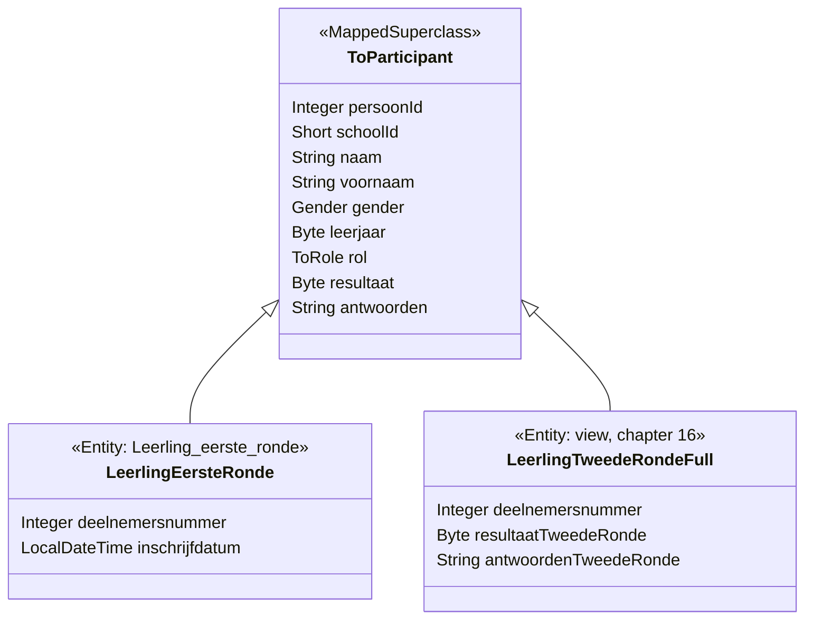

# 14. Enrolling pupils

<div class="level-tabs" data-levels>
  <button data-level="overview" aria-pressed="true">Overview</button>
  <button data-level="deep" data-short="Deep">Deep Understanding</button>
  <button data-level="drill">Drilling</button>
</div>

<div class="level overview">

A registered school sends its pupils. The responsable fills in a list of
names, genders and grades. The API then:

1. stores the pupils in `Leerling_eerste_ronde`;
2. gives each pupil a participant number;
3. later answers the questions every organiser asks: how many pupils are there, and how many per school?

The VWO does this in `VwoParticipantsController` with `LeerlingVWODaoImpl` behind it. TechOlympiad gets
`ToParticipantsController`, `LeerlingToRepository` and `LeerlingToDao`.

Three new ideas come with it. The pupil columns are shared by several
tables (round 1, round 2, the history), so they live in a
<dfn data-def="A JPA class annotated @MappedSuperclass: its field mappings are inherited by every entity that extends it, but it is not an entity itself and has no table.">mapped superclass</dfn>,
`ToParticipant`. The client does not send entities. It sends
<dfn data-def="A plain request or response class in restAPI.models, shaped for the API caller, with no JPA mapping. The repository copies its values into entities.">models</dfn>,
`ParticipantRegistration` and `PupilData`, so it cannot set fields it
has no business setting. And the counts come from HQL `GROUP BY`
queries whose rows arrive as `Object[]`, mapped by hand into a
`Map<Short, Long>`, exactly as `LeerlingVWODaoImpl.countPerSchool` does.

**After this chapter you can:**

- share column mappings between entities with `@MappedSuperclass`, and say how it differs from real JPA inheritance;
- keep request models apart from entities, and validate nested lists;
- insert a list of pupils in one transaction and number them;
- run aggregate HQL queries and turn `Object[]` rows into a map.

<div class="code-compare" data-code-compare data-labels="VWO LeerlingVWODaoImpl|TechOlympiad LeerlingToDaoImpl">

```java
@Override
@Transactional(value = transactionR, readOnly = true)
public Map<Short, Long> countPerSchool(Configuration.VwoRole edition, short year) {
    if (year != General.getCurrentSchoolYear()) {
        return countHistoricPerSchool(edition, year);
    }
    Session session = getFactoryR().getCurrentSession();
    String hql = "SELECT l.schoolId, COUNT(l) FROM LeerlingEersteRonde l WHERE l.rol = :edition GROUP BY l.schoolId";
    Query<Object[]> query = session.createQuery(hql, Object[].class);
    query.setParameter("edition", edition);
    return toCountMap(query.getResultList());
}
```

```java
@Override
@Transactional(value = transactionR, readOnly = true)
public Map<Short, Long> countPerSchool(Configuration.ToRole edition) {
    Session session = getFactoryR().getCurrentSession();
    String hql = "SELECT l.schoolId, COUNT(l) FROM LeerlingEersteRonde l "
            + "WHERE l.rol = :edition "
            + "GROUP BY l.schoolId";
    Query<Object[]> query = session.createQuery(hql, Object[].class);
    query.setParameter("edition", edition);
    return toCountMap(query.getResultList());
}
```

</div>

The `year` branch is missing on purpose: last year's pupils live in
another table, read with native SQL, and that is
[chapter 17](build-17-archive.md).

</div>

<div class="level deep">

### One pupil, several tables

The pupil columns appear in more than one place. `Leerling_eerste_ronde`
holds every pupil of the current year with their round 1 result.
`Leerling_tweede_ronde` holds only a key and the round 2 result for those
who were selected, and the view `Leerling_tweede_ronde_full` joins the
two back into full rows. `Historiek_leerling_eerste_ronde` holds the same
columns again for earlier years. In Java the VWO wants to treat a round 1
pupil and a round 2 pupil alike, for instance in
`getBySchoolAndEdition`, which returns `List<? extends VwoParticipant>`
for any round. So the shared columns are declared once, in an abstract
class, and every entity extends it.



### `@MappedSuperclass` and real inheritance

`@MappedSuperclass` is inheritance of *mappings*, nothing more. Each
subclass is an independent entity with its own table, and gets the
superclass's fields as if it had declared them. `ToParticipant` itself
is no entity: it has no table, `session.get(ToParticipant.class, id)`
fails, and `FROM ToParticipant` is not valid HQL. JPA also has real
entity inheritance, with three strategies:

<div class="table-wrap">

| Strategy | Tables | A query on the parent | EF Core name |
|---|---|---|---|
| `@MappedSuperclass` | one per subclass, unrelated | not possible | a base class that is not in the model |
| `@Inheritance(SINGLE_TABLE)` | one table for the whole tree, plus a discriminator column | one `SELECT`, filtered on the discriminator | TPH |
| `@Inheritance(JOINED)` | one table for the parent, one per subclass with the extra columns | a `JOIN` per subclass | TPT |
| `@Inheritance(TABLE_PER_CLASS)` | one complete table per concrete class | a `UNION` over all tables | TPC |

</div>

The real strategies model an "is a" relation in the data: every row of a
subclass is also a row of the parent, with one shared key space. That
does not describe these tables:

- A round 2 pupil is the *same* person as a round 1 pupil, with the same
  `PERSOON_ID`, seen through a view.
- A history row is a copy with a year added.

Under `JOINED` or `SINGLE_TABLE`, Hibernate would insist on owning the
key and the discriminator, and the view could not be mapped at all. With
`@MappedSuperclass`, each entity maps its own table or view as it is.
The shared Java type is all the VWO needs. The polymorphism happens in
Java (`List<? extends VwoParticipant>`), never in a query.

Fields in a mapped superclass are `protected`, as in the VWO's
`VwoParticipant`, so subclasses can use them directly. Lombok's `@Getter`
and `@Setter` on the abstract class generate the accessors, which
Jackson then finds on every subclass.

### Models are not entities

The `POST` body could be a list of `LeerlingEersteRonde` entities. The
VWO has a hidden endpoint that does exactly that (`@PostMapping("/post")`
with `@Operation(hidden = true)`), and the public one takes a nested
record instead:

```java
record Pupils(@JsonProperty(index = 1) Short schoolId,
              @JsonProperty(index = 2) @Enumerated(EnumType.STRING) Configuration.VwoRole edition,
              @JsonProperty(index = 3) List<VwoPupil> pupilData) {
}
```

A separate request type keeps three things out of the client's hands:
the generated `personId`, the `participantNumber` the server assigns,
and the `result` that only scoring may set. With the entity as body, a
client could send `"result": 30` and the insert would store it. ASP.NET
Core developers know this as the over-posting problem, from binding
straight to EF entities. It also lets the request have its own shape: school and
edition once at the top, then the list of pupils.

We write the two models as Lombok classes:
`ParticipantRegistration { schoolId, edition, pupilData[] }` and
`PupilData { personId, firstName, lastName, gender, grade }`. They go in
`restAPI.models`, the VWO's package for exactly this (its `PupilData`
lives there). The `personId` is ignored on a `POST`. It is required on a
`PUT`, which updates pupils that already exist. (The `@Enumerated` in the VWO record has no
effect: it is a JPA annotation and the record is no entity.)

### Validating a nested list

`@Valid` on the `@RequestBody` validates the `ParticipantRegistration`.
Its `pupilData` field carries `@Valid` too, which tells Hibernate
Validator to *cascade*: every `PupilData` in the list is validated as
well, and an error reads `pupilData[1].gender: must not be null`.

The `PUT` takes a bare `List<PupilData>`. Here `@Valid` does not help.
Spring validates the list object itself, but an `ArrayList` has no
constraints, so the elements are never visited. To validate them, you
need `List<@Valid PupilData>` together with `@Validated` on the
controller class. `@Validated` switches on Spring's method validation,
which reports failures as
`javax.validation.ConstraintViolationException`. We keep the `PUT`
simple and check the one field that matters, `personId`, by hand.

### Inserting a list, and why `IDENTITY` cannot batch

`TechOlympiadDao.addAll` (the VWO's `VwoDao.addAll`) runs in one
`transactionToRW` transaction and calls `session.save` for each entity.
One transaction means all or nothing: if pupil 12 of 25 violates a
constraint, none of the 25 is stored.

`PERSOON_ID` is `AUTO_INCREMENT`, mapped as
`GenerationType.IDENTITY`. Hibernate only learns such an id by executing
the `INSERT`, and `save` must return the id, so every `save` sends its
`INSERT` at once, one statement per pupil. JDBC batching
(`hibernate.jdbc.batch_size`) is silently disabled for identity keys.
For a class of thirty pupils that is thirty quick statements and not
worth optimising. It would matter for a nightly import of thousands.

### Numbering participants

Each pupil gets a `DEELNEMERSNUMMER`, the number on the answer sheet.
The VWO's public `POST` leaves it `null`. When the VWO API does assign
one, `LeerlingVWODaoImpl.transfer` shows the rule: the highest number in
use, plus one (`getMaxParticipantNumber(pupil.getSchoolId(), role) + 1`).
The VWO takes that maximum per school and edition.

The TechOlympiad seed numbers pupils differently. The first two digits
are the school year, and the rest is one sequence over all schools. So
the 2027 pupils are `27000001` to `27000009`, and last year's history
rows start at `26000001`. We keep that scheme, which makes the maximum a single query
over the whole table:

```text
(JAAR % 100) * 1000000 + n        2027 -> 27000001, 27000002, ...
```

Because `DEELNEMERSNUMMER` is `UNIQUE` across the table, a global
sequence is also the simplest way to never collide between schools.

<div class="callout danger">
<div class="callout-label">Two registrations at the same moment</div>

`MAX + 1` read in one transaction and written in another is a race: two
requests at the same moment can both read `27000009` and both write
`27000010`. The `UNIQUE` index on `DEELNEMERSNUMMER` turns the second
request into an error instead of a duplicate number, and the rollback of
the whole batch keeps the data consistent. A handful of responsables
fill in this form over several weeks, so that is an acceptable
trade-off. The VWO's `transfer` lives with the same one.

</div>

### Columns the database fills in

`INSCHRIJFDATUM` has `DEFAULT current_timestamp()`. The mapping
`insertable = false, updatable = false` keeps Hibernate from writing it,
so the default applies. That alone would leave the field `null` in the
object you return, because Hibernate never reads back what it did not
write. `@Generated(GenerationTime.INSERT)` (from `org.hibernate.annotations`)
tells it to `SELECT` generated columns right after the `INSERT`, so the
response shows the stored value.

The VWO combines `insertable = false, updatable = false` with
`@CreationTimestamp`. That annotation sets the field from the JVM clock
before the insert. The column is not insertable, so the database still
uses its own default. The response then shows the JVM's time and
the table holds MariaDB's, which agree as long as both clocks and time
zones do.

### Counting with `GROUP BY`

`SELECT COUNT(l) FROM LeerlingEersteRonde l WHERE l.rol = :edition`
returns one value, a `Long`, so the query is typed
`createQuery(hql, Long.class)` and read with `uniqueResult()`. When the
`SELECT` lists two expressions, each row is an `Object[]`:
`row[0]` is the `Short` school id and `row[1]` the `Long` count. The VWO
converts the rows with a small helper:

```java
private static Map<Short, Long> toCountMap(List<Object[]> rows) {
    Map<Short, Long> result = new HashMap<>();
    for (Object[] row : rows) {
        // Pupils without a school can't be counted per school.
        if (row[0] == null) {
            continue;
        }
        result.put(((Number) row[0]).shortValue(), ((Number) row[1]).longValue());
    }
    return result;
}
```

The casts go through `Number` on purpose. HQL returns the mapped Java
types (`Short`, `Long`), but the same helper also handles rows from
native SQL in chapter 17, where the driver decides the types, and a
`COUNT(*)` may come back as `Long` or `BigInteger`. `Number` covers them
all.

HQL could also build objects directly with a constructor expression,
`SELECT new be.techolympiad...SchoolCount(l.schoolId, COUNT(l)) ...`.
The VWO does not use that anywhere: its counts end up in maps and
records assembled in the controller, and `Object[]` rows keep the query
independent of any result class. We follow it. In EF Core you would
write `GroupBy(l => l.SchoolId).Select(g => new { g.Key, Count = g.Count() })`
and `ToDictionary`. The `Object[]` loop does that last step by hand.

### Lists in query parameters

`GET /count?edition=JTO,STO` binds to `List<ToRole> editions`. Spring
splits the text on commas and converts each part with the conversion
service, so `ToRoleConverter` from chapter 12 handles every element and
`?edition=jto,sto` works too. Leaving the parameter out gives `null`,
which the controller reads as "all editions", the VWO's convention for
these endpoints.

### Why some fields say `type = "integer"`

`leerjaar` and `resultaat` are `Byte`, matching `tinyint` columns.
Swagger's model converter documents a Java `Byte` as
`type: string, format: byte`. That is the OpenAPI way of saying
"base64-encoded bytes", and it would make Swagger UI show a text field
and an example like `"string"`. The VWO overrides it with
`@Schema(type = "integer")` on such fields, and so do we. The JSON
Jackson produces is a plain number either way. The annotation only fixes
the documentation.

</div>

<div class="level drill">

### What you should have

The end state of [chapter 13](build-13-registration.md): `General` with
the school year, registrations and fees working. The seed holds some
round 1 pupils in `Leerling_eerste_ronde` for the registered schools.

Paths are relative to `src/main/java/be/techolympiad/common/`.

### Tasks

<ul class="checklist">
<li><label><input type="checkbox"><span>Create the mapped superclass <code>ToParticipant</code> and the entity <code>LeerlingEersteRonde</code>; map only the entity in <code>hibernate_TO.cfg.xml</code>.</span></label></li>
<li><label><input type="checkbox"><span>Create the models <code>PupilData</code> and <code>ParticipantRegistration</code>.</span></label></li>
<li><label><input type="checkbox"><span>Create <code>LeerlingToDao</code> and <code>LeerlingToDaoImpl</code>.</span></label></li>
<li><label><input type="checkbox"><span>Create <code>LeerlingToRepository</code> and <code>LeerlingToRepositoryImpl</code>.</span></label></li>
<li><label><input type="checkbox"><span>Create the <code>ToParticipantsController</code> interface and its <code>v1</code> class.</span></label></li>
<li><label><input type="checkbox"><span>Build, restart, and run the calls under <em>Run it</em>.</span></label></li>
<li><label><input type="checkbox"><span>Commit: <code>git add -A &amp;&amp; git commit -m "Enrol pupils for round 1"</code>.</span></label></li>
</ul>

### Entities

`dbEntities/ToParticipant.java`

```java
package be.techolympiad.common.dbEntities;

import be.techolympiad.common.Configuration;
import com.fasterxml.jackson.annotation.JsonAlias;
import com.fasterxml.jackson.annotation.JsonProperty;
import io.swagger.v3.oas.annotations.media.Schema;
import lombok.Getter;
import lombok.Setter;

import javax.persistence.*;
import java.io.Serializable;

@MappedSuperclass
@Getter
@Setter
public abstract class ToParticipant implements Serializable {

    @Id
    @GeneratedValue(strategy = GenerationType.IDENTITY)
    @Column(name = "PERSOON_ID", nullable = false)
    @JsonProperty("personId")
    @JsonAlias("persoonId")
    protected Integer persoonId;

    @Column(name = "SCHOOL_ID")
    @JsonProperty("schoolId")
    protected Short schoolId;

    @Column(name = "NAAM")
    @JsonProperty("lastName")
    @JsonAlias("naam")
    protected String naam;

    @Column(name = "VOORNAAM")
    @JsonProperty("firstName")
    @JsonAlias("voornaam")
    protected String voornaam;

    @Column(name = "GENDER")
    @Enumerated(EnumType.STRING)
    @JsonProperty("gender")
    protected Configuration.Gender gender;

    @Column(name = "LEERJAAR")
    @JsonProperty("grade")
    @JsonAlias("leerjaar")
    @Schema(description = "Grade of this pupil in secondary school", type = "integer")
    protected Byte leerjaar;

    @Column(name = "ROL")
    @Enumerated(EnumType.STRING)
    @JsonProperty("role")
    @JsonAlias("rol")
    protected Configuration.ToRole rol;

    @Column(name = "RESULTAAT")
    @JsonProperty("result")
    @JsonAlias("resultaat")
    @Schema(type = "integer")
    protected Byte resultaat;

    @Column(name = "ANTWOORDEN", length = 30)
    @JsonProperty("answers")
    @JsonAlias("antwoorden")
    protected String antwoorden;

    @Override
    public boolean equals(Object o) {
        if (this == o) return true;
        if (o == null || getClass() != o.getClass()) return false;
        ToParticipant that = (ToParticipant) o;
        return persoonId != null && persoonId.equals(that.persoonId);
    }

    @Override
    public int hashCode() {
        return getClass().hashCode();
    }
}
```

The VWO calls the grade `year` in JSON. TechOlympiad already uses `year`
for the school year everywhere, so the pupil's grade is `grade`, with the
Dutch `leerjaar` as alias. `equals` and `hashCode` live here once. The
`getClass()` comparison keeps a round 1 pupil and a round 2 row of the
same person apart.

`dbEntities/LeerlingEersteRonde.java`

```java
package be.techolympiad.common.dbEntities;

import com.fasterxml.jackson.annotation.JsonAlias;
import com.fasterxml.jackson.annotation.JsonFormat;
import com.fasterxml.jackson.annotation.JsonProperty;
import io.swagger.v3.oas.annotations.media.Schema;
import lombok.Getter;
import lombok.NoArgsConstructor;
import lombok.Setter;
import org.hibernate.annotations.Generated;
import org.hibernate.annotations.GenerationTime;

import javax.persistence.Column;
import javax.persistence.Entity;
import javax.persistence.Table;
import java.time.LocalDateTime;

@Entity
@Table(name = "Leerling_eerste_ronde", schema = "TechOlympiad")
@Schema(name = "ToPupil")
@Getter
@Setter
@NoArgsConstructor
public class LeerlingEersteRonde extends ToParticipant {

    @Column(name = "DEELNEMERSNUMMER", unique = true)
    @JsonProperty("participantNumber")
    @JsonAlias("deelnemersnummer")
    private Integer deelnemersnummer;

    @Column(name = "INSCHRIJFDATUM", insertable = false, updatable = false)
    @Generated(GenerationTime.INSERT)
    @JsonProperty("subscriptionDate")
    @JsonAlias("inschrijfdatum")
    @JsonFormat(shape = JsonFormat.Shape.STRING, pattern = "yyyy-MM-dd HH:mm:ss")
    private LocalDateTime inschrijfdatum;
}
```

`@JsonFormat` gives the VWO's date format, `2026-10-19 14:05:00`, instead
of Jackson's ISO default with a `T`. The VWO also passes a `timezone` to
it, which has no effect on a `LocalDateTime`: there is no zone to
convert from.

`hibernate_TO.cfg.xml`: only entities get a line, so `ToParticipant`
does not.

<div class="diff-view" data-diff-view>

```diff
         <mapping class="be.techolympiad.common.dbEntities.Inschrijvingsgeld"/>
+        <mapping class="be.techolympiad.common.dbEntities.LeerlingEersteRonde"/>
     </session-factory>
```

</div>

### Models

`restAPI/models/PupilData.java`

```java
package be.techolympiad.common.restAPI.models;

import be.techolympiad.common.Configuration;
import io.swagger.v3.oas.annotations.media.Schema;
import lombok.Getter;
import lombok.NoArgsConstructor;
import lombok.Setter;

import javax.validation.constraints.Max;
import javax.validation.constraints.Min;
import javax.validation.constraints.NotBlank;
import javax.validation.constraints.NotNull;

@Getter
@Setter
@NoArgsConstructor
@Schema(name = "PupilData")
public class PupilData {

    @Schema(description = "Only for updates: the pupil's personId")
    private Integer personId;

    @NotBlank
    private String firstName;

    @NotBlank
    private String lastName;

    @NotNull
    private Configuration.Gender gender;

    @NotNull
    @Min(1)
    @Max(6)
    @Schema(type = "integer")
    private Byte grade;
}
```

`restAPI/models/ParticipantRegistration.java`

```java
package be.techolympiad.common.restAPI.models;

import be.techolympiad.common.Configuration;
import io.swagger.v3.oas.annotations.media.Schema;
import lombok.Getter;
import lombok.NoArgsConstructor;
import lombok.Setter;

import javax.validation.Valid;
import javax.validation.constraints.NotEmpty;
import javax.validation.constraints.NotNull;
import java.util.List;

@Getter
@Setter
@NoArgsConstructor
@Schema(name = "ParticipantRegistration")
public class ParticipantRegistration {

    @NotNull
    private Short schoolId;

    @NotNull
    private Configuration.ToRole edition;

    @NotEmpty
    @Valid
    private List<PupilData> pupilData;
}
```

### The DAO

`dao/LeerlingToDao.java`

```java
package be.techolympiad.common.dao;

import be.techolympiad.common.Configuration;
import be.techolympiad.common.dbEntities.LeerlingEersteRonde;
import org.springframework.data.repository.NoRepositoryBean;

import java.util.Collection;
import java.util.List;
import java.util.Map;

@NoRepositoryBean
public interface LeerlingToDao extends TechOlympiadDao<LeerlingEersteRonde, Integer> {

    List<LeerlingEersteRonde> getBySchoolAndEdition(Short schoolId, Configuration.ToRole edition);

    int getMaxParticipantNumber(short year);

    List<LeerlingEersteRonde> updateAll(Collection<LeerlingEersteRonde> pupils);

    long count(Configuration.ToRole edition);

    Map<Short, Long> countPerSchool(Configuration.ToRole edition);
}
```

<div class="code-walk" data-code-walk>

```java
package be.techolympiad.common.dao.impl;

import be.techolympiad.common.Configuration;
import be.techolympiad.common.dao.LeerlingToDao;
import be.techolympiad.common.dbEntities.LeerlingEersteRonde;
import org.hibernate.Session;
import org.hibernate.query.Query;
import org.springframework.stereotype.Repository;
import org.springframework.transaction.annotation.Transactional;

import java.util.ArrayList;
import java.util.Collection;
import java.util.HashMap;
import java.util.List;
import java.util.Map;

@Repository
public class LeerlingToDaoImpl extends TechOlympiadDaoImpl<LeerlingEersteRonde, Integer> implements LeerlingToDao {

    private static final int NUMBERS_PER_YEAR = 1000000;

    @Override
    @Transactional(value = transactionR, readOnly = true)
    public List<LeerlingEersteRonde> getBySchoolAndEdition(Short schoolId, Configuration.ToRole edition) {
        Session session = getFactoryR().getCurrentSession();
        String hql = "SELECT l FROM LeerlingEersteRonde l "
                + "WHERE l.schoolId = :schoolId "
                + "AND l.rol = :edition "
                + "ORDER BY l.deelnemersnummer";
        Query<LeerlingEersteRonde> query = session.createQuery(hql, type);
        query.setParameter("schoolId", schoolId);
        query.setParameter("edition", edition);
        return query.getResultList();
    }

    @Override
    @Transactional(value = transactionR, readOnly = true)
    public int getMaxParticipantNumber(short year) {
        Session session = getFactoryR().getCurrentSession();
        String hql = "SELECT MAX(l.deelnemersnummer) FROM LeerlingEersteRonde l";
        Query<Integer> query = session.createQuery(hql, Integer.class);
        Integer max = query.uniqueResult(); // (1)
        int yearStart = (year % 100) * NUMBERS_PER_YEAR;
        return max == null ? yearStart : Integer.max(max, yearStart);
    }

    @Override
    @Transactional(value = transactionRW)
    public List<LeerlingEersteRonde> updateAll(Collection<LeerlingEersteRonde> pupils) {
        Session session = getFactoryRW().getCurrentSession();
        List<LeerlingEersteRonde> result = new ArrayList<>();
        for (LeerlingEersteRonde pupil : pupils) {
            session.update(pupil); // (2)
            result.add(pupil);
        }
        return result;
    }

    @Override
    @Transactional(value = transactionR, readOnly = true)
    public long count(Configuration.ToRole edition) {
        Session session = getFactoryR().getCurrentSession();
        String hql = "SELECT COUNT(l) FROM LeerlingEersteRonde l "
                + "WHERE l.rol = :edition";
        Query<Long> query = session.createQuery(hql, Long.class); // (3)
        query.setParameter("edition", edition);
        return query.uniqueResult();
    }

    @Override
    @Transactional(value = transactionR, readOnly = true)
    public Map<Short, Long> countPerSchool(Configuration.ToRole edition) {
        Session session = getFactoryR().getCurrentSession();
        String hql = "SELECT l.schoolId, COUNT(l) FROM LeerlingEersteRonde l "
                + "WHERE l.rol = :edition "
                + "GROUP BY l.schoolId";
        Query<Object[]> query = session.createQuery(hql, Object[].class); // (4)
        query.setParameter("edition", edition);
        return toCountMap(query.getResultList());
    }

    private static Map<Short, Long> toCountMap(List<Object[]> rows) {
        Map<Short, Long> result = new HashMap<>();
        for (Object[] row : rows) {
            if (row[0] == null) {
                continue; // (5)
            }
            result.put(((Number) row[0]).shortValue(), ((Number) row[1]).longValue());
        }
        return result;
    }
}
```

1. `MAX` over no rows is SQL `NULL`, so the result is an `Integer` that can be `null`, not an `int`. The first pupil of a year gets `yearStart + 1`, `27000001` for 2027.
2. The VWO's `updateAll`: `update` attaches each detached pupil to the read-write session, and the `UPDATE`s run at commit, all in one transaction. `saveAll` would be wrong here: `save` on a detached pupil with an identity key inserts a new row.
3. `COUNT` is a `Long` in HQL, never an `Integer`. Asking for `Integer.class` fails with a type mismatch.
4. Two expressions in the `SELECT`, so each row is an `Object[]` of length two.
5. A pupil without a school would give a `null` key. The VWO skips such rows with the same check.

</div>

### The repository

`restAPI/repositories/LeerlingToRepository.java`

```java
package be.techolympiad.common.restAPI.repositories;

import be.techolympiad.common.Configuration;
import be.techolympiad.common.dbEntities.LeerlingEersteRonde;
import be.techolympiad.common.restAPI.models.ParticipantRegistration;
import be.techolympiad.common.restAPI.models.PupilData;
import org.springframework.data.repository.NoRepositoryBean;
import org.springframework.data.repository.Repository;

import java.util.List;
import java.util.Map;

@NoRepositoryBean
public interface LeerlingToRepository extends Repository<LeerlingEersteRonde, Integer> {

    List<LeerlingEersteRonde> findBySchoolAndEdition(Short schoolId, Configuration.ToRole edition);

    List<LeerlingEersteRonde> register(ParticipantRegistration registration);

    List<LeerlingEersteRonde> update(List<PupilData> pupils);

    void deleteById(Integer id);

    long count(Configuration.ToRole edition);

    Map<Short, Long> countPerSchool(Configuration.ToRole edition);
}
```

`restAPI/repositories/LeerlingToRepositoryImpl.java`

```java
package be.techolympiad.common.restAPI.repositories;

import be.techolympiad.common.Configuration;
import be.techolympiad.common.General;
import be.techolympiad.common.dao.LeerlingToDao;
import be.techolympiad.common.dbEntities.LeerlingEersteRonde;
import be.techolympiad.common.restAPI.models.ParticipantRegistration;
import be.techolympiad.common.restAPI.models.PupilData;
import org.springframework.beans.factory.annotation.Autowired;
import org.springframework.stereotype.Repository;

import java.util.ArrayList;
import java.util.List;
import java.util.Map;
import java.util.NoSuchElementException;

@Repository
public class LeerlingToRepositoryImpl implements LeerlingToRepository {

    private final LeerlingToDao leerlingToDao;

    @Autowired
    public LeerlingToRepositoryImpl(LeerlingToDao leerlingToDao) {
        this.leerlingToDao = leerlingToDao;
    }

    @Override
    public List<LeerlingEersteRonde> findBySchoolAndEdition(Short schoolId, Configuration.ToRole edition) {
        return leerlingToDao.getBySchoolAndEdition(schoolId, edition);
    }

    @Override
    public List<LeerlingEersteRonde> register(ParticipantRegistration registration) {
        int number = leerlingToDao.getMaxParticipantNumber(General.getCurrentSchoolYear());
        List<LeerlingEersteRonde> pupils = new ArrayList<>();
        for (PupilData data : registration.getPupilData()) {
            LeerlingEersteRonde pupil = new LeerlingEersteRonde();
            pupil.setSchoolId(registration.getSchoolId());
            pupil.setRol(registration.getEdition());
            pupil.setDeelnemersnummer(++number);
            copy(data, pupil);
            pupils.add(pupil);
        }
        leerlingToDao.addAll(pupils);
        return pupils;
    }

    @Override
    public List<LeerlingEersteRonde> update(List<PupilData> pupils) {
        List<LeerlingEersteRonde> toUpdate = new ArrayList<>();
        for (PupilData data : pupils) {
            LeerlingEersteRonde pupil = leerlingToDao.getOptional(data.getPersonId())
                    .orElseThrow(() -> new NoSuchElementException("No pupil with id " + data.getPersonId()));
            copy(data, pupil);
            toUpdate.add(pupil);
        }
        return leerlingToDao.updateAll(toUpdate);
    }

    @Override
    public void deleteById(Integer id) {
        leerlingToDao.deleteById(id);
    }

    @Override
    public long count(Configuration.ToRole edition) {
        return leerlingToDao.count(edition);
    }

    @Override
    public Map<Short, Long> countPerSchool(Configuration.ToRole edition) {
        return leerlingToDao.countPerSchool(edition);
    }

    private static void copy(PupilData data, LeerlingEersteRonde pupil) {
        pupil.setVoornaam(data.getFirstName());
        pupil.setNaam(data.getLastName());
        pupil.setGender(data.getGender());
        pupil.setLeerjaar(data.getGrade());
    }
}
```

`register` returns the same objects it passed to `addAll`. After each
`save` they carry their generated `persoonId`, and thanks to
`@Generated` their `inschrijfdatum`, so the response shows exactly what
was stored.

`update` follows the same path as the VWO's `put` endpoint:

1. It loads each pupil through the read-only factory.
2. It changes the pupil.
3. It hands the now-detached objects to `updateAll`, which writes them through the read-write factory.

### The controller

<div class="param-table" data-param-table>

| Name | Type | Description |
|---|---|---|
| `GET /to/participants` | `ToPupil[]` | Query `schoolId`, `edition` and `round` (default `1`; other rounds return `400` until chapter 16). |
| `POST /to/participants` | `ToPupil[]` | Body `ParticipantRegistration`. Stores and numbers the pupils. |
| `PUT /to/participants` | `ToPupil[]` | Body `PupilData[]`, each with its `personId`. Changes names, gender and grade. |
| `DELETE /to/participants/{pupilId}` | `void` | `204`. |
| `GET /to/participants/count` | `EditionCount[]` | Query `edition` optional, comma-separated; all editions when left out. |
| `GET /to/participants/school-counts` | `SchoolParticipantCount[]` | The same per school; schools without pupils are absent. |

</div>

`restAPI/controllers/ToParticipantsController.java`

```java
package be.techolympiad.common.restAPI.controllers;

import be.techolympiad.common.Configuration;
import be.techolympiad.common.General;
import be.techolympiad.common.dbEntities.LeerlingEersteRonde;
import be.techolympiad.common.dbEntities.ToParticipant;
import be.techolympiad.common.restAPI.models.ParticipantRegistration;
import be.techolympiad.common.restAPI.models.PupilData;
import be.techolympiad.common.restAPI.repositories.LeerlingToRepository;
import io.swagger.v3.oas.annotations.Operation;
import io.swagger.v3.oas.annotations.Parameter;
import io.swagger.v3.oas.annotations.media.Schema;
import org.springframework.http.HttpStatus;
import org.springframework.http.MediaType;
import org.springframework.http.ResponseEntity;
import org.springframework.web.bind.annotation.*;

import javax.validation.Valid;
import javax.validation.constraints.NotNull;
import java.util.ArrayList;
import java.util.List;

public interface ToParticipantsController {

    LeerlingToRepository getRepository();

    @GetMapping
    @Operation(summary = "Get the pupils of a school for an edition and round")
    @ResponseBody
    default ResponseEntity<List<? extends ToParticipant>> get(
            @RequestParam("schoolId") Short schoolId,
            @RequestParam("edition") Configuration.ToRole edition,
            @RequestParam(value = "round", defaultValue = "1") @Parameter(schema = @Schema(allowableValues = {"1", "2"})) char roundChar) {
        Configuration.ToRound round = Configuration.ToRound.fromCode(roundChar);
        if (round == null) {
            return ResponseEntity.badRequest().build();
        }
        switch (round) {
            case ONE:
                return ResponseEntity.ok().body(getRepository().findBySchoolAndEdition(schoolId, edition));
            default:
                return ResponseEntity.badRequest().build();
        }
    }

    @PostMapping(consumes = MediaType.APPLICATION_JSON_VALUE)
    @Operation(summary = "Register pupils of a school for an edition")
    @ResponseBody
    default ResponseEntity<List<LeerlingEersteRonde>> create(@RequestBody @Valid @NotNull ParticipantRegistration registration) {
        return ResponseEntity.ok().body(getRepository().register(registration));
    }

    @PutMapping(consumes = MediaType.APPLICATION_JSON_VALUE)
    @Operation(summary = "Change the data of registered pupils")
    @ResponseBody
    default ResponseEntity<List<LeerlingEersteRonde>> update(@RequestBody @NotNull List<PupilData> pupils) {
        if (pupils.stream().anyMatch(pupil -> pupil.getPersonId() == null)) {
            return ResponseEntity.badRequest().build();
        }
        return ResponseEntity.ok().body(getRepository().update(pupils));
    }

    @DeleteMapping("/{pupilId}")
    @Operation(summary = "Delete a pupil")
    @ResponseStatus(HttpStatus.NO_CONTENT)
    default void deleteById(@PathVariable("pupilId") Integer pupilId) {
        getRepository().deleteById(pupilId);
    }

    @GetMapping("/count")
    @Operation(summary = "Get the number of pupils per edition")
    @ResponseBody
    default ResponseEntity<List<EditionCount>> getCount(
            @RequestParam(value = "edition", required = false) @Parameter(description = "Comma-separated list of editions; all editions if empty") List<Configuration.ToRole> editions) {
        short year = General.getCurrentSchoolYear();
        List<EditionCount> result = new ArrayList<>();
        for (Configuration.ToRole edition : editionsOrAll(editions)) {
            result.add(new EditionCount(edition, year, getRepository().count(edition)));
        }
        return ResponseEntity.ok().body(result);
    }

    @GetMapping("/school-counts")
    @Operation(summary = "Get the number of pupils per school and edition")
    @ResponseBody
    default ResponseEntity<List<SchoolParticipantCount>> getSchoolCounts(
            @RequestParam(value = "edition", required = false) @Parameter(description = "Comma-separated list of editions; all editions if empty") List<Configuration.ToRole> editions) {
        short year = General.getCurrentSchoolYear();
        List<SchoolParticipantCount> result = new ArrayList<>();
        for (Configuration.ToRole edition : editionsOrAll(editions)) {
            getRepository().countPerSchool(edition).forEach((schoolId, count) ->
                    result.add(new SchoolParticipantCount(schoolId, edition, year, count)));
        }
        return ResponseEntity.ok().body(result);
    }

    private static List<Configuration.ToRole> editionsOrAll(List<Configuration.ToRole> editions) {
        if (editions == null || editions.isEmpty()) {
            return List.of(Configuration.ToRole.values());
        }
        return editions;
    }

    record EditionCount(Configuration.ToRole edition, short year, long count) {
    }

    record SchoolParticipantCount(Short schoolId, Configuration.ToRole edition, short year, long count) {
    }
}
```

Interfaces may have `private static` methods since Java 9. The VWO's
`FunctionController` uses one for the same kind of helper. The lambda
passed to `forEach` uses `year` and `edition`, which works because both
are effectively final: assigned once and never changed.

`restAPI/controllers/v1/ToParticipantsController.java`

```java
package be.techolympiad.common.restAPI.controllers.v1;

import be.techolympiad.common.restAPI.repositories.LeerlingToRepository;
import io.swagger.v3.oas.annotations.tags.Tag;
import lombok.Getter;
import org.springframework.beans.factory.annotation.Autowired;
import org.springframework.http.MediaType;
import org.springframework.web.bind.annotation.RequestMapping;
import org.springframework.web.bind.annotation.RestController;

@RestController("toParticipantsController.v1")
@RequestMapping(path = V1Config.BASE_URL + "/to/participants", produces = MediaType.APPLICATION_JSON_VALUE)
@Tag(name = "to-participants-controller")
@Getter
public class ToParticipantsController implements be.techolympiad.common.restAPI.controllers.ToParticipantsController {

    private final LeerlingToRepository repository;

    @Autowired
    public ToParticipantsController(LeerlingToRepository repository) {
        this.repository = repository;
    }
}
```

### Run it

```bash
mvn -q -DskipTests -Plocal package && docker compose restart api
```

1. `GET /api/v1/to/participants` with `schoolId` = `1` and
   `edition` = `jto`: Lotte Claes (`27000001`) and Mats Goossens
   (`27000002`), the seeded JTO pupils of Campus Zonnedauw.
2. Register two more pupils for that school with `POST /api/v1/to/participants`:

   ```json
   {
     "schoolId": 1,
     "edition": "JTO",
     "pupilData": [
       { "firstName": "Lena", "lastName": "Peeters", "gender": "V", "grade": 2 },
       { "firstName": "Milan", "lastName": "Claes", "gender": "M", "grade": 1 }
     ]
   }
   ```

   The response has both pupils with a new `personId` (`10` and `11`
   after the nine seeded pupils), the next two participant numbers
   (`27000010` and `27000011`), today's `subscriptionDate`, and `null` for
   `result` and `answers`:

   ```json
   [
     {
       "personId": 10,
       "schoolId": 1,
       "lastName": "Peeters",
       "firstName": "Lena",
       "gender": "V",
       "grade": 2,
       "role": "JTO",
       "result": null,
       "answers": null,
       "participantNumber": 27000010,
       "subscriptionDate": "2026-10-19 14:05:00"
     }
   ]
   ```

3. Send the same body with `"gender"` removed from the second pupil:
   `400`, and the log names `pupilData[1].gender`. Nothing was stored:
   validation runs before the method.
4. `GET /api/v1/to/participants/count`: one entry per edition, for the
   current school year.

   ```json
   [
     { "edition": "JTO", "year": 2027, "count": 7 },
     { "edition": "STO", "year": 2027, "count": 4 }
   ]
   ```

   The seed has five JTO and four STO pupils. The two you added make it
   seven JTO pupils.

   With `edition` = `jto` only the first entry comes back.
5. `GET /api/v1/to/participants/school-counts?edition=JTO`: schools 1, 2
   and 3 (school 4 has no JTO pupils, so it is absent):

   ```json
   [
     { "schoolId": 1, "edition": "JTO", "year": 2027, "count": 4 },
     { "schoolId": 2, "edition": "JTO", "year": 2027, "count": 1 },
     { "schoolId": 3, "edition": "JTO", "year": 2027, "count": 2 }
   ]
   ```

   A `HashMap` has no order, so the entries may come in another order.
6. Rename Lena with `PUT /api/v1/to/participants`, using the `personId`
   the `POST` gave her (`10` in the example above):

   ```json
   [ { "personId": 10, "firstName": "Lena", "lastName": "Peeters-Janssens", "gender": "V", "grade": 2 } ]
   ```

   Her `participantNumber` and `subscriptionDate` are unchanged.
7. `DELETE /api/v1/to/participants/{pupilId}` with that id: `204`, and
   the count drops by one.

<div class="callout danger">
<div class="callout-label">When it breaks</div>

- **`org.hibernate.MappingException: Unknown entity: be.techolympiad.common.dbEntities.ToParticipant`**, or `ToParticipant is not mapped` in HQL: you listed or queried the mapped superclass. Only entities can be loaded and queried.
- **`subscriptionDate` is `null` in the `POST` response**: `@Generated(GenerationTime.INSERT)` is missing, so Hibernate never read the database default back.
- **`DataIntegrityViolationException ... Duplicate entry '27000010' for key 'DEELNEMERSNUMMER'`**: two registrations raced for the same numbers. The whole batch was rolled back; send it again.
- **`Type specified for TypedQuery [java.lang.Integer] is incompatible with query return type [class java.lang.Long]`**: a `COUNT` query typed as `Integer`. Use `Long.class`.
- **The `PUT` creates new pupils instead of changing them**: the DAO used `save` or `saveAll` on the loaded objects. Use `update`.
- **`500` with `NoSuchElementException: No pupil with id ...`** on the `PUT`: an unknown id. Error handling is the subject of chapter 18.

</div>

### Quiz

<div class="quiz" data-quiz>
<p class="quiz-q">Why does the VWO map the pupil columns with <code>@MappedSuperclass</code> and not with <code>@Inheritance(strategy = JOINED)</code>?</p>
<ol class="quiz-options">
<li>Hibernate 5 does not support <code>JOINED</code> with MariaDB<p class="quiz-whynot">All three inheritance strategies work on MariaDB.</p></li>
<li data-correct>The tables are not a type hierarchy: round 2 and the history are other views of the same person, and one of them is a database view<p class="quiz-why">Real JPA inheritance needs one key space owned by the parent and, for <code>SINGLE_TABLE</code>/<code>JOINED</code>, a parent table. The VWO only wants shared Java fields over independent tables.</p></li>
<li><code>@MappedSuperclass</code> allows <code>FROM VwoParticipant</code> queries over all tables<p class="quiz-whynot">The opposite: a mapped superclass is not an entity and cannot be queried. Polymorphic queries need real inheritance.</p></li>
</ol>
<p class="quiz-explain">The polymorphism the VWO uses is in Java, as <code>List&lt;? extends VwoParticipant&gt;</code>; each query names a concrete entity.</p>
</div>

<div class="quiz" data-quiz>
<p class="quiz-q">A registration of 25 pupils arrives, and the insert of pupil 13 fails on the unique participant number. How many pupils are in the table afterwards?</p>
<ol class="quiz-options">
<li>12: the inserts before the failure already ran<p class="quiz-whynot">They ran, but inside one transaction, which is rolled back as a whole.</p></li>
<li data-correct>None of the 25<p class="quiz-why"><code>addAll</code> saves every pupil inside a single <code>transactionToRW</code> transaction. The exception makes the proxy roll it back, including the 12 inserts that succeeded.</p></li>
<li>24: Hibernate skips the failing pupil<p class="quiz-whynot">Hibernate never skips a failed statement; the exception ends the unit of work.</p></li>
</ol>
<p class="quiz-explain">The identity key forces an immediate <code>INSERT</code> per pupil, so the first twelve really were sent; the transaction is what makes them disappear again.</p>
</div>

<div class="quiz" data-quiz>
<p class="quiz-q"><code>SELECT l.schoolId, COUNT(l) FROM LeerlingEersteRonde l GROUP BY l.schoolId</code>, run with <code>createQuery(hql, Object[].class)</code>. What is in each element of the result list?</p>
<ol class="quiz-options">
<li>A <code>LeerlingEersteRonde</code> with only <code>schoolId</code> filled in<p class="quiz-whynot">HQL only returns entities when the <code>SELECT</code> names an entity alias, such as <code>SELECT l</code>.</p></li>
<li data-correct>An <code>Object[]</code> holding a <code>Short</code> and a <code>Long</code><p class="quiz-why">Each selected expression becomes one array element, typed after the mapped field (<code>Short</code>) and the aggregate (<code>Long</code>).</p></li>
<li>A <code>Map.Entry&lt;Short, Long&gt;</code><p class="quiz-whynot">Hibernate has no notion of map entries for rows; building the map is the DAO's job.</p></li>
</ol>
<p class="quiz-explain">That is why <code>toCountMap</code> exists, and why it reads through <code>Number</code>: the same loop then also works for native SQL rows.</p>
</div>

### Flashcards

<div class="flashcards" data-flashcards data-front-label="Term" data-back-label="Meaning">
<div class="card"><div class="front"><code>@MappedSuperclass</code></div><div class="back">Shared field mappings for entities with their own tables. Not an entity: no table, no queries, no <code>&lt;mapping&gt;</code> line.</div></div>
<div class="card"><div class="front"><code>SINGLE_TABLE</code> / <code>JOINED</code> / <code>TABLE_PER_CLASS</code></div><div class="back">Real JPA inheritance, EF Core's TPH / TPT / TPC. Polymorphic queries, one shared key space.</div></div>
<div class="card"><div class="front">Model vs entity</div><div class="back">A model is the API's request or response shape; an entity is a mapped row. Models stop clients from setting server-owned fields.</div></div>
<div class="card"><div class="front"><code>@Valid</code> on a list field</div><div class="back">Cascades validation into every element. On a bare <code>List</code> body it does nothing; that needs <code>List&lt;@Valid T&gt;</code> plus <code>@Validated</code>.</div></div>
<div class="card"><div class="front"><code>IDENTITY</code> and batching</div><div class="back">Every <code>save</code> runs its <code>INSERT</code> at once to learn the id, so JDBC batching is disabled.</div></div>
<div class="card"><div class="front"><code>@Generated(GenerationTime.INSERT)</code></div><div class="back">Hibernate re-reads the column after the <code>INSERT</code>, for values the database fills in.</div></div>
<div class="card"><div class="front">Aggregate HQL rows</div><div class="back">One expression: that type (<code>COUNT</code> is <code>Long</code>). Several: <code>Object[]</code> per row.</div></div>
</div>

### Self-checks

<details class="qa">
<summary>Self-check: why does <code>getMaxParticipantNumber</code> return <code>Integer.max(max, yearStart)</code> instead of just <code>max</code>?</summary>
<div class="ans">
On the first registration after a new school year starts, the table may still hold last year's numbers (if nobody archived yet), say <code>27000140</code>. <code>max + 1</code> would continue that sequence with a 27 prefix in 2028. Taking the larger of the two starts the new year at <code>28000001</code>. The VWO's version also combines two maxima: the current one and the highest number freed by a transfer.
<div class="mark"><button type="button">Mark as known</button></div>
</div>
</details>

<details class="qa">
<summary>Self-check: the <code>PUT</code> loads pupils through <code>toR</code> and writes them through <code>toRW</code>. Why does that work?</summary>
<div class="ans">
Each <code>getOptional</code> runs in its own read-only transaction; when it ends, its session closes and the pupil is detached. <code>session.update</code> in the read-write session attaches the detached object to that session, and the commit sends an <code>UPDATE</code> of all its columns. The two sessions never share an object at the same time.
<div class="mark"><button type="button">Mark as known</button></div>
</div>
</details>

<details class="qa">
<summary>Self-check: what stops a client from sending <code>"result": 30</code> when registering a pupil?</summary>
<div class="ans">
The body is a <code>ParticipantRegistration</code>, and <code>PupilData</code> has no <code>result</code> field. Jackson ignores the unknown property (Spring Boot disables <code>FAIL_ON_UNKNOWN_PROPERTIES</code>), and the repository only copies names, gender and grade into the entity.
<div class="mark"><button type="button">Mark as known</button></div>
</div>
</details>

<button type="button" data-mark-done>Mark this chapter done</button>

</div>
