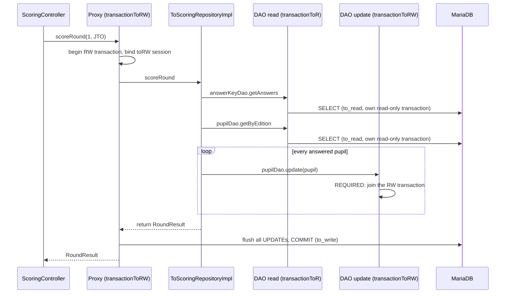

# 16. Scoring and selection

<div class="level-tabs" data-levels>
  <button data-level="overview" aria-pressed="true">Overview</button>
  <button data-level="deep" data-short="Deep">Deep Understanding</button>
  <button data-level="drill">Drilling</button>
</div>

<div class="level overview">

After round 1 the answer sheets come in, every sheet is compared with the
key, and everyone at or above the cut-off goes on to round 2. This is
the heart of the contest. It is also the one place where TechOlympiad
deliberately does more than the VWO API. The VWO fills in results
outside the API. TechOlympiad gets three endpoints for it.

<div class="table-wrap">

| Endpoint | What it does | Tables it writes |
|---|---|---|
| `POST /to/round/{round}/answers?edition=` | stores a list of answer sheets | `Leerling_eerste_ronde` or `Leerling_tweede_ronde` |
| `POST /to/round/{round}/score?edition=` | scores every sheet against the key | the same |
| `POST /to/round/1/select?edition=` | copies everyone above the cut-off into round 2 | `Leerling_tweede_ronde` |

</div>

Each of them reads from several tables and writes to one or two, and
each must succeed or fail as a whole. A half-scored round, or a round 2
list with only the first 40 selected pupils, is worse than no result at
all. So the logic lives in one repository, `ToScoringRepositoryImpl`.
Each of its methods runs in a single read-write transaction that spans
several DAOs, with `rollbackFor = Exception.class`. The VWO does the
same for its Kangoeroe answer forms in
`KangoeroePoolsTemporaryAnswersRepositoryImpl`, and that file is the
model for this chapter.

**After this chapter you can:**

- draw the transaction boundary of a request and say which DAO calls join it;
- predict when `@Transactional` rolls back and when it commits, <dfn data-def="An Exception that is not a RuntimeException. The compiler requires callers to catch it or declare it with throws; C# has no equivalent.">checked exceptions</dfn> included;
- write stream pipelines (Java's counterpart of LINQ to Objects) that filter, map and count;
- map a database view as an `@Immutable` entity.

<div class="code-compare" data-code-compare data-labels="VWO KangoeroePoolsTemporaryAnswersRepositoryImpl|TechOlympiad ToScoringRepositoryImpl">

```java
@Override
@Transactional(value = "transactionVwoRW", rollbackFor = Exception.class)
public void saveAnswers(Map<Integer, String> closedAnswers, Map<Integer, Map<Integer, String>> openAnswers, Configuration.Channel channel, short year, boolean update) {
    closedAnswers.forEach((k, v) ->
    {
        LeerlingKangoeroeAntwoorden answer = new LeerlingKangoeroeAntwoorden();
        answer.setPersoonId(k);
        answer.setAntwoorden(v);
        answer.setKanaal(channel);
        answer.setJaar(year);
        if (update) {
            getClosedAnswersDao().saveOrUpdate(answer);
        } else {
            getClosedAnswersDao().save(answer);
        }
    });
    // ... the open answers, through a second DAO
}
```

```java
@Override
@Transactional(value = "transactionToRW", rollbackFor = Exception.class)
public RoundResult selectForNextRound(byte round, Configuration.ToRole edition) {
    short year = General.getCurrentSchoolYear();
    byte cutOff = cutOffDao.getOptional(new CesurenPK(year, edition, round))
            .map(Cesuren::getCesuur)
            .orElseThrow(() -> new IllegalStateException("No cut-off for " + edition + " round " + round + " in " + year));
    List<LeerlingEersteRonde> scored = pupilDao.getByEdition(edition).stream()
            .filter(pupil -> pupil.getResultaat() != null)
            .collect(Collectors.toList());
    List<LeerlingTweedeRonde> selected = scored.stream()
            .filter(pupil -> pupil.getResultaat() >= cutOff)
            .map(pupil -> new LeerlingTweedeRonde(pupil.getPersoonId()))
            .collect(Collectors.toList());
    secondRoundDao.deleteByEdition(edition);
    secondRoundDao.addAll(selected);
    return new RoundResult(round, edition, scored.size(), selected.size());
}
```

</div>

</div>

<div class="level deep">

### Where business logic lives in this codebase

The VWO API has three layers: controller interfaces, repositories and
DAOs. There is no service layer. The only `@Service` classes in the
source are in the `security` package (`UserAuthenticationService`,
`JWTTokenService` and similar classes). All other code that does more
than a query sits in a `*RepositoryImpl`. Two examples:

- `FunctiesRepositoryImpl.transferFunctions` moves a responsibility.
  Then it patches payments, invoices and tolerance periods through four
  DAOs.
- `KangoeroePoolsTemporaryAnswersRepositoryImpl` validates answer forms
  and stores them through two DAOs in one transaction.

The repository is the VWO's service layer under another name.

TechOlympiad follows it. `ToScoringRepository` is a repository in the
VWO sense: an interface marked `@NoRepositoryBean`, an implementation
annotated `@Repository`, DAOs injected through the constructor. If you
come from a .NET codebase with an `ApplicationService` per use case,
read "repository" here as that.

### Transaction boundaries

A <dfn data-def="The span of code between the start of a database transaction and its commit or rollback. Everything written in between becomes visible together, or not at all.">transaction boundary</dfn>
is where a transaction starts and ends. With `@Transactional` the
boundary is a method: Spring's proxy starts the transaction before the
method runs and commits or rolls back after it returns or throws. So
far every boundary was a DAO method, which made each `save` or `update`
its own unit. For scoring that is wrong: 25 `update` calls would be 25
transactions, and an exception at the 13th would leave 12 pupils scored.

Putting `@Transactional` on the repository method moves the boundary up:



The `update` calls inside the loop only attach entities to the
read-write session. Nothing reaches MariaDB until the proxy flushes at
commit, and if anything throws before that, the rollback discards them
all.

### Propagation: who joins whom

When a `@Transactional` method is called while a transaction is already
active, its
<dfn data-def="The @Transactional attribute that decides what happens when a transaction already exists: join it (REQUIRED), suspend it and start a new one (REQUIRES_NEW), use a savepoint (NESTED), and so on.">propagation</dfn>
decides what happens. The default is `REQUIRED`.

<div class="table-wrap">

| Propagation | With an active transaction | Without one | In the VWO |
|---|---|---|---|
| `REQUIRED` (default) | joins it | starts one | every DAO method |
| `REQUIRES_NEW` | suspends it, runs its own, resumes | starts one | `KangoeroePoolsTemporaryAnswersRepositoryImpl.getAnswers` |
| `NESTED` | savepoint inside it (needs a manager that allows it) | starts one | `FunctiesDaoImpl.addIndividualMember` |
| `SUPPORTS`, `MANDATORY`, `NOT_SUPPORTED`, `NEVER` | join, join or fail, suspend, fail | none, fail, none, none | not used |

</div>

There is a subtlety specific to this codebase. Propagation works per
transaction manager. `pupilDao.update` is `@Transactional(value = "transactionToRW")`,
the same manager as the repository method, so it joins. But
`pupilDao.getByEdition` is `@Transactional(value = "transactionToR", readOnly = true)`.
The R manager looks for an active transaction on *its* session factory,
finds none, and starts a separate read-only transaction on a `to_read`
connection. That read cannot see what the RW transaction has written but
not committed yet.

<div class="callout danger">
<div class="callout-label">Reads in a write transaction do not see its writes</div>

Inside `scoreRound`, every read goes through `toR`, every write through
`toRW`. Read first, then write, and never read back what you wrote in
the same method: you would get the committed state from before the
transaction. The VWO's Kangoeroe repository uses the same order:

1. An outer read.
2. `self.saveAnswers` writes in RW.
3. `self.getAnswers` reads in a new transaction.

All three methods in this chapter read everything before they write
anything.

</div>

### Rollback rules

`@Transactional` rolls back when the method throws an unchecked
exception (`RuntimeException` or `Error`). A
<dfn data-def="An Exception that is not a RuntimeException. The compiler requires callers to catch it or declare it with throws; C# has no equivalent.">checked exception</dfn>
such as `IOException` does **not** trigger a rollback by default: Spring
commits whatever was done and then rethrows. That rule comes from EJB
(Enterprise JavaBeans), the Java EE component model that came before
Spring. In EJB, a checked exception meant "a business outcome the caller
should handle". It did not mean "the unit of work failed".

`rollbackFor = Exception.class` widens the rule to every exception. All
three scoring methods carry it, like the VWO's `saveAnswers`. Today they
only throw unchecked exceptions, so it changes nothing yet. It stops the
first person who adds, say, a `throws IOException` for reading a scanner
export from silently committing half a round.

Two more rules complete the picture:

- An exception caught *inside* the method does not roll anything back:
  the proxy never sees it.
- When a joined inner method (a DAO's `update`) throws an unchecked
  exception, its interceptor marks the shared transaction rollback-only
  even if the outer method catches the exception. The outer commit then
  fails with `UnexpectedRollbackException: Transaction silently rolled back because it has been marked as rollback-only`.

### Self-invocation, again

The transactional proxy only sees calls that come in from outside the
bean. If `scoreRound` called `this.selectForNextRound(...)`, Spring
would ignore the annotation on `selectForNextRound`. Here that would do
no harm, because both methods use the same manager and propagation. The
VWO needs different settings for its inner calls (`REQUIRES_NEW`, a
different manager), so it injects the bean into itself:

```java
@Resource
@Lazy
@Getter(AccessLevel.NONE)
private KangoeroePoolsTemporaryAnswersRepository self;
```

and calls `self.saveAnswers(...)`, which goes through the proxy. `@Lazy`
breaks the circular dependency: Spring injects a lazy proxy that looks
the real bean up on first use. Our scoring methods never call each other,
so we do not need it.

### Streams

The scoring code uses three stream operations, all of which have a LINQ
twin:

<div class="table-wrap">

| Java stream | LINQ | Used for |
|---|---|---|
| `.filter(p -> p.getResultaat() != null)` | `.Where(...)` | pupils who were scored |
| `.map(p -> new LeerlingTweedeRonde(p.getPersoonId()))` | `.Select(...)` | building round 2 rows |
| `.collect(Collectors.toList())` | `.ToList()` | materialising the result |
| `IntStream.range(0, 30).filter(...).count()` | `Enumerable.Range(0, 30).Count(...)` | counting correct answers |

</div>

A stream is lazy like `IEnumerable`: nothing runs until a terminal
operation (`collect`, `count`, `forEach`) pulls the elements. Unlike
`IEnumerable` it can be consumed only once. A lambda can use a local
variable only if it is effectively final, which is why `cutOff` is
assigned once and never changed.

Streams are for computing values. Where each element causes a database
write, the code uses a plain `for` loop: a `forEach` with side effects
works, but it hides the writes inside a lambda and makes exceptions
harder to follow.

### Scoring rules

An answer sheet is 30 characters, one per question: `A` to `E`, or `-`
for a question left blank. The sheet scores one point per position where
the pupil's letter is among the accepted answers for that question. The
key comes from the rows of `Antwoorden`, not from the answer string of
chapter 15, so a question that accepts `B,D` gives a point for either
letter. A round is scored only if its key is complete (30 rows). A
pupil without a sheet keeps `RESULTAAT` `NULL` and is not selected.

### A view as an `@Immutable` entity

`Leerling_tweede_ronde_full` is a view: round 1 columns joined with the
round 2 result. A `SELECT` on a view looks like a `SELECT` on a table,
so Hibernate maps the view like a table. The VWO's
`LeerlingTweedeRondeFull` does the same.

`@Immutable` (from `org.hibernate.annotations`) tells Hibernate the
entity is read-only. Hibernate then never checks loaded instances for
changes and never generates an `UPDATE`. This has two effects:

- It saves the dirty-checking work. Dirty checking compares each loaded
  entity with its original state to find changes, like EF Core's change
  tracker.
- More importantly, an accidental setter call cannot turn into an
  `UPDATE` on the view. MariaDB could not perform that `UPDATE` anyway.

The view's own key is the round 1 `PERSOON_ID`, so the entity inherits
`ToParticipant` unchanged. The `@GeneratedValue` on that field never
matters, because nothing ever inserts into a view.

### Round 2 has no entity hierarchy of its own

`Leerling_tweede_ronde` holds only `PERSOON_ID`, `RESULTAAT` and
`ANTWOORDEN`, without an edition. To find "the JTO pupils of round 2",
`LeerlingTweedeRondeDao.getByEdition` joins it to round 1 with the ad hoc
`JOIN ... ON` of chapter 12. The VWO's `LeerlingTweedeRonde` entity does
not implement `Serializable`, so it cannot have a `VwoDao`, and the VWO
indeed has no DAO for it. Ours implements it and gets one.

<div class="callout note">
<div class="callout-label">A documented deviation, and where it stops</div>

The VWO enters round results outside the API. TechOlympiad scores
rounds 1 and 2 and selects from round 1 into round 2. Selecting
finalists is out of scope: `Leerling_finale` has no entity, and the jury
picks finalists by hand. `POST /to/round/2/select` answers `400`.

</div>

</div>

<div class="level drill">

### What you should have

The end state of [chapter 15](build-15-answer-key-dates.md): the answer
keys and round dates are served. The seed has cut-offs for 2027 in
`Cesuren` (JTO 18 and 20, STO 20 and 22 for rounds 1 and 2), and
`Leerling_tweede_ronde` is empty. If you changed question 1 of the JTO
key to `'B,D'` in chapter 15, set it back to `'B'`.

Paths are relative to `src/main/java/be/techolympiad/common/`.

### Tasks

<ul class="checklist">
<li><label><input type="checkbox"><span>Create <code>CesurenPK</code>, <code>Cesuren</code>, <code>LeerlingTweedeRonde</code> and <code>LeerlingTweedeRondeFull</code>; map the three entities.</span></label></li>
<li><label><input type="checkbox"><span>Create the models <code>PupilAnswers</code> and <code>RoundResult</code>.</span></label></li>
<li><label><input type="checkbox"><span>Create <code>CesurenDao</code> and <code>LeerlingTweedeRondeDao</code> with their implementations, and add <code>getByEdition</code> and <code>getSecondRound</code> to <code>LeerlingToDao</code>.</span></label></li>
<li><label><input type="checkbox"><span>Add <code>findSecondRound</code> to <code>LeerlingToRepository</code> and round 2 to <code>GET /to/participants</code>.</span></label></li>
<li><label><input type="checkbox"><span>Create <code>ToScoringRepository</code> and <code>ToScoringRepositoryImpl</code>.</span></label></li>
<li><label><input type="checkbox"><span>Create the <code>ScoringController</code> interface and its <code>v1</code> class.</span></label></li>
<li><label><input type="checkbox"><span>Build, restart, and play a round under <em>Run it</em>, including the failed submission.</span></label></li>
<li><label><input type="checkbox"><span>Commit: <code>git add -A &amp;&amp; git commit -m "Score rounds and select for round 2"</code>.</span></label></li>
</ul>

### Entities

`dbEntities/CesurenPK.java`

```java
package be.techolympiad.common.dbEntities;

import be.techolympiad.common.Configuration;
import lombok.AllArgsConstructor;
import lombok.EqualsAndHashCode;
import lombok.Getter;
import lombok.NoArgsConstructor;
import lombok.Setter;

import java.io.Serializable;

@Getter
@Setter
@NoArgsConstructor
@AllArgsConstructor
@EqualsAndHashCode
public class CesurenPK implements Serializable {

    private short jaar;
    private Configuration.ToRole editie;
    private byte ronde;
}
```

`dbEntities/Cesuren.java`

```java
package be.techolympiad.common.dbEntities;

import be.techolympiad.common.Configuration;
import com.fasterxml.jackson.annotation.JsonProperty;
import io.swagger.v3.oas.annotations.media.Schema;
import lombok.Getter;
import lombok.NoArgsConstructor;
import lombok.Setter;

import javax.persistence.*;
import java.io.Serializable;
import java.util.Objects;

@Entity
@Table(name = "Cesuren", schema = "TechOlympiad")
@IdClass(CesurenPK.class)
@Schema(name = "CutOff")
@Getter
@Setter
@NoArgsConstructor
public class Cesuren implements Serializable {

    @Id
    @Column(name = "JAAR", nullable = false)
    @JsonProperty("year")
    private short jaar;

    @Id
    @Column(name = "EDITIE", nullable = false)
    @Enumerated(EnumType.STRING)
    @JsonProperty("edition")
    private Configuration.ToRole editie;

    @Id
    @Column(name = "RONDE", nullable = false)
    @JsonProperty("round")
    @Schema(type = "integer")
    private byte ronde;

    @Column(name = "CESUUR", nullable = false)
    @JsonProperty("cutOff")
    @Schema(type = "integer")
    private byte cesuur;

    @Override
    public boolean equals(Object o) {
        if (this == o) return true;
        if (o == null || getClass() != o.getClass()) return false;
        Cesuren that = (Cesuren) o;
        return jaar == that.jaar && ronde == that.ronde && editie == that.editie;
    }

    @Override
    public int hashCode() {
        return Objects.hash(jaar, editie, ronde);
    }
}
```

The VWO has a `Cesuren` table but no entity for it. This one is new, in
the same style as the others.

`dbEntities/LeerlingTweedeRonde.java`

```java
package be.techolympiad.common.dbEntities;

import lombok.Getter;
import lombok.NoArgsConstructor;
import lombok.Setter;

import javax.persistence.Column;
import javax.persistence.Entity;
import javax.persistence.Id;
import javax.persistence.Table;
import java.io.Serializable;
import java.util.Objects;

@Entity
@Table(name = "Leerling_tweede_ronde", schema = "TechOlympiad")
@Getter
@Setter
@NoArgsConstructor
public class LeerlingTweedeRonde implements Serializable {

    @Id
    @Column(name = "PERSOON_ID", nullable = false)
    private Integer persoonId;

    @Column(name = "RESULTAAT")
    private Byte resultaat;

    @Column(name = "ANTWOORDEN", length = 30)
    private String antwoorden;

    public LeerlingTweedeRonde(Integer persoonId) {
        this.persoonId = persoonId;
    }

    @Override
    public boolean equals(Object o) {
        if (this == o) return true;
        if (o == null || getClass() != o.getClass()) return false;
        return Objects.equals(persoonId, ((LeerlingTweedeRonde) o).persoonId);
    }

    @Override
    public int hashCode() {
        return Objects.hashCode(persoonId);
    }
}
```

The key is assigned (it is the round 1 `PERSOON_ID`), so the hash may
use it, and there is no `@GeneratedValue`. The entity is never sent to
clients directly, so it has no JSON annotations, like the VWO's.

`dbEntities/LeerlingTweedeRondeFull.java`

```java
package be.techolympiad.common.dbEntities;

import com.fasterxml.jackson.annotation.JsonProperty;
import io.swagger.v3.oas.annotations.media.Schema;
import lombok.Getter;
import lombok.NoArgsConstructor;
import lombok.Setter;
import org.hibernate.annotations.Immutable;

import javax.persistence.Column;
import javax.persistence.Entity;
import javax.persistence.Table;

@Entity
@Table(name = "Leerling_tweede_ronde_full", schema = "TechOlympiad")
@Immutable
@Schema(name = "ToPupilSecondRound")
@Getter
@Setter
@NoArgsConstructor
public class LeerlingTweedeRondeFull extends ToParticipant {

    @Column(name = "DEELNEMERSNUMMER")
    @JsonProperty("participantNumber")
    private Integer deelnemersnummer;

    @Column(name = "RESULTAAT_TWEEDE_RONDE")
    @JsonProperty("resultSecondRound")
    @Schema(type = "integer")
    private Byte resultaatTweedeRonde;

    @Column(name = "ANTWOORDEN_TWEEDE_RONDE")
    @JsonProperty("answersSecondRound")
    private String antwoordenTweedeRonde;
}
```

In the VWO's view, `RESULTAAT` and `ANTWOORDEN` are the round 2 values.
Our view keeps the round 1 values under their own names (so the
inherited `result` is the round 1 score) and adds the round 2 columns
with a suffix.

`hibernate_TO.cfg.xml`:

<div class="diff-view" data-diff-view>

```diff
         <mapping class="be.techolympiad.common.dbEntities.WebsiteToWedstrijddatums"/>
+        <mapping class="be.techolympiad.common.dbEntities.Cesuren"/>
+        <mapping class="be.techolympiad.common.dbEntities.LeerlingTweedeRonde"/>
+        <mapping class="be.techolympiad.common.dbEntities.LeerlingTweedeRondeFull"/>
     </session-factory>
```

</div>

### Models

`restAPI/models/PupilAnswers.java`

```java
package be.techolympiad.common.restAPI.models;

import io.swagger.v3.oas.annotations.media.Schema;
import lombok.Getter;
import lombok.NoArgsConstructor;
import lombok.Setter;

@Getter
@Setter
@NoArgsConstructor
@Schema(name = "PupilAnswers")
public class PupilAnswers {

    @Schema(description = "The pupil's personId")
    private Integer participantId;

    @Schema(description = "30 characters, A-E or - for no answer", example = "BDACEABDCECEABDDBECAEACDBACBED")
    private String answers;
}
```

`restAPI/models/RoundResult.java`

```java
package be.techolympiad.common.restAPI.models;

import be.techolympiad.common.Configuration;
import io.swagger.v3.oas.annotations.media.Schema;
import lombok.AllArgsConstructor;
import lombok.Getter;
import lombok.NoArgsConstructor;
import lombok.Setter;

@Getter
@Setter
@NoArgsConstructor
@AllArgsConstructor
@Schema(name = "RoundResult")
public class RoundResult {

    @Schema(type = "integer")
    private byte round;

    private Configuration.ToRole edition;

    @Schema(description = "Pupils with a result in this round")
    private int scored;

    @Schema(description = "Pupils selected for the next round")
    private int selected;
}
```

### DAOs

`dao/CesurenDao.java`

```java
package be.techolympiad.common.dao;

import be.techolympiad.common.dbEntities.Cesuren;
import be.techolympiad.common.dbEntities.CesurenPK;
import org.springframework.data.repository.NoRepositoryBean;

@NoRepositoryBean
public interface CesurenDao extends TechOlympiadDao<Cesuren, CesurenPK> {
}
```

`dao/impl/CesurenDaoImpl.java`

```java
package be.techolympiad.common.dao.impl;

import be.techolympiad.common.dao.CesurenDao;
import be.techolympiad.common.dbEntities.Cesuren;
import be.techolympiad.common.dbEntities.CesurenPK;
import org.springframework.stereotype.Repository;

@Repository
public class CesurenDaoImpl extends TechOlympiadDaoImpl<Cesuren, CesurenPK> implements CesurenDao {
}
```

`dao/LeerlingTweedeRondeDao.java`

```java
package be.techolympiad.common.dao;

import be.techolympiad.common.Configuration;
import be.techolympiad.common.dbEntities.LeerlingTweedeRonde;
import org.springframework.data.repository.NoRepositoryBean;

import java.util.List;

@NoRepositoryBean
public interface LeerlingTweedeRondeDao extends TechOlympiadDao<LeerlingTweedeRonde, Integer> {

    List<LeerlingTweedeRonde> getByEdition(Configuration.ToRole edition);

    int deleteByEdition(Configuration.ToRole edition);
}
```

`dao/impl/LeerlingTweedeRondeDaoImpl.java`

```java
package be.techolympiad.common.dao.impl;

import be.techolympiad.common.Configuration;
import be.techolympiad.common.dao.LeerlingTweedeRondeDao;
import be.techolympiad.common.dbEntities.LeerlingTweedeRonde;
import org.hibernate.Session;
import org.hibernate.query.Query;
import org.springframework.stereotype.Repository;
import org.springframework.transaction.annotation.Transactional;

import java.util.List;

@Repository
public class LeerlingTweedeRondeDaoImpl extends TechOlympiadDaoImpl<LeerlingTweedeRonde, Integer> implements LeerlingTweedeRondeDao {

    @Override
    @Transactional(value = transactionR, readOnly = true)
    public List<LeerlingTweedeRonde> getByEdition(Configuration.ToRole edition) {
        Session session = getFactoryR().getCurrentSession();
        String hql = "SELECT t FROM LeerlingTweedeRonde t "
                + "JOIN LeerlingEersteRonde l ON t.persoonId = l.persoonId "
                + "WHERE l.rol = :edition";
        Query<LeerlingTweedeRonde> query = session.createQuery(hql, type);
        query.setParameter("edition", edition);
        return query.getResultList();
    }

    @Override
    @Transactional(value = transactionRW)
    public int deleteByEdition(Configuration.ToRole edition) {
        Session session = getFactoryRW().getCurrentSession();
        String hql = "DELETE FROM LeerlingTweedeRonde t "
                + "WHERE t.persoonId IN (SELECT l.persoonId FROM LeerlingEersteRonde l WHERE l.rol = :edition)";
        return session.createQuery(hql)
                .setParameter("edition", edition)
                .executeUpdate();
    }
}
```

`deleteByEdition` is an HQL bulk statement, like the VWO's
`FunctiesDaoImpl.delete`: `executeUpdate` sends one `DELETE` at once and
returns the number of rows. It bypasses the persistence context, so it
must run before any round 2 entities are attached to the session, which
is the order `selectForNextRound` uses.

`dao/LeerlingToDao.java` and its implementation get two queries:

<div class="diff-view" data-diff-view>

```diff
 import be.techolympiad.common.dbEntities.LeerlingEersteRonde;
+import be.techolympiad.common.dbEntities.LeerlingTweedeRondeFull;
 import org.springframework.data.repository.NoRepositoryBean;
@@
     List<LeerlingEersteRonde> getBySchoolAndEdition(Short schoolId, Configuration.ToRole edition);
 
+    List<LeerlingEersteRonde> getByEdition(Configuration.ToRole edition);
+
+    List<LeerlingTweedeRondeFull> getSecondRound(Short schoolId, Configuration.ToRole edition);
+
     int getMaxParticipantNumber(short year);
```

</div>

<div class="diff-view" data-diff-view>

```diff
 import be.techolympiad.common.dbEntities.LeerlingEersteRonde;
+import be.techolympiad.common.dbEntities.LeerlingTweedeRondeFull;
 import org.hibernate.Session;
@@
+    @Override
+    @Transactional(value = transactionR, readOnly = true)
+    public List<LeerlingEersteRonde> getByEdition(Configuration.ToRole edition) {
+        Session session = getFactoryR().getCurrentSession();
+        String hql = "SELECT l FROM LeerlingEersteRonde l "
+                + "WHERE l.rol = :edition";
+        Query<LeerlingEersteRonde> query = session.createQuery(hql, type);
+        query.setParameter("edition", edition);
+        return query.getResultList();
+    }
+
+    @Override
+    @Transactional(value = transactionR, readOnly = true)
+    public List<LeerlingTweedeRondeFull> getSecondRound(Short schoolId, Configuration.ToRole edition) {
+        Session session = getFactoryR().getCurrentSession();
+        String hql = "SELECT l FROM LeerlingTweedeRondeFull l "
+                + "WHERE l.schoolId = :schoolId "
+                + "AND l.rol = :edition "
+                + "ORDER BY l.deelnemersnummer";
+        Query<LeerlingTweedeRondeFull> query = session.createQuery(hql, LeerlingTweedeRondeFull.class);
+        query.setParameter("schoolId", schoolId);
+        query.setParameter("edition", edition);
+        return query.getResultList();
+    }
+
     @Override
     @Transactional(value = transactionR, readOnly = true)
     public int getMaxParticipantNumber(short year) {
```

</div>

`getSecondRound` queries another entity than the DAO's own, so it passes
`LeerlingTweedeRondeFull.class` instead of `type`. The VWO's
`getBySchoolAndEdition` does the same in its `case TWO`.

### Round 2 in the participants list

<div class="diff-view" data-diff-view>

```diff
 public interface LeerlingToRepository extends Repository<LeerlingEersteRonde, Integer> {
 
     List<LeerlingEersteRonde> findBySchoolAndEdition(Short schoolId, Configuration.ToRole edition);
+
+    List<LeerlingTweedeRondeFull> findSecondRound(Short schoolId, Configuration.ToRole edition);
```

</div>

<div class="diff-view" data-diff-view>

```diff
     @Override
     public List<LeerlingEersteRonde> findBySchoolAndEdition(Short schoolId, Configuration.ToRole edition) {
         return leerlingToDao.getBySchoolAndEdition(schoolId, edition);
     }
+
+    @Override
+    public List<LeerlingTweedeRondeFull> findSecondRound(Short schoolId, Configuration.ToRole edition) {
+        return leerlingToDao.getSecondRound(schoolId, edition);
+    }
```

</div>

Both files also need `import be.techolympiad.common.dbEntities.LeerlingTweedeRondeFull;`.
In `ToParticipantsController`:

<div class="diff-view" data-diff-view>

```diff
         switch (round) {
             case ONE:
                 return ResponseEntity.ok().body(getRepository().findBySchoolAndEdition(schoolId, edition));
+            case TWO:
+                return ResponseEntity.ok().body(getRepository().findSecondRound(schoolId, edition));
             default:
                 return ResponseEntity.badRequest().build();
         }
```

</div>

The return type `List<? extends ToParticipant>` from chapter 14 already
accepts a list of either entity.

### The scoring repository

`restAPI/repositories/ToScoringRepository.java`

```java
package be.techolympiad.common.restAPI.repositories;

import be.techolympiad.common.Configuration;
import be.techolympiad.common.dbEntities.LeerlingEersteRonde;
import be.techolympiad.common.restAPI.models.PupilAnswers;
import be.techolympiad.common.restAPI.models.RoundResult;
import org.springframework.data.repository.NoRepositoryBean;
import org.springframework.data.repository.Repository;

import java.util.List;

@NoRepositoryBean
public interface ToScoringRepository extends Repository<LeerlingEersteRonde, Integer> {

    void submitAnswers(byte round, Configuration.ToRole edition, List<PupilAnswers> sheets);

    RoundResult scoreRound(byte round, Configuration.ToRole edition);

    RoundResult selectForNextRound(byte round, Configuration.ToRole edition);
}
```

<div class="code-walk" data-code-walk>

```java
package be.techolympiad.common.restAPI.repositories;

import be.techolympiad.common.Configuration;
import be.techolympiad.common.General;
import be.techolympiad.common.dao.AntwoordenDao;
import be.techolympiad.common.dao.CesurenDao;
import be.techolympiad.common.dao.LeerlingToDao;
import be.techolympiad.common.dao.LeerlingTweedeRondeDao;
import be.techolympiad.common.dbEntities.Antwoorden;
import be.techolympiad.common.dbEntities.Cesuren;
import be.techolympiad.common.dbEntities.CesurenPK;
import be.techolympiad.common.dbEntities.LeerlingEersteRonde;
import be.techolympiad.common.dbEntities.LeerlingTweedeRonde;
import be.techolympiad.common.restAPI.models.PupilAnswers;
import be.techolympiad.common.restAPI.models.RoundResult;
import org.springframework.beans.factory.annotation.Autowired;
import org.springframework.stereotype.Repository;
import org.springframework.transaction.annotation.Transactional;

import java.util.List;
import java.util.NoSuchElementException;
import java.util.stream.Collectors;
import java.util.stream.IntStream;

@Repository
public class ToScoringRepositoryImpl implements ToScoringRepository {

    private static final String ANSWER_PATTERN = "[A-E-]{" + Configuration.NUMBER_OF_QUESTIONS + "}";
    private static final char NO_ANSWER = '-';

    private final LeerlingToDao pupilDao;
    private final LeerlingTweedeRondeDao secondRoundDao;
    private final AntwoordenDao answerKeyDao;
    private final CesurenDao cutOffDao;

    @Autowired
    public ToScoringRepositoryImpl(LeerlingToDao pupilDao, LeerlingTweedeRondeDao secondRoundDao,
                                   AntwoordenDao answerKeyDao, CesurenDao cutOffDao) {
        this.pupilDao = pupilDao;
        this.secondRoundDao = secondRoundDao;
        this.answerKeyDao = answerKeyDao;
        this.cutOffDao = cutOffDao;
    }

    @Override
    @Transactional(value = "transactionToRW", rollbackFor = Exception.class) // (1)
    public void submitAnswers(byte round, Configuration.ToRole edition, List<PupilAnswers> sheets) {
        for (PupilAnswers sheet : sheets) {
            if (sheet.getAnswers() == null || !sheet.getAnswers().matches(ANSWER_PATTERN)) {
                throw new IllegalArgumentException("Invalid answers for participant " + sheet.getParticipantId()); // (2)
            }
            LeerlingEersteRonde pupil = findPupil(sheet.getParticipantId(), edition);
            if (round == 1) {
                pupil.setAntwoorden(sheet.getAnswers());
                pupil.setResultaat(null);
                pupilDao.update(pupil); // (3)
            } else {
                LeerlingTweedeRonde secondRound = secondRoundDao.getOptional(pupil.getPersoonId())
                        .orElseThrow(() -> new NoSuchElementException("Participant " + pupil.getPersoonId() + " is not in round 2"));
                secondRound.setAntwoorden(sheet.getAnswers());
                secondRound.setResultaat(null);
                secondRoundDao.update(secondRound);
            }
        }
    }

    @Override
    @Transactional(value = "transactionToRW", rollbackFor = Exception.class)
    public RoundResult scoreRound(byte round, Configuration.ToRole edition) {
        List<String> key = answerKey(edition, round); // (4)
        int scored = 0;
        if (round == 1) {
            for (LeerlingEersteRonde pupil : pupilDao.getByEdition(edition)) {
                if (pupil.getAntwoorden() != null) {
                    pupil.setResultaat(score(pupil.getAntwoorden(), key));
                    pupilDao.update(pupil);
                    scored++;
                }
            }
        } else {
            for (LeerlingTweedeRonde pupil : secondRoundDao.getByEdition(edition)) {
                if (pupil.getAntwoorden() != null) {
                    pupil.setResultaat(score(pupil.getAntwoorden(), key));
                    secondRoundDao.update(pupil);
                    scored++;
                }
            }
        }
        return new RoundResult(round, edition, scored, 0);
    }

    @Override
    @Transactional(value = "transactionToRW", rollbackFor = Exception.class)
    public RoundResult selectForNextRound(byte round, Configuration.ToRole edition) {
        short year = General.getCurrentSchoolYear();
        byte cutOff = cutOffDao.getOptional(new CesurenPK(year, edition, round))
                .map(Cesuren::getCesuur)
                .orElseThrow(() -> new IllegalStateException("No cut-off for " + edition + " round " + round + " in " + year));
        List<LeerlingEersteRonde> scored = pupilDao.getByEdition(edition).stream()
                .filter(pupil -> pupil.getResultaat() != null)
                .collect(Collectors.toList());
        List<LeerlingTweedeRonde> selected = scored.stream()
                .filter(pupil -> pupil.getResultaat() >= cutOff) // (5)
                .map(pupil -> new LeerlingTweedeRonde(pupil.getPersoonId()))
                .collect(Collectors.toList());
        secondRoundDao.deleteByEdition(edition); // (6)
        secondRoundDao.addAll(selected);
        return new RoundResult(round, edition, scored.size(), selected.size());
    }

    private LeerlingEersteRonde findPupil(Integer participantId, Configuration.ToRole edition) {
        if (participantId == null) {
            throw new IllegalArgumentException("participantId is required");
        }
        return pupilDao.getOptional(participantId)
                .filter(pupil -> pupil.getRol() == edition)
                .orElseThrow(() -> new NoSuchElementException("No " + edition + " participant with id " + participantId));
    }

    private List<String> answerKey(Configuration.ToRole edition, byte round) {
        short year = General.getCurrentSchoolYear();
        List<String> key = answerKeyDao.getAnswers(edition, round, year).stream()
                .map(Antwoorden::getAntwoord)
                .collect(Collectors.toList());
        if (key.size() != Configuration.NUMBER_OF_QUESTIONS) {
            throw new IllegalStateException("The " + edition + " key for round " + round + " in " + year + " has " + key.size() + " answers");
        }
        return key;
    }

    private static byte score(String answers, List<String> key) {
        return (byte) IntStream.range(0, key.size())
                .filter(i -> answers.charAt(i) != NO_ANSWER && key.get(i).indexOf(answers.charAt(i)) >= 0)
                .count(); // (7)
    }
}
```

1. One boundary for the whole request. Every DAO write below joins it; every DAO read runs in its own read-only transaction on `toR`.
2. An invalid sheet anywhere in the list aborts the request. The sheets before it were attached to the session but never flushed, and the rollback drops them.
3. `pupil` was loaded by `getOptional` in a read-only session that has already closed, so it is detached; `update` attaches it to the read-write session.
4. The key is read before any write, which is the order the R/RW split requires.
5. `cutOff` is a local captured by a lambda, so it must be effectively final. `getResultaat()` returns a `Byte`, unboxed for the comparison; the `filter` before it guarantees it is not `null`.
6. Selecting again replaces the earlier selection for this edition, including any round 2 answers already stored. The bulk `DELETE` runs at once; the `INSERT`s of `addAll` follow at commit.
7. `count()` returns a `long`. The value is at most 30, so the cast to `byte` is safe. A set value like `B,D` contains the letter, so either answer scores.

</div>

### The controller

<div class="param-table" data-param-table>

| Name | Type | Description |
|---|---|---|
| `POST /to/round/{round}/answers` | `void` | `round` 1 or 2; query `edition`; body `PupilAnswers[]`; `204`. |
| `POST /to/round/{round}/score` | `RoundResult` | Scores every sheet of the edition in that round. |
| `POST /to/round/{round}/select` | `RoundResult` | Only `round` 1: copies everyone at or above the cut-off into round 2. |

</div>

`restAPI/controllers/ScoringController.java`

```java
package be.techolympiad.common.restAPI.controllers;

import be.techolympiad.common.Configuration;
import be.techolympiad.common.restAPI.models.PupilAnswers;
import be.techolympiad.common.restAPI.models.RoundResult;
import be.techolympiad.common.restAPI.repositories.ToScoringRepository;
import io.swagger.v3.oas.annotations.Operation;
import io.swagger.v3.oas.annotations.Parameter;
import io.swagger.v3.oas.annotations.media.Schema;
import org.springframework.http.MediaType;
import org.springframework.http.ResponseEntity;
import org.springframework.web.bind.annotation.*;

import javax.validation.constraints.NotNull;
import java.util.List;

public interface ScoringController {

    ToScoringRepository getRepository();

    @PostMapping(value = "/{round}/answers", consumes = MediaType.APPLICATION_JSON_VALUE)
    @Operation(summary = "Store the answer sheets of a round")
    default ResponseEntity<Void> submitAnswers(
            @PathVariable("round") @Parameter(schema = @Schema(type = "integer", allowableValues = {"1", "2"})) byte round,
            @RequestParam("edition") Configuration.ToRole edition,
            @RequestBody @NotNull List<PupilAnswers> sheets) {
        if (round != 1 && round != 2) {
            return ResponseEntity.badRequest().build();
        }
        getRepository().submitAnswers(round, edition, sheets);
        return ResponseEntity.noContent().build();
    }

    @PostMapping("/{round}/score")
    @Operation(summary = "Score every answer sheet of a round")
    @ResponseBody
    default ResponseEntity<RoundResult> score(
            @PathVariable("round") @Parameter(schema = @Schema(type = "integer", allowableValues = {"1", "2"})) byte round,
            @RequestParam("edition") Configuration.ToRole edition) {
        if (round != 1 && round != 2) {
            return ResponseEntity.badRequest().build();
        }
        return ResponseEntity.ok().body(getRepository().scoreRound(round, edition));
    }

    @PostMapping("/{round}/select")
    @Operation(summary = "Select the pupils at or above the cut-off for the next round")
    @ResponseBody
    default ResponseEntity<RoundResult> select(
            @PathVariable("round") @Parameter(schema = @Schema(type = "integer", allowableValues = {"1"})) byte round,
            @RequestParam("edition") Configuration.ToRole edition) {
        if (round != 1) {
            return ResponseEntity.badRequest().build();
        }
        return ResponseEntity.ok().body(getRepository().selectForNextRound(round, edition));
    }
}
```

`restAPI/controllers/v1/ScoringController.java`

```java
package be.techolympiad.common.restAPI.controllers.v1;

import be.techolympiad.common.restAPI.repositories.ToScoringRepository;
import io.swagger.v3.oas.annotations.tags.Tag;
import lombok.Getter;
import org.springframework.beans.factory.annotation.Autowired;
import org.springframework.http.MediaType;
import org.springframework.web.bind.annotation.RequestMapping;
import org.springframework.web.bind.annotation.RestController;

@RestController("scoringController.v1")
@RequestMapping(path = V1Config.BASE_URL + "/to/round", produces = MediaType.APPLICATION_JSON_VALUE)
@Tag(name = "scoring-controller")
@Getter
public class ScoringController implements be.techolympiad.common.restAPI.controllers.ScoringController {

    private final ToScoringRepository repository;

    @Autowired
    public ScoringController(ToScoringRepository repository) {
        this.repository = repository;
    }
}
```

The controller injects the repository interface. Spring hands it the
transactional proxy around `ToScoringRepositoryImpl`, and that proxy is
what makes the annotations work: a `new ToScoringRepositoryImpl(...)`
would have no transactions at all.

### Run it

```bash
mvn -q -DskipTests -Plocal package && docker compose restart api
```

The JTO round 1 key for 2027 is `BDACEABDCECEABDDBECAEACDBACBED` and the
cut-off is 18. The seeded JTO pupils have `personId` 1 (Lotte), 2 (Mats),
5 (Pia), 7 (Roos) and 8 (Sam).

1. Submit four sheets with `POST /api/v1/to/round/1/answers`, `edition` = `JTO`:

   ```json
   [
     { "participantId": 1, "answers": "BDACEABDCECEABDDBECAEACDBACBED" },
     { "participantId": 2, "answers": "CEBDABCEDADAABDDBECAEACDBACBED" },
     { "participantId": 5, "answers": "CEBDABCEDADABBDDBECAEACDBACBED" },
     { "participantId": 7, "answers": "CEB--ABDCECEABDDBECAEACDBACBED" }
   ]
   ```

   `204`. Lotte's sheet is the key itself, Mats has the first 12 wrong,
   Pia the first 13, and Roos has 3 wrong and 2 blank. Sam has no sheet.
2. Watch a rollback: send the same list again, with Lotte's sheet changed
   to 30 `A`s and a fifth entry `{ "participantId": 8, "answers": "ABC" }`
   at the end. The answer is `500` with
   `IllegalArgumentException: Invalid answers for participant 8` in the
   log. `GET /api/v1/to/participants?schoolId=1&edition=JTO` still shows
   Lotte's original sheet: the change to her sheet was rolled back with
   the rest.
3. `POST /api/v1/to/round/1/score`, `edition` = `JTO`:

   ```json
   { "round": 1, "edition": "JTO", "scored": 4, "selected": 0 }
   ```

   The participants list now shows `result` 30, 18, 17 and 25.
4. `POST /api/v1/to/round/1/select`, `edition` = `JTO`:

   ```json
   { "round": 1, "edition": "JTO", "scored": 4, "selected": 3 }
   ```

   Mats is in with exactly 18; Pia is out with 17.
5. `GET /api/v1/to/participants?schoolId=1&edition=JTO&round=2`: Lotte
   and Mats, read from the view, with `result` from round 1 and
   `resultSecondRound` still `null`.
6. Play round 2 for Lotte: submit
   `[{ "participantId": 1, "answers": "ABDCEDCABEBDEACCEBADADBCEEBDAC" }]`
   to `POST /api/v1/to/round/2/answers?edition=JTO`, then
   `POST /api/v1/to/round/2/score?edition=JTO`: `"scored": 1`, and her
   `resultSecondRound` is 25. Pia's sheet for round 2 gives `500`
   (`NoSuchElementException: Participant 5 is not in round 2`).
7. `POST /api/v1/to/round/2/select`: `400`.

<div class="callout danger">
<div class="callout-label">When it breaks</div>

- **Half a round is stored after an error**: the `@Transactional` is missing on the repository method (or names `transactionToR`), so every DAO call commits on its own.
- **`NoUniqueBeanDefinitionException ... found 2`**: a bare `@Transactional` on the repository. Name the manager.
- **`NonUniqueObjectException: A different object with the same identifier value was already associated with the session`**: the same `participantId` twice in one request. Each `findPupil` loads a new instance, and the read-write session refuses a second object for the same row.
- **`UnexpectedRollbackException: Transaction silently rolled back because it has been marked as rollback-only`**: you caught an exception thrown by a DAO call inside the transaction. The joined DAO already marked the transaction for rollback.
- **`IllegalStateException: The JTO key for round 1 in 2027 has 0 answers`**: no key for the current school year, for instance because your clock is past 31 August 2027.
- **A setter on a `LeerlingTweedeRondeFull` that never reaches the database**: Hibernate ignores changes to an `@Immutable` entity. Write round 2 data through `LeerlingTweedeRonde`.
- **`500` for errors that are really the client's fault** (an unknown pupil, a malformed sheet): mapping these to `404` and `400` is the job of chapter 18's error handling.

</div>

### Quiz

<div class="quiz" data-quiz>
<p class="quiz-q">A colleague changes <code>submitAnswers</code> to read the scanner's export file and declares <code>throws IOException</code>. They remove <code>rollbackFor = Exception.class</code> because "rollback is the default". Sheet 7 of 20 makes the method throw an <code>IOException</code>. What is stored?</p>
<ol class="quiz-options">
<li>Nothing: any exception rolls back a <code>@Transactional</code> method<p class="quiz-whynot">Only unchecked exceptions do, by default. Checked exceptions are treated as a normal outcome.</p></li>
<li data-correct>Sheets 1 to 6: Spring commits, then rethrows the <code>IOException</code><p class="quiz-why">Without <code>rollbackFor</code>, a checked exception leaves the transaction to commit, flushing the six attached pupils.</p></li>
<li>Sheets 1 to 6, but only because the DAO calls committed on their own<p class="quiz-whynot">The DAO calls joined the repository's transaction (<code>REQUIRED</code>); they did not commit separately. The outer commit is what writes them.</p></li>
</ol>
<p class="quiz-explain"><code>rollbackFor = Exception.class</code> makes the rollback rule independent of the kind of exception, which is why the VWO and TechOlympiad put it on multi-DAO writes.</p>
</div>

<div class="quiz" data-quiz>
<p class="quiz-q">Inside <code>scoreRound</code>, after the loop has updated every pupil, you call <code>pupilDao.getByEdition(edition)</code> again to build the response. What results do you see?</p>
<ol class="quiz-options">
<li>The new results: the same transaction wrote them<p class="quiz-whynot">The write transaction did, but the read runs in a different one, on another connection.</p></li>
<li data-correct>The old results: the read runs in its own <code>transactionToR</code> transaction and the updates are not committed (or even flushed) yet<p class="quiz-why">Propagation is per transaction manager. The R manager has no active transaction of its own, so it starts one and reads committed data through <code>to_read</code>.</p></li>
<li>An exception, because a read-only method cannot run inside a write transaction<p class="quiz-whynot">It can; it just does not take part in that transaction.</p></li>
</ol>
<p class="quiz-explain">The rule for this codebase: in a write transaction, read first, then write, and keep in memory what you need afterwards.</p>
</div>

<div class="quiz" data-quiz>
<p class="quiz-q">Why is the scoring logic in a <code>*RepositoryImpl</code> and not in a <code>ScoringService</code>?</p>
<ol class="quiz-options">
<li>Spring cannot apply <code>@Transactional</code> to <code>@Service</code> classes<p class="quiz-whynot">It applies to any Spring bean, <code>@Service</code> included.</p></li>
<li data-correct>Because the VWO has no service layer: multi-DAO logic lives in repository implementations, and TechOlympiad keeps its structure<p class="quiz-why"><code>FunctiesRepositoryImpl.transferFunctions</code> and <code>KangoeroePoolsTemporaryAnswersRepositoryImpl</code> are the precedents; <code>@Service</code> only appears in the <code>security</code> package.</p></li>
<li>Because repositories are the only beans that get exception translation<p class="quiz-whynot"><code>@Repository</code> does get it, but that is a side effect, not why the logic is there.</p></li>
</ol>
<p class="quiz-explain">The transactional behaviour would be identical in a service class. The choice is about mirroring the codebase you will maintain.</p>
</div>

### Flashcards

<div class="flashcards" data-flashcards data-front-label="Term" data-back-label="Meaning">
<div class="card"><div class="front">Transaction boundary</div><div class="back">The method whose proxy starts and ends the transaction. Put it on the method that must succeed or fail as a whole.</div></div>
<div class="card"><div class="front"><code>REQUIRED</code></div><div class="back">Join the active transaction of the same manager, or start one. The default.</div></div>
<div class="card"><div class="front"><code>REQUIRES_NEW</code></div><div class="back">Suspend the active transaction, run an independent one, resume.</div></div>
<div class="card"><div class="front">Default rollback rule</div><div class="back">Roll back on <code>RuntimeException</code> and <code>Error</code>; commit on checked exceptions.</div></div>
<div class="card"><div class="front"><code>rollbackFor = Exception.class</code></div><div class="back">Roll back on every exception, checked ones included.</div></div>
<div class="card"><div class="front">Rollback-only</div><div class="back">A joined method threw; the shared transaction can no longer commit, even if the caller catches the exception.</div></div>
<div class="card"><div class="front"><code>@Immutable</code></div><div class="back">Hibernate: no dirty checking, no <code>UPDATE</code>. For views and other read-only mappings.</div></div>
<div class="card"><div class="front">Effectively final</div><div class="back">A local assigned once; the only kind a Java lambda may capture.</div></div>
</div>

### Self-checks

<details class="qa">
<summary>Self-check: in step 2 of <em>Run it</em>, why did Lotte's changed sheet never reach the database, even though <code>update</code> had been called for it?</summary>
<div class="ans">
<code>update</code> only attached the detached pupil to the read-write session; the <code>UPDATE</code> would be sent at flush, during commit. The invalid fifth sheet threw an unchecked exception before that, so the proxy rolled back and the session was discarded with its pending changes.
<div class="mark"><button type="button">Mark as known</button></div>
</div>
</details>

<details class="qa">
<summary>Self-check: what goes wrong if <code>selectForNextRound</code> calls <code>addAll</code> first and <code>deleteByEdition</code> second?</summary>
<div class="ans">
<code>addAll</code> would attach the new round 2 rows, and Hibernate would insert them at the next flush. The bulk <code>DELETE</code> makes Hibernate flush before it runs. So the rows are inserted first, and then the same <code>DELETE</code> removes them again. You end up with an empty round 2. (If a previous selection existed, the inserts could also collide with the old rows before the delete.) Bulk statements bypass the persistence context, so order them before you attach entities.
<div class="mark"><button type="button">Mark as known</button></div>
</div>
</details>

<details class="qa">
<summary>Self-check: what does <code>@Lazy @Resource private ... self</code> buy the VWO, and why does <code>ToScoringRepositoryImpl</code> not need it?</summary>
<div class="ans">
It lets a bean call its own methods through the Spring proxy, so their <code>@Transactional</code> settings (another manager, <code>REQUIRES_NEW</code>) apply; <code>@Lazy</code> avoids a circular-reference failure at startup. Our three scoring methods are called only from the controller, never from each other, so the proxy sees every call.
<div class="mark"><button type="button">Mark as known</button></div>
</div>
</details>

<button type="button" data-mark-done>Mark this chapter done</button>

</div>
