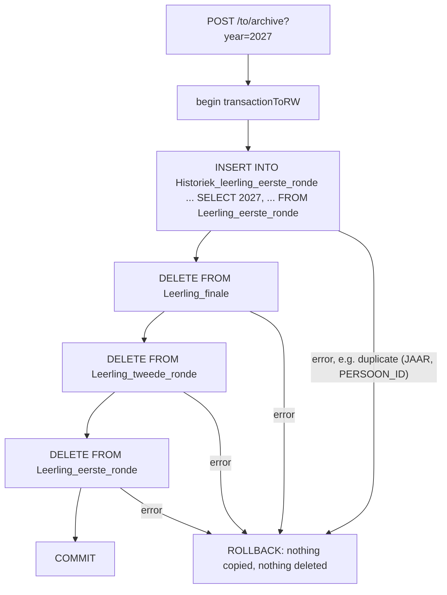

# 17. Archiving a year

<div class="level-tabs" data-levels>
  <button data-level="overview" aria-pressed="true">Overview</button>
  <button data-level="deep" data-short="Deep">Deep Understanding</button>
  <button data-level="drill">Drilling</button>
</div>

<div class="level overview">

The current-year tables only ever hold one contest year. When it is
over, its pupils move to `Historiek_leerling_eerste_ronde`, a copy of
the round 1 table with a `JAAR` column in front, and the current tables
are emptied for the next year. The VWO has a whole family of these
tables (`Historiek_leerling_eerste_ronde`, `_tweede_ronde`, `_finale`,
`_eerste_ronde_anoniem` and the Kangoeroe ones), and its
`LeerlingVWODaoImpl` reads them whenever a caller asks for the count of
an earlier year.

No entity maps a history table, in the VWO or here. They are read and
written with
<dfn data-def="SQL sent to the database as written, through Session.createNativeQuery, instead of HQL that Hibernate translates. It names tables and columns, not entities and fields.">native SQL</dfn>,
next to the HQL of the current-year queries. This chapter adds the two
historic counts, lets the count endpoints pick the right query by year
the way the VWO does, and builds an archive operation that copies a
year's pupils into the history table and empties the current tables in
one transaction.

**After this chapter you can:**

- choose between HQL and native SQL for a query, and read native results safely;
- route a query to the current or the history table by school year;
- run several native write statements as one unit of work;
- explain what native DML does to Hibernate's caches.

<div class="code-compare" data-code-compare data-labels="VWO LeerlingVWODaoImpl|TechOlympiad LeerlingToDaoImpl">

```java
private long countHistoric(Configuration.VwoRole edition, short year) {
    Session session = getFactoryR().getCurrentSession();
    Number count = (Number) session.createNativeQuery("SELECT COUNT(*) FROM " + HISTORIC_PARTICIPANTS)
            .setParameter("year", year)
            .setParameter("min", minGrade(edition))
            .setParameter("max", maxGrade(edition))
            .getSingleResult();
    return count.longValue();
}
```

```java
@Override
@Transactional(value = transactionR, readOnly = true)
public long countHistoric(short year, Configuration.ToRole edition) {
    Session session = getFactoryR().getCurrentSession();
    Number count = (Number) session.createNativeQuery(
                    "SELECT COUNT(*) FROM Historiek_leerling_eerste_ronde "
                            + "WHERE JAAR = :year AND ROL = :edition")
            .setParameter("year", year)
            .setParameter("edition", edition.name())
            .getSingleResult();
    return count.longValue();
}
```

</div>

The VWO's history table has no edition column, so it filters on the
grade range of each edition (JWO grades 1 to 4, VWO 5 to 7), and it
unions in the `_anoniem` table that older years move to. Our history
table keeps `ROL`, so the query filters on it directly.

</div>

<div class="level deep">

### HQL or native SQL

<div class="table-wrap">

| | HQL | Native SQL |
|---|---|---|
| Names | entities and fields: `LeerlingEersteRonde l`, `l.rol` | tables and columns: `Leerling_eerste_ronde`, `ROL` |
| Needs a mapping | yes, every name must be mapped | no |
| Result types | the mapped Java types, typed queries | whatever the JDBC driver returns: `Object`, `Object[]` |
| Enum parameters | bound through the mapping (`'JTO'`) | not known; pass `edition.name()` |
| Database features | the portable subset Hibernate knows | anything MariaDB accepts: `INSERT ... SELECT` into any table, `UNION ALL`, `DATE()` |
| Caches and session | Hibernate knows which tables a statement touches | Hibernate does not, unless you tell it |
| EF Core | LINQ | `FromSqlRaw`, `ExecuteSqlRaw` |

</div>

The VWO uses native SQL exactly where the table has no entity or the
query needs a database feature: the history counts (with a `UNION ALL`
over two tables), the daily counts (`GROUP BY DATE(INSCHRIJFDATUM)`), and
the registration log. Everything else is HQL. A comment in
`LeerlingVWODaoImpl` gives the reason for the history: "No JPA entity
exists for this archive table ... so a native query is used instead of
HQL." We follow the same rule: the history table is not mapped, so it is
only reachable natively.

Mapping it would be possible (a `HistoriekLeerlingEersteRonde extends ToParticipant`
with a two-column key), but the archive would gain nothing: it is a bulk
copy, not a set of objects to load and change, and loading thousands of
entities to write them out again is slower and uses more memory than one
`INSERT ... SELECT`.

### Reading native results

`createNativeQuery(sql)` without a result class returns rows as the
driver delivers them. A single column is a single object, several
columns are an `Object[]`. Which Java type each value has follows the
column's JDBC type and the Hibernate dialect, not your entity mappings:
Hibernate 5 returns a native `COUNT(*)`, a `BIGINT`, as a `BigInteger`,
while the HQL `COUNT` of chapter 14 is a `Long`; a `SMALLINT` comes back
as a `Short`. The VWO reads
everything through `Number` (`((Number) row[0]).shortValue()`), which
works for all of them. Our `toCountMap` from chapter 14 was written that
way so it can serve both kinds of query.

Parameters in native SQL are bound as plain JDBC values. An enum has no
JDBC type, so the VWO passes `edition.name()` in its native queries
(`.setParameter("edition", edition.name())`) and the enum itself in
HQL. Forgetting the `.name()` makes Hibernate bind the enum as a
serialized object, and the comparison silently matches nothing.

### Choosing the query by year

The count endpoints take an optional `year`. For the current school year
the pupils are in `Leerling_eerste_ronde`; for any other year they are in
the history table. The VWO makes that choice inside the DAO method:

```java
public long countParticipants(Configuration.VwoRole edition, short year) {
    if (year != General.getCurrentSchoolYear()) {
        return countHistoric(edition, year);
    }
    // HQL on LeerlingEersteRonde
}
```

TechOlympiad keeps each DAO method to one query (`count`, `countHistoric`)
and makes the choice one layer up, in `LeerlingToRepositoryImpl`. The
rule is the same; the DAO stays a list of queries and the repository
decides which one a request needs, which is the split chapter 16 used for
scoring.

<div class="callout danger">
<div class="callout-label"><code>short</code> or <code>Short</code> matters for <code>==</code></div>

`year != General.getCurrentSchoolYear()` compares a primitive `short`
with a `Short`, so Java unboxes the `Short` and compares numbers. If
`year` were a `Short` too, `==` and `!=` would compare *object
references*. Java caches boxed values only from -128 to 127, so two
`Short`s holding `2027` are usually different objects, and
`year == General.getCurrentSchoolYear()` would be `false` for the
current year. The repository parameter is a primitive `short` for this
reason; with two wrappers, use `equals`.

</div>

The rule has one consequence to keep in mind. It assumes the current
school year is never archived while it is still current. If you archive
2027 in July 2027, the 2027 pupils are in the history table, but a count
for 2027 still goes to the (now empty) current table and returns `0`.
Archive after 1 September, passing the finished year explicitly, or
accept that the counts read zero until then.

### One unit of work for the archive

Archiving is four statements:



Without the transaction, a failure after the copy would leave the pupils
in both places, and a failure in the copy followed by the deletes would
lose them. With `@Transactional(value = transactionRW)` on the DAO method,
all four run on one `to_write` connection inside one MariaDB transaction,
and `executeUpdate` requires that: outside a transaction it throws
`TransactionRequiredException: Executing an update/delete query`.

The deletes go child first (final, round 2, round 1). Our schema has no
foreign keys between those tables, but the VWO's production schema may,
and the order costs nothing.

Only round 1 is copied, because TechOlympiad has only a round 1 history
table. Round 2 and final results are deleted with the year. The VWO keeps
them in `Historiek_leerling_tweede_ronde` and `Historiek_leerling_finale`;
adding those is the same `INSERT ... SELECT` twice more.

<div class="callout danger">
<div class="callout-label">Why not <code>TRUNCATE</code></div>

`TRUNCATE TABLE` is faster and resets `AUTO_INCREMENT`, which looks
tempting for "empty the table". In MariaDB it is a DDL statement: it
commits the open transaction implicitly, so the copy before it would be
committed even if a later step failed, and it needs the `DROP` privilege,
which `to_write` does not have (`DROP command denied to user 'to_write'`).
`DELETE` is transactional and needs only `DELETE`. Keeping the
`AUTO_INCREMENT` counter is in fact what we want: next year's
`PERSOON_ID`s stay different from this year's.

</div>

### Native DML and Hibernate's caches

Hibernate cannot parse native SQL, so it does not know which tables an
`INSERT` or `DELETE` touches. Before running one it flushes the session,
and afterwards it assumes the worst: every second-level cache region is
invalidated. That does not matter yet, but chapter 21 caches `Scholen`,
and an archive would throw those cached schools away for no reason.
`NativeQuery` lets you name what a statement affects:

- `addSynchronizedEntityClass(LeerlingEersteRonde.class)` for a statement
  on a mapped table;
- `addSynchronizedQuerySpace("Historiek_leerling_eerste_ronde")` for a
  table without an entity.

With those declared, Hibernate invalidates only the regions of the named
entities. The archive below declares them on every statement.

</div>

<div class="level drill">

### What you should have

The end state of [chapter 16](build-16-scoring.md): pupils can be
enrolled, scored and selected. The seed has four 2026 pupils in
`Historiek_leerling_eerste_ronde` (two JTO at schools 1 and 2, two STO at
schools 1 and 4).

Paths are relative to `src/main/java/be/techolympiad/common/`.

### Tasks

<ul class="checklist">
<li><label><input type="checkbox"><span>Add <code>countHistoric</code>, <code>countPerSchoolHistoric</code> and <code>archive</code> to <code>LeerlingToDao</code> and its implementation.</span></label></li>
<li><label><input type="checkbox"><span>Give the count methods of <code>LeerlingToRepository</code> a <code>year</code> and route them; add <code>archive</code>.</span></label></li>
<li><label><input type="checkbox"><span>Add the <code>year</code> parameter to <code>GET /to/participants/count</code> and <code>/school-counts</code>.</span></label></li>
<li><label><input type="checkbox"><span>Create the <code>ArchiveController</code> interface and its <code>v1</code> class.</span></label></li>
<li><label><input type="checkbox"><span>Build, restart, and run the calls under <em>Run it</em>; reset the database afterwards.</span></label></li>
<li><label><input type="checkbox"><span>Commit: <code>git add -A &amp;&amp; git commit -m "Archive a contest year"</code>.</span></label></li>
</ul>

### The DAO

`dao/LeerlingToDao.java`:

<div class="diff-view" data-diff-view>

```diff
     long count(Configuration.ToRole edition);
 
     Map<Short, Long> countPerSchool(Configuration.ToRole edition);
+
+    long countHistoric(short year, Configuration.ToRole edition);
+
+    Map<Short, Long> countPerSchoolHistoric(short year, Configuration.ToRole edition);
+
+    int archive(short year);
 }
```

</div>

`dao/impl/LeerlingToDaoImpl.java`, the new methods (placed after
`countPerSchool`, before the private `toCountMap`):

<div class="code-walk" data-code-walk>

```java
    @Override
    @Transactional(value = transactionR, readOnly = true)
    public long countHistoric(short year, Configuration.ToRole edition) {
        Session session = getFactoryR().getCurrentSession();
        Number count = (Number) session.createNativeQuery( // (1)
                        "SELECT COUNT(*) FROM Historiek_leerling_eerste_ronde "
                                + "WHERE JAAR = :year AND ROL = :edition")
                .setParameter("year", year)
                .setParameter("edition", edition.name()) // (2)
                .getSingleResult();
        return count.longValue();
    }

    @Override
    @Transactional(value = transactionR, readOnly = true)
    @SuppressWarnings("unchecked")
    public Map<Short, Long> countPerSchoolHistoric(short year, Configuration.ToRole edition) {
        Session session = getFactoryR().getCurrentSession();
        List<Object[]> rows = session.createNativeQuery( // (3)
                        "SELECT SCHOOL_ID, COUNT(*) FROM Historiek_leerling_eerste_ronde "
                                + "WHERE JAAR = :year AND ROL = :edition "
                                + "GROUP BY SCHOOL_ID")
                .setParameter("year", year)
                .setParameter("edition", edition.name())
                .getResultList();
        return toCountMap(rows);
    }

    @Override
    @Transactional(value = transactionRW) // (4)
    public int archive(short year) {
        Session session = getFactoryRW().getCurrentSession();
        int archived = session.createNativeQuery(
                        "INSERT INTO Historiek_leerling_eerste_ronde "
                                + "(JAAR, PERSOON_ID, DEELNEMERSNUMMER, SCHOOL_ID, NAAM, VOORNAAM, GENDER, LEERJAAR, ROL, RESULTAAT, ANTWOORDEN, INSCHRIJFDATUM) "
                                + "SELECT :year, PERSOON_ID, DEELNEMERSNUMMER, SCHOOL_ID, NAAM, VOORNAAM, GENDER, LEERJAAR, ROL, RESULTAAT, ANTWOORDEN, INSCHRIJFDATUM "
                                + "FROM Leerling_eerste_ronde")
                .addSynchronizedQuerySpace("Historiek_leerling_eerste_ronde") // (5)
                .setParameter("year", year)
                .executeUpdate();
        session.createNativeQuery("DELETE FROM Leerling_finale")
                .addSynchronizedQuerySpace("Leerling_finale")
                .executeUpdate();
        session.createNativeQuery("DELETE FROM Leerling_tweede_ronde")
                .addSynchronizedEntityClass(LeerlingTweedeRonde.class)
                .executeUpdate();
        session.createNativeQuery("DELETE FROM Leerling_eerste_ronde")
                .addSynchronizedEntityClass(LeerlingEersteRonde.class)
                .executeUpdate();
        return archived; // (6)
    }
```

1. No result class, so the result is an `Object`, here a `BigInteger`. Reading it as a `Number` works whatever the concrete type is.
2. A native parameter is a plain JDBC value. `ROL` holds `'JTO'`, so pass the name.
3. Two columns, so each row is an `Object[]`; `getResultList()` on an untyped native query returns a raw `List`, hence the `@SuppressWarnings`. `toCountMap` reads both values through `Number`.
4. One read-write transaction for the four statements, which is what makes the archive all or nothing.
5. Declares what the statement touches, so Hibernate does not invalidate every cache region (chapter 21 makes this matter).
6. `executeUpdate` returns the number of rows affected; for the `INSERT ... SELECT`, the number of pupils archived.

</div>

The file needs `import be.techolympiad.common.dbEntities.LeerlingTweedeRonde;`
next to the existing imports.

### The repository

`restAPI/repositories/LeerlingToRepository.java`:

<div class="diff-view" data-diff-view>

```diff
-    long count(Configuration.ToRole edition);
+    long count(Configuration.ToRole edition, short year);
 
-    Map<Short, Long> countPerSchool(Configuration.ToRole edition);
+    Map<Short, Long> countPerSchool(Configuration.ToRole edition, short year);
+
+    int archive(short year);
 }
```

</div>

`restAPI/repositories/LeerlingToRepositoryImpl.java` (it already imports
`General` since chapter 14):

<div class="diff-view" data-diff-view>

```diff
     @Override
-    public long count(Configuration.ToRole edition) {
-        return leerlingToDao.count(edition);
+    public long count(Configuration.ToRole edition, short year) {
+        if (year != General.getCurrentSchoolYear()) {
+            return leerlingToDao.countHistoric(year, edition);
+        }
+        return leerlingToDao.count(edition);
     }
 
     @Override
-    public Map<Short, Long> countPerSchool(Configuration.ToRole edition) {
-        return leerlingToDao.countPerSchool(edition);
+    public Map<Short, Long> countPerSchool(Configuration.ToRole edition, short year) {
+        if (year != General.getCurrentSchoolYear()) {
+            return leerlingToDao.countPerSchoolHistoric(year, edition);
+        }
+        return leerlingToDao.countPerSchool(edition);
+    }
+
+    @Override
+    public int archive(short year) {
+        return leerlingToDao.archive(year);
     }
```

</div>

### The count endpoints

`restAPI/controllers/ToParticipantsController.java`, which also needs
`import java.util.Objects;`:

<div class="diff-view" data-diff-view>

```diff
     default ResponseEntity<List<EditionCount>> getCount(
-            @RequestParam(value = "edition", required = false) @Parameter(description = "Comma-separated list of editions; all editions if empty") List<Configuration.ToRole> editions) {
-        short year = General.getCurrentSchoolYear();
+            @RequestParam(value = "edition", required = false) @Parameter(description = "Comma-separated list of editions; all editions if empty") List<Configuration.ToRole> editions,
+            @RequestParam(value = "year", required = false) @Parameter(description = "School year; current school year if empty") Short yearOpt) {
+        short year = Objects.requireNonNullElse(yearOpt, General.getCurrentSchoolYear());
         List<EditionCount> result = new ArrayList<>();
         for (Configuration.ToRole edition : editionsOrAll(editions)) {
-            result.add(new EditionCount(edition, year, getRepository().count(edition)));
+            result.add(new EditionCount(edition, year, getRepository().count(edition, year)));
         }
         return ResponseEntity.ok().body(result);
     }
@@
     default ResponseEntity<List<SchoolParticipantCount>> getSchoolCounts(
-            @RequestParam(value = "edition", required = false) @Parameter(description = "Comma-separated list of editions; all editions if empty") List<Configuration.ToRole> editions) {
-        short year = General.getCurrentSchoolYear();
+            @RequestParam(value = "edition", required = false) @Parameter(description = "Comma-separated list of editions; all editions if empty") List<Configuration.ToRole> editions,
+            @RequestParam(value = "year", required = false) @Parameter(description = "School year; current school year if empty") Short yearOpt) {
+        short year = Objects.requireNonNullElse(yearOpt, General.getCurrentSchoolYear());
         List<SchoolParticipantCount> result = new ArrayList<>();
         for (Configuration.ToRole edition : editionsOrAll(editions)) {
-            getRepository().countPerSchool(edition).forEach((schoolId, count) ->
+            getRepository().countPerSchool(edition, year).forEach((schoolId, count) ->
                     result.add(new SchoolParticipantCount(schoolId, edition, year, count)));
         }
```

</div>

`year` is still assigned exactly once, so the lambda may keep using it.
The parameter is named `yearOpt` like the VWO's, leaving `year` for the
resolved value.

### The archive controller

`restAPI/controllers/ArchiveController.java`

```java
package be.techolympiad.common.restAPI.controllers;

import be.techolympiad.common.General;
import be.techolympiad.common.restAPI.repositories.LeerlingToRepository;
import io.swagger.v3.oas.annotations.Operation;
import io.swagger.v3.oas.annotations.Parameter;
import org.springframework.http.ResponseEntity;
import org.springframework.web.bind.annotation.PostMapping;
import org.springframework.web.bind.annotation.RequestParam;
import org.springframework.web.bind.annotation.ResponseBody;

import java.util.Objects;

public interface ArchiveController {

    LeerlingToRepository getRepository();

    @PostMapping
    @Operation(summary = "Move all current pupils into the history as the given school year, and empty the current tables")
    @ResponseBody
    default ResponseEntity<ArchiveResult> archive(
            @RequestParam(value = "year", required = false) @Parameter(description = "School year the pupils belong to; current school year if empty") Short year) {
        short schoolYear = Objects.requireNonNullElse(year, General.getCurrentSchoolYear());
        return ResponseEntity.ok().body(new ArchiveResult(schoolYear, getRepository().archive(schoolYear)));
    }

    record ArchiveResult(short year, int archived) {
    }
}
```

`restAPI/controllers/v1/ArchiveController.java`

```java
package be.techolympiad.common.restAPI.controllers.v1;

import be.techolympiad.common.restAPI.repositories.LeerlingToRepository;
import io.swagger.v3.oas.annotations.tags.Tag;
import lombok.Getter;
import org.springframework.beans.factory.annotation.Autowired;
import org.springframework.http.MediaType;
import org.springframework.web.bind.annotation.RequestMapping;
import org.springframework.web.bind.annotation.RestController;

@RestController("archiveController.v1")
@RequestMapping(path = V1Config.BASE_URL + "/to/archive", produces = MediaType.APPLICATION_JSON_VALUE)
@Tag(name = "archive-controller")
@Getter
public class ArchiveController implements be.techolympiad.common.restAPI.controllers.ArchiveController {

    private final LeerlingToRepository repository;

    @Autowired
    public ArchiveController(LeerlingToRepository repository) {
        this.repository = repository;
    }
}
```

<div class="callout rule">
<div class="callout-label">Open to everyone, for now</div>

This endpoint deletes a whole year of data, and so far every endpoint is
open. Chapter 20 adds authentication and puts
`@PreAuthorize("hasAuthority('ADMIN')")` on it, so only an admin can
archive. Until then, run it only against your local database.

</div>

### Run it

```bash
mvn -q -DskipTests -Plocal package && docker compose restart api
```

1. Last year, from the history table: `GET /api/v1/to/participants/count?year=2026`:

   ```json
   [
     { "edition": "JTO", "year": 2026, "count": 2 },
     { "edition": "STO", "year": 2026, "count": 2 }
   ]
   ```

   `GET /api/v1/to/participants/school-counts?edition=STO&year=2026` gives
   schools 1 and 4, one pupil each. Without `year`, both endpoints still
   read the current tables, as in chapter 14.
2. Watch the all-or-nothing behaviour first. Put one 2027 row in the
   history by hand, with the same `PERSOON_ID` as a current pupil:

   ```bash
   docker compose exec db mariadb -uroot -pdevpass TechOlympiad \
     -e "INSERT INTO Historiek_leerling_eerste_ronde (JAAR, PERSOON_ID) VALUES (2027, 1)"
   ```

   Then `POST /api/v1/to/archive` (no year, so 2027): `500`, with
   `Duplicate entry '2027-1' for key 'PRIMARY'` in the log.
   `GET /api/v1/to/participants/count` shows every current pupil still
   there. Remove the row again:

   ```bash
   docker compose exec db mariadb -uroot -pdevpass TechOlympiad \
     -e "DELETE FROM Historiek_leerling_eerste_ronde WHERE JAAR = 2027"
   ```

3. Archive for real: `POST /api/v1/to/archive`:

   ```json
   { "year": 2027, "archived": 10 }
   ```

   Ten if you kept Milan from chapter 14 next to the nine seeded pupils;
   your number is the size of `Leerling_eerste_ronde` before the call.
4. `GET /api/v1/to/participants/count` now gives `0` for both editions:
   the current tables are empty. A count with `year=2027` also gives `0`,
   because 2027 is still the current school year and is read from the
   current table (see *Choosing the query by year*). The history holds the
   pupils, with their round 1 results and answers:

   ```bash
   docker compose exec db mariadb -uroot -pdevpass TechOlympiad \
     -e "SELECT JAAR, ROL, COUNT(*), MAX(RESULTAAT) FROM Historiek_leerling_eerste_ronde GROUP BY JAAR, ROL"
   ```

5. Archive again: `{ "year": 2027, "archived": 0 }`. The current table is
   empty, so nothing is copied and nothing fails.
6. Put the seed back for the next chapters. The init scripts only run on
   an empty data volume, so remove it:

   ```bash
   docker compose down -v && docker compose up -d
   ```

<div class="callout danger">
<div class="callout-label">When it breaks</div>

- **`TransactionRequiredException: Executing an update/delete query`**: `archive` has no `@Transactional(value = transactionRW)`, or calls `getFactoryR()`.
- **`INSERT command denied to user 'to_read'`**: the archive runs on the read-only factory.
- **The historic counts are always `0`**: the enum was bound without `.name()`, or `year` and `JAAR` do not match. Run the query by hand in `mariadb` to check.
- **`ClassCastException: class java.math.BigInteger cannot be cast to class java.lang.Long`**: a native result was cast to a concrete type. Cast to `Number` and call `longValue()`.
- **`DROP command denied to user 'to_write'`**: someone replaced a `DELETE` with `TRUNCATE`. Keep `DELETE`.
- **Counts for the current year read `0` after archiving**: expected, by the routing rule; the year's pupils are in the history.

</div>

### Quiz

<div class="quiz" data-quiz>
<p class="quiz-q">The archive's third statement, <code>DELETE FROM Leerling_tweede_ronde</code>, fails. What is in the database afterwards?</p>
<ol class="quiz-options">
<li>The pupils in the history and still in the current tables: the <code>INSERT</code> had already run<p class="quiz-whynot">It had run, inside the transaction. Its rows were never committed.</p></li>
<li data-correct>Exactly what was there before the call<p class="quiz-why">All four statements run in one <code>transactionToRW</code> transaction; the exception rolls back the <code>INSERT</code> and the first <code>DELETE</code> too.</p></li>
<li>An empty <code>Leerling_finale</code>, because each native statement commits on its own<p class="quiz-whynot">Native statements take part in the session's transaction like HQL ones; <code>executeUpdate</code> even refuses to run without one.</p></li>
</ol>
<p class="quiz-explain">This is why the archive uses <code>DELETE</code>, which is transactional, and not <code>TRUNCATE</code>, which would commit implicitly.</p>
</div>

<div class="quiz" data-quiz>
<p class="quiz-q">Why does the history count pass <code>edition.name()</code> while the HQL count passes <code>edition</code>?</p>
<ol class="quiz-options">
<li>Native queries do not support parameters, so the name is concatenated in<p class="quiz-whynot">They support named parameters; the value is bound, not concatenated.</p></li>
<li data-correct>In HQL Hibernate knows the field is mapped with <code>EnumType.STRING</code>; in native SQL there is no mapping, so the parameter must already be the column value<p class="quiz-why">Without a mapping Hibernate cannot know that <code>ROL</code> stores names, so you bind the <code>String</code> yourself.</p></li>
<li>MariaDB rejects Java enums in prepared statements, with an error<p class="quiz-whynot">The usual result is worse than an error: the enum is bound in some other form and the comparison quietly matches nothing.</p></li>
</ol>
<p class="quiz-explain">The VWO does exactly this: <code>.setParameter("edition", edition.name())</code> in its native <code>countPerSchoolPerDay</code>, the enum itself in its HQL counts.</p>
</div>

### Flashcards

<div class="flashcards" data-flashcards data-front-label="Term" data-back-label="Meaning">
<div class="card"><div class="front"><code>createNativeQuery(sql)</code></div><div class="back">Runs SQL as written. Untyped results: <code>Object</code> or <code>Object[]</code> per row.</div></div>
<div class="card"><div class="front">Reading native numbers</div><div class="back">Cast to <code>Number</code>, then <code>longValue()</code> / <code>shortValue()</code>: the JDBC type decides the concrete class (<code>COUNT(*)</code> is a <code>BigInteger</code>).</div></div>
<div class="card"><div class="front">Choosing by year</div><div class="back">Current school year: HQL on the current table. Any other year: native SQL on <code>Historiek_*</code>.</div></div>
<div class="card"><div class="front"><code>executeUpdate()</code></div><div class="back">Runs an <code>INSERT</code>/<code>UPDATE</code>/<code>DELETE</code> and returns the affected row count. Needs an active transaction.</div></div>
<div class="card"><div class="front"><code>addSynchronizedQuerySpace</code> / <code>addSynchronizedEntityClass</code></div><div class="back">Tell Hibernate which tables a native statement touches, so it invalidates only those cache regions.</div></div>
<div class="card"><div class="front"><code>TRUNCATE</code> in MariaDB</div><div class="back">DDL: implicit commit and needs <code>DROP</code>. Use <code>DELETE</code> inside a transaction.</div></div>
<div class="card"><div class="front"><code>Short == Short</code></div><div class="back">Compares references; only -128 to 127 are cached. Compare a primitive, or use <code>equals</code>.</div></div>
</div>

### Self-checks

<details class="qa">
<summary>Self-check: why does the VWO's history query filter on grades instead of on the edition?</summary>
<div class="ans">
Its <code>Historiek_leerling_eerste_ronde</code> has no <code>ROL</code> column. The edition can only be recovered from the grade: JWO pupils are in grades 1 to 4, VWO pupils in 5 to 7, which is what <code>minGrade</code> and <code>maxGrade</code> return. It also unions the <code>_anoniem</code> table, because older archived years move there. Our history keeps <code>ROL</code>, so a plain filter works.
<div class="mark"><button type="button">Mark as known</button></div>
</div>
</details>

<details class="qa">
<summary>Self-check: what would it take to read the history with HQL instead of native SQL?</summary>
<div class="ans">
An entity for the table, for example <code>HistoriekLeerlingEersteRonde extends ToParticipant</code> with <code>@IdClass</code> over <code>JAAR</code> and <code>PERSOON_ID</code>, plus its <code>&lt;mapping&gt;</code> line. Then <code>SELECT COUNT(h) FROM HistoriekLeerlingEersteRonde h WHERE h.jaar = :year AND h.rol = :edition</code> would work. The archive's bulk copy would still be native, since HQL's <code>INSERT ... SELECT</code> needs an entity on both sides and would add nothing over SQL.
<div class="mark"><button type="button">Mark as known</button></div>
</div>
</details>

<details class="qa">
<summary>Self-check: you archive 2027 on 15 September 2027 without passing <code>year</code>. What goes wrong?</summary>
<div class="ans">
From 1 September the current school year is 2028, so the 2027 pupils are archived with <code>JAAR = 2028</code>. Their participant numbers still start with 27, and a count for 2027 finds nothing. After the school year has rolled over, always pass the finished year explicitly.
<div class="mark"><button type="button">Mark as known</button></div>
</div>
</details>

<button type="button" data-mark-done>Mark this chapter done</button>

</div>
