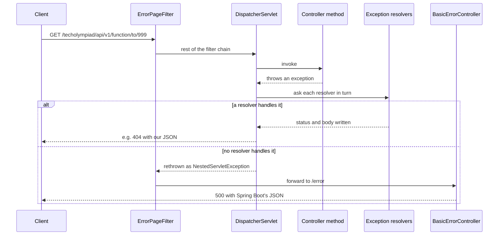

# 18. Error handling

<div class="level-tabs" data-levels>
  <button data-level="overview" aria-pressed="true">Overview</button>
  <button data-level="deep" data-short="Deep">Deep Understanding</button>
  <button data-level="drill">Drilling</button>
</div>

<div class="level overview">

Every endpoint so far handles failure on its own. For example:

- A missing person ends in `.orElse(ResponseEntity.notFound().build())`
  and an empty body.
- A foreign key violation escapes as a `500` with Spring Boot's generic
  error body.
- A missing registration fee is an `Optional` passed all the way up to
  the controller.

This chapter moves that error handling into one place.

The VWO API has that place: `restAPI/ErrorAdvice.java`, a class Spring
consults whenever a controller throws. It turns a refused database row
into a `409 Conflict` with a JSON body that says what the database
objected to, and a failed Bean Validation into a `422`. TechOlympiad
gets the same class with the same shape, plus two exceptions of its own:
`NotFoundException` for a resource that does not exist (`404`), and
`RoundClosedException` for a write that comes too late in the contest
year (`409`).

**After this chapter you can:**

- follow an exception from a controller method to the HTTP response, through each resolver Spring MVC tries;
- write a `@RestControllerAdvice` with `@ExceptionHandler` methods and predict which one wins;
- explain why the VWO handles two different `ConstraintViolationException` classes;
- replace `Optional` plumbing in controllers with exceptions thrown where the problem is found.

<div class="code-compare" data-code-compare data-labels="VWO ErrorAdvice|TechOlympiad ErrorAdvice">

```java
@RestControllerAdvice
public class ErrorAdvice {
    @ResponseStatus(HttpStatus.CONFLICT)
    @ExceptionHandler({org.hibernate.exception.ConstraintViolationException.class}/*FIXME in Spring 6: produces = MediaType.APPLICATION_JSON_VALUE*/)
    public ResponseEntity<Map<String, String>> handle(ConstraintViolationException ex) {
        Map<String, String> map = new HashMap<>();
        map.put("message", ex.getMessage());
        map.put("description", ex.getSQLException().getMessage());
        return ResponseEntity.status(HttpStatus.CONFLICT).body(map);
    }

    @ResponseStatus(HttpStatus.UNPROCESSABLE_ENTITY)
    @ExceptionHandler({javax.validation.ConstraintViolationException.class}/*FIXME in Spring 6: produces = MediaType.APPLICATION_JSON_VALUE*/)
    public ResponseEntity<Map<String, String>> handle(javax.validation.ConstraintViolationException ex) {
        // ...
    }
    // IllegalQuestionTypeException, TeamException, AccessDeniedException
}
```

```java
@RestControllerAdvice
public class ErrorAdvice {

    @ResponseStatus(HttpStatus.NOT_FOUND)
    @ExceptionHandler(NotFoundException.class)
    public ResponseEntity<Map<String, String>> handle(NotFoundException ex) {
        return error(HttpStatus.NOT_FOUND, ex.getMessage(), ex.toString());
    }

    @ResponseStatus(HttpStatus.CONFLICT)
    @ExceptionHandler(ConstraintViolationException.class)
    public ResponseEntity<Map<String, String>> handle(ConstraintViolationException ex) {
        return error(HttpStatus.CONFLICT, ex.getMessage(), ex.getSQLException().getMessage());
    }
    // RoundClosedException, both validation exceptions, and the error(...) helper
}
```

</div>

</div>

<div class="level deep">

### Where an exception goes today

A controller method that throws does not talk to the client itself. The
exception travels back up the call stack into `DispatcherServlet`, and
what the client sees depends on who picks it up on the way out:



The bottom branch is what chapter 12's `POST /function` with an unknown
`personId` does now. The <dfn data-def="A servlet filter Spring Boot adds when the application runs as a WAR in an external container. It catches exceptions and error statuses and forwards the request to /error, the job embedded Tomcat's error pages do in a jar.">ErrorPageFilter</dfn>
exists only because TechOlympiad is a WAR on an external Tomcat: Spring
Boot registers it from `SpringBootServletInitializer`. It catches what
escaped, or notices a status of 400 or more set with `sendError`, and
forwards to `/error`. There `BasicErrorController` builds the familiar
body from `DefaultErrorAttributes`:

```json
{
  "timestamp": "2026-10-19T14:20:31.118+00:00",
  "status": 500,
  "error": "Internal Server Error",
  "path": "/techolympiad/api/v1/function"
}
```

The exception message is not in it. Spring Boot 2.3 changed
`server.error.include-message` to `never`, so the reason only appears in
the Tomcat log. Hiding the message is safe, because messages can leak
SQL. But it does not help a client that sent a bad id.

### The resolver chain

`DispatcherServlet` keeps a list of
<dfn data-def="Spring MVC's extension point for exceptions: resolveException(request, response, handler, ex) either handles the exception (writes a response and returns a ModelAndView) or returns null so the next resolver can try.">HandlerExceptionResolver</dfn>s
and asks them in order until one returns a result:

<div class="table-wrap">

| Order | Resolver | What it handles | What the client gets |
|---|---|---|---|
| 1 | `DefaultErrorAttributes` (Spring Boot) | Everything, but it only stores the exception as a request attribute for `/error` and returns `null` | Nothing yet |
| 2 | `ExceptionHandlerExceptionResolver` | Exceptions an `@ExceptionHandler` method accepts: first in the controller that threw, then in `@ControllerAdvice` beans | Whatever that method returns |
| 3 | `ResponseStatusExceptionResolver` | `ResponseStatusException`, and exception classes annotated `@ResponseStatus` | `sendError(status, reason)`, so the `/error` body |
| 4 | `DefaultHandlerExceptionResolver` | Spring MVC's own exceptions: type mismatch, missing parameter, unreadable body, `MethodArgumentNotValidException`, wrong HTTP method or media type | `sendError(4xx)`, so the `/error` body |

</div>

Resolvers 2 to 4 sit in one `HandlerExceptionResolverComposite` created
by `WebMvcConfigurationSupport`, in exactly that order. Two consequences
follow:

1. A request for `/api/v1/school/abc` fails to convert `abc` to a
   `Short`. Nothing of ours handles that, so resolver 4 answers `400`.
2. An `@ExceptionHandler` always runs before Spring's own defaults. So a
   handler for a broad type such as `RuntimeException` would also capture
   that conversion error, because `MethodArgumentTypeMismatchException`
   is a `RuntimeException`.

The VWO has such a catch-all in `ErrorAdvice`, commented out, that maps
every `RuntimeException` to `409`. Leaving it out is the right call. It
would turn two other statuses into `409`: the `400` for a bad parameter,
and the `403` of an `AccessDeniedException` from
[chapter 20](build-20-authentication.md).

### `@ExceptionHandler` and `@RestControllerAdvice`

An `@ExceptionHandler` method is an ordinary handler method that Spring
calls with the exception instead of with request data. It can take the
exception, the `HttpServletRequest` or the `HandlerMethod` as parameters
and return anything a controller method can return.

Placed in a controller (or, as the VWO does in
`KangoeroePoolsParticipantsController`, as a `default` method of a
controller interface), it only applies to exceptions from that
controller. Placed in a class annotated
<dfn data-def="@ControllerAdvice plus @ResponseBody: a bean whose @ExceptionHandler (and @InitBinder, @ModelAttribute) methods apply to every controller, and whose return values are written as the response body.">@RestControllerAdvice</dfn>,
it applies to all of them. The local one is tried first.

When several handlers accept an exception, the one whose declared type is
closest in the class hierarchy wins. When none accepts the exception
itself, Spring 5.3 looks at its cause, and at the cause's cause, and
passes the matching one to your method. That rule is what makes the
VWO's database handler work at all, as the next section shows.

<div class="code-walk" data-code-walk>

```java
@ResponseStatus(HttpStatus.CONFLICT)                          // (1)
@ExceptionHandler(ConstraintViolationException.class)         // (2)
public ResponseEntity<Map<String, String>> handle(ConstraintViolationException ex) { // (3)
    return error(HttpStatus.CONFLICT, ex.getMessage(), ex.getSQLException().getMessage()); // (4)
}
```

1. Documents the status. The `ResponseEntity` below sets it again and wins, because Spring writes the `@ResponseStatus` status first and the entity's status last. springdoc reads this annotation on advice methods and lists a `409` response on every operation in Swagger.
2. The exception types this method accepts. Leave the attribute out and Spring takes them from the parameter types.
3. Overloads named `handle` are fine: Spring picks by the annotation, never by name. The VWO names almost all of its handlers `handle`.
4. `getSQLException()` is the JDBC exception underneath, with the database's own message.

</div>

### `@ResponseStatus` on an exception class

There is a shorter route for an exception that always means one status:

```java
@ResponseStatus(HttpStatus.NOT_FOUND)
public class NotFoundException extends RuntimeException { ... }
```

Resolver 3 then answers with `sendError(404, reason)`, and the client gets
Spring Boot's `/error` body, without the message. That is why
TechOlympiad handles `NotFoundException` in `ErrorAdvice` instead. This
gives one JSON shape for every error the API itself raises.

`ResponseStatusException` is the same mechanism without a class of your
own: `throw new ResponseStatusException(HttpStatus.UNAUTHORIZED, "...")`.
Chapter 20 uses it for the login endpoint.

### Two `ConstraintViolationException`s

The VWO's `ErrorAdvice` imports one `ConstraintViolationException` and
spells the other out in full, because they are unrelated classes with
the same simple name:

<div class="table-wrap">

| | `org.hibernate.exception.ConstraintViolationException` | `javax.validation.ConstraintViolationException` |
|---|---|---|
| Who raises it | Hibernate, when the database refuses a statement | Bean Validation (Hibernate Validator) |
| Typical cause | Duplicate primary key, foreign key violation, `NOT NULL` column | A constraint annotation such as `@Pattern`, `@Size` or `@NotNull` fails |
| When | At flush, usually at commit | When a validated method is called, or when Hibernate validates an entity before inserting it |
| Useful detail | `getSQLException().getMessage()`, the MariaDB message | `getConstraintViolations()`, one entry per failed constraint |
| VWO status | `409` | `422` |
| TechOlympiad status | `409` | `400` |

</div>

#### The database one arrives wrapped

Hibernate throws its `ConstraintViolationException` when MariaDB answers
an `INSERT` with error 1452 (foreign key) or 1062 (duplicate key). It
never reaches the controller in that form. The statement usually runs at
commit, and `JpaTransactionManager` commits the DAO's transaction: it
catches the failure and converts it into one of Spring's own
`DataAccessException`s. Spring Boot's `PersistenceExceptionTranslationPostProcessor`
does the same for exceptions thrown inside any `@Repository` bean. Which
class you get depends on how the Hibernate exception was packed when
Spring saw it:

- bare, it becomes a `DataIntegrityViolationException`, the class chapter 12 saw in the log for the foreign key;
- wrapped in a JPA `PersistenceException` by Hibernate's commit, Spring may not recognise it and falls back to the generic `JpaSystemException`, which is what a duplicate key through our DAOs produces.

Either way the Hibernate exception is somewhere in the cause chain.
`ErrorAdvice` has a handler for neither Spring class, so
`ExceptionHandlerExceptionResolver` walks `getCause()` recursively, finds
the Hibernate exception, and calls the `409` handler with it. The
handler's parameter receives the cause, not the wrapper. Before Spring
5.3 only the top-level exception counted (with one level of cause from
4.3), and this handler, the VWO's included, would have been dead code.
TechOlympiad therefore needs no handler for the wrappers. A handler for
`DataIntegrityViolationException` would even take precedence and hide
the MariaDB message.

#### The validation one has a sibling

Bean Validation has three ways in, and they raise different exceptions:

- `@Valid` on a `@RequestBody`, as chapter 13 put on `ParticipationInfo`, validates while binding and throws `MethodArgumentNotValidException`. That is a Spring MVC exception, so without a handler resolver 4 answers `400`.
- `@Validated` on a bean class makes Spring validate constraint annotations on that bean's method parameters, through the `MethodValidationPostProcessor` Spring Boot registers. Failures throw `javax.validation.ConstraintViolationException`.
- Hibernate validates every entity it is about to insert or update when a validator is on the classpath (`javax.persistence.validation.mode` defaults to `auto`). Failures throw `javax.validation.ConstraintViolationException` from inside the flush.

The VWO uses none of the first two. Its `@NotNull` annotations on path
variables are never enforced, as chapter 13 noted. Its validation errors
come from the third route, from entity constraints such as the `@Pattern`
and `@Size` on `ApiUser.email`. TechOlympiad handles both validation
exceptions with `400`.

<div class="callout note">
<div class="callout-label">Why 400 here and 422 in the VWO</div>

Both are defensible: `422 Unprocessable Entity` says the JSON was well
formed but its content is not acceptable. TechOlympiad already answers
`400` for a `@Valid` failure, because that is what Spring does for
`MethodArgumentNotValidException`, so the other validation exception
gets the same code. A client then has one rule: `400` means fix your
input.

</div>

### Throwing instead of returning `Optional`

Chapter 13's `RegistrationFeeRepository.getAmount` returns an
`Optional<Float>` only so that the controller can map an empty result to
`404`. With an exception, the repository says what is wrong where it
knows it, and the controller only describes the happy path:

```java
default ResponseEntity<Float> get(@PathVariable("edition") Configuration.ToRole edition) {
    return ResponseEntity.ok().body(getRepository().getAmount(edition));
}
```

Java has two kinds of exceptions. A
<dfn data-def="A subclass of Exception that is not a RuntimeException. The compiler forces every caller to catch it or declare it with throws.">checked exception</dfn>
must be declared with `throws` on every method it passes through. C#
has nothing like it. An unchecked exception, a subclass of
`RuntimeException`, needs no declaration. That is why
`NotFoundException` and `RoundClosedException` extend
`RuntimeException`, as the VWO's `IllegalQuestionTypeException` and
`TeamException` do.

The kind of exception matters for transactions too. `@Transactional`
rolls back on unchecked exceptions only, unless you add `rollbackFor`.
That is why the scoring repository of chapter 16 says
`rollbackFor = Exception.class`.

### What goes in the body

The VWO answers with a `Map<String, String>` of two keys, `message` and
`description`, and so does TechOlympiad:

```json
{
  "message": "could not execute statement",
  "description": "(conn=7) Cannot add or update a child row: a foreign key constraint fails (...)"
}
```

The map is a `HashMap` on purpose. `Map.of` rejects `null` values, and
`getMessage()` returns `null` for an exception created without one, so a
`Map.of("message", ex.getMessage(), ...)` would throw a
`NullPointerException` inside the error handler and produce exactly the
`500` it was meant to prevent.

The VWO is not consistent about this shape:

- `TeamException` carries its own `HttpStatus` and is answered with
  plain text.
- The local handlers in `KangoeroePoolsParticipantsController` answer
  `text/plain` too.
- The `AccessDeniedException` handler returns `map.toString()`. That is
  the text `{message=..., description=...}`, not JSON.

The repeated
`FIXME in Spring 6: produces = ...` comments refer to a `produces`
attribute on `@ExceptionHandler` that only Spring 6.2 has.

### The same job in ASP.NET Core

<div class="table-wrap">

| ASP.NET Core | Spring MVC |
|---|---|
| `app.UseExceptionHandler(...)` or an `IExceptionHandler` | `@RestControllerAdvice` with `@ExceptionHandler` methods |
| An exception filter on one controller | An `@ExceptionHandler` method inside that controller |
| `[ApiController]` answering `400` with `ProblemDetails` for an invalid model | `@Valid` plus `MethodArgumentNotValidException`, answered `400` by `DefaultHandlerExceptionResolver` |
| `ProblemDetails` (RFC 7807) | `ProblemDetail` exists only from Spring 6; on 5.3 you shape the body yourself |
| `UseDeveloperExceptionPage` | `server.error.include-message`, `include-stacktrace` |

</div>

</div>

<div class="level drill">

### Tasks

<ul class="checklist">
<li><label><input type="checkbox"><span>Create <code>NotFoundException</code> and <code>RoundClosedException</code> in <code>restAPI</code>.</span></label></li>
<li><label><input type="checkbox"><span>Create <code>restAPI/ErrorAdvice.java</code>.</span></label></li>
<li><label><input type="checkbox"><span>Throw <code>NotFoundException</code> in <code>FunctionController.getByPerson</code>, <code>ToParticipationController.update</code> and <code>SchoolController.getById</code>.</span></label></li>
<li><label><input type="checkbox"><span>Make <code>RegistrationFeeRepository.getAmount</code> return a plain <code>float</code> and throw when there is no fee; simplify the controller.</span></label></li>
<li><label><input type="checkbox"><span>Close enrolment once round 1 has taken place: add the <code>RoundClosedException</code> check to <code>ToParticipantsController</code>.</span></label></li>
<li><label><input type="checkbox"><span>Replace the <code>NoSuchElementException</code> throws in <code>LeerlingToRepositoryImpl</code> (chapter 14) and <code>ToScoringRepositoryImpl</code> (chapter 16) with <code>NotFoundException</code>, keeping the messages. Drop the <code>java.util.NoSuchElementException</code> imports.</span></label></li>
<li><label><input type="checkbox"><span>Find what is left: <code>grep -rn "notFound()\|NoSuchElementException" src/main/java</code>. Convert every hit the same way.</span></label></li>
<li><label><input type="checkbox"><span>Build, restart and work through <em>Run it</em>.</span></label></li>
<li><label><input type="checkbox"><span>Commit: <code>git add -A &amp;&amp; git commit -m "Add error handling"</code>.</span></label></li>
</ul>

### The exceptions

`restAPI/NotFoundException.java`

```java
package be.techolympiad.common.restAPI;

/**
 * Exception used when a requested resource does not exist.
 */
public class NotFoundException extends RuntimeException {
    public NotFoundException(String message) {
        super(message);
    }
}
```

`restAPI/RoundClosedException.java`

```java
package be.techolympiad.common.restAPI;

/**
 * Exception used when a write comes after the contest round it belongs to has started.
 */
public class RoundClosedException extends RuntimeException {
    public RoundClosedException(String message) {
        super(message);
    }
}
```

Both follow the VWO's `IllegalQuestionTypeException`: a message, nothing
else. The status lives in `ErrorAdvice`, so the exceptions stay free of
HTTP and can be thrown from a repository.

### The advice

`restAPI/ErrorAdvice.java`

```java
package be.techolympiad.common.restAPI;

import org.hibernate.exception.ConstraintViolationException;
import org.springframework.http.HttpStatus;
import org.springframework.http.ResponseEntity;
import org.springframework.web.bind.MethodArgumentNotValidException;
import org.springframework.web.bind.annotation.ExceptionHandler;
import org.springframework.web.bind.annotation.ResponseStatus;
import org.springframework.web.bind.annotation.RestControllerAdvice;

import javax.validation.ConstraintViolation;
import java.util.HashMap;
import java.util.Map;

@RestControllerAdvice
public class ErrorAdvice {

    @ResponseStatus(HttpStatus.NOT_FOUND)
    @ExceptionHandler(NotFoundException.class)
    public ResponseEntity<Map<String, String>> handle(NotFoundException ex) {
        return error(HttpStatus.NOT_FOUND, ex.getMessage(), ex.toString());
    }

    @ResponseStatus(HttpStatus.CONFLICT)
    @ExceptionHandler(RoundClosedException.class)
    public ResponseEntity<Map<String, String>> handle(RoundClosedException ex) {
        return error(HttpStatus.CONFLICT, ex.getMessage(), ex.toString());
    }

    @ResponseStatus(HttpStatus.BAD_REQUEST)
    @ExceptionHandler(IllegalArgumentException.class)
    public ResponseEntity<Map<String, String>> handle(IllegalArgumentException ex) {
        return error(HttpStatus.BAD_REQUEST, ex.getMessage(), ex.toString());
    }

    @ResponseStatus(HttpStatus.CONFLICT)
    @ExceptionHandler(ConstraintViolationException.class)
    public ResponseEntity<Map<String, String>> handle(ConstraintViolationException ex) {
        return error(HttpStatus.CONFLICT, ex.getMessage(), ex.getSQLException().getMessage());
    }

    @ResponseStatus(HttpStatus.BAD_REQUEST)
    @ExceptionHandler(javax.validation.ConstraintViolationException.class)
    public ResponseEntity<Map<String, String>> handle(javax.validation.ConstraintViolationException ex) {
        String description = ex.getConstraintViolations().stream().findFirst()
                .map(ConstraintViolation::getMessage).orElse("");
        return error(HttpStatus.BAD_REQUEST, ex.getMessage(), description);
    }

    @ResponseStatus(HttpStatus.BAD_REQUEST)
    @ExceptionHandler(MethodArgumentNotValidException.class)
    public ResponseEntity<Map<String, String>> handle(MethodArgumentNotValidException ex) {
        String description = ex.getBindingResult().getFieldErrors().stream().findFirst()
                .map(fieldError -> fieldError.getField() + " " + fieldError.getDefaultMessage()).orElse("");
        return error(HttpStatus.BAD_REQUEST, "Validation failed", description);
    }

    private ResponseEntity<Map<String, String>> error(HttpStatus status, String message, String description) {
        Map<String, String> map = new HashMap<>();
        map.put("message", message);
        map.put("description", description);
        return ResponseEntity.status(status).body(map);
    }
}
```

The `IllegalArgumentException` handler answers `400` for the scoring
checks from [chapter 16](build-16-scoring.md): a malformed answer sheet or
a missing `participantId` is the client's mistake. There is deliberately
no handler for `IllegalStateException`. Chapter 16 throws it when the
answer key in the database is incomplete, which is a data problem on our
side, and Spring itself throws it for misconfiguration. Both should stay a
`500` that someone notices in the log.

The class lives in `restAPI`, inside the scanned package, so component
scanning finds it like any controller. `MethodArgumentNotValidException`
gets a fixed message because its own `getMessage()` is a long technical
summary of every binding error.

### Throwing `NotFoundException`

`restAPI/controllers/FunctionController.java` (chapter 12):

<div class="diff-view" data-diff-view>

```diff
 import be.techolympiad.common.dbEntities.Persoon;
+import be.techolympiad.common.restAPI.NotFoundException;
 import be.techolympiad.common.restAPI.repositories.FunctiesRepository;
@@
     @GetMapping("/to/{personId}")
     @Operation(summary = "Get a person with all their functions")
     @ResponseBody
     default ResponseEntity<PersonFunction> getByPerson(@PathVariable("personId") short personId) {
-        return getPersonRepository().findById(personId)
-                .map(person -> ResponseEntity.ok().body(new PersonFunction(person, getFunctionsRepository().findByPerson(personId))))
-                .orElse(ResponseEntity.notFound().build());
+        Persoon person = getPersonRepository().findById(personId)
+                .orElseThrow(() -> new NotFoundException("No person with ID " + personId));
+        return ResponseEntity.ok().body(new PersonFunction(person, getFunctionsRepository().findByPerson(personId)));
     }
```

</div>

`orElseThrow` takes a `Supplier`, so the exception is only created when
the `Optional` is empty. The lambda can use `personId` because the
parameter is never reassigned: Java lets a lambda capture a local only
when it is effectively final, where a C# lambda may capture and even
change any local.

`restAPI/controllers/ToParticipationController.java` (chapter 13):

<div class="diff-view" data-diff-view>

```diff
 import be.techolympiad.common.dbEntities.WedstrijdinfoTo;
+import be.techolympiad.common.restAPI.NotFoundException;
 import be.techolympiad.common.restAPI.repositories.ToParticipationRepository;
@@
     default ResponseEntity<WedstrijdinfoTo> update(@RequestBody @Valid @NotNull ParticipationInfo info) {
         WedstrijdinfoTo participation = info.toEntity();
         if (getRepository().findByPrimaryKey(participation.getJaar(), participation.getSchoolId(), participation.getEditie()).isEmpty()) {
-            return ResponseEntity.notFound().build();
+            throw new NotFoundException("School " + participation.getSchoolId() + " is not registered for "
+                    + participation.getEditie() + " in " + participation.getJaar());
         }
         return ResponseEntity.ok().body(getRepository().update(participation));
     }
```

</div>

`restAPI/controllers/SchoolController.java` (chapter 11). Your method
may differ in names; the change is the same:

<div class="diff-view" data-diff-view>

```diff
+import be.techolympiad.common.restAPI.NotFoundException;
@@
     @GetMapping("/{schoolId}")
     @Operation(summary = "Get school information by school ID")
     @ResponseBody
     default ResponseEntity<Scholen> getById(@PathVariable("schoolId") Short schoolId) {
-        return getRepository().findById(schoolId)
-                .map(school -> ResponseEntity.ok().body(school)).orElse(ResponseEntity.notFound().build());
+        Scholen school = getRepository().findById(schoolId)
+                .orElseThrow(() -> new NotFoundException("No school with ID " + schoolId));
+        return ResponseEntity.ok().body(school);
     }
```

</div>

### The fee: throwing in the repository

Here the exception moves one layer down. The repository knows there is
no fee. The controller no longer needs to know there could be none.

`restAPI/repositories/RegistrationFeeRepository.java`:

<div class="diff-view" data-diff-view>

```diff
 import org.springframework.data.repository.Repository;
 
-import java.util.Optional;
-
 @NoRepositoryBean
 public interface RegistrationFeeRepository extends Repository<Inschrijvingsgeld, Configuration.ToRole> {
 
-    Optional<Float> getAmount(Configuration.ToRole edition);
+    float getAmount(Configuration.ToRole edition);
 }
```

</div>

`restAPI/repositories/RegistrationFeeRepositoryImpl.java`:

<div class="diff-view" data-diff-view>

```diff
 import be.techolympiad.common.dao.InschrijvingsgeldDao;
+import be.techolympiad.common.restAPI.NotFoundException;
 import org.springframework.beans.factory.annotation.Autowired;
 import org.springframework.stereotype.Repository;
 
-import java.util.Optional;
-
 @Repository
 public class RegistrationFeeRepositoryImpl implements RegistrationFeeRepository {
@@
     @Override
-    public Optional<Float> getAmount(Configuration.ToRole edition) {
-        return dao.getOptional(edition).map(fee -> fee.getBedrag().floatValue());
+    public float getAmount(Configuration.ToRole edition) {
+        return dao.getOptional(edition)
+                .map(fee -> fee.getBedrag().floatValue())
+                .orElseThrow(() -> new NotFoundException("No registration fee for " + edition));
     }
 }
```

</div>

`restAPI/controllers/RegistrationFeeController.java`:

<div class="diff-view" data-diff-view>

```diff
     default ResponseEntity<Float> get(@PathVariable("edition") Configuration.ToRole edition) {
-        return getRepository().getAmount(edition)
-                .map(amount -> ResponseEntity.ok().body(amount))
-                .orElse(ResponseEntity.notFound().build());
+        return ResponseEntity.ok().body(getRepository().getAmount(edition));
     }
```

</div>

The return type is back to the VWO's `float`, and so is the shape of the
controller. The only difference is that the `NullPointerException` is
gone.

### Closing enrolment with `RoundClosedException`

Pupils can be enrolled until round 1 takes place. After that date a new
enrolment is a mistake, and the API says so with `409`. The check needs
the round date, so `ToParticipantsController` (chapter 14) gets the
dates repository of chapter 15 as a second getter, the way the VWO's
`FunctionController` takes three repositories.

`restAPI/controllers/ToParticipantsController.java`. Only the lines
marked `+` are new; your `create` method keeps its chapter 14 body and
return type:

<div class="diff-view" data-diff-view>

```diff
 import be.techolympiad.common.Configuration;
 import be.techolympiad.common.General;
+import be.techolympiad.common.dbEntities.WebsiteToWedstrijddatumsPK;
+import be.techolympiad.common.restAPI.RoundClosedException;
 import be.techolympiad.common.restAPI.repositories.LeerlingToRepository;
+import be.techolympiad.common.restAPI.repositories.ToContestDatesRepository;
@@
+import java.time.LocalDate;
@@
 public interface ToParticipantsController {
 
     LeerlingToRepository getRepository();
 
+    ToContestDatesRepository getDatesRepository();
+
@@
     default ResponseEntity<List<LeerlingEersteRonde>> create(@RequestBody @Valid @NotNull ParticipantRegistration registration) {
+        requireEnrolmentOpen();
         ...
     }
+
+    private void requireEnrolmentOpen() {
+        short year = General.getCurrentSchoolYear();
+        WebsiteToWedstrijddatumsPK pk = new WebsiteToWedstrijddatumsPK();
+        pk.setJaar(year);
+        pk.setRonde(Configuration.ToRound.ONE);
+        getDatesRepository().findById(pk)
+                .filter(date -> !date.getDatum().isAfter(LocalDate.now()))
+                .ifPresent(date -> {
+                    throw new RoundClosedException("Enrolment for " + year + " closed on " + date.getDatum());
+                });
+    }
 }
```

</div>

A `private` method in an interface is Java 9 and later. It is invisible
to the implementing classes, and Spring MVC never maps it because it has
no mapping annotation. A lambda may throw an unchecked exception, which
is why `ifPresent` can do the throwing. A year without a round 1 date
stays open: no row, nothing to compare.

`restAPI/controllers/v1/ToParticipantsController.java`, complete:

```java
package be.techolympiad.common.restAPI.controllers.v1;

import be.techolympiad.common.restAPI.repositories.LeerlingToRepository;
import be.techolympiad.common.restAPI.repositories.ToContestDatesRepository;
import io.swagger.v3.oas.annotations.tags.Tag;
import lombok.Getter;
import org.springframework.beans.factory.annotation.Autowired;
import org.springframework.http.MediaType;
import org.springframework.web.bind.annotation.RequestMapping;
import org.springframework.web.bind.annotation.RestController;

@RestController("toParticipantsController.v1")
@RequestMapping(path = V1Config.BASE_URL + "/to/participants", produces = MediaType.APPLICATION_JSON_VALUE)
@Tag(name = "to-participants-controller")
@Getter
public class ToParticipantsController implements be.techolympiad.common.restAPI.controllers.ToParticipantsController {

    private final LeerlingToRepository repository;
    private final ToContestDatesRepository datesRepository;

    @Autowired
    public ToParticipantsController(LeerlingToRepository repository, ToContestDatesRepository datesRepository) {
        this.repository = repository;
        this.datesRepository = datesRepository;
    }
}
```

The bean name and tag are chapter 14's. The class
`@Getter` generates `getDatesRepository()`, which implements the new
interface method.

### Run it

```bash
mvn -q -DskipTests -Plocal package && docker compose restart api
```

Use the Swagger UI or `curl`. The base URL is
`http://localhost:8081/techolympiad/api/v1`.

1. A person that does not exist:

   ```bash
   curl -i http://localhost:8081/techolympiad/api/v1/function/to/999
   ```

   ```text
   HTTP/1.1 404
   Content-Type: application/json

   {"description":"be.techolympiad.common.restAPI.NotFoundException: No person with ID 999","message":"No person with ID 999"}
   ```

   A `HashMap` has no order, so the keys may come in either order.
2. `GET /registration-fee/jto` gives `2.5`. Delete the row
   (`docker exec techolympiad-db mariadb -uroot -pdevpass TechOlympiad -e "DELETE FROM Inschrijvingsgeld WHERE EDITIE = 'JTO'"`)
   and call it again: `404` with `"message":"No registration fee for JTO"`.
   Put the row back with
   `docker exec techolympiad-db mariadb -uroot -pdevpass TechOlympiad -e "INSERT INTO Inschrijvingsgeld VALUES ('JTO', 2.50)"`.
3. A foreign key violation, the request chapter 12 ended on:

   ```bash
   curl -i -X POST http://localhost:8081/techolympiad/api/v1/function \
     -H 'Content-Type: application/json' \
     -d '{"personId": 999, "schoolId": 1, "function": "JTO"}'
   ```

   ```text
   HTTP/1.1 409

   {"description":"(conn=12) Cannot add or update a child row: a foreign key constraint fails (`TechOlympiad`.`Functies`, CONSTRAINT `Functies_ibfk_1` FOREIGN KEY (`PERSOON_ID`) REFERENCES `Persoon` (`PERSOON_ID`) ON DELETE CASCADE)","message":"could not execute statement"}
   ```

   The log still shows a `DataIntegrityViolationException` (for a
   duplicate key it is a `JpaSystemException`). That is the exception
   that was thrown. The handler received the Hibernate exception from
   the cause chain of that exception.
4. A body that fails `@Valid`: `POST /to/participation` with
   `{"schoolId": 1}` gives `400` and
   `"description":"edition must not be null"` (or another missing field:
   the response reports the first one found).
5. Spring's own resolver: `GET /school/abc` gives `400` with Spring
   Boot's body (`timestamp`, `status`, `error`, `path`). No handler of
   ours matches, so `DefaultHandlerExceptionResolver` answered.
6. Close enrolment. Move round 1 into the past, try to enrol, move it
   back:

   ```bash
   docker exec techolympiad-db mariadb -uroot -pdevpass TechOlympiad \
     -e "UPDATE Website_to_wedstrijddatums SET DATUM = '2026-10-01' WHERE JAAR = 2027 AND RONDE = '1'"
   curl -i -X POST http://localhost:8081/techolympiad/api/v1/to/participants \
     -H 'Content-Type: application/json' \
     -d '{"schoolId": 1, "edition": "JTO", "pupilData": [{"firstName": "Vera", "lastName": "Test", "gender": "V", "grade": 1}]}'
   docker exec techolympiad-db mariadb -uroot -pdevpass TechOlympiad \
     -e "UPDATE Website_to_wedstrijddatums SET DATUM = '2027-01-14' WHERE JAAR = 2027 AND RONDE = '1'"
   ```

   The `POST` answers `409` with
   `"message":"Enrolment for 2027 closed on 2026-10-01"`. The body has to
   pass `@Valid` first (chapter 14 requires at least one pupil), because
   binding and validation run before the method body. This uses the
   school year of today's date, so if you read this after 1 September
   2027, use the next year's row.

<div class="callout danger">
<div class="callout-label">When it breaks</div>

- **Still `500` for the foreign key violation**: the handler imports `javax.validation.ConstraintViolationException` instead of `org.hibernate.exception.ConstraintViolationException`. Check the import at the top; the `javax` one must be written in full.
- **`IllegalStateException: Ambiguous @ExceptionHandler method mapped for class ...`** at startup: two methods in `ErrorAdvice` declare the same exception type. Each type may appear once per advice.
- **`404` with an empty body instead of JSON**: a controller still returns `ResponseEntity.notFound().build()`. Run the `grep` from the task list again.
- **`500` with `NullPointerException` in `ErrorAdvice`**: the body map is a `Map.of(...)` somewhere and a message was `null`. Use the `error(...)` helper.
- **The `POST /to/participants` is not refused**: `General.getCurrentSchoolYear()` returned a year without a round 1 row, or the `UPDATE` targeted another year. `SELECT * FROM Website_to_wedstrijddatums` shows what is there.
- **`No qualifying bean of type ToContestDatesRepository`**: the repository from chapter 15 is missing `@Repository` on its `Impl`, or the new constructor parameter has a typo in its type.

</div>

### Quiz

<div class="quiz" data-quiz>
<p class="quiz-q"><code>POST /function</code> with an unknown <code>personId</code> throws a <code>DataIntegrityViolationException</code>. <code>ErrorAdvice</code> only has a handler for <code>org.hibernate.exception.ConstraintViolationException</code>. What does the client get?</p>
<ol class="quiz-options">
<li><code>500</code>, because no handler declares <code>DataIntegrityViolationException</code><p class="quiz-whynot">That was true before Spring 5.3. Since then the resolver also tries the exception's causes.</p></li>
<li data-correct><code>409</code>, because the Hibernate exception is the cause and Spring matches handlers against causes<p class="quiz-why"><code>ExceptionHandlerExceptionResolver</code> finds no handler for the top-level type, walks <code>getCause()</code>, and calls the handler with the cause.</p></li>
<li><code>400</code>, because <code>DefaultHandlerExceptionResolver</code> handles data errors<p class="quiz-whynot">It only knows Spring MVC's own exceptions, such as type mismatches and unreadable bodies.</p></li>
</ol>
<p class="quiz-explain">Spring translates persistence exceptions into its own <code>DataAccessException</code> hierarchy at the transaction manager and at <code>@Repository</code> beans (<code>DataIntegrityViolationException</code>, or <code>JpaSystemException</code> when it cannot classify the failure), and keeps the original in the cause chain. Handlers for the original still work.</p>
</div>

<div class="quiz" data-quiz>
<p class="quiz-q">You add the VWO's commented-out catch-all, <code>@ExceptionHandler(RuntimeException.class)</code> answering <code>409</code>. What does <code>GET /api/v1/school/abc</code> return now?</p>
<ol class="quiz-options">
<li><code>400</code>, because Spring handles its own exceptions before yours<p class="quiz-whynot">The order is the other way round: <code>ExceptionHandlerExceptionResolver</code> comes before <code>DefaultHandlerExceptionResolver</code>.</p></li>
<li data-correct><code>409</code>, because <code>MethodArgumentTypeMismatchException</code> is a <code>RuntimeException</code><p class="quiz-why">Your handler accepts it, and it runs before Spring's default resolver gets a chance.</p></li>
<li><code>404</code>, because <code>abc</code> matches no route<p class="quiz-whynot">The route <code>/{schoolId}</code> matches any segment; the failure is converting it to a <code>Short</code>.</p></li>
</ol>
<p class="quiz-explain">A broad handler captures every Spring exception that happens to extend the type. Handle the exceptions you mean, and let the rest reach the resolvers that know them.</p>
</div>

<div class="quiz" data-quiz>
<p class="quiz-q">A handler is annotated <code>@ResponseStatus(HttpStatus.CONFLICT)</code> and returns <code>ResponseEntity.status(HttpStatus.NOT_FOUND).body(map)</code>. Which status does the client see?</p>
<ol class="quiz-options">
<li><code>409</code>: the annotation is more specific<p class="quiz-whynot">The annotation's status is applied first and then overwritten.</p></li>
<li data-correct><code>404</code>: the entity's status is written last<p class="quiz-why">Spring sets the <code>@ResponseStatus</code> status before handling the return value, and the <code>ResponseEntity</code> sets its own while being written.</p></li>
<li>Startup fails because the two disagree<p class="quiz-whynot">Spring does not compare them; the VWO even sets both on every handler.</p></li>
</ol>
<p class="quiz-explain">Keep the two equal. The annotation still matters: springdoc reads it on advice methods and documents that status for every operation.</p>
</div>

### Flashcards

<div class="flashcards" data-flashcards data-front-label="Term" data-back-label="Meaning">
<div class="card"><div class="front"><code>HandlerExceptionResolver</code></div><div class="back">What <code>DispatcherServlet</code> asks, in order, to turn an exception into a response. The first that returns a result wins.</div></div>
<div class="card"><div class="front"><code>@RestControllerAdvice</code></div><div class="back">A bean whose <code>@ExceptionHandler</code> methods apply to every controller and whose results are written as the body.</div></div>
<div class="card"><div class="front"><code>ExceptionHandlerExceptionResolver</code></div><div class="back">Runs <code>@ExceptionHandler</code> methods: the controller's own first, then the advice. Matches the exception or one of its causes.</div></div>
<div class="card"><div class="front"><code>DefaultHandlerExceptionResolver</code></div><div class="back">Answers Spring MVC's own exceptions with <code>sendError</code>: type mismatch and invalid body give <code>400</code>, wrong method <code>405</code>.</div></div>
<div class="card"><div class="front"><code>ErrorPageFilter</code></div><div class="back">Spring Boot's filter in a WAR: forwards uncaught exceptions and error statuses to <code>/error</code>.</div></div>
<div class="card"><div class="front"><code>DataIntegrityViolationException</code></div><div class="back">Spring's translation of a refused statement. The Hibernate <code>ConstraintViolationException</code> is its cause. A failure Spring cannot classify becomes <code>JpaSystemException</code> instead.</div></div>
<div class="card"><div class="front"><code>MethodArgumentNotValidException</code></div><div class="back">Thrown when <code>@Valid</code> on a <code>@RequestBody</code> fails. Not the same class as either <code>ConstraintViolationException</code>.</div></div>
<div class="card"><div class="front">Unchecked exception</div><div class="back">A <code>RuntimeException</code> subclass: no <code>throws</code> needed, and <code>@Transactional</code> rolls back on it by default.</div></div>
</div>

### Self-checks

<details class="qa">
<summary>Self-check: why does TechOlympiad handle <code>NotFoundException</code> in <code>ErrorAdvice</code> instead of putting <code>@ResponseStatus(HttpStatus.NOT_FOUND)</code> on the class?</summary>
<div class="ans">
With the annotation on the class, <code>ResponseStatusExceptionResolver</code> calls <code>sendError</code>, and the client gets Spring Boot's <code>/error</code> body, which leaves out the message by default. A handler in the advice writes the same <code>message</code>/<code>description</code> JSON as every other error.
<div class="mark"><button type="button">Mark as known</button></div>
</div>
</details>

<details class="qa">
<summary>Self-check: the VWO puts <code>@NotNull</code> on path variables, yet a <code>null</code> never triggers its <code>javax.validation.ConstraintViolationException</code> handler. Where do the validation errors it does handle come from?</summary>
<div class="ans">
From Hibernate validating entities before it inserts or updates them, for example the <code>@Pattern</code> and <code>@Size</code> on <code>ApiUser.email</code>. Parameter constraints would need <code>@Validated</code> on the controller class, and no VWO controller has it.
<div class="mark"><button type="button">Mark as known</button></div>
</div>
</details>

<details class="qa">
<summary>Self-check: why do the two new exceptions extend <code>RuntimeException</code> and not <code>Exception</code>?</summary>
<div class="ans">
A checked exception would need a <code>throws</code> clause on every repository and controller method it passes through, including the interface default methods. And <code>@Transactional</code> only rolls back on unchecked exceptions unless <code>rollbackFor</code> says otherwise.
<div class="mark"><button type="button">Mark as known</button></div>
</div>
</details>

<button type="button" data-mark-done>Mark this chapter done</button>

</div>
