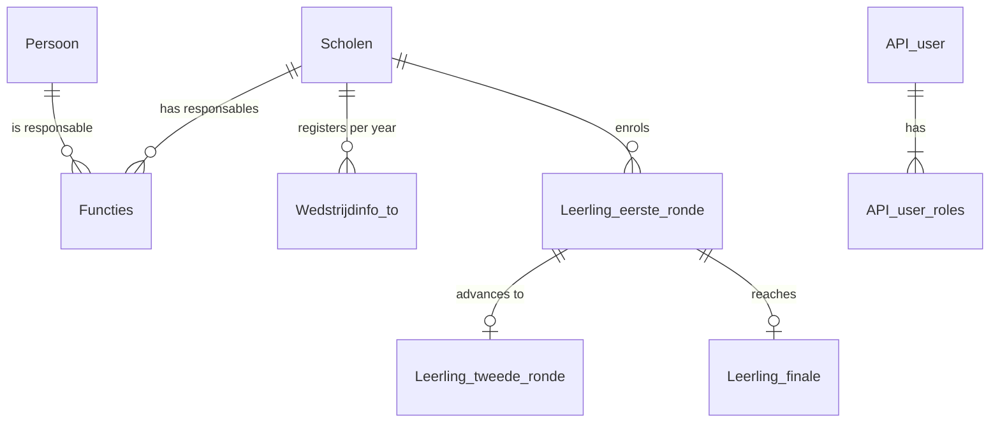

# Designing TechOlympiad

TechOlympiad is the VWO Olympiad with the maths taken out and the size
cut down. The same things happen in the same order, in tables with the
same shape and the same kind of names. This page fixes that design before
any code is written, so every later chapter can point back to it.

## The contest

TechOlympiad has two editions, like VWO and JWO:

| VWO | TechOlympiad | Who takes part |
|---|---|---|
| `JWO` | `JTO` | Junior TechOlympiad: the first grades of secondary school |
| `VWO` | `STO` | Senior TechOlympiad: the higher grades |

One contest year runs like this, exactly as in the VWO:

- **Register** A school takes part in an edition for this year (`Wedstrijdinfo_to`).
- **Assign** A teacher is the school's responsable for that edition (`Functies`).
- **Enrol** The responsable registers pupils (`Leerling_eerste_ronde`).
- **Round 1** Pupils answer 30 multiple-choice questions; the answers are scored against the key (`Antwoorden`).
- **Select** Everyone above the cut-off (`Cesuren`) goes on to round 2 (`Leerling_tweede_ronde`).
- **Round 2 and final** The same again, ending with a small final (`Leerling_finale`).
- **Archive** At the end of the year the pupils move to the history tables (`Historiek_*`).

## The schema

Every table below has a VWO original with the same name pattern, the same
key and a subset of its columns. Tables and columns stay Dutch and
UPPER_SNAKE, the JSON and URLs are English, exactly like the VWO API.

| TechOlympiad table | VWO original | Holds | Key |
|---|---|---|---|
| `Scholen` | `Scholen` | Schools | `SCHOOL_ID` |
| `Persoon` | `Persoon` | Teachers and contacts | `PERSOON_ID` (auto-increment) |
| `Functies` | `Functies` | Who is responsable for which school and edition | `PERSOON_ID`, `SCHOOL_ID`, `FUNCTIE` |
| `Wedstrijdinfo_to` | `Wedstrijdinfo_vwo` | A school's registration for an edition in a year | `JAAR`, `SCHOOL_ID`, `EDITIE` |
| `Inschrijvingsgeld` | `Inschrijvingsgeld` | The fee per edition | `EDITIE` |
| `Leerling_eerste_ronde` | `Leerling_eerste_ronde` | This year's pupils and their round 1 result | `PERSOON_ID` (auto-increment) |
| `Leerling_tweede_ronde` | `Leerling_tweede_ronde` | Pupils selected for round 2 | `PERSOON_ID` |
| `Leerling_finale` | `Leerling_finale` | Finalists and their score per question | `PERSOON_ID` |
| `Leerling_tweede_ronde_full` | view of the same name | Round 1 joined with round 2 | view |
| `Antwoorden` | `Antwoorden` | The correct answer per question | `JAAR`, `EDITIE`, `RONDE`, `VRAAG` |
| `Cesuren` | `Cesuren` | The cut-off score per round | `JAAR`, `EDITIE`, `RONDE` |
| `Website_to_wedstrijddatums` | `Website_vwo_wedstrijddatums` | The date and time of each round | `JAAR`, `RONDE` |
| `Historiek_leerling_eerste_ronde` | same name | Last years' pupils | `JAAR`, `PERSOON_ID` |
| `API_user`, `API_user_roles` | same names | Who may call the API, with role `USER` or `ADMIN` | `id` / `user_id`, `role` |

What we leave out, because it adds size without teaching anything new:
Kangoeroe and its pools and teams, invoicing (`Betalingen*`), the digital
contest tables (`Leerling_VWO_usolvit*`), surveys, documents and
certificates.

## The code

The Java side mirrors the VWO API's packages one to one:

- `be.techolympiad.common` (VWO: `be.vwo.common`)
  - `Configuration`, `General`: enums such as `ToRole` and `ToRound`, and the school year helper
  - `dbEntities`: entities and their `*PK` key classes
  - `dao`: DAO interfaces, starting with `AbstractDao` and `TechOlympiadDao` (VWO: `VwoDao`)
    - `impl`: `AbstractDaoImpl`, `TechOlympiadDaoImpl` (VWO: `VwoDaoImpl`), then one `*DaoImpl` per entity
  - `restAPI`: the application class, Swagger and error handling
    - `controllers`: the shared controller interfaces
      - `v1`, `v2`: the thin versioned controllers and `V1Config`/`V2Config`
    - `repositories`: repository interfaces and their `*RepositoryImpl`
    - `models`: request and response objects that are not entities
  - `security`: login, tokens and the security filter chain

Names follow the VWO habits:

- Entities are named after their table: `Scholen`, `Functies`, `LeerlingEersteRonde`.
- DAOs and repositories are named after their entity (`ScholenDao`, `ScholenRepository`),
  controllers after the English resource (`SchoolController`).
- URLs are English kebab-case under `/api/v1` and `/api/v2`: `/school`, `/to/participation`, `/to/participants`.
- The school year is a `short` called `JAAR` in the database and `year` in the JSON. It is the
  year the school year ends in, so 2026-2027 is `2027`.
- School and person ids are `Short`, pupil ids `Integer`, rounds and question numbers `byte`.

## Where we deviate on purpose

| VWO API | TechOlympiad | Why |
|---|---|---|
| Round results are filled in outside the API | Endpoints to submit answers, score them and select for the next round | It is the most interesting logic in the domain, and it exercises transactions across several DAOs |
| `Functies` has no primary key, only a unique index | `Functies` gets that unique index as its primary key | The entity already treats it as the key |
| Logins are checked with `sha2(...)` in HQL while production stores bcrypt hashes | Logins use bcrypt through Spring Security | The VWO mismatch is a bug, not a pattern |
| Hard-coded keys and an in-memory `admin` user in the source | Secrets come from the environment properties | Same reason |
| Kangoeroe, invoicing, digital contest | Left out | Size |

Everything else, including the parts that look odd at first (two session
factories, Spring XML next to annotations, the build profiles that copy a
properties file), we copy as it is. The [roadmap](roadmap.md) explains each
of them when we get there.
